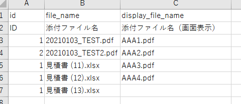

# 데이터 가져오기·내보내기(명령)
테이블의 데이터를 서버의 명령으로 가져오고 내보내는 방법의 설명입니다.

| 하고 싶은 일 | 명령 | 볼 곳 |
|---|---|---|
| 데이터를 파일로 내보낸다 | `php artisan exment:export` | "데이터 내보내기" |
| 데이터를 정한 건수마다 나누어 내보낸다 | `php artisan exment:chunkexport` | "데이터 내보내기(chunk 모드)" |
| 파일에서 데이터를 넣는다 | `php artisan exment:import` | "데이터 가져오기" |
| "이미지", "파일" 열에 파일을 한꺼번에 넣는다 | `php artisan exment:file-import` | "데이터 가져오기 - 이미지·파일 열의 첨부 파일 가져오기" |
| 데이터의 첨부 파일(문서)을 한꺼번에 넣는다 | `php artisan exment:document-import` | "데이터 가져오기 - 문서(첨부 파일) 목록" |

> 데이터 가져오기·내보내기의 개요에 대해서는 [데이터 가져오기·내보내기](/ko/data_import_export)를 확인하십시오.

## 데이터 내보내기
테이블의 데이터를 명령으로 파일로 내보냅니다(출력).  
파일의 형식은 csv, xlsx입니다.  


### 조작 방법

- 명령줄에서 다음 명령을 실행합니다.

~~~
php artisan exment:export (테이블 이름)

# 예
php artisan exment:export information
~~~

- 이 명령을 실행하면 폴더 "(Exment의 루트 폴더)/storage/app/export/(실행 일시: yyyyMMddHHiiss)"에 csv 데이터가 출력됩니다.

### 명령의 인수

```
php artisan exment:export (테이블 이름) {--action=default} {--type=all} {--page=1} {--count=} {--format=csv} {--view=} {--dirpath=} {--add_setting=0} {--add_relation=0} {--add_comment=0}
```

- ##### 테이블 이름  
(필수) 출력할 대상의 테이블 이름(영숫자).

- ##### action  
(옵션) 내보내기를 실행하는 방법.
    - default : 모든 시스템 열·사용자 정의 열을 출력. 기본값.
    - view : 지정한 뷰 형식으로 출력.

- ##### type  
(옵션) 내보낼 데이터의 종류(건수).
    - all : 전체 데이터. 기본값.
    - page : 지정한 페이지.

- ##### page    
(옵션) type이 page인 경우의 페이지 번호. 정수. 지정하지 않으면 1페이지를 출력.

- ##### count    
(옵션) type이 page인 경우에 출력할 최대 데이터 건수. 지정하지 않으면 대상 뷰에서 지정된 데이터 건수.

- ##### format  
(옵션) 내보낼 파일 형식.
    - csv : CSV 형식. 기본값.
    - xlsx : Xlsx(Excel) 형식.

- ##### view  
(옵션) 출력 대상의 뷰. id나 suuid로 지정. 설정하지 않으면 전체 데이터 뷰로 출력.

- ##### dirpath  
(옵션) 내보낼 폴더 경로. 전체 경로. 설정하지 않으면 (Exment의 루트 폴더)/storage/app/export/(실행 일시: yyyyMMddHHiiss).

- ##### add_relation  
(옵션) 관계 데이터도 출력할지 여부. 기본값은 0(출력하지 않음). Xlsx 형식이고 action이 default인 경우에만 유효.

- ##### add_setting  
(옵션) 설정 데이터도 출력할지 여부. 기본값은 0(출력하지 않음). Xlsx 형식이고 action이 default인 경우에만 유효.

- ##### add_comment  
(옵션) 각 데이터의 댓글도 출력할지 여부. 기본값은 0(출력하지 않음). 1을 지정하면 시트(CSV 형식의 경우에는 파일) "comment"에 댓글을 출력합니다. action이 default이고 사용자 정의 테이블 설정의 "코멘트 사용"이 YES인 테이블인 경우에만 유효.

~~~
# 예: 댓글도 포함하여 Xlsx 형식으로 출력
php artisan exment:export information --format=xlsx --add_comment=1
~~~


<h2 id="export_chunk"><a href="#/ko/data_cmd_import_export?id=export_chunk" data-id="export_chunk" class="anchor"><span>데이터 내보내기(chunk 모드)</span></a></h2>

정한 건수(기본값: 1000건)마다 데이터를 나누어 출력합니다. 대량의 데이터를 출력할 때 파일 하나의 행 수를 줄일 수 있습니다.  


### 조작 방법

- 명령줄에서 다음 명령을 실행합니다.

~~~
php artisan exment:chunkexport (테이블 이름)

# 예
php artisan exment:chunkexport information
~~~

- 이 명령을 실행하면 폴더 "(Exment의 루트 폴더)/storage/app/export/(실행 일시: yyyyMMddHHiiss)"에 csv 데이터가 출력됩니다.


### 명령의 인수

```
php artisan exment:chunkexport (테이블 이름) {--action=default} {--start=1} {--end=1000} {--count=1000} {--seqlength=1} {--delimiter=} {--format=csv} {--view=} {--dirpath=}
```

- ##### 테이블 이름  
(필수) 출력할 대상의 테이블 이름(영숫자).

- ##### action  
(옵션) 내보내기를 실행하는 방법.
    - default : 모든 시스템 열·사용자 정의 열을 출력. 기본값.
    - view : 지정한 뷰 형식으로 출력.

- ##### start  
(옵션) 출력을 시작할 파일 번호. 내보내기가 도중에 끝나 버린 경우, 지정한 일련번호부터 내보내기를 다시 시작할 수도 있습니다. 지정하지 않으면 1.

- ##### end  
(옵션) 출력을 끝낼 파일 번호. 지정하지 않으면 1000.

- ##### count    
(옵션) 파일 하나에 출력할 최대 데이터 건수. 지정하지 않으면 1000.

- ##### seqlength    
(옵션) 일련번호를 0으로 채우는 자릿수. 예를 들어 "3"을 입력하면 "001", "002"처럼 일련번호를 출력. 지정하지 않으면 1.

- ##### delimiter    
(옵션) 파일 이름에서 테이블 이름과 일련번호 사이에 넣을 문자. 지정하지 않으면 "."(마침표).

- ##### format  
(옵션) 내보낼 파일 형식.
    - csv : CSV 형식. 기본값.
    - xlsx : Xlsx(Excel) 형식.

- ##### view  
(옵션) 출력 대상의 뷰. id나 suuid로 지정. 설정하지 않으면 전체 데이터 뷰로 출력.

- ##### dirpath  
(옵션) 내보낼 폴더 경로. 전체 경로. 설정하지 않으면 (Exment의 루트 폴더)/storage/app/export/(실행 일시: yyyyMMddHHiiss).


### 출력 사양

- 파일 이름은 **"(사용자 정의 테이블의 이름).일련번호.csv"** (예: client.1.csv)처럼 일련번호로 출력됩니다.

```
#예
client.1.csv
client.2.csv
client.3.csv

#예(seqlength=3으로 지정한 경우)
client.001.csv
client.002.csv
client.003.csv
```

- 데이터의 건수나 count 옵션과 관계없이, 한 번의 실행으로 출력할 수 있는 파일은 최대 1000건입니다.


## 데이터 가져오기
정해진 폴더에 둔 파일에서 사용자 정의 테이블에 데이터를 한꺼번에 넣습니다.

- 쓸 수 있는 파일은 화면에서 하는 가져오기와 같은 형식의 EXCEL 파일 또는 csv 파일입니다.  
- 화면에서는 제한되는, 5000건을 넘는 데이터도 넣을 수 있습니다.  

### 주의할 점
- ZIP 형식으로 압축한 CSV 파일은 가져올 수 없습니다.  

- 화면에서 하는 가져오기와 같은 오류 검사를 합니다. 그래서 대량의 데이터를 넣으면 시간이 매우 오래 걸릴 수 있습니다.  

- 데이터는 100건씩 가져옵니다. 예를 들어 처음 100건을 올바르게 등록한 다음 그다음 100건의 데이터에 잘못된 곳이 있으면, 거기에서 파일의 처리를 그만둡니다. 이미 등록된 100건은 되돌릴 수 없습니다. 직접 삭제하거나, 파일에서 등록된 데이터를 빼는 등의 조치를 하십시오.  

- <span class="red">명령으로 하는 가져오기에서도, 건수가 매우 많은 데이터는 메모리가 모자라 오류가 날 수 있습니다.</span>  
현재 개선을 진행하고 있습니다. 대량의 데이터를 가져올 때는 [대량 데이터 일괄 투입](/ko/data_bulk_insert)을 이용하십시오.

- csv로 가져올 때는 지금은 그 테이블의 데이터만 가져올 수 있습니다. 관계 데이터도 가져올 때는 xlsx로 가져오십시오.


### 데이터 준비
먼저 가져오기용 파일을 만듭니다. 자세한 내용은 [템플릿 출력](/ko/data_import_export)을 참고하십시오.  

- 가져올 수 있는 csv 파일의 문자 코드는 <strong>UTF-8</strong>입니다.  

- 파일 이름은 다음 중 하나의 형식으로 하십시오.  
※ 폴더 안의 파일은 이름 순서대로 가져옵니다. 그러므로 관계된 데이터를 동시에 가져올 때처럼 가져오는 순서가 중요할 때는, 3.의 방법으로 가져올 순서대로 일련번호를 붙이십시오.

    1. "(사용자 정의 테이블의 이름).csv"    ※ 예: client.csv
    2. "(사용자 정의 테이블의 이름).(일련번호).csv"   ※ 예: client.1.csv, client.002.csv
    3. "(일련번호).(사용자 정의 테이블의 이름).csv"   ※ 예: 01.client.csv, 02.estimate.csv

- <span class="small">v3.8.0 미만에서는 "<span class="bold">일련번호<span class="red">#</span>(사용자 정의 테이블의 이름).csv</span>" 파일 이름으로도 가져올 수 있었습니다.  
v3.8.0에서 [가져올 때의 라이브러리를 변경](/ja/update/v3_8)(일본어)했기 때문에, 이 파일 이름으로는 가져올 수 없게 되었습니다.  
일련번호를 붙여 가져올 때는 "<span class="bold">일련번호<span class="red">.</span>(사용자 정의 테이블의 이름).csv</span>" 형식으로 바꾸어 가져오십시오.</span>

### 조작 방법

- 서버의 다음 위치에 작업용 폴더를 만듭니다. 폴더 이름은 이번 작업의 내용을 알 수 있는 것이나 날짜 등을 권장합니다.  

~~~
(프로젝트의 루트 디렉터리)/storage/app/import/(폴더 이름)
~~~

- 만든 csv 파일 또는 EXCEL 파일(여러 개 가능)을 그 폴더에 둡니다.

#### 폴더 배치 예
  

- 명령줄에서 다음 명령을 실행합니다.
~~~
php artisan exment:import {폴더 이름}
~~~

#### 명령 실행 예
  


### 실행이 끝난 다음
- 가져오기가 끝나면 "storage/app/import" 폴더에 둔 파일은 필요에 따라 삭제하십시오. (※ 자동으로는 삭제하지 않습니다.)


<h2 id="import_file"><a href="#/ko/data_cmd_import_export?id=import_file" data-id="import_file" class="anchor"><span>데이터 가져오기 - 이미지·파일 열의 첨부 파일 가져오기</span></a></h2>
사용자 정의 열 유형이 "이미지", "파일"인 열에 첨부 파일을 한꺼번에 등록할 수 있습니다. 아래 화면의 부분입니다.  

  

### 사양
- 이미 첨부 파일이 등록된 사용자 정의 열에 새로 첨부 파일을 가져오면 이전 파일은 삭제됩니다.


### 가져올 데이터의 준비

- 서버의 다음 위치에 작업용 폴더를 만듭니다. 폴더 이름은 이번 작업의 내용을 알 수 있는 것이나 날짜 등을 권장합니다.  

~~~
(프로젝트의 루트 디렉터리)/storage/app/file-import/(폴더 이름)
~~~

- 만든 폴더 안에 "files" 폴더를 만듭니다.

- "files" 폴더에 가져오고 싶은 첨부 파일을 모두 둡니다.

### 가져오기 정보 입력
- 가져오기용 파일을 만듭니다. 다음 링크에서 가져오기용 파일을 다운로드하십시오.  
    - [xlsx 형식](https://exment.net/downloads/template/file_import_ja.xlsx)
    - [csv 형식](https://exment.net/downloads/template/file_import_ja.csv)

- 가져올 수 있는 csv 파일의 문자 코드는 <strong>UTF-8</strong>입니다.  

- 파일 이름은 다음 중 하나의 형식으로 하십시오.  
※ 폴더 안의 파일은 이름 순서대로 가져옵니다. 그러므로 관계된 데이터를 동시에 가져올 때처럼 가져오는 순서가 중요할 때는, 3.의 방법으로 가져올 순서대로 일련번호를 붙이십시오.

    1. "(사용자 정의 테이블의 이름).csv"    ※ 예: client.csv
    2. "(사용자 정의 테이블의 이름).(일련번호).csv"   ※ 예: client.1.csv, client.002.csv
    3. "(일련번호).(사용자 정의 테이블의 이름).csv"   ※ 예: 01.client.csv, 02.estimate.csv

- xlsx의 경우 파일 이름은 자유입니다. 시트 이름을 다음 형식으로 하십시오.  

    1. "(사용자 정의 테이블의 이름)"    ※ 예: client

- 시트에 값을 적습니다. 아래의 "가져오기 항목 목록"에 따라 적으십시오.

- 만든 가져오기용 파일은 "(프로젝트의 루트 디렉터리)/storage/app/file-import/(폴더 이름)"에 두십시오.

#### 가져오기 항목 목록

  

##### id(ID)  
첨부 파일을 가져올 대상인 사용자 정의 데이터의 ID입니다. 데이터를 등록했을 때 자동으로 일련번호가 붙는 양의 정수입니다.  

##### column_name(열 이름)  
첨부 파일을 가져올 대상인 사용자 정의 열의 영숫자 이름입니다. (예: estimate_file, avatar)  

##### file_name(첨부 파일 이름)  
"files" 폴더에 둔 첨부 파일의 이름을 적으십시오.

##### display_file_name(첨부 파일 이름(화면 표시))  
첨부 파일을 화면에 표시할 때·다운로드할 때의 파일 이름입니다. ※ 적지 않아도 됩니다. 적지 않으면 file_name의 값이 다운로드할 때의 파일 이름이 됩니다.

### 가져오기 전의 폴더 구성
가져올 때의 폴더 구성은 다음과 같습니다.

```
(프로젝트의 루트 디렉터리)/storage/app/file-import/(폴더 이름)
    - 가져오기용 파일(예: client.csv)
    - files
        - 가져올 파일(예: 첨부파일1.pdf)
        - 가져올 파일(예: 첨부파일2.pdf)
        - 가져올 파일(예: 첨부파일3.jpg)
```

### 조작 방법

- 명령줄에서 다음 명령을 실행합니다.
~~~
php artisan exment:file-import {폴더 이름}
~~~

### 실행이 끝난 다음
- 실행이 끝나면 "storage/app/file-import" 폴더에 둔 첨부 파일은 애플리케이션에서 다운로드할 수 있는 곳으로 복사됩니다.  
"storage/app/file-import" 폴더에 둔 파일은 필요에 따라 삭제하십시오. (※ 자동으로는 삭제하지 않습니다.)


<h2 id="import_document"><a href="#/ko/data_cmd_import_export?id=import_document" data-id="import_document" class="anchor"><span>데이터 가져오기 - 문서(첨부 파일) 목록</span></a></h2>
사용자 정의 데이터의 문서(첨부 파일)에 파일을 한꺼번에 등록할 수 있습니다. 아래 화면의 부분입니다.  

  

### 사양
- 같은 사용자 정의 데이터에 여러 첨부 파일을 추가할 수 있습니다. 이미 첨부 파일이 등록되어 있어도 이전 파일은 삭제되지 않습니다.


### 가져올 데이터의 준비

- 서버의 다음 위치에 작업용 폴더를 만듭니다. 폴더 이름은 이번 작업의 내용을 알 수 있는 것이나 날짜 등을 권장합니다.  

~~~
(프로젝트의 루트 디렉터리)/storage/app/document-import/(폴더 이름)
~~~

- 만든 폴더 안에 "documents" 폴더를 만듭니다.

- "documents" 폴더에 가져오고 싶은 첨부 파일을 모두 둡니다.

### 가져오기 정보 입력
- 가져오기용 파일을 만듭니다. 다음 링크에서 가져오기용 파일을 다운로드하십시오.  
    - [xlsx 형식](https://exment.net/downloads/template/document_import_ja.xlsx)
    - [csv 형식](https://exment.net/downloads/template/document_import_ja.csv)

- 가져올 수 있는 csv 파일의 문자 코드는 <strong>UTF-8</strong>입니다.  

- 파일 이름은 다음 중 하나의 형식으로 하십시오.  
※ 폴더 안의 파일은 이름 순서대로 가져옵니다. 그러므로 관계된 데이터를 동시에 가져올 때처럼 가져오는 순서가 중요할 때는, 3.의 방법으로 가져올 순서대로 일련번호를 붙이십시오.

    1. "(사용자 정의 테이블의 이름).csv"    ※ 예: client.csv
    2. "(사용자 정의 테이블의 이름).(일련번호).csv"   ※ 예: client.1.csv, client.002.csv
    3. "(일련번호).(사용자 정의 테이블의 이름).csv"   ※ 예: 01.client.csv, 02.estimate.csv

- xlsx의 경우 파일 이름은 자유입니다. 시트 이름을 다음 형식으로 하십시오.  

    1. "(사용자 정의 테이블의 이름)"    ※ 예: client

- 시트에 값을 적습니다. 아래의 "가져오기 항목 목록"에 따라 적으십시오.

- 만든 가져오기용 파일은 "(프로젝트의 루트 디렉터리)/storage/app/document-import/(폴더 이름)"에 두십시오.

#### 가져오기 항목 목록

  

##### id(ID)  
첨부 파일을 가져올 대상인 사용자 정의 데이터의 ID입니다. 데이터를 등록했을 때 자동으로 일련번호가 붙는 양의 정수입니다.  

##### file_name(첨부 파일 이름)  
"documents" 폴더에 둔 첨부 파일의 이름을 적으십시오.

##### display_file_name(첨부 파일 이름(화면 표시))  
첨부 파일을 화면에 표시할 때·다운로드할 때의 파일 이름입니다. ※ 적지 않아도 됩니다. 적지 않으면 file_name의 값이 다운로드할 때의 파일 이름이 됩니다.

### 가져오기 전의 폴더 구성
가져올 때의 폴더 구성은 다음과 같습니다.

```
(프로젝트의 루트 디렉터리)/storage/app/document-import/(폴더 이름)
    - 가져오기용 파일(예: client.csv)
    - documents
        - 가져올 파일(예: 첨부파일1.pdf)
        - 가져올 파일(예: 첨부파일2.pdf)
        - 가져올 파일(예: 첨부파일3.jpg)
```

### 조작 방법

- 명령줄에서 다음 명령을 실행합니다.
~~~
php artisan exment:document-import {폴더 이름}
~~~

### 실행이 끝난 다음
- 실행이 끝나면 "storage/app/document-import" 폴더에 둔 첨부 파일은 애플리케이션에서 다운로드할 수 있는 곳으로 복사됩니다.  
"storage/app/document-import" 폴더에 둔 파일은 필요에 따라 삭제하십시오. (※ 자동으로는 삭제하지 않습니다.)
