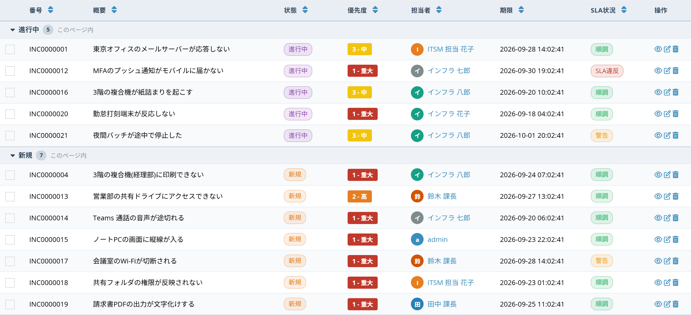
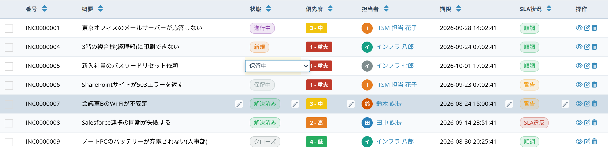
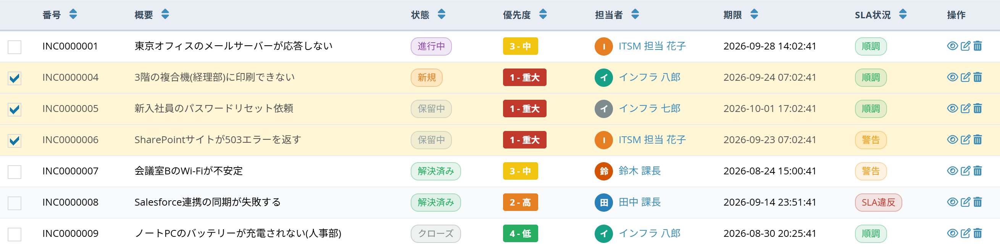

# 데이터 목록의 조작 도구

[데이터 목록](/ko/data_grid) 화면에서 쓸 수 있는, 표시 전환과 그 자리에서 편집하는 기능을 모았습니다.  
설정은 필요 없으며, 데이터 목록을 열면 바로 쓸 수 있습니다.

## 도구 모음의 버튼

데이터 목록의 오른쪽 위, 뷰 선택의 왼쪽에 버튼이 늘어섭니다.

왼쪽부터 ［표시할 열 선택］, ［열 고정］, ［그룹화］, ［표시 밀도］, ［자동 새로 고침］입니다. v7.1.0 이후에는 [［Excel 모드］](/ko/data_grid_tools?id=excel-모드로-편집) 버튼도 표시됩니다.

> 이 설정들은 사용하는 사람마다 따로입니다. 뷰의 설정은 바꾸지 않으므로 다른 사용자의 화면에는 영향을 주지 않습니다.  
> ［열 고정］, ［표시 밀도］는 **브라우저에 저장되며**, 브라우저를 닫아도 남습니다.  
> ［그룹화］, ［자동 새로 고침］은 탭을 닫을 때까지 브라우저에 저장됩니다.  
> ［표시할 열 선택］은 브라우저에는 저장되지 않고, **목록의 주소(URL)에만 유지됩니다**(`_columns_`). 메뉴에서 목록을 다시 열거나 뷰를 바꾸면 원래대로 돌아갑니다. 복사한 주소를 열면 같은 열이 표시됩니다. ［필터］에서 ［검색］을 눌렀을 때도 고른 열의 지정은 풀립니다.

### 표시할 열 선택

그 뷰의 열 중에서 화면에 표시할 열을 고릅니다.

- 위쪽의 입력란에 글자를 넣으면 열 이름으로 좁힐 수 있습니다.
- ［모두 선택］, ［모두 해제］, ［기본값으로 되돌리기］로 한꺼번에 조작할 수 있습니다.
- ［적용］으로 반영하고, ［취소］로 닫습니다.

※ 열을 하나도 고르지 않고 ［적용］할 수는 없습니다.  
※ 숨긴 열도 데이터는 사라지지 않습니다. ［기본값으로 되돌리기］로 언제든지 원래대로 되돌릴 수 있습니다.

### 열 고정

가로로 스크롤해도 지정한 열을 화면의 왼쪽 끝에 고정합니다. 건수가 많고 가로로 긴 표에서, 어느 행을 보고 있는지 모르게 되는 것을 막습니다.

| 항목 | 내용 |
| --- | --- |
| 앞의 2열 고정 / 앞의 3열 고정 | 자주 쓰는 조합을 바로 설정합니다 |
| 고정 해제 | 모든 고정을 해제합니다 |
| 작업 열 고정 | ［작업］ 열을 항상 표시합니다. 처음 상태에서 ON입니다. v7.0에서는 "작업 열을 오른쪽에 고정"이라는 이름입니다 |
| 헤더 행 고정 | 세로로 스크롤할 때 제목 행을 남깁니다. 처음 상태에서 ON입니다 |
| (열 이름의 목록) | 고정할 열을 하나씩 고릅니다 |

※ 화면의 폭이 모자라면 일부 열은 고정되지 않습니다. 그 경우에는 화면에 메시지가 표시됩니다.

### 그룹화

표시 중인 페이지의 데이터를, 고른 열의 값별로 묶어서 표시합니다.

- 그룹의 제목에는 그 그룹의 건수가 표시됩니다.
- 제목 왼쪽의 삼각형을 클릭하면 그룹을 접거나 펼칠 수 있습니다.
- ［그룹화 안 함］으로 원래의 순서로 돌아갑니다.

> **"이 페이지 내"라고 표시되는 이유**  
> 그룹화는 지금 화면에 읽어 들인 페이지의 데이터만 정렬합니다.  
> 모든 데이터에 걸쳐 집계하고 싶은 경우에는 [집계 뷰](/ko/view)를 만드십시오.

### 표시 밀도

행의 높이와, 셀 안의 줄 바꿈을 전환합니다.

| 항목 | 내용 |
| --- | --- |
| 좁게 | 행의 높이를 줄입니다. 한 화면에 더 많은 행이 들어갑니다. |
| 표준 | 기본 높이입니다. |
| 넓게 | 행의 높이를 넓힙니다. 읽기 쉬움을 우선합니다. |
| 한 줄로 표시 | 셀 안에서 글자를 줄 바꿈하지 않고 한 줄에 넣습니다. 긴 문장은 중간에서 생략됩니다. 처음 상태에서 ON이며, 위의 3가지 높이와 조합하여 씁니다. |

### 자동 새로 고침

목록을 일정 시간마다 자동으로 다시 읽어 들입니다.  
여러 사람이 동시에 대응하는 업무(문의 접수 등)에서, 화면을 연 채로 최신 상태를 확인할 수 있습니다.

꺼짐/30초/1분/5분 중에서 선택합니다.  
※ 이 설정은 탭을 닫으면 해제됩니다.

## 표 위에서의 조작

※ v7.1.0 이후, 화면의 디자인이 "모던"일 때는 ［작업］ 열(보기·편집·삭제)이 체크박스 바로 오른쪽(표의 왼쪽)에 표시됩니다. "클래식"에서는 지금까지와 같이 오른쪽 끝입니다.

### 인라인 편집（더블클릭으로 편집）

셀을 더블클릭하면 그 자리에서 값을 바꿀 수 있습니다. 편집할 수 있는 셀은 마우스를 올리면 연필 아이콘이 표시됩니다.

값을 고르면(입력하면) 자동으로 저장되고 셀의 표시가 갱신됩니다.

편집할 수 있는 열의 종류는 다음과 같습니다.

| 열의 종류 | 표시되는 입력 |
| --- | --- |
| 선택 (고정 값), 선택 (값과 표시명 저장), YES/NO | 선택 목록 |
| 한 줄 텍스트, 이메일, URL | 텍스트 입력 |
| 정수, 소수, 통화 | 숫자 입력 |
| 날짜, 날짜 및 시각 | Exment의 캘린더(날짜 선택). 편집 화면과 같은 것입니다 |

다음 열은 그 자리에서 편집할 수 없습니다.

- 다중 선택을 할 수 있는 열
- 계산식으로 자동 계산되는 열, 그리고 계산식의 입력으로 쓰이는 열
- 그 데이터의 편집 화면(폼)에서 사용자가 바꿀 수 없는 열

편집 조작을 비활성화한 테이블이나 휴지통 표시에서는 연필 아이콘이 표시되지 않습니다. 테이블의 편집 권한이 없는 경우에도 표시되지 않습니다.  
저장은 그 데이터의 편집 화면과 같은 조건에 따릅니다. 폼의 항목 설정, "표시 화면에서 변경 불가" 설정, 입력 검사, 워크플로에 의한 잠금, 그 데이터에 대한 사용자의 권한이 대상입니다. 변경 이력도 남습니다. 바꿀 수 없었던 경우에는 저장되지 않고, 이유가 메시지로 표시되며, 원래의 표시로 돌아갑니다.

### Excel 모드로 편집

도구 모음의 ［Excel 모드］를 ON으로 하면 Excel처럼 키보드로 셀을 골라 편집할 수 있습니다(v7.1.0 이후). 처음 상태는 OFF입니다. ON/OFF는 브라우저에 저장됩니다.

| 조작 | 내용 |
| --- | --- |
| 클릭 | 셀을 선택합니다(데이터의 상세는 열리지 않습니다) |
| 화살표 키·Tab·Shift+Tab | 선택할 셀을 이동합니다 |
| Home·End(Ctrl+Home·Ctrl+End) | 행의 처음·끝(표의 처음·끝)으로 이동합니다 |
| F2·Enter·더블클릭·글자 입력 | 선택한 셀의 편집을 시작합니다. 글자를 입력하면 그 글자부터 입력이 시작됩니다(일본어 입력도 지원합니다) |
| Delete·Backspace | 빈 상태로 편집을 시작합니다(Enter로 저장할 때까지 값은 사라지지 않습니다) |
| 편집 중의 Enter·Tab | 저장하고 다음 셀로 이동합니다 |
| 편집 중의 Esc | 편집을 그만두고 원래 값으로 되돌립니다 |

※ OFF일 때는 지금까지와 같습니다(클릭으로 데이터를 열고, 더블클릭이나 연필 아이콘으로 편집합니다).  
※ 편집할 수 있는 셀·저장의 조건(입력 검사·권한·워크플로 등)은 [인라인 편집](/ko/data_grid_tools?id=인라인-편집（더블클릭으로-편집）)과 같습니다. 달라지는 것은 편집을 시작하는 방법과 끝내는 방법뿐입니다.

### 오른쪽 클릭 메뉴

행을 오른쪽 클릭하면 그 데이터에 대한 조작이 메뉴로 표시됩니다.

| 항목 | 내용 |
| --- | --- |
| 빠른 미리 보기 | 화면을 이동하지 않고 상세를 그 자리에서 표시합니다 |
| 보기 | 데이터의 상세 화면을 엽니다 |
| 편집 | 데이터의 편집 화면을 엽니다 |
| 복제하여 새로 만들기 | 이 행의 값을 복사한 신규 작성 화면을 엽니다 |
| 나를 ○○(으)로 지정 | 담당자 등의 열에 로그인 중인 사용자를 설정합니다 |
| 이 페이지 내에서 필터: "○○" | 클릭한 셀과 같은 값의 행만 표시합니다 |
| 셀 값 복사 | 클릭한 셀의 값을 클립보드에 복사합니다 |
| 삭제 | 확인한 다음 이 데이터를 삭제합니다 |

※ 메뉴는 테이블마다 사용자의 권한으로 만들어지므로, 열람만 할 수 있는 사용자에게는 삭제나 편집이 표시되지 않습니다. 데이터 1건마다의 권한(워크플로로 잠긴 데이터 등)은 실행했을 때 확인되며, 실행할 수 없는 경우에는 메시지가 표시됩니다.  
※ Shift 키를 누른 채 오른쪽 클릭하면 브라우저 본래의 메뉴가 열립니다.

### 빠른 미리 보기

목록에서 떠나지 않고 1건의 내용을 확인할 수 있습니다.

- ［전체 페이지 열기］로 보통의 상세 화면으로 이동합니다.
- ［닫기］로 목록으로 돌아갑니다. 목록의 스크롤 위치나 좁히기는 그대로 남습니다.

### 다중 선택과 일괄 조작

행 왼쪽 끝의 체크박스를 선택하면 선택한 행의 색이 바뀌고, 화면 아래쪽에 조작 막대가 표시됩니다.

| 버튼 | 내용 |
| --- | --- |
| 일괄 편집 | 선택한 행의 값을 한꺼번에 바꿉니다 |
| CSV / Excel | 선택한 행만 파일로 출력합니다(형식마다 버튼이 하나씩 있습니다) |
| 일괄 삭제 | 선택한 행을 한꺼번에 삭제합니다 |
| 선택 해제 | 선택을 모두 해제합니다 |

※ ［일괄 삭제］ 등의 항목은 권한과 [일괄 업데이트 설정](/ko/operation)에 따라 달라집니다.

#### 워크플로 실행
워크플로를 설정한 테이블에서는 체크한 데이터의 워크플로 액션을 한꺼번에 실행할 수 있습니다(v7.1.0 이후).  
목록의 일괄 조작 메뉴, 또는 화면 아래의 조작 막대에서 ［워크플로 실행］을 클릭합니다.

- 고른 데이터에서 실행할 수 있는 액션이 "승인(8건 / 고른 10건)"처럼 건수와 함께 표시됩니다. 액션을 고르고, 필요하면 댓글이나 다음 작업 사용자를 입력한 다음 ［실행］을 클릭합니다.
- 데이터는 1건씩, 데이터 상세 화면의 액션 버튼과 같은 확인(열람할 수 있는지·그 상태에서 실행할 수 있는지·이미 실행하지 않았는지)을 하고 실행합니다. 실행할 수 없는 데이터는 건너뛰고, 끝난 다음 실행한 건수와 건너뛴 건수(이유 포함)를 표시합니다.
- 알림·플러그인·여러 사람의 승인은 1건씩 실행했을 때와 똑같이 동작합니다. 한 번에 실행할 수 있는 것은 500건까지입니다.

※ 편집 권한이 없어도 그 데이터에서 액션을 실행할 수 있는 사용자에게는 표시됩니다. 휴지통 표시에서는 쓸 수 없습니다.  
※ 워크플로에 대해서는 [워크플로 실행](/ko/workflow_execution)을 확인하십시오.

#### 일괄 편집

- 바꾸고 싶은 항목만 입력합니다. 어느 항목이든 처음에는 "(변경 안 함)"이며, 그대로 두면 바뀌지 않습니다.
- 필수가 아닌 항목에서 빈 선택지를 고르면 **선택한 모든 행에서 그 값이 사라집니다**. 필수 항목은 비울 수 없습니다.
- ［○건에 적용］을 클릭하면 확인한 다음 업데이트됩니다.
- 진행 상황이 표시되고, 끝난 다음 성공 건수·실패 건수가 표시됩니다.

※ 일괄 편집에 표시되는 것은 선택 목록에서 값을 고를 수 있는 열뿐입니다.  
※ 저장은 1건씩 보통의 업데이트 처리를 거치므로, 입력 검사·워크플로·변경 이력이 그대로 동작합니다. 권한이나 검사 때문에 업데이트할 수 없었던 행은 "실패"로 건수에 표시됩니다.

### 필터 적용 중의 표시

［필터］에서 조건을 지정하여 검색하면 표 위에 현재의 조건이 칩(작은 라벨)으로 표시됩니다.

- 조건 이름 오른쪽의 "×"로 그 조건만 해제할 수 있습니다.
- ［모두 해제］로 모든 조건을 해제합니다.

오른쪽 클릭 메뉴의 "이 페이지 내에서 필터"를 쓴 경우에는 노란색 띠로 표시됩니다.

- 몇 건이 숨겨져 있는지 표시됩니다.
- ［필터 해제］로 원래대로 돌아갑니다.

> "이 페이지 내에서 필터"는 지금 표시된 페이지의 행만 대상으로 합니다. 페이지에 걸쳐 좁히고 싶은 경우에는 ［필터］ 패널이나 [뷰의 데이터 표시 조건](/ko/view)을 사용하십시오.

## 권한에 대하여

이 기능들은 기존의 권한을 그대로 사용합니다.

- 목록에 표시되는 데이터는 지금까지와 같이 로그인 사용자가 열람할 수 있는 데이터뿐입니다.
- 편집·삭제 조작은 테이블에 대한 사용자의 권한에 따라 표시됩니다. 바꿀 수 없는 데이터(그 데이터에 대한 권한이 없거나 워크플로로 잠겨 있는 경우)는 실행했을 때 거부되며, 아무것도 저장되지 않습니다.
- 인라인 편집과 일괄 편집은 그 데이터의 편집 화면과 같은 조건에 따릅니다(위의 "인라인 편집" 참고). 바꿀 수 없는 데이터는 업데이트되지 않습니다.

## 관련 항목

- [데이터 목록](/ko/data_grid)
- [사용자 정의 뷰](/ko/view)
- [표시 프리셋](/ko/cell_style_preset)
- [일괄 업데이트 설정](/ko/operation)
