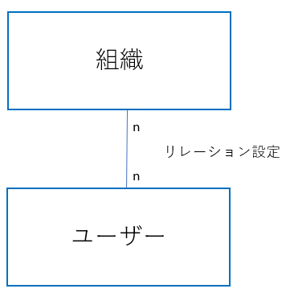
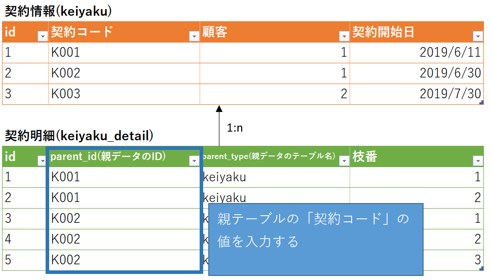

# 데이터 가져오기·내보내기
테이블의 데이터를 파일(csv·xlsx)로 내보내고(내보내기), 파일에서 넣기(가져오기) 위한 화면의 설명입니다.

| 하고 싶은 일 | 볼 곳 |
|---|---|
| 데이터를 파일로 내보낸다(모든 열) | [데이터 내보내기](/ko/data_import_export?id=데이터-내보내기) |
| 지금 보고 있는 뷰의 형태로 파일로 내보낸다 | "데이터 내보내기(뷰)" |
| 파일에서 데이터를 넣는다 | "데이터 가져오기" |
| 명령으로 가져오기·내보내기를 한다 | [명령으로 데이터 가져오기·내보내기](/ko/data_cmd_import_export) |
| 대량의 데이터를 명령으로 한꺼번에 넣는다 | [대량 데이터 일괄 투입](/ko/data_bulk_insert) |

## 데이터 내보내기·가져오기 기능의 종류
- 내보내기·가져오기 기능은 지금 다음 종류가 있습니다.
    - 내보내기  
    저장된 테이블의 데이터를 모든 열에 대해 내보냅니다(출력).  

    - 내보내기(뷰)  
    지금 표시하고 있는 뷰의 형태로 테이블의 데이터를 내보냅니다(출력).  

    - 가져오기  
    csv, xlsx 파일에서 테이블의 데이터를 가져옵니다(입력).  

- 테이블의 데이터 목록 화면에서 ［가져오기/내보내기］ 버튼을 클릭하면 다음 메뉴가 나옵니다.
  

>쓰지 않는 항목은 [설정값](/ko/config)에서 나오지 않게 할 수 있습니다.

## 데이터 내보내기
테이블의 데이터를 파일로 내보냅니다(출력).  
파일의 형식은 csv, xlsx(권장)입니다.  

### 조작 방법
- 데이터 목록 화면을 표시합니다.
  

- 페이지 오른쪽 위에 ［가져오기/내보내기］ 버튼이 표시되므로 클릭합니다.  
  

- 메뉴가 표시되므로 출력하고 싶은 항목을 선택하십시오.  
  
    - 전체  
    그 테이블의 전체 데이터를 출력합니다.  
    ※ 다만 **로그인 사용자에게 권한이 없는 데이터는 출력되지 않습니다.**  
    
    - 현재 페이지  
    지금 열려 있는 페이지의 데이터 목록을 출력합니다.

    - 전체(댓글 포함)  
    그 테이블의 전체 데이터와, 각 데이터의 댓글을 출력합니다.  
    댓글은 Excel 형식에서는 시트 "comment"에, CSV 형식에서는 파일 "comment"에 출력됩니다.  
    ※ 사용자 정의 테이블 설정의 "코멘트 사용"이 YES인 테이블에서만 나옵니다.  
    ※ 댓글의 출력은 보기 위한 것입니다. 가져올 때 "comment" 시트(파일)는 가져오지 않습니다.

- ［CSV］ 또는 ［Excel］ 버튼을 클릭하면 데이터가 파일로 다운로드됩니다.  

### 출력 항목 목록
##### ID  
데이터를 등록했을 때 자동으로 일련번호가 붙는 양의 정수입니다.

##### 내부 ID(20자리)
데이터를 등록했을 때 자동으로 붙는 20자리의 영숫자입니다. 화면에는 잘 나오지 않습니다. 데이터의 이전 등에 씁니다.  

##### 상위 데이터 ID  
그 테이블을 관계 설정의 "1:n"의 n으로 등록했을 때의 부모 테이블의 id입니다. 관계 설정이 없을 때는 빈칸입니다.  

##### 상위 데이터 테이블 이름  
그 테이블을 관계 설정의 "1:n"의 n으로 등록했을 때의 부모 테이블 이름(영숫자)입니다. 관계 설정이 없을 때는 빈칸입니다.  

##### 사용자 정의 열 목록  
사용자 정의 열로 등록한 값이 열마다 출력됩니다.  

##### 작성 일시, 업데이트 일시, 삭제 일시  
데이터를 만든 일시, 업데이트한 일시, 삭제한 일시가 각각 출력됩니다.  

### 1:n 관계의 내보내기
- 관계 설정의 "1:n"의 "1"로 등록한 테이블에서 데이터 내보내기를 하면, **관계된 "n"의 데이터 목록도 동시에 내보내집니다.**  

예: "계약 정보"를 1, "계약 명세 정보"를 n으로 하여 관계 설정을 저장한 경우  
  
- "계약 정보" 화면에서 데이터 내보내기를 실행한 경우(※ 그림의 "고객"은 테스트 데이터입니다)  
  
- "계약 정보"와 "계약 명세 정보"의 데이터가 둘 다 출력됩니다.
  
  
- "n"의 데이터 목록의 "상위 데이터 ID", "상위 데이터 테이블 이름"에는 관계 대상인 부모 테이블의 ID, 테이블 이름이 출력됩니다.

### n:n 관계의 내보내기
- 관계 설정의 "n:n"의 기준이 되는 n으로 등록한 테이블에서 데이터 내보내기를 하면, **관계 대상인 "n"과의 관련 정보도 동시에 내보내집니다.**  

예: "조직 정보"와 "사용자 정보"를 n:n으로 하여 관계 설정을 저장한 경우  
  
- "조직 정보" 화면에서 데이터 내보내기를 실행한 경우,  
  
- "조직 정보"의 데이터가 출력됩니다. 또한 "사용자 정보"와 "조직 정보"를 관련짓는 데이터도 출력됩니다.
  
  
- "parent_id"에는 부모가 되는 조직 정보의 ID, "child_id"에는 자식이 되는 사용자 정보의 ID가 나옵니다.  

### 그 밖의 특기 사항
- CSV 형식, Excel 형식 모두 1행이 열 이름(영숫자), 2행이 열 표시 이름(일본어)입니다. CSV 형식에서도 헤더는 2행입니다. 양해해 주십시오.  
- CSV 형식으로 출력한 파일은 문자 코드가 UTF-8, 줄 바꿈 코드가 LF, BOM 없음입니다.  
- 관계 설정에 따라 여러 데이터가 출력될 때는, Excel 형식에서는 여러 시트가 되고 CSV 형식에서는 여러 csv 파일을 zip으로 묶습니다.  

### 내보낼 때의 출력 값 변경
내보낼 때 "상위 데이터 ID", "선택 (테이블에서)", "사용자", "조직" 열에는 보통 참조 대상 테이블의 데이터 ID가 출력됩니다. 이것을 **참조 대상의 사용자 정의 열 값으로 할 수 있습니다.**  
그 절차를 아래에 적습니다.  

#### parent_id(상위 데이터 ID)의 경우
1. 관계 설정 화면을 엽니다.

2. "내보내기 시 키 열"에 내보낼 때 출력하고 싶은 사용자 정의 열을 설정하고 저장합니다.  

3. 그다음 데이터를 내보내면 출력 값이 id 대신 고른 사용자 정의 열의 값이 됩니다. 

※ 보통 때
  
  
※ "내보내기 시 키 열"을 지정했을 때
  

#### "선택 (테이블에서)", "사용자", "조직"의 경우
1. 그 열의 사용자 정의 열 설정 화면을 엽니다.

2. "내보내기 시 키 열"에 내보낼 때 출력하고 싶은 사용자 정의 열을 설정하고 저장합니다.  

3. 그다음 참조하는 쪽의 테이블에서 데이터를 내보내면 출력 값이 id 대신 고른 사용자 정의 열의 값이 됩니다. 

※ 보통 때
  
  
※ "내보내기 시 키 열"을 지정했을 때
  

## 데이터 내보내기(뷰)
테이블의 데이터를 지금 표시하고 있는 뷰의 형태로 파일로 내보냅니다(출력).  
파일의 형식은 csv, xlsx(권장)입니다.  

### 조작 방법
- 데이터 목록 화면을 표시합니다.
  

- 페이지 오른쪽 위에 ［가져오기/내보내기］ 버튼이 표시되므로 클릭합니다.  
  

- 메뉴가 표시되므로 출력하고 싶은 항목을 선택하십시오.
  
    - 전체  
    그 테이블의 전체 데이터를 출력합니다.  
    ※ 다만 **로그인 사용자에게 권한이 없는 데이터는 출력되지 않습니다.**  

    - 현재 페이지  
    지금 열려 있는 페이지의 데이터 목록을 출력합니다.

- ［CSV］ 또는 ［Excel］ 버튼을 클릭하면 데이터가 파일로 다운로드됩니다. 지금 표시하고 있는 뷰의 항목이 그대로 출력됩니다.  

## 데이터 가져오기
파일에서 테이블의 데이터를 가져옵니다(입력).  
파일의 형식은 csv, xlsx(권장)입니다. 데이터는 Exment가 정한 형식에 맞추어 미리 만들어 두어야 합니다.

순서는 다음과 같습니다.

1. 템플릿을 출력합니다("템플릿 출력").  
2. 템플릿에 가져오고 싶은 데이터를 적습니다("가져오기 항목 목록").  
3. 가져오기를 실행합니다("데이터 가져오기 실행").

> 지금은 성능 때문에 한 번에 가져올 수 있는 건수를 5000건까지로 하고 있습니다.  
5000건을 넘는 데이터를 한 번에 등록할 때는 [대량 데이터 투입](/ko/data_bulk_insert)을 검토하십시오.

### 조작 방법

#### 템플릿 출력
데이터를 가져오기 위한 템플릿 파일을 출력합니다.

- 데이터 목록 화면을 표시합니다.
  

- 페이지 오른쪽 위에 ［가져오기/내보내기］ 버튼이 표시되므로 클릭합니다.  
  

- 가져오기의 템플릿 출력 중에서 ［CSV］ 또는 ［Excel］을 클릭합니다.
  

- 데이터 가져오기용 CSV 또는 Excel 파일이 다운로드됩니다.  
  
※ 파일의 형식은 "내보내기"로 출력했을 때와 같습니다.  
템플릿은 데이터가 0건인 상태로 출력됩니다.

- 출력한 템플릿에 가져오고 싶은 데이터를 적으십시오.

### 가져오기 항목 목록
##### ID  
데이터를 등록했을 때 자동으로 일련번호가 붙는 양의 정수입니다.  
가져올 때 이 ID를 직접 정하고 싶을 때만 적으십시오.  
정하지 않아도 될 때는 빈칸으로 두십시오. 가져올 때 시스템이 자동으로 값을 넣습니다.  

##### 내부 ID(20자리)  
데이터를 등록했을 때 자동으로 붙는 20자리의 영숫자입니다. 화면에는 잘 나오지 않습니다.  
가져올 때 이 내부 ID를 직접 정하고 싶을 때만 적으십시오.  
정하지 않아도 될 때는 빈칸으로 두십시오. 시스템이 자동으로 값을 넣습니다.  

##### 상위 데이터 ID  
보통은 빈칸으로 둡니다.  
가져올 테이블을 관계 설정의 "1:n"의 n으로 등록했을 때는 부모 테이블의 id를 입력하십시오.  
  
※ 처음 설정에서는 부모 테이블 데이터의 ID를 지정하지만, **사용자 정의 열을 지정하여 가져올 수도 있습니다**. 자세한 내용은 "[다른 테이블 데이터의 지정 방법 변경](/ko/data_import_export?id=다른-테이블-데이터의-지정-방법-변경)"을 참고하십시오.  

##### 상위 데이터 테이블 이름  
보통은 빈칸으로 둡니다.  
그 테이블을 관계 설정의 "1:n"의 n으로 등록했을 때는 부모 테이블 이름(영숫자)을 입력합니다.  
  

##### 사용자 정의 열 목록  
사용자 정의 열로 등록할 값을 적으십시오.  
※ 열의 종류에 따라 값을 적는 방법이 다릅니다. 아래의 "[가져올 때의 사용자 정의 열 입력 방법](/ko/data_import_export?id=가져올-때의-사용자-정의-열-입력-방법)"을 확인하십시오.

##### 작성 일시, 업데이트 일시, 삭제 일시  
보통은 빈칸으로 둡니다.  
데이터를 만든 일시, 업데이트한 일시, 삭제한 일시를 직접 정하고 싶을 때만 적으십시오.  
빈칸일 때는 가져올 때 시스템이 자동으로 값을 넣습니다.

### 데이터 가져오기 실행
화면에서 가져오기를 실행합니다.

- 데이터 목록 화면을 표시합니다.
  

- 페이지 오른쪽 위에 ［가져오기/내보내기］ 버튼이 표시되므로 클릭합니다.  
  

- "가져오기(CSV)" 또는 "가져오기(Excel)" 중에서 "가져오기"를 클릭합니다.
  

- 가져오기 대화 상자가 나옵니다.  
  

- "가져올 파일"에서 데이터를 적은 가져오기용 템플릿 파일을 고릅니다.  

- "기본 키"에서 가져올 때 신규인지 업데이트인지를 구분하기 위한 기본 키를 고릅니다.  
자세한 내용은 아래의 "기본 키의 종류"를 확인하십시오.

- 설정이 끝났으면 대화 상자의 ［전송］을 클릭합니다.

- 가져올 데이터에 문제가 있었을 때는 "오류 메시지"에 헤더보다 뒤의 행 번호와 오류의 내용이 나옵니다.

※ 사용자 정의 열의 설정에서 "[필수](/ko/column)"로 한 항목에 값이 들어 있지 않으면 가져오기는 성공하지 않습니다. 가져오기용 템플릿 파일에 입력이 빠진 곳이 없는지 확인하십시오.
- 가져오기가 올바르게 끝나면 대화 상자가 닫히고 데이터가 다시 읽어 들여집니다.

### 새로 추가할 데이터, 업데이트할 데이터의 판정 방법
가져올 때 한 행마다, 새로 추가할 데이터인지 지금 있는 데이터를 업데이트할 데이터인지 구분합니다.  
그 구분 방법을 적습니다.

- 가져올 때의 화면에서 구분하는 데 쓸 "기본 키" 열을 지정합니다. (여기에서는 "ID"로 합니다)  
※ 기본 키는 가져올 때 고릅니다. 아래의 "기본 키의 종류"를 참고하십시오

- 가져올 때 시스템은 가져올 데이터의 ID 열의 값을 봅니다.
  

    - 가져올 데이터의 ID가 빈칸일 때는 새로 추가할 데이터로 다룹니다.
  

    - 가져올 데이터의 ID에 값이 있을 때는, 이미 등록된 데이터 중에 같은 ID의 데이터가 있는지 찾습니다.  
  
    같은 ID의 데이터가 있으면 그 데이터를 가져올 데이터의 내용으로 업데이트합니다.  
    없으면 가져올 데이터를 새로 추가합니다. 그때 ID는 가져올 데이터의 ID가 됩니다.  

### 기본 키의 종류

- ##### ID(권장)  
시스템이 자동으로 붙이는 정수입니다. 다른 테이블과의 관계 등에도 씁니다.  
간편하고, 미리 값을 넣어 두기 쉬운 항목입니다. 다만 자동으로 일련번호를 붙이는 항목이므로, 환경에서 환경으로 이전할 때 뜻하지 않은 어긋남이 생길 수 있습니다.

- ##### 내부 ID(20자리)  
데이터를 저장할 때 시스템이 자동으로 붙이는 20자리의 영숫자입니다.  
환경에서 환경으로 이전할 때는 업데이트할 데이터를 분명히 하기 위해 이 내부 ID를 쓰기를 권장합니다.  

- ##### 고유 열  
사용자 정의 열의 설정에서 "고유"로 한 열은 기본 키로 고를 수 있습니다. (예: 이메일 주소, 사용자 코드)    

### 가져올 때의 사용자 정의 열 입력 방법
사용자 정의 열의 종류에 따라 가져올 때 값을 적는 방법이 다릅니다.  
아래 내용을 확인하십시오.

##### 선택 (값과 표시명 저장)  
데이터베이스에 등록할 "값", 또는 화면에 나오는 "제목"을 입력하십시오.  

##### 선택 (테이블에서), 사용자, 조직  
**참조 대상 테이블의 ID**를 입력하십시오.  
  
※ 처음 설정에서는 참조 대상 테이블 데이터의 ID를 지정하지만, **사용자 정의 열을 지정하여 가져올 수도 있습니다**. 자세한 내용은 "[다른 테이블 데이터의 지정 방법 변경](/ko/data_import_export?id=다른-테이블-데이터의-지정-방법-변경)"을 참고하십시오.  

##### YES/NO  
"YES" 또는 "NO", 혹은 "1" 또는 "0"을 입력하십시오.  

##### 2개 값 선택  
사용자 정의 열 화면에서 입력한 "2개 값 선택"의 표시 또는 값을 입력하십시오.  
  

##### 그 밖의 것  
등록할 값을 그대로 입력하십시오.  

### 다른 테이블 데이터의 지정 방법 변경
가져올 때 "상위 데이터 ID", "선택 (테이블에서)", "사용자", "조직" 열에는 보통 참조 대상 테이블의 데이터 ID를 적습니다. 이것을 **사용자 정의 열의 값으로 지정하여 가져올 수 있습니다.**  
그 절차를 아래에 적습니다.  

#### parent_id(상위 데이터 ID)의 경우
1. 관계 설정 화면을 엽니다.

2. "가져오기 시 키 열"에 가져올 때 값을 찾는 데 쓸 사용자 정의 열을 설정하고 저장합니다.  
※ 지정할 수 있는 것은 사용자 정의 열 설정에서 "검색 인덱스"로 지정한 열뿐입니다.  

3. 그다음 자식 테이블에서 가져오기용 Excel 파일을 다운로드합니다. "##setting##" 시트에 자식 테이블 이름, "parent_id", 지정한 부모 테이블의 사용자 정의 열 이름이 출력되어 있습니다.  
  

4. 이 시트의 내용은 바꾸지 말고, 자식 테이블의 시트에 가져올 데이터를 적으십시오.  
그때 "parent_id" 열에는 **가져오기 시 키 열**로 등록한 사용자 정의 열의 값을 적습니다.  
아래 예에서는 부모 테이블 "계약 정보"의 "계약 코드" 값을 입력합니다.
  
  

5. 그다음 가져오기를 실행합니다.

#### "선택 (테이블에서)", "사용자", "조직"의 경우
1. 그 열의 사용자 정의 열 설정 화면을 엽니다.

2. "가져오기 시 키 열"에 가져올 때 값을 찾는 데 쓸 사용자 정의 열을 설정하고 저장합니다.  
※ 지정할 수 있는 것은 사용자 정의 열 설정에서 "검색 인덱스"로 지정한 열뿐입니다.  

3. 그다음 참조하는 쪽의 테이블에서 가져오기용 Excel 파일을 다운로드합니다. "##setting##" 시트에 참조하는 쪽의 테이블 이름, "value." + 참조하는 쪽의 사용자 정의 열 이름, 참조 대상의 사용자 정의 열 이름이 출력되어 있습니다.  
  

4. 이 시트의 내용은 바꾸지 말고, 참조하는 쪽 테이블의 시트에 가져올 데이터를 적으십시오.  
그때 참조하는 쪽의 사용자 정의 열에는 **가져오기 시 키 열**로 등록한, 참조 대상의 사용자 정의 열 값을 적습니다.  
아래 예에서는 참조 대상 테이블 "고객 마스터"의 "고객 코드" 값을 입력합니다.
  
  

5. 그다음 가져오기를 실행합니다.

#### 주의할 점
- Excel 형식으로 가져오는 것만 지원합니다. CSV 형식은 지금 지원하지 않습니다.
