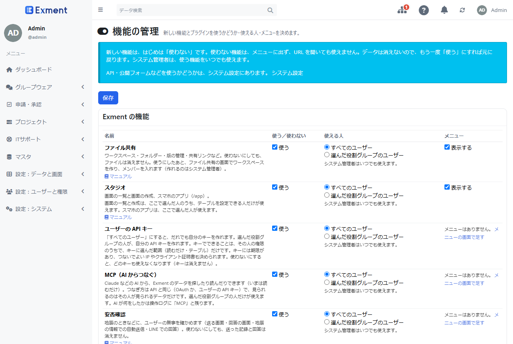

# 기능 관리
새 기능과 플러그인을 쓸지 말지·사용할 수 있는 사람·메뉴를 정합니다.  
Exment는 많은 사이트에서 쓰이고 있으므로, 새 기능은 처음에는 "사용 안 함"입니다. 시스템 관리자가 "사용"으로 할 때까지 메뉴에 나오지 않고, URL을 열어도 쓸 수 없습니다. Exment를 업데이트한 것만으로 화면이나 메뉴가 바뀌는 일은 없습니다.

※ 이 화면은 Exment v7.2.1 이후에서 쓸 수 있습니다.

## 설정 화면
시스템 관리자로 로그인하고 "관리자 설정" → "기능 관리"를 엽니다(URL은 `/feature`).  
이 화면을 열 수 있는 것은 시스템 관리자뿐입니다.

화면은 위의 "Exment 기능"과 아래의 "플러그인"으로 나뉘어 있습니다.

## Exment 기능
Exment 본체의 새 기능입니다. 지금은 다음이 있습니다.

| 이름 | 내용 |
| --- | --- |
| 파일 공유 | 작업 공간·폴더·버전 관리·공유 링크 등. 사용 안 함으로 해도 파일은 사라지지 않습니다. (파일 공유가 들어 있는 버전에만 나옵니다) |
| 스튜디오 | 화면 목록과 화면 작성, 스마트폰 앱(/app). 쓸 수 있는 것은 테이블을 설정할 수 있는 사람입니다. |
| 데이터 유지보수 | 테이블의 데이터를 한꺼번에 정리합니다(지금은 첨부 파일의 일괄 삭제). 쓸 수 있는 것은 테이블을 설정할 수 있는 사람입니다. (v7.3.0 이후) [데이터 유지보수](/ko/data_maintenance) |

기능마다 다음 3가지를 정합니다.

| 항목 | 내용 |
| --- | --- |
| 사용 | 그 기능을 이 사이트에서 쓸지 말지. 처음에는 "사용 안 함"입니다. |
| 사용할 수 있는 사람 | "모든 사용자"나 "선택한 역할 그룹의 사용자". 역할 그룹을 하나도 고르지 않으면 시스템 관리자만 쓸 수 있습니다. 시스템 관리자는 언제든지 쓸 수 있습니다. |
| 메뉴 | 메뉴에 "표시"할지 말지. 사용할 수 있는 사람에게만 나옵니다. 메뉴의 행이 없을 때는 "메뉴의 행이 없습니다. 저장하면 만듭니다."라고 나옵니다. |

"상태" 칸에는 다음과 같이 나옵니다.

| 상태 | 의미 |
| --- | --- |
| 신규 | 아직 아무도 정하지 않은 기능입니다("사용 안 함"으로 다룹니다). |
| 사용 중 | "사용"으로 되어 있어 쓸 수 있는 상태입니다. |
| 이 환경에서는 사용할 수 없습니다 | 서버의 설정으로 막고 있습니다([서버의 설정으로 고정하기](/ko/feature?id=서버의-설정으로-고정하기)). 이 화면에서는 "사용"으로 할 수 없습니다. |
| 필요한 기능이 사용 안 함으로 설정되어 있어 사용할 수 없습니다. | 다른 기능이 있어야 비로소 동작하는 기능("○○"을(를) 사용하는 동안에만 사용할 수 있습니다."라고 나옵니다)이고, 그 기능이 "사용 안 함"으로 되어 있습니다. |

※ 스튜디오는 여기에서 고른 사람 중 테이블을 설정할 수 있는 사람만 쓸 수 있습니다.  
※ API·공개 폼 등을 쓸지 말지는 지금까지와 같이 [시스템 설정](/ko/system_setting)에 있습니다.

<!-- 화면 사진: Exment 기능의 한 행(사용·사용할 수 있는 사람·메뉴)(img/feature/feature_core.png). #1861 병합 뒤에 찍는다 -->

## 플러그인
설치한 플러그인도 같은 화면에 나란히 나옵니다.  
새 설정을 이중으로 갖는 것이 아니라, 지금 있는 설정을 그대로 보여 줍니다.

| 항목 | 내용 |
| --- | --- |
| 사용 | 플러그인의 활성·비활성과 같은 것입니다. 비활성일 때는 "플러그인이 비활성입니다"라고 나옵니다. 바꿀 때는 "플러그인 설정에서 변경"에서 [플러그인](/ko/plugin) 화면으로 가서 바꿉니다. |
| 사용할 수 있는 사람 | 역할 그룹의 플러그인 "사용" 권한과 같은 것입니다. 바꿀 때는 [역할 그룹](/ko/role_group) 화면에서 바꿉니다. |
| 메뉴 | 메뉴에 내보낼지 말지. 이것만은 이 화면에서 정합니다. |

※ 종류가 "누구나 쓸 수 있는" 플러그인이나, 플러그인 설정에서 "모든 사용자가 사용 가능"으로 한 플러그인은 그 사실이 나옵니다.  
※ 플러그인 안에 플러그인이 등록한 기능(예를 들면 웹 메일 등)이 있을 때는 플러그인 아래에 한 행씩 나옵니다. 플러그인 안의 기능도 처음에는 "사용 안 함"입니다. 사용할 수 있는 사람은 플러그인을 쓸 수 있는 사람 중 여기에서 고른 사람입니다.

<!-- 화면 사진: 플러그인의 행과 플러그인 안의 기능의 행(img/feature/feature_plugin.png). #1861 병합 뒤에 찍는다 -->

## 무료 공식 플러그인(Exment에 포함)
Exment에는 무료 공식 플러그인(프로젝트 관리·IT 지원·Groupware)이 함께 들어 있습니다. "기능 관리"의 "무료 공식 플러그인(Exment에 포함)" 칸에서 설치합니다. 자세한 내용은 [공식 플러그인](/ko/plugin_official)을 보십시오.

- "사용(설치)"을 누를 때까지는 설치도 읽어 들이기도 하지 않습니다(테이블도 만들지 않습니다).
- 누르면 확인한 뒤에 설치하고 활성으로 합니다. 그 플러그인의 주요 기능도 "사용"이 됩니다. 그 뒤에는 위의 "플러그인" 칸에도 나란히 나와, 사용할 수 있는 사람이나 메뉴를 정할 수 있습니다.
- 새 버전이 있을 때는 "새 버전 ○○을(를) 사용할 수 있습니다."라고 나옵니다. 자동으로는 설치하지 않습니다. "이 버전으로 업데이트"로 업데이트합니다(설정·메뉴·권한은 남습니다).
- 업데이트하기 전의 버전은 남아 있어, "이전 버전(○○)으로 되돌리기"로 되돌릴 수 있습니다.
- Exment를 업데이트해도 쓰고 있는 플러그인은 자동으로 바뀌지 않습니다. 자세한 내용은 [업데이트와 포함된 공식 플러그인](/ko/update?id=업데이트와-포함된-공식-플러그인)을(를) 보십시오.
- 전부터 손으로 설치했던 플러그인은 그대로 쓸 수 있습니다(다시 설치하지 않습니다). 포함된 쪽이 더 새로울 때만 알립니다. 포함된 버전으로 바꾸면 손으로 설치한 버전으로는 되돌릴 수 없습니다.
- 포함된 플러그인은 엑시드원(Exceed One)의 서명을 확인한 뒤에 설치합니다. 서명이 맞지 않는 것은 나오지 않습니다.
- 운영자가 버전을 바꾸는 사이트(SaaS 등)에서는 "버전 변경은 이 사이트의 운영자가 수행합니다."라고 나오고 버튼은 나오지 않습니다(`.env`의 `EXMENT_BUNDLED_PLUGINS_UPDATES=false`).

#### 보안 수정 알림
설치된 공식 플러그인의 새 버전에 보안 수정이 들어 있을 때는 시스템 관리자에게 알립니다.

- 시스템 관리자의 홈 위쪽에 "공식 플러그인 업데이트 안내(○○)"가 나옵니다. 기능 관리의 행에도 "보안 수정" 표시와 "이 버전에는 보안 수정이 포함되어 있습니다. "이 버전으로 업데이트"를 눌러 주십시오."가 나옵니다.
- 종 모양의 알림과, 메일을 보낼 수 있는 사이트에서는 메일로, 같은 제목과 본문을 한 번만 보냅니다.
- 다른 이용자에게는 아무것도 나오지 않습니다. 업데이트하는 것은 시스템 관리자가 "이 버전으로 업데이트"를 눌렀을 때뿐입니다.
- 보안 수정이 들어 있지 않은 버전으로 되돌릴 때는 한 번 더 확인합니다.

#### 새 기능 알림
Exment를 업데이트하여 아직 정하지 않은 새 기능이 늘었을 때는 시스템 관리자의 홈 알림과 종 모양의 알림으로 한 번만 알립니다("새 기능이 있습니다(○○). 처음에는 "사용 안 함"으로 되어 있습니다. …"). 메일은 보내지 않습니다. 새로 설치한 사이트에서는 나오지 않습니다.

<!-- 화면 사진: 무료 공식 플러그인의 칸(img/feature/feature_bundled.png). #1867 병합 뒤에 찍는다 -->

## "사용 안 함"으로 했을 때
- 메뉴에 나오지 않게 됩니다(메뉴의 행은 지우지 않고 숨기기만 합니다).
- 그 기능의 페이지와 API는 URL을 직접 열어도 쓸 수 없습니다.
- 데이터(작업 공간·파일·화면 등)는 사라지지 않습니다. 다시 "사용"으로 하면 원래대로 돌아갑니다.
- 쓰고 있는 사람이 있는 기능을 "사용 안 함"으로 하거나 사용할 수 있는 사람을 줄여서 저장할 때는 "다음 항목을 더 이상 사용할 수 없게 되는 사용자가 있습니다. 저장하시겠습니까?"라고 확인합니다.

## 쓸 수 없을 때 나오는 알림
쓸 수 없는 기능의 URL을 열면 다음 알림이 나옵니다.

| 알림 | 언제 나오는가 |
| --- | --- |
| 이 사이트에서는 이 기능을 사용하지 않습니다. | 그 기능이 "사용 안 함"일 때(또는 서버의 설정으로 막고 있을 때). 시스템 관리자에게는 "기능 관리"로 가는 링크도 나옵니다. |
| 이 기능을 사용할 권한이 없습니다. 관리자에게 문의해 주십시오. | 기능은 "사용"으로 되어 있지만, 로그인한 사람이 "사용할 수 있는 사람"에 들어 있지 않을 때. |

어느 쪽이든 "홈으로 돌아가기" 링크에서 홈으로 돌아갈 수 있습니다. API에서 호출했을 때는 같은 알림이 JSON으로 돌아옵니다(쓰지 않을 때는 404, 권한이 없을 때는 403).

<!-- 화면 사진: "이 사이트에서는 이 기능을 사용하지 않습니다." 화면(img/feature/feature_not_used.png). #1861 병합 뒤에 찍는다 -->

## 업데이트한 사이트에서는
Exment를 업데이트해도 지금까지 쓰던 것은 그대로 쓸 수 있습니다.

- 업데이트 전부터 쓰던 기능은 "사용"이 됩니다. 지금까지와 같이 보입니다.
  - 파일 공유: 작업 공간이 하나라도 있는 사이트
  - 스튜디오: 누군가가 스튜디오 화면이나 스마트폰 앱을 연 적이 있는 사이트(작업 로그로 확인합니다)
- 메뉴가 있기만 하고 쓰지 않던 기능은 "사용 안 함"이 됩니다.
- 플러그인의 활성·비활성과 역할 그룹의 권한은 바뀌지 않습니다.
- 플러그인 안의 기능 중 그 플러그인이 전부터 가지고 있던 것은, 전부터 플러그인을 설치했던 사이트에서는 "사용" 그대로입니다.
- 새로 설치한 사이트에서는 모두 "사용 안 함"에서 시작합니다.
- "관리자 설정" 아래에 "기능 관리" 메뉴가 더해집니다.

## 서버의 설정으로 고정하기
서버의 `.env`에 `EXMENT_FEATURES_LOCKED`를 쓰면, 사이트의 시스템 관리자가 무엇을 고르든 그 기능을 "사용 안 함"으로 고정할 수 있습니다.  
기능을 내보내지 않는 서비스(SaaS 등)에서 씁니다. 키를 쉼표로 구분하여 씁니다.

~~~
EXMENT_FEATURES_LOCKED=file_server,studio
~~~

| 키 | 기능 |
| --- | --- |
| `file_server` | 파일 공유 |
| `studio` | 스튜디오(스마트폰 앱 포함) |

고정한 기능은 이 화면에서 "이 환경에서는 사용할 수 없습니다"라고 나옵니다.

※ `.env`를 바꾼 뒤에는, 설정의 캐시를 쓰는 서버에서는 `php artisan config:clear`(또는 `php artisan config:cache`)를 실행하십시오.

## 정해지는 순서
쓸 수 있는지 없는지는 위에서부터 차례로 정해집니다. 아래의 설정으로 위의 설정보다 넓힐 수는 없습니다.

1. **서버의 설정**: `EXMENT_FEATURES_LOCKED`에 쓴 기능은 쓸 수 없습니다.
2. **사이트의 "사용", "사용 안 함"**: "사용 안 함"인 기능은 아무도 쓸 수 없습니다.
3. **사용할 수 있는 사람**: 모든 사용자이거나, 선택한 역할 그룹의 사용자(시스템 관리자는 언제든지 쓸 수 있습니다).
4. **기능 안의 설정**: 스튜디오라면 테이블의 권한, 파일 공유라면 작업 공간의 권한 등.

## 플러그인을 만드는 분께
플러그인은 자신 안의 기능을 등록하여 이 화면에 한 행을 내보낼 수 있습니다. 등록한 기능은 처음에는 "사용 안 함"입니다.

~~~php
use Exceedone\Exment\Services\Features;

// 플러그인 클래스의 생성자 등에서 등록한다. 키는 플러그인의 uri로 시작한다
Features::register('exment_groupware.mail', [
    'label' => 'Web 메일',
    'endpoints' => ['plugins/exment_groupware/mail'],
]);

// 플러그인의 페이지 안에서 확인한다
if (!Features::allowed('exment_groupware.mail')) {
    return Features::deny('exment_groupware.mail');
}
~~~

- `endpoints`에 쓴 페이지는 쓸 수 없을 때 위의 알림이 나옵니다.
- `existing => true`로 하면, 그 플러그인을 전부터 설치했던 사이트에서는 "사용" 그대로가 됩니다(전부터 있던 기능을 나중에 등록할 때).
- `requires`에 다른 기능의 키를 쓰면, 그 기능이 "사용 안 함"일 때는 쓸 수 없습니다.

## 관련 항목
- [시스템 설정](/ko/system_setting)
- [플러그인](/ko/plugin)
- [역할 그룹·권한 설정](/ko/role_group)
- [메뉴](/ko/menu)
