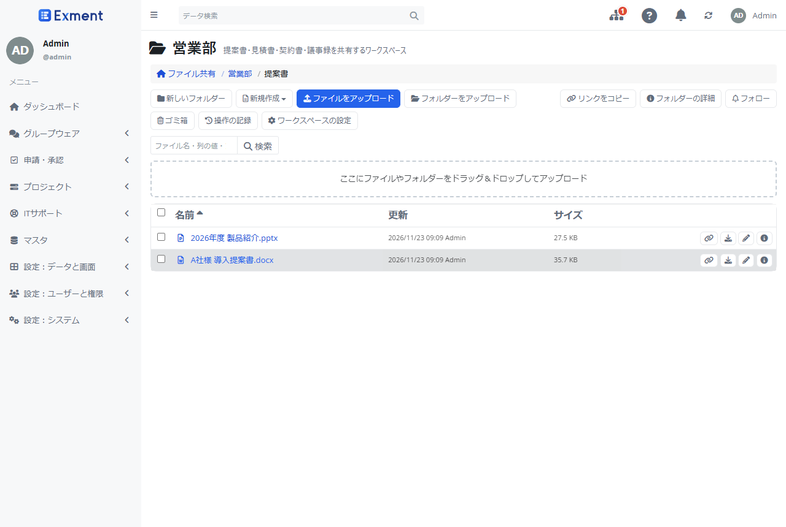
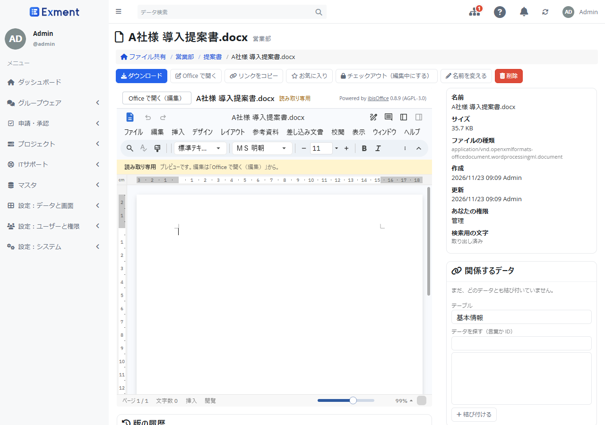

# 파일 공유
팀마다의 작업 공간에 폴더와 파일을 두고 공유합니다. 폴더마다의 권한·버전 관리·미리 보기·휴지통이 있습니다. Box나 SharePoint의 문서 라이브러리처럼 쓸 수 있습니다.  
파일의 내용은 Exment의 파일 저장 위치(로컬·S3·Azure·FTP 등, 지금의 설정 그대로)에 둡니다.

※이 기능은 Exment v7.2.1 이후에서 쓸 수 있습니다.<!-- TODO: 파일 공유가 master에 들어가는 버전에 맞추어 고친다 -->

## 처음 쓰기
파일 공유는 처음에는 "사용 안 함"입니다. 시스템 관리자가 "관리자 설정" → "[기능 관리](/ko/feature)"에서 "파일 공유"를 "사용"으로 하면, 왼쪽 메뉴에 "파일 공유"가 나옵니다. 쓸 수 있는 사람(역할 그룹)도 기능 관리에서 고를 수 있습니다.

## 작업 공간
작업 공간은 팀의 파일을 두는 곳입니다(SharePoint의 사이트에 해당합니다).

- "새 작업 공간"으로 만듭니다. 만든 사람이 그 작업 공간의 관리자가 됩니다. 누가 만들 수 있는지는 `.env`의 `EXMENT_FILE_SERVER_WORKSPACE_CREATE`로 정합니다(`admin`: 시스템 관리자만, `all`: 누구나).
- "작업 공간 설정"에서 다음 것을 정합니다.

| 항목 | 내용 |
| --- | --- |
| 이름·설명 | 작업 공간의 이름과 설명입니다. |
| 멤버 | 사용자·조직과 그 권한(보기·업로드·편집·관리). 관리자가 1명 이상 필요합니다. |
| 용량 제한(GB) | 비워 두면 제한 없음. 이전 버전·휴지통의 파일도 셉니다. |
| 휴지통 보관 일수 | 지나면 완전히 삭제합니다. 0으로 하면, 손으로 삭제할 때까지 남깁니다. |
| 보관할 버전 수 | 파일 하나에 남기는 이전 버전의 수입니다. |
| 열(메타데이터) | 이 작업 공간의 파일에 붙이는 열입니다. 아래의 "열(메타데이터)"를 보십시오. |

맨 위에는 열 수 있는 작업 공간의 목록과, "즐겨찾기" "최근 변경된 파일" "나와 공유된 항목"이 나옵니다.

## 폴더와 파일
- "새 폴더" "파일 업로드" "폴더 업로드", 또는 드래그 앤 드롭으로 업로드합니다. 큰 파일은 나누어 보내므로, 도중에 끊겨도 이어서 보낼 수 있습니다.
- 파일·폴더마다 이름 변경·이동·복사·다운로드(여러 개는 ZIP)·삭제·즐겨찾기를 할 수 있습니다.
- 삭제한 것은 휴지통에 들어갑니다. 휴지통에서 "복원"하거나 "완전히 삭제"할 수 있습니다.

## 권한
권한은 4가지입니다. 위의 권한은 아래의 권한으로 할 수 있는 일도 모두 할 수 있습니다.

| 권한 | 할 수 있는 일 |
| --- | --- |
| 보기 | 보기·다운로드하기 |
| 업로드 | 파일을 더하기 |
| 편집 | 이름 변경·이동·삭제·새 버전·공유 링크 만들기 |
| 관리 | 권한 변경·체크아웃 해제·승인 |

- 폴더·파일은 상위 폴더(또는 작업 공간)의 권한을 이어받습니다.
- "권한 상속 중지"로, 그 폴더·파일만의 권한으로 할 수 있습니다. "권한 상속"으로 원래대로 되돌릴 수 있습니다.
- 시스템 관리자는 모든 작업 공간을 관리할 수 있습니다.

## 버전 관리와 체크아웃
- 같은 이름의 파일을 덮어쓰거나 "새 버전 업로드"를 하면 새 버전이 됩니다. "버전 기록"에서 이전 버전을 다운로드하거나, "이 버전으로 되돌리기"로 이전 버전의 내용을 새 버전으로 저장할 수 있습니다.
- "체크아웃(편집 중으로 설정)"으로 하면, 다른 사람은 그 파일을 변경·삭제할 수 없습니다. 끝나면 "체크인(편집 종료)"으로 합니다. 관리 권한이 있는 사람은 "체크아웃 해제"를 할 수 있습니다.

## 미리 보기
이미지·동영상·음성·PDF·텍스트는 화면에서 볼 수 있습니다. Office 파일(docx·xlsx·pptx)은 서버의 준비에 따라 보이는 방식이 달라집니다.

| 서버의 준비 | Office 파일이 보이는 방식 |
| --- | --- |
| LibreOffice가 있다(`EXMENT_FILE_SERVER_SOFFICE_PATH`) | PDF로 만들어 표시합니다. |
| 공식 플러그인 "Groupware"가 있다 | "Office에서 열기"로, 브라우저의 Office(ibisOffice)에서 읽기 전용으로 열 수 있습니다. LibreOffice도 있으면 탭으로 전환합니다. |
| 둘 다 없다 | 파일 안의 글자만 표시합니다. 보이는 모양 그대로 보려면 다운로드하십시오. |

Groupware의 ibisOffice라면 LibreOffice도 Docker도 필요 없고, 임대 서버에서도 쓸 수 있습니다. 준비와 웹 서버의 설정은 [Groupware](/ko/plugin_groupware)를 보십시오.

※html·svg 등은 안전을 위해 화면에는 내지 않고, 다운로드만 됩니다.

※수신용 링크로 사외에서 도착한 파일은, 열어도 미리 보기와 글자 추출을 하지 않습니다. 관리 권한이 있는 사람이 "미리 보기 만들기"를 눌렀을 때만 만듭니다.

## 외부 공유 링크
파일·폴더를 로그인하지 않는 사외의 사람에게 건네거나, 사외의 사람에게서 파일을 받을 수 있습니다. 파일 화면의 "외부 공유 링크" 칸에서 링크를 만듭니다.

| 링크 종류 | 내용 | 만들 수 있는 사람 |
| --- | --- | --- |
| 공유 링크(외부 사용자가 보기 및 다운로드) | 폴더일 때는 안의 것도 보여 줍니다. "다운로드 허용"을 해제하면 미리 보기만입니다. | 편집 권한이 있는 사람 |
| 수신용 링크(외부에서 업로드) | 사외의 사람이 폴더에 파일을 넣습니다. 다른 사람의 파일은 보이지 않습니다. 같은 이름의 파일은 덮어쓰지 않고 "이름 (2)"로 합니다. | 편집 권한이 있는 사람(7.2.1부터. 전에 업로드 권한만 있는 사람이 만든 링크는 열리지 않게 됩니다) |

- 유효 기한·비밀번호·열 수 있는 횟수를 붙일 수 있습니다. 비밀번호는 8자 이상입니다(`EXMENT_FILE_SERVER_SHARE_PASSWORD_MIN`). "취소"로 언제든지 무효로 할 수 있습니다.
- 무효인 링크(기한 만료·취소됨·횟수의 상한 등)는 모두 "링크를 열 수 없습니다"라고 나옵니다.
- 새 공유 링크의 유효 기한은 30일이 기본이고, 길어도 90일입니다(`EXMENT_FILE_SERVER_SHARE_DEFAULT_DAYS`·`EXMENT_FILE_SERVER_SHARE_MAX_DAYS`. 0으로 하면 기본 없음·상한 없음). 전에 만든 기한 없는 링크는 링크의 목록에 "기한 없음"이라고 나옵니다.
- 공유 링크의 주소를 볼 수 있는 것은 그 링크를 만든 사람과, 그 파일·폴더의 관리 권한이 있는 사람뿐입니다.
- 사내의 사람에게 건넬 때는 "사내 링크 복사"를 씁니다. 열 수 있는 것은 그 파일을 볼 권한이 있는 사람뿐입니다.
- 외부 공유 링크를 쓰지 못하게 할 때는 `.env`에 `EXMENT_FILE_SERVER_EXTERNAL_SHARE=false`를 적습니다. 유효 기한의 상한은 `EXMENT_FILE_SERVER_SHARE_MAX_DAYS`로 바꿀 수 있습니다.
- 공유 링크(`/share/...`)는 사외의 사람에게 건네는 것이므로, 평소에는 시스템 설정의 웹 IP 필터를 적용하지 않습니다. 사내에서만 열게 하고 싶을 때는 `.env`에 `EXMENT_FILE_SERVER_SHARE_WEB_IP_FILTER=true`를 적습니다. 라우트를 만들 때 읽는 설정이므로, `php artisan route:cache`를 쓰는 사이트는 바꾼 뒤에 다시 한 번 실행하십시오.

## 열(메타데이터)
작업 공간 설정에서 파일에 붙이는 열("고객" "종류" 등)을 만들 수 있습니다.

- 종류는 텍스트·여러 줄·숫자·날짜·선택·여러 개 선택·예/아니요입니다. 필수·기본값·목록에 표시할지를 정할 수 있습니다.
- 목록에서 열로 필터링("미입력"도 고를 수 있음)·정렬·그룹 나누기를 할 수 있습니다.

## 데이터와 연결하기
파일 화면의 "관련 데이터"에서 Exment의 테이블 데이터(고객 등)와 연결할 수 있습니다. 데이터의 상세 화면에는 "파일 공유의 파일" 칸이 나옵니다. 둘 다 볼 권한이 있는 것만 나옵니다.

## 검색
"검색"으로 파일 이름·열의 값·파일 안의 글자로 찾을 수 있습니다. 볼 권한이 있는 파일만 나옵니다.

- 파일 안의 글자는 텍스트·HTML·Office(docx·xlsx·pptx)·OpenDocument에서 추출합니다. PDF는 pdftotext(`EXMENT_FILE_SERVER_PDFTOTEXT_PATH`)가 있을 때, 이미지와 스캔한 PDF는 tesseract(`EXMENT_FILE_SERVER_OCR_PATH`)가 있을 때 추출합니다.
- 평소에는 데이터베이스에서 찾습니다. `EXMENT_FILE_SERVER_MEILI=true`로 하면 [Meilisearch](/ko/additional_meilisearch)로 찾습니다(데이터의 전문 검색과는 다른 인덱스 `exment_files`를 씁니다).

## 승인·법적 보존·보존 기간
<!-- TODO: P5(exment PR #1859)가 들어가면 확인한다 -->
| 기능 | 내용 |
| --- | --- |
| 승인 | 폴더의 "규칙"에서 "승인 필요"로 하면, 넣은 파일은 "승인 대기"가 됩니다. 승인될 때까지 볼 수 있는 것은 업로드한 사람과 관리자뿐입니다. 관리 권한이 있는 사람이 "승인" 또는 "반려"를 합니다. |
| 법적 보존 | 작업 공간·폴더·파일에 붙이면 삭제할 수 없게 됩니다. 이전 버전도 지워지지 않습니다. 붙이고 떼는 것은 시스템 관리자뿐입니다(관리 권한이 있는 사람은 보기만). |
| 보존 기간 | 작업 공간 설정에서 일수를 정하면, 파일은 그 일수 동안 삭제할 수 없습니다. 정하고 해제하는 것은 시스템 관리자뿐입니다(관리 권한이 있는 사람은 보기만). |
| 다운로드 가능 대상 | 정한 권한보다 아래인 사람은 보기만 합니다(아래의 "보기만 할 때"). |
| 워터마크 | 미리 보기 위에, 보고 있는 사람의 이름과 일시를 겹쳐서 표시합니다. |
| 감사 로그 | 보기·다운로드·업로드·삭제·권한 변경·공유 링크 등을 기록합니다. CSV로 내보낼 수 있습니다. |
| 팔로우·코멘트 | 팔로우한 작업 공간·폴더·파일이 바뀌면, 벨과 메일로 알립니다. 코멘트의 `@사용자 코드`로 그 사람에게 알립니다. |

### 보기만 할 때
작업 공간의 "다운로드 가능 대상"보다 아래인 사람과, "다운로드 허용"을 해제한 공유 링크에서는 파일을 다음과 같이 보여 줍니다.

| 파일 | 보이는 방식 |
| --- | --- |
| 이미지 | 작게 만든 이미지로 보여 줍니다. |
| Office·PDF | PDF로 변환한 것이 있으면 그것으로 보여 줍니다. |
| 텍스트·동영상·음성 | 보여 주지 않습니다. |

볼 때마다 감사 로그에 남습니다.

## 서버의 준비
- **매일의 처리**: 휴지통의 자동 삭제는 `php artisan exment:file-server-purge`(매일 3:30)로 움직입니다. [작업 스케줄](/ko/additional_task_schedule)을 설정하십시오.
- **큐**: 썸네일·미리 보기·글자 추출은 큐로 움직입니다.
- **글자 추출 다시 하기**: `php artisan exment:file-server-index`로, 아직 하지 않은 파일의 글자를 추출하고 Meilisearch의 인덱스를 다시 만듭니다.
- **다른 소프트웨어**(모두 없어도 움직입니다): LibreOffice(Office의 미리 보기)·pdftotext(PDF의 글자)·tesseract(OCR)·Meilisearch(빠른 검색).
- **LibreOffice를 네트워크 없이 움직이기**: Office 파일은 바깥의 URL을 읽으러 가는 일이 있습니다. `EXMENT_FILE_SERVER_SOFFICE_PREFIX`에 LibreOffice 앞에 붙일 명령을 적으면, 네트워크 없이 변환할 수 있습니다(예: `unshare -rn`, `firejail --net=none --quiet`). 서버에서 그 명령을 쓸 수 있는지 먼저 확인하십시오.
- **업로드의 상한**: 큰 파일은 나누어 보냅니다. 파일 하나는 2 GB까지(`EXMENT_FILE_SERVER_MAX_FILE_SIZE`), 한 사람이 도중인 채로 둘 수 있는 업로드는 20개까지(`EXMENT_FILE_SERVER_MAX_UPLOADS`), 그 합계는 10 GB까지(`EXMENT_FILE_SERVER_MAX_UPLOAD_BYTES`)입니다. 도중인 업로드도 작업 공간의 용량에 셉니다. 60분 동안 아무것도 도착하지 않은 것은 세지 않고, 그 사람이 다음에 시작할 때 지웁니다.

## 주요 설정(.env)
| 설정 | 기본 | 내용 |
| --- | --- | --- |
| `EXMENT_FILE_SERVER_WORKSPACE_CREATE` | `admin` | 작업 공간을 만들 수 있는 사람(`admin`·`all`) |
| `EXMENT_FILE_SERVER_MAX_FILE_SIZE` | `2147483648`(2 GB) | 파일 1개 크기의 상한(바이트. 0은 상한 없음. 7.2.1부터 2 GB) |
| `EXMENT_FILE_SERVER_MAX_UPLOADS` | `20` | 한 사람이 도중인 채로 둘 수 있는 업로드의 수 |
| `EXMENT_FILE_SERVER_MAX_UPLOAD_BYTES` | `10737418240`(10 GB) | 한 사람의 도중인 업로드의 합계(바이트. 0은 상한 없음) |
| `EXMENT_FILE_SERVER_EXTERNAL_SHARE` | `true` | 외부 공유 링크를 쓸지 |
| `EXMENT_FILE_SERVER_SHARE_DEFAULT_DAYS` | `30` | 새 공유 링크의 유효 기한의 기본(일. 0은 기본 없음) |
| `EXMENT_FILE_SERVER_SHARE_MAX_DAYS` | `90` | 공유 링크의 유효 기한의 상한(일. 0은 상한 없음·기한 없음도 가능) |
| `EXMENT_FILE_SERVER_SHARE_PATH` | `share` | 공유 링크의 URL의 첫 부분 |
| `EXMENT_FILE_SERVER_SHARE_PASSWORD_MIN` | `8` | 공유 링크 비밀번호의 최소 글자 수 |
| `EXMENT_FILE_SERVER_SHARE_WEB_IP_FILTER` | `false` | 공유 링크에도 웹 IP 필터를 적용할지 |
| `EXMENT_FILE_SERVER_SOFFICE_PATH` | 없음 | LibreOffice(soffice)의 위치 |
| `EXMENT_FILE_SERVER_SOFFICE_PREFIX` | 없음 | LibreOffice 앞에 붙일 명령(네트워크 없이 움직이기) |
| `EXMENT_FILE_SERVER_PDFTOTEXT_PATH` | 없음 | pdftotext의 위치 |
| `EXMENT_FILE_SERVER_OCR_PATH` | 없음 | tesseract의 위치 |
| `EXMENT_FILE_SERVER_MEILI` | `false` | Meilisearch로 찾을지 |
| `EXMENT_FILE_SERVER_AUDIT` | `true` | 감사 로그를 남길지 |
| `EXMENT_FILE_SERVER_NOTIFY` | `true` | 팔로우의 알림을 보낼지 |

## 관련 항목
- [기능 관리](/ko/feature)
- [파일 저장 위치의 설정](/ko/additional_file_saveplace)
- [작업 스케줄](/ko/additional_task_schedule)
- [전문 검색 엔진(Meilisearch)의 이용](/ko/additional_meilisearch)
- [역할 그룹·권한 설정](/ko/role_group)
