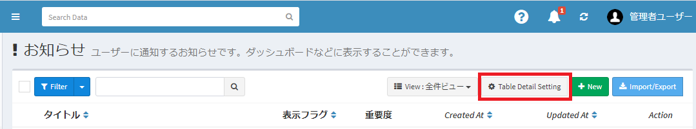
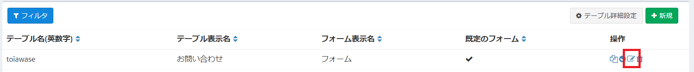
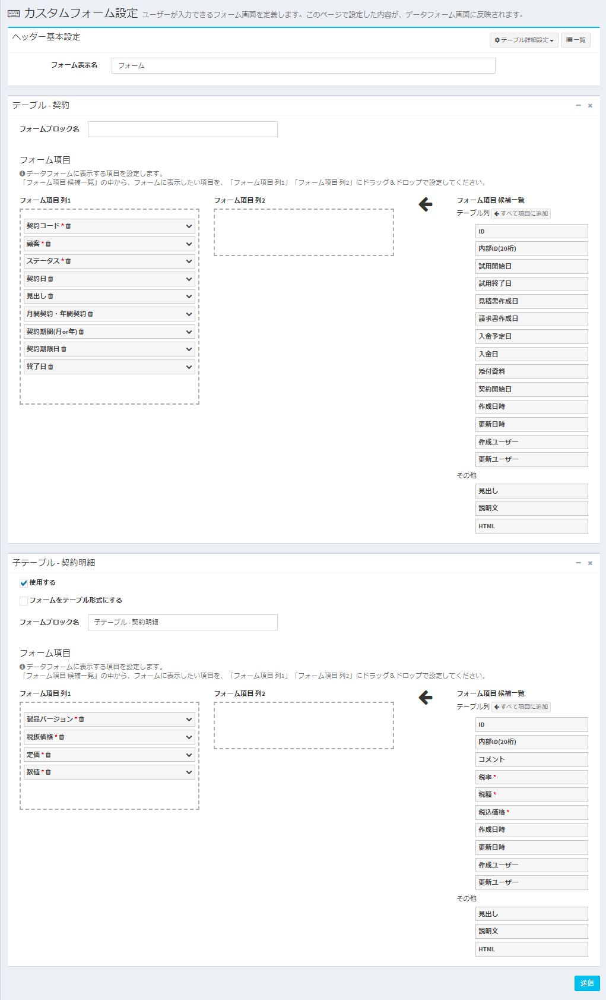
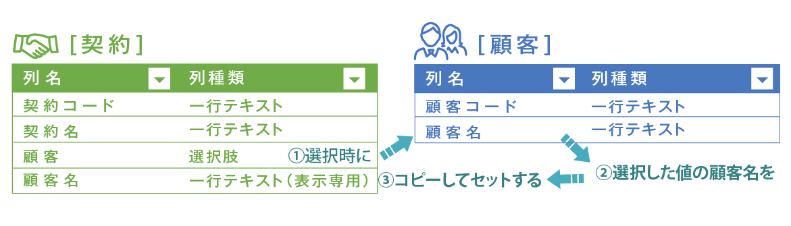
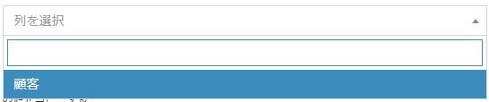

# 사용자 정의 폼
Exment의 [데이터 폼 화면](/ko/data_form)(데이터를 입력하는 화면)에 내보내는 항목과 그 배치를 정하는 페이지입니다. 항목의 배치(박스의 레이아웃), 숨김 필드, 데이터 연동 설정 등을 바꿀 수 있습니다.  
여기에서 설정한 내용이 각 테이블의 [데이터 폼 화면](/ko/data_form)에 반영됩니다.

- 화면을 여는 방법: 아래의 "페이지 표시", "폼 편집"
- 항목을 배치하는 방법: 아래의 "사용자 정의 폼의 설정 항목"
- 다른 테이블에서 고른 데이터의 값을 복사한다: 아래의 "데이터 연동 설정"
- 고른 값에 맞추어 다른 선택지를 좁힌다: 아래의 "관계 필터 설정"
- 조건에 따라 쓰는 폼을 전환한다: 아래의 "폼 표시 조건 설정"

## 페이지 표시
- 사용자 정의 테이블 목록에서 설정할 테이블에 체크를 넣고 오른쪽 위의 "테이블 상세 설정"을 누릅니다.  

> ※ 그 사용자 정의 테이블의 데이터 목록 화면이나 데이터 등록 화면에서 직접 열 수도 있습니다. 그때도 오른쪽 위의 "테이블 상세 설정"을 누르십시오.  

- 나온 테이블 상세 설정 화면에서 폼 설정의 아이콘을 누르면 폼의 목록이 나옵니다.  
※ 테이블마다 하나씩 처음부터 기본 폼이 만들어져 있습니다.


## 폼 편집
폼을 고칠 때는 그 폼의 [편집] 링크를 누릅니다.  


## 사용자 정의 폼의 설정 항목


### 폼 기본 설정
폼의 기본 정보를 입력합니다.

- ##### 폼 표시명
폼의 이름을 입력합니다.  

- ##### 기본 폼
이 폼을 기본 폼으로 할 때는 YES로 하십시오.  
[폼 표시 조건 설정](/ko/form?id=폼-표시-조건-설정)이 설정되어 있을 때는 그쪽이 우선합니다.

- ##### 상세 화면 표시 방법
[데이터 상세 화면](/ko/data_details)에서 항목을 내보내는 방법을 고릅니다. 이 화면에서 정한 행·열의 레이아웃에 맞추거나, 단순한 세로 1열로 합니다.  


- ##### 제목 표시 방법
각 항목의 제목을 어떻게 내보낼지를 정합니다.  
※ 폼 전체의 설정입니다. 항목별로 바꿀 때는 각 항목의 설정을 바꾸십시오.

### 폼 블록 설정
폼의 블록을 설정합니다.  
블록은 데이터의 묶음이고, 보통은 테이블 하나에 하나입니다.  
다만 1:n의 관계 설정이 있을 때는 자식 테이블의 데이터도 같은 화면에서 입력할 수 있습니다. 자식 테이블 블록의 "사용"을 체크하고 설정하십시오.


#### 폼 블록 항목
※ 다음은 모두 자식 테이블의 설정 항목입니다.

- ##### 폼을 표 형식으로 표시  
자식 테이블의 입력 칸을 테이블(표)의 형태로 내보냅니다.

- ##### 자식 테이블 데이터 읽기 최적화  
YES로 하면 편집 화면을 표시한 뒤에 이 자식 테이블의 행을 자동으로 읽어 들입니다. 자식 테이블의 행이 많은 데이터에서 편집 화면이 나올 때까지의 시간을 줄입니다. 기본값은 NO입니다.  
기존 데이터를 편집할 때, "폼을 표 형식으로 표시"가 YES인 1대다의 블록에서 쓸 수 있습니다. 읽어 들이기가 끝날 때까지는 저장할 수 없습니다.  
"폼을 표 형식으로 표시"를 NO로 하고 폼을 저장하면 이 설정도 NO가 됩니다.  
※ v7.1.0부터 쓸 수 있습니다.


- ##### 폼 블록 이름  
폼의 각 블록에 표시하는 이름입니다.  

- ##### 표시 순서  
자식 테이블이 여러 개 있을 때 내보내는 순서를 정할 수 있습니다.  


#### 폼 항목
입력 폼에 내보내는 항목을 골라서 배치합니다.  
항목은 아래의 "폼 항목 후보 목록"에서 고를 수 있습니다.


폼에는 1~4열까지의 박스를 둘 수 있습니다.  
이 박스 안에 폼 항목을 두어 갑니다.


박스에서는 다음 조작을 할 수 있습니다.  

- 박스 옆에 있는 "+" 버튼을 누르면 지금의 행에 새 열을 추가합니다.  


- 박스 아래에 있는 "+" 버튼을 누르면 새 행을 추가합니다. (다음 행이 이미 있을 때는 그 행에 새 열을 추가합니다)  


- 박스 오른쪽의 여백을 드래그 앤 드롭하면 박스의 크기를 바꿀 수 있습니다.  


- 박스 오른쪽 위에 있는 휴지통 아이콘을 누르면 박스를 삭제합니다.  


박스의 행이나 열을 늘리고·줄이고, 폭을 바꾸면 예를 들어 다음과 같은 레이아웃을 만들 수 있습니다.  

- 1열 - 2열


- 3열 - 1열


- 1열 - 2열 - 1열


### 폼 항목 후보 목록  
폼에 추가할 수 있는 항목의 후보입니다.  
"테이블 열"과 "기타"의 2종류가 있습니다.  


#### 테이블 열  
사용자 정의 테이블에 설정된 사용자 정의 열의 항목입니다.  
"폼 항목"의 박스에 드래그 앤 드롭하면 데이터 폼에 배치됩니다. 사용자 정의 열의 종류나 [폼 항목 상세](/ko/form?id=폼-항목-상세)의 설정에 따라 동작은 다르지만, 보통은 항목의 값을 편집하거나 표시할 수 있습니다.

#### 기타  
제목·설명문·HTML 등 데이터와는 연결되어 있지 않고, 폼에 내보내기만 하는 항목입니다.  
"폼 항목"의 박스에 드래그 앤 드롭하면 데이터 폼에 배치됩니다.

- ##### 제목:
폼에 제목 형식으로 표시됩니다.

- ##### 설명문:
폼에 설명문을 표시합니다. HTML은 쓸 수 없습니다.

- ##### HTML:
폼에 HTML을 표시합니다.  
※ 안전을 위해 `<script>`·`<iframe>` 태그와 `id` 속성은 출력되지 않습니다(v6.2.15 이후). 화면에서 스크립트를 실행할 때는 [스크립트 플러그인](/ko/plugin_quickstart_script)을 쓰십시오.  

- ##### 확장 HTML:
HTML에 더해 [매개변수](/ko/params)로 지정한 형식의 문자열을 쓸 수 있습니다. 화면을 그릴 때 저장된 데이터의 값으로 바꾸어 HTML을 만들 수 있습니다.  
※ "HTML"과 마찬가지로 `<script>`·`<iframe>` 태그와 `id` 속성은 출력되지 않습니다(v6.2.15 이후).  
예:
```
<h4>ID: ${id}, 회사 코드: ${value:company_code}</h4>
```
※ 열의 값을 바꾸는 것은 화면을 그릴 때뿐입니다. 데이터 편집 화면에서 대상 열의 값을 편집해도 연동하여 값이 바뀌지는 않으니 주의하십시오.  

- ##### 이미지:
폼에 이미지를 표시합니다.

- ##### 구분선:
폼에 구분선을 표시합니다.


#### 폼 항목 상세
박스에 추가한 항목은 다음과 같은 라벨로 나옵니다.  
- 사용자 정의 열의 설정에서 필수로 한 항목은 이름 옆에 빨간 마크가 붙습니다.  
- 라벨 오른쪽의 휴지통 아이콘을 누르면 박스에서 그 항목이 삭제됩니다.  
- 라벨 오른쪽의 톱니바퀴 아이콘을 누르면 상세 설정 대화 상자가 나옵니다.  


##### 제목 표시 형식
항목별로 제목을 내보내는 방법을 정할 수 있습니다.
(폼 전체의 설정보다 우선합니다)

##### 필드 유형
데이터 폼 화면에서 내보내는 방법을 정합니다. 다음 4가지가 있습니다.

| 종류 | 화면에서 보이는 모습 | 사용자가 값을 바꾼다 | 계산 필드·데이터 연동 설정에서 쓴다 |
|---|---|---|---|
| 읽기 전용 | 회색으로 나온다 | 할 수 없다 | 할 수 있다 |
| 표시 전용 | 텍스트로 나온다 | 할 수 없다 | 할 수 없다 |
| 숨김 필드 | 나오지 않는다(숨김 필드(hidden)로 추가된다) | - | 할 수 있다 |
| 숨김 | 나오지 않는다(저장 직전에 시스템 안에서 추가된다) | - | - |

- 읽기 전용:  
체크를 하면 사용자가 값을 변경할 수 없습니다. 시스템이나 계산 필드, [데이터 연동 설정](/ko/form?id=데이터-연동-설정)에서만 값을 변경·취득할 수 있습니다.  
설정하면 폼에서는 다음과 같이 회색으로 표시됩니다.  
  
- 표시 전용:  
체크를 하면 사용자가 값을 변경할 수 없습니다. 시스템이나 계산 필드, [데이터 연동 설정](/ko/form?id=데이터-연동-설정)에서도 값을 변경·취득할 수 없습니다.  
설정하면 폼에서는 다음과 같이 텍스트로 표시됩니다.  
  
- 숨김 필드:  
체크를 하면 항목이 화면에 표시되지 않고 숨김 필드(hidden)로 추가됩니다.  
계산 필드, [데이터 연동 설정](/ko/form?id=데이터-연동-설정)에서 쓰고 싶지만 화면에는 표시하고 싶지 않은 경우에 이 설정을 씁니다.  

- 숨김:  
체크를 하면 항목은 화면에 추가되지 않습니다. 데이터 저장 직전에 시스템 내부에서 추가됩니다.  
화면에 존재하지 않으므로 계산 필드나 데이터 연동 설정에서 쓸 수는 없습니다.  
내부의 매개변수 값 등 위조나 수정을 하게 하고 싶지 않은 항목에 이 설정을 쓰십시오.


##### 데이터 연동 설정(항목)  
[데이터 연동 설정](/ko/form?id=데이터-연동-설정)을 참조하십시오.  

##### 관계 필터 설정(항목)  
[관계 필터 설정](/ko/form?id=관계-필터-설정)을 참조하십시오.  


## 데이터 연동 설정
폼 안에 다른 테이블의 데이터를 고르는 항목이 있을 때, 고른 데이터의 내용을 폼의 다른 항목에 복사할 수 있습니다.  
예: "계약" 폼 안의 "고객"을 선택했을 때, "고객" 데이터 안의 "고객 이름" 값을 "계약" 폼 안의 "고객 이름"에 복사한다.


"계약" 폼에 "고객" 선택지와 "고객 이름" 한 줄 텍스트가 있고,  
  
 
"고객"을 선택했을 때, 


"고객 이름" 텍스트에 값이 자동으로 설정된다  


<br />  

#### 절차
- 사용자 정의 폼 화면을 엽니다.  
폼 항목의 "고객 이름"의 설정 아이콘을 누릅니다.  


- 열린 대화 상자에 "데이터 연동 설정" 항목이 있습니다.  


- "열 선택"에서 복사의 계기(트리거)가 되는 사용자 정의 열을 고릅니다.  
**※ 같은 폼 안에 있는, 열 종류가 "선택 (테이블에서)", "사용자", "조직"인 열을 선택할 수 있습니다.**
이 예에서는 "고객"을 고릅니다.  


- "열 선택"을 고르면 두 번째 항목 "링크 열 선택"의 선택지가 나옵니다.  
"열 선택"에서 고른 테이블의 사용자 정의 열이 목록으로 나옵니다.  
이 예에서는 "고객 이름"을 고릅니다.  


- 마지막으로 [설정] 버튼을 누릅니다.  
대화 상자가 닫히고 [데이터 연동 설정] 버튼 옆에 "설정됨"이라고 나옵니다.  


- 페이지 아래의 [전송] 버튼을 눌러 설정을 저장하십시오.


## 관계 필터 설정
열 종류가 "선택 (테이블에서)", "사용자", "조직"인 경우에, 같은 폼 안에 있는 다른 항목의 선택에 따라 선택지를 좁힙니다. 대상 테이블의 부모 테이블 또는 참조하는 테이블의 열이 같은 폼 안에 있는 경우에만 설정할 수 있습니다.  

#### 예
"고객 정보" 테이블과 "담당자 정보" 테이블에 1:n의 관계가 설정되어 있고, 또 "계약 정보" 테이블에 "고객" 열과 "담당자" 열이 있다.  
"고객" 열을 선택했을 때 "담당자" 열의 선택지 후보를, 선택한 "고객"을 부모로 하는 담당자만으로 좁히고 싶다.

  

다음과 같은 데이터가 있고,
  

계약 정보 화면에서,
 

"고객"에서 "주식회사 A"를 선택하면 주식회사 A에 소속하는 담당자를 선택지 후보로 하고,
  

"고객"에서 "주식회사 B"를 선택하면 주식회사 B에 소속하는 담당자를 선택지 후보로 한다.
  

#### 절차
- 사용자 정의 폼 화면을 엽니다.  
폼 항목의 "담당자" 열의 설정 아이콘을 누릅니다.  


- 열린 대화 상자에 "관계 필터 설정" 항목이 있습니다.  
선택지에 나오는 것은 같은 폼 안에서, 고른 열의 부모가 되는 열의 목록입니다.  
이 예에서는 "담당자" 테이블의 부모 테이블인 "고객" 테이블의 열이 선택지에 나옵니다.  
※ "관계 필터 설정" 버튼은 사용자 정의 열이 "선택 (테이블에서)", "사용자", "조직"인 경우에 표시됩니다.


- 설정했으면 "설정" 버튼을 누릅니다.  


#### v3.3.1 미만의 사양에 대하여
<span class="small">v3.3.1 미만에서는 이 설정 화면이 표시되지 않고, 모든 1:n 부모-자식 관계·참조 관계를 가지는 필드에서 선택지의 좁히기를 하고 있었습니다.  
그 결과 때로 불필요한 좁히기나 예기치 않은 결함을 일으키는 일도 있어, v3.3.1에서 좁히기를 할지 말지를 선택할 수 있도록 설정을 추가했습니다.  
v3.3.1 미만에서 v3.3.1 이상으로 업데이트할 때는 호환성을 유지하기 위해 "모든 1:n 부모-자식 관계·참조 관계를 가지는 필드에서 선택지의 좁히기를 한다"는 설정을 이어받습니다.  
업데이트할 때의 사양의 상세는 [여기](/patch/relation_filter)(영어)를 참조하십시오.</span>


## 폼 표시 조건 설정
조건과 우선순위를 정해 두면, 데이터의 작성이나 데이터 상세 화면에서 쓰는 폼을 조건에 따라 전환할 수 있습니다.  

### 새로 만들기
폼 표시 조건 설정의 오른쪽에 있는 [만들기] 버튼에서 만듭니다.


### 설정 화면


##### 대상 폼  
조건에 맞을 때 쓰고 싶은 폼을 고릅니다.

##### 우선순위  
폼을 쓰는 우선순위를 정합니다.
여러 폼 표시 조건에 맞는 데이터에서는 우선순위가 높은 폼으로 화면을 내보냅니다.

##### 조건 항목  
표시 조건으로 쓰는 열입니다.

##### 검색 조건  
조건의 내용을 고릅니다.
"조건 항목"에서 고른 열의 종류("날짜", "사용자" 등)에 따라 고를 수 있는 내용이 달라집니다.

##### 조건 값  
검색 조건과 비교하는 값을 입력합니다.

##### [삭제] 버튼  
폼의 표시 조건을 삭제합니다.

##### [만들기] 버튼  
폼의 표시 조건을 새로 추가합니다.
