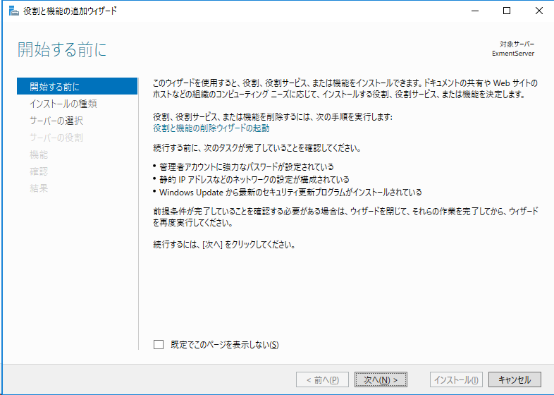
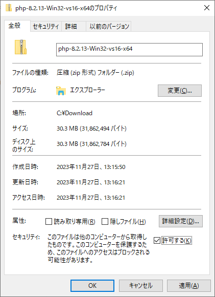
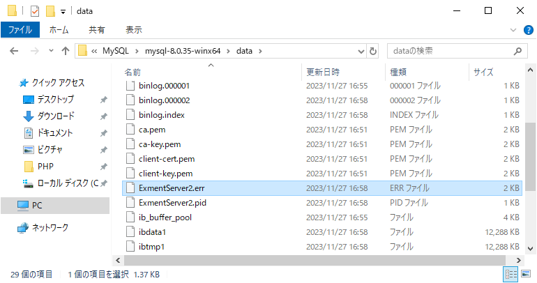
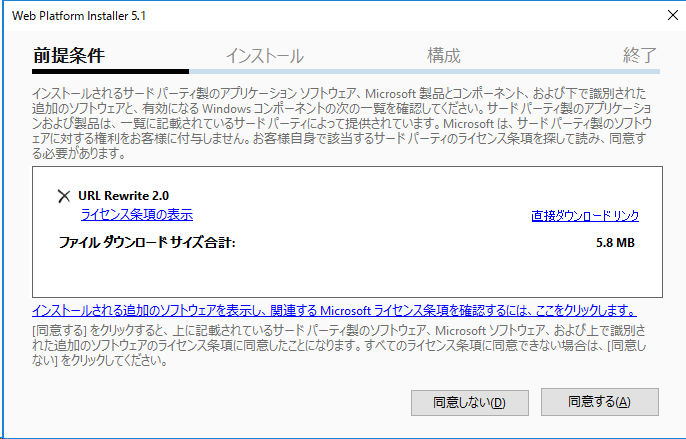
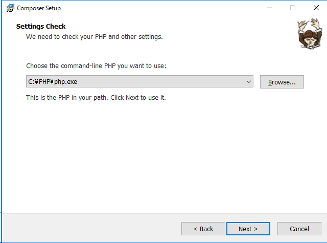
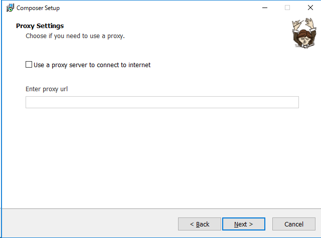
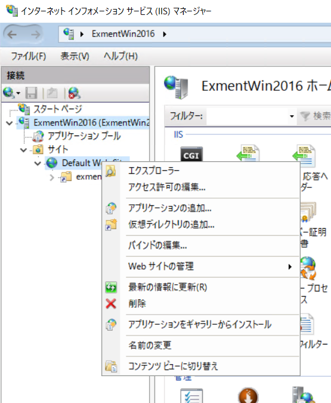
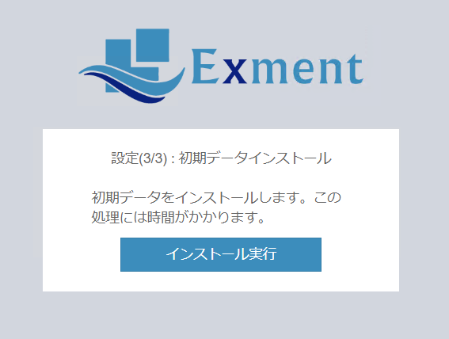

# Windows Server로 환경 구축
Windows Server의 IIS(Windows에 들어 있는 Web 서버)에 Exment를 설치하는 절차입니다.  
Web 서버의 설치부터 시작해서, 아무것도 없는 상태에서 만듭니다.

큰 흐름은 다음과 같습니다.

1. Web 서버(IIS)를 설치한다
2. PHP를 준비한다
3. MySQL을 설치한다
4. IIS를 준비한다
5. Composer를 설치한다
6. Exment를 다운로드하고 실행할 준비를 한다

## 환경
이 페이지의 절차는 다음 환경에서 만들었습니다.
- Windows Server 2019 Standard 일본어판
- IIS 10
- PHP 8.2.X
- MySQL 8.4.X

검증을 위해 Windows 10을 쓸 때의 차이는 그때마다 적었습니다.

## 주의점

- 사용하는 환경이나 버전에 따라서는 이 절차대로 설정할 수 없는 경우가 있습니다. 양해해 주십시오.

- 이 페이지에는 Exment를 Windows Server에서 움직이기 위한 절차만 적었습니다.  
Windows Server의 관리·데이터베이스 만들기·명령 등 일반적인 IT 지식은 적지 않았습니다. 양해해 주십시오.

- **이 절차에는 관리자 권한이 필요합니다. 필요에 맞추어 명령 프롬프트·PowerShell·실행 파일을 "관리자 권한으로 실행"(또는 사용자 계정 컨트롤로 권한 상승)하십시오**.

## Windows Server에서의 설치 절차

> 작업을 시작하기 전에 Windows Server의 탐색기에서 "파일 확장명"을 표시하는 설정으로 해 두는 것을 권장합니다

### Web 서버(IIS)의 설치
서버에서 IIS 기능이 켜져 있지 않을 때는 먼저 IIS 기능을 설치합니다.
1. 서버 관리자의 \[관리\]에서 \[역할 및 기능 추가\] 마법사를 엽니다  
   
2. \[설치 유형\]은 "역할 기반 또는 기능 기반 설치"를 고르고, \[서버 선택\]은 IIS를 설치할 서버(보통은 작업하고 있는 서버)를 골라서 진행합니다.
3. \[서버 역할\]에서는 "웹 서버(IIS)"를 고르고, 표시되는 기능의 추가도 합니다  
   
4. \[기능 선택\]·\[웹 서버 역할(IIS)\] 화면은 그대로 다음으로 진행합니다
5. \[역할 서비스 선택\]에서 \[응용 프로그램 개발\]을 펼치고 "CGI"에 체크한 다음 다음으로 진행합니다  
     
   그 밖의 역할(인증이나 압축 등)은 필요에 따라 추가하십시오(Exment 자체의 동작에는 추가할 필요가 없습니다)
6. \[설치 선택 확인\]에서 "설치"를 클릭하고 설치가 끝나기를 기다립니다
7. 설치가 끝나면 브라우저(Internet Explorer 등)를 시작하고 http://localhost 에 접속해서 IIS의 기본 페이지가 표시되는지 확인합니다

> Windows 10에 설치하는 경우에는 \[제어판\] - \[프로그램\] -\[프로그램 및 기능\] - \[Windows 기능 켜기/끄기] 에서 "인터넷 정보 서비스"를 켜고, \[응용 프로그램 개발 기능\]에서 "CGI"를 켜십시오.

### PHP의 준비
PHP를 다운로드해서 설치합니다
1. https://windows.php.net/download/ 에 접속합니다
2. \[PHP 8.2\]의 \[VC15 x64 Non Thread Safe\] ZIP 파일을 다운로드합니다  
   > Windows 10 환경에서 32비트 버전 Windows를 쓰고 있는 경우에는 \[VC15 x86 Non Thread Safe \] ZIP 파일을 다운로드하십시오
3. 다운로드한 ZIP 파일을 오른쪽 클릭해서 속성을 표시하고, \[일반\] 탭의 \[보안\]에 있는 "차단 해제"에 체크한 다음 \[확인\]을 클릭합니다  
   
4. ZIP 파일의 내용을 적당한 폴더(예 C:\PHP)에 풉니다
5. PHP를 실행하기 위한 환경 변수를 설정합니다  
   \[실행\]에서 sysdm.cpl을 실행해서 \[시스템 속성\]을 표시합니다
6. \[고급\] 탭에서 \[환경 변수\]를 엽니다  
   
7. \[시스템 변수\] 목록에서 변수 이름 "Path" 항목을 찾아서 고릅니다  
   
8. \[편집\]을 클릭하고 \[새로 만들기\]를 클릭합니다  
   
9.  PHP를 푼 폴더의 경로(예 C:\PHP)를 입력하고 \[확인\]을 3번 클릭합니다  
    
10. 명령 프롬프트에서  
    ```
    set path
    ```
    를 실행해서 PHP 폴더에 경로가 잡혀 있는지 확인하십시오
11. PHP의 설정 파일을 만듭니다  
    PHP를 푼 폴더 안의 "php.ini-development" 파일을 복사해서 php.ini 파일을 만듭니다
12. php.ini 파일을 편집해서 저장합니다
    1.  "Paths and Directories" 섹션의  
        ```
        ;extension_dir = "ext"
        ```
        를
        ```
        extension_dir = "PHP를 푼 폴더의 경로\ext" (예 extension_dir = "C:\PHP\ext")
        ```
        로 변경 (줄 앞의 ; 를 지워서 주석을 풉니다)
    2. "Dynamic Extension" 섹션의
        ```
        ;extension=gd
        ;extension=openssl
        ;extension=pdo_mysql
        ```
        를
        ```
        extension=gd
        extension=openssl
        extension=pdo_mysql
        ```
        로 변경 (줄 앞의 ; 를 지워서 주석을 풉니다)
    3.  "File Uploads" 섹션의  
        ```
        ;upload_tmp_dir=
        ```
        를
        ```
        upload_tmp_dir = "임의의 작업용 폴더의 경로" (예 upload_tmp_dir = "C:\Temp")
        ```
        로 변경 (줄 앞의 ; 를 지워서 주석을 풉니다)  
        ※지정한 폴더는 파일을 업로드할 때의 임시 보관 장소가 됩니다.
    4. 파일의 끝에 아래 내용을 추가합니다.
        ```
        extension=php_fileinfo.dll
        ```

13. 명령 프롬프트에서 아래 명령을 실행해서 PHP가 동작하는지 확인합니다  
    ```
    php -v
    ```
    

    Visual C++ 14.0 런타임을 찾을 수 없다는 오류가 나는 경우에는 [지원되는 최신 Visual C++ 다운로드
](https://support.microsoft.com/help/2977003/the-latest-supported-visual-c-downloads) 에서 Visual Studio 2015, 2017 및 2019용 Visual C++ 재배포 가능 패키지 (vc_redist.x64.exe)를 다운로드·설치하십시오  
    

### MySQL의 설치
Exment에서 쓰는 MySQL을 설치하고 초기 구성을 합니다  
여기서는 MySQL 8.4.X를 설치합니다

1. [MySQL Community Downloads](https://dev.mysql.com/downloads/mysql/) 페이지에 접속합니다
2. \[General Availability (GA) Releases\]를 클릭합니다  
   
3. \[Select Version\]에서 "8.4.X"를 고르고, \[Select Operating System\]에서 "Microsoft Windows"를 고르고, \[Select OS Version\]에서 "Windows (x86, 64bit)"를 고릅니다
     
   > Windows 10 환경에서 32비트 버전 Windows를 쓰고 있는 경우에는 \[Select OS Version\]에서 "Windows (x86, 32bit)"를 고르십시오
4. \[Other Downloads\]의 "ZIP Archive" 칸의 \[Download\] 버튼을 클릭해서 mysql-8.4.xx-winx64.zip 파일을 다운로드합니다
   
5. \[Login Now or Sign Up for a free account.\]가 표시되면 맨 아래의 \[No thanks, just start my download.\]를 클릭합니다. 다운로드가 시작됩니다
6. 다운로드한 ZIP 파일을 오른쪽 클릭해서 속성을 표시하고, \[일반\] 탭의 \[보안\]에 있는 "차단 해제"에 체크한 다음 \[확인\]을 클릭합니다  
   
7. ZIP 파일의 내용을 적당한 폴더(예 C:\MySQL)에 풉니다
8. 관리자 명령 프롬프트를 시작하고, ZIP 파일을 푼 폴더 안의 mysql-8.4.xx-winx64\bin 폴더로 이동합니다
   
9.  아래 명령을 실행해서 MySQL을 초기화합니다
    ```
    mysqld --initialize
    ```
    

    Visual C++ 12.0 런타임을 찾을 수 없다는 오류가 나는 경우에는 [지원되는 최신 Visual C++ 다운로드
](https://support.microsoft.com/help/2977003/the-latest-supported-visual-c-downloads) 를 참조해서, \[Update for Visual C++ 2013 Redistributable Package\](https://support.microsoft.com/help/4032938/update-for-visual-c-2013-redistributable-package) 에서 일본어판 (Japanese)의 Visual Studio 2013용 Microsoft Visual C++ 재배포 가능 패키지 (vc_redist.x64.exe)를 다운로드·설치하십시오  
    
10. 아래 명령을 실행해서 MySQL이 시작되는지 확인합니다. "mysqld: ready for connections."가 표시되면 올바르게 시작된 것입니다
    ```
    mysqld --console
    ```
    
11. Ctrl + C를 눌러서 MySQL을 일단 멈춥니다
12. MySQL을 Windows의 서비스로 설치합니다. 서비스로 설치하면 Windows가 시작될 때 자동으로 MySQL이 실행됩니다
    ```
    mysqld --install
    ```
    
13. 바로 MySQL을 시작하기 위해 아래 명령을 실행합니다
    ```
    net start mysql
    ```
    
14. MySQL을 쓰기 위한 관리자 (root) 비밀번호의 초기값을 확인합니다  
    MySQL을 푼 폴더가 C:\MySQL인 경우 C:\MySQL\mysql-8.4.xx-winx64\data에 확장자가 .err인 파일이 있으므로, 이것을 메모장 등의 텍스트 편집기로 엽니다  
    > 아래 그림의 경우는 ExmentServer2.err라는 파일 이름입니다  
    
15. 파일의 앞부분 가까이에 "\[Note\] A temporary password is generated for root@localhost:"라고 적힌 줄이 있습니다 (아래 그림의 빨간 밑줄). 그 뒤에 적혀 있는 문자열 (아래 그림에서는 1fyr*IXeC2%w)이 초기 비밀번호입니다. 이 비밀번호를 적어 두십시오
    
16. 관리자 명령 프롬프트로 돌아가서 아래 명령을 실행해 MySQL의 초기 설정을 합니다
    ```
    mysql_secure_installation
    ```
    1. "Enter password for user root:"라고 물으므로 적어 둔 초기 비밀번호를 입력하고 Enter를 누릅니다
    2. "The existing password for the user account root has expired. Please set a new password."라고 표시됩니다  
       "New password:"라고 새 비밀번호를 물으므로 새 비밀번호를 입력하고 Enter를 누르고, "Re-enter new password:"라고 확인하므로 다시 한 번 새 비밀번호를 입력하고 Enter를 누릅니다
       > 비밀번호는 강력하고 추측하기 어려운 것을 쓰십시오. 8자 이상·대문자/소문자/숫자/기호 중 3종류 이상을 사용·사전에 있는 단어를 그대로 쓰지 않는다, 는 요건을 만족하는 것을 권장합니다
    3. VALIDATE PASSWORD PLUGIN을 쓸지 확인합니다  
       강력하고 추측하기 어려운 비밀번호를 설정한 경우에는 "y" 이외의 키를 입력하고 Enter를 누릅니다
    4. "Change the password for root ?"라고 물으므로 "y" 이외의 키를 입력하고 Enter를 누릅니다
    5. 나머지 확인에는 모두 "y"를 입력하고 Enter를 누릅니다
    6. "All done!"이라고 표시되면 초기 설정이 끝난 것입니다
17. 아래 명령을 실행해서 MySQL에 로그인합니다
    ```
    mysql -u root -p
    ```
18. "Enter password:"라고 비밀번호를 물으므로 앞에서 설정한 비밀번호를 입력하고 Enter를 누릅니다
    
19. "MySQL>" 프롬프트가 표시되면 아래 명령을 차례로 실행합니다
    > 여기서는 Exment에서 쓰는 MySQL 사용자를 "exment_user", 그 비밀번호를 "M!p3~S$W7fLm"이라고 합니다  
      실제 사용자 이름·비밀번호는 직접 정하십시오 (비밀번호는 강력하고 추측하기 어려운 것을 쓰십시오)  
      이 사용자 이름과 비밀번호는 Exment의 초기 설정에서 씁니다
    ```
    CREATE DATABASE exment_database;
    CREATE USER 'exment_user' IDENTIFIED BY 'M!p3~S$W7fLm';
    GRANT ALL ON exment_database.* TO 'exment_user';
    FLUSH PRIVILEGES;
    ```
20. 아래와 같이 입력하고 Enter를 눌러 MySQL에서 로그아웃합니다
    ```
    \q
    ```

### IIS의 준비
Exment를 실행하기 위한 IIS의 준비를 합니다
1. URL Rewrite 모듈을 도입합니다.  
   https://www.iis.net/downloads/microsoft/url-rewrite 에 접속해서 \[Install this extention\]을 클릭합니다
2. urlrewrite2.exe가 다운로드되므로 실행하고, 화면의 안내에 따라 설치합니다
   1. \[설치\]를 클릭합니다  
      
   2.  \[동의함\]을 클릭합니다  
      
   3.  설치가 시작됩니다  
      
   4.  \[마침\]을 클릭합니다  
      
   5.  \[끝내기\]를 클릭합니다  
      
3. 서버 관리자의 \[도구\]에서 \[IIS(인터넷 정보 서비스) 관리자\]를 엽니다  
   
4. 연결 창에서 \[(서버 이름)\] - \[사이트\]로 펼치고 \[Default Web Site\]를 고릅니다
5. 기능 보기에서 \[처리기 매핑\]을 더블 클릭합니다
6. 작업 창에서 \[모듈 매핑 추가\]를 클릭합니다
7. \[모듈 매핑 추가\]에 아래와 같이 입력하고 \[확인\]을 클릭합니다  
   - 요청 경로: *.php  
   - 모듈: FastCgiModule  
   - 실행 파일: (PHP를 푼 폴더의 경로)\php-cgi.exe (예 C:\PHP\php-cgi.exe)  
   - 이름: 임의 (예: PHP)  
   
8. 확인 메시지가 표시되면 \[예\]를 클릭합니다

### Composer의 설치
Exment에 필요한 PHP 라이브러리 관리 도구 (Composer)를 설치합니다
1. [Composer의 다운로드 페이지 (https://getcomposer.org/download/)](https://getcomposer.org/download/) 에 접속해서, "Download and run Composer-Setup.exe - it will install the latest composer version whenever it is executed"라고 적혀 있는 부분에서 Composer-Setup.exe를 다운로드합니다  
   
2.  다운로드한 Composer-Setup.exe를 실행합니다
3.  "Install for all users"를 고릅니다  
   
4.  "Developer Mode"에 체크하지 않고 다음으로 진행합니다  
   
5. "Setting Check"에 표시된 PHP의 경로가 올바른지 확인하고 다음으로 진행합니다  
   
6. "PHP Configration Error"가 표시되면 \[Create a php,ini file\] 또는 \[Update this php.ini\]에 체크하고 다음으로 진행합니다  
   
7. "Proxy Settings"에서는 인터넷 접속에 쓰는 프록시를 지정합니다. 프록시를 쓰지 않는 경우에는 그대로 다음으로 진행합니다  
   
8. 확인 화면이 표시되므로 \[Install\]을 클릭합니다  
   
9. "Information"이 표시되면 그대로 다음으로 진행합니다  
    
10. \[Finish\]를 클릭해서 끝냅니다  
    

### Exment의 다운로드와 실행 준비

1. Exment의 설치 절차 페이지 ([https://exment.net/docs/#/ko/quickstart](https://exment.net/docs/#/ko/quickstart)) 에서 Exment zip 파일 (exment.zip)을 다운로드합니다
2. 다운로드한 ZIP 파일을 오른쪽 클릭해서 속성을 표시하고, \[일반\] 탭의 \[보안\]에 있는 "차단 해제"에 체크한 다음 \[확인\]을 클릭합니다  
   
3. ZIP 파일 안의 exment 폴더의 내용을 적당한 폴더(예 C:\exment)에 풉니다  
     
   **"inetpub\wwwroot" 폴더 바로 아래에는 절대로 풀지 마십시오. 데이터베이스의 설정값이나 메일의 비밀번호 등이 적힌 설정 파일 등이 밖에서 보이게 되어 중대한 정보 유출로 이어집니다**
4. 가상 디렉터리를 만듭니다  
   IIS(인터넷 정보 서비스) 관리자를 열고, \[연결\] 창에서 \[(서버 이름)\] - \[사이트\]로 펼친 다음 \[Default Web Site\]를 오른쪽 클릭해서 \[가상 디렉터리 추가\]를 고릅니다  
   
5. 아래와 같이 가상 디렉터리를 구성합니다  
   예에서는 별칭 (Exment에 접속하기 위한 URL의 경로)을 "exment"로 했습니다  
   실제 경로에는 Exment의 ZIP 파일을 푼 폴더의 경로 (예 C:\exment)를 설정합니다
   - 별칭: exment  
   - 실제 경로: C:\Exment\public  
   
6. "index.php"를 기본 파일에 추가합니다  
   \[Default Web Site\]를 고르고 \[기본 문서\]를 더블 클릭으로 엽니다  
   
7. \[작업\] 창에서 \[추가\]를 클릭합니다
8. index.php를 추가합니다  
   
9.  Web.config에 URL 바꾸기 (Rewrite) 규칙을 추가합니다  
   \[연결\] 창에서 "4."에서 추가한 가상 디렉터리 (예에서는 exment)를 고르고 \[URL 재작성\]을 더블 클릭으로 엽니다  
   
10. \[작업\] 창에서 \[규칙 추가\]를 클릭합니다  
   
11. \[규칙 추가\]에서 \[인바운드 규칙\]의 \[빈 규칙\]을 고르고 \[확인\]을 클릭합니다  
   
12. \[인바운드 규칙 편집\]에서 아래와 같이 규칙을 만듭니다  
    
    - 이름: 임의의 이름
    - \[URL 일치\]
      - 요청한 URL: 패턴과 일치
      - 사용: 정규식
      - 패턴: (.*)$
    - 조건
      - 논리적 그룹화: 모두 일치
      - \[추가\]를 클릭해서 아래 2개의 조건을 추가
        - 입력: {REQUEST_FILENAME}  
        유형: 파일이 아님
        - 입력: {REQUEST_FILENAME}  
        유형: 디렉터리가 아님
    - 작업
      - 작업 유형: 재작성
      - 작업 속성
      - URL 재작성: index.php/{R:1}
      - 쿼리 문자열 추가: ON
      - 재작성된 문자열을 기록: OFF
    - 후속 규칙 처리 중지: ON
13. \[작업\] 창에서 \[적용\]을 클릭합니다
14. "변경 내용이 저장되었습니다"라고 표시되면 \[규칙으로 돌아가기\]를 클릭합니다

<!-- 이 뒤의 절차는 확인 필요 -->

15. Laravel에서 쓸 수 있도록 폴더의 접근 권한을 설정합니다
    Exment의 ZIP을 풀어서 가상 디렉터리를 구성한 폴더에 IIS의 실행 사용자 (IIS_IUSRS)의 쓰기 권한을 줍니다  
    > 예에서는 C:\exment
    
    

16. IIS 실행 사용자 (IIS_IUSRS)에게 exment 폴더에 대한 쓰기 접근 권한을 추가합니다
    1. exment 폴더를 오른쪽 클릭하고 \[속성\]을 고릅니다
    2. \[보안\] 탭을 열고 \[편집\]을 클릭합니다
    3. \[exment의 사용 권한\]에서 \[추가\] 버튼을 클릭해서 \[사용자 또는 그룹 선택\]을 표시합니다
    4. \[선택할 개체 이름을 입력하십시오\] 칸에 IIS_IUSRS라고 입력하고 \[이름 확인\]을 클릭합니다
    5. 표시가 (컴퓨터 이름)\IIS_IUSRS로 바뀌면 \[확인\]을 클릭합니다  
       
    6. \[exment의 사용 권한\]으로 돌아가므로 \[그룹 또는 사용자 이름\] 칸에서 IIS_IUSRS를 클릭하고, \[사용 권한\] 칸의 \[쓰기\]의 \[허용\]에 체크합니다  
    
    1. \[확인\]을 2번 클릭해서 속성을 닫습니다

<!--
실제로는 storage 폴더뿐 아니라 exment 폴더 안의 다른 파일이나 폴더에 대해서도 IIS_IUSRS의 쓰기 권한이 필요한 것 같습니다.
실제로 어느 리소스에 어느 정도의 권한이 최소한으로 필요한지 알 수 없으므로, 테스트 환경에서는 C:\exment 폴더 전체에 IIS_IUSRS의 쓰기 권한을 주고 Exment의 Web 앱이 동작하는 것을 확인했습니다.
최소한의 접근 권한을 알게 되면 이 부분은 그에 맞추어 고칩니다.

14. Laravel에서 쓸 수 있도록 폴더의 접근 권한을 설정합니다
    > Exment의 ZIP을 풀어서 가상 디렉터리를 구성한 폴더 (예 C:\exment)에 IIS의 실행 사용자 (IIS_IUSRS)의 쓰기 권한을 줍니다
15. 접근 권한을 구성합니다
    1. exment 폴더를 오른쪽 클릭하고 \[속성\]을 고릅니다
    2. \[보안\] 탭을 열고 \[편집\]을 클릭합니다
    3. \[exment의 사용 권한\]에서 \[추가\] 버튼을 클릭해서 \[사용자 또는 그룹 선택\]을 표시합니다
    4. \[선택할 개체 이름을 입력하십시오\] 칸에 IIS_IUSRS라고 입력하고 \[이름 확인\]을 클릭합니다
    5. 표시가 (컴퓨터 이름)\IIS_IUSRS로 바뀌면 \[확인\]을 클릭합니다  
    6. \[exment의 사용 권한\]으로 돌아가므로 \[그룹 또는 사용자 이름\] 칸에서 IIS_IUSRS를 클릭하고, \[사용 권한\] 칸의 \[쓰기\]의 \[허용\]에 체크합니다  
    7. \[확인\]을 2번 클릭해서 속성을 닫습니다
-->

17.  브라우저 (Chrome 또는 Microsoft Edge)를 시작하고 http://localhost/(가상 디렉터리의 별칭) 에 접속합니다 (예 http://localhost/exment . `ADMIN_ROUTE_PREFIX`에 "admin"이 있는 사이트는 http://localhost/exment/admin)  
    Exment의 설치 페이지가 표시됩니다.
> Exment는 Internet Explorer에서의 표시를 지원하지 않습니다. Exment에 접속할 때는 Chrome 또는 Microsoft Edge를 쓰십시오

   1. Language가 \[일본어\], Timezone이 \[(GMT+09:00)일본\]으로 되어 있는지 확인하고 \[Submit\]을 클릭합니다
   

   2. 만들어 둔 데이터베이스에 관한 설정을 입력하고 \[전송\]을 클릭합니다
   > 예에서는,<br />데이터베이스\[exment_database\] <br />사용자 이름\[exment_user\] <br />비밀번호\[M!p3~S$W7fLm\] 

   

   3. \[설치 실행\]을 클릭합니다  
   
   설치가 올바르게 끝난 경우 Exment 초기 설정 화면이 표시됩니다.  
   초기 설정에 대해서는 [여기](/ko/first_setting)를 참조하십시오.

18.  설치가 끝나면 exment 폴더에 설정했던 접근 권한을 해제합니다

   1. exment 폴더를 오른쪽 클릭하고 \[속성\]을 고릅니다
   > 예에서는 C:\exment  
   2. \[보안\] 탭을 열고 \[편집\]을 클릭합니다
   3. \[그룹 또는 사용자 이름\] 칸에서 \[IIS_IUSRS\]를 고릅니다
   4. \[사용 권한\]에서 \[이름 확인\]을 클릭하고, \[사용 권한\] 칸의 \[쓰기\]의 \[허용\]의 체크를 해제합니다
   
   5. \[확인\]을 2번 클릭해서 속성을 닫습니다   

19.  몇 개의 폴더에 쓰기 접근 권한을 추가합니다. 추가할 폴더·파일은 다음과 같습니다.

| 종류 | 파일·폴더 이름 | 필요한 기능 |
| ---- | ---- | ---- |
| 폴더 | storage | 모든 기능 |
| 폴더 | bootstrap/cache | 모든 기능 |
| 파일 | .env | 간편 설치, 복원 |
| 폴더 | config | 간편 설치, 복원 |
| 폴더 | app | 간편 설치 |
| 폴더 | public | 간편 설치 |
| 폴더 | resources | 간편 설치 |

아래 예는 storage 폴더에 권한을 추가하는 절차입니다.

   1. storage 폴더를 오른쪽 클릭하고 \[속성\]을 고릅니다
   > 예에서는 C:\exment\storage
   2. \[보안\] 탭을 열고 \[편집\]을 클릭합니다
   3. \[storage의 사용 권한\]에서 \[추가\] 버튼을 클릭해서 \[사용자 또는 그룹 선택\]을 표시합니다
   4. \[선택할 개체 이름을 입력하십시오\] 칸에 IIS_IUSRS라고 입력하고 \[이름 확인\]을 클릭합니다
   5. 표시가 (컴퓨터 이름)\IIS_IUSRS로 바뀌면 \[확인\]을 클릭합니다  
       
   6. \[storage의 사용 권한\]으로 돌아가므로 \[그룹 또는 사용자 이름\] 칸에서 IIS_IUSRS를 클릭하고, \[사용 권한\] 칸의 \[쓰기\]의 \[허용\]에 체크합니다  
    
   7. \[확인\]을 2번 클릭해서 속성을 닫습니다

20.  업로드 파일을 임시로 보관할 수 있도록 php.ini의 upload_tmp_dir로 지정한 폴더에 대한 쓰기 접근 권한을 추가합니다
   1. 해당 폴더를 오른쪽 클릭하고 \[속성\]을 고릅니다
   > 예에서는 C:\Temp
   2. \[보안\] 탭을 열고 \[편집\]을 클릭합니다
   3. \[Temp의 사용 권한\]에서 \[추가\] 버튼을 클릭해서 \[사용자 또는 그룹 선택\]을 표시합니다
   4. \[선택할 개체 이름을 입력하십시오\] 칸에 IIS_IUSRS라고 입력하고 \[이름 확인\]을 클릭합니다
   5. 표시가 (컴퓨터 이름)\IIS_IUSRS로 바뀌면 \[확인\]을 클릭합니다  
       
   6. \[Temp의 사용 권한\]으로 돌아가므로 \[그룹 또는 사용자 이름\] 칸에서 IIS_IUSRS를 클릭하고, \[사용 권한\] 칸의 \[쓰기\]의 \[허용\]에 체크합니다  
    
   7. \[확인\]을 2번 클릭해서 속성을 닫습니다

   > 설치 뒤의 초기 설정에 대해서는 [여기](/ko/first_setting)를 참조하십시오

   
## PHP 버전을 올릴 때의 대응
PHP의 버전을 바꿀 때는 다음 절차로 버전을 올리십시오.  
※버전을 올리는 작업 중에는 Exment에 접속할 수 없게 됩니다.  
※아래 예는 PHP7.4에서 PHP8.2로 업데이트하기 위한 절차입니다.  
※환경이나 도입 시기, 버전이나 설치 방법에 따라 버전을 올리는 방법은 다를 수 있습니다.  

- 먼저 IIS를 멈춥니다.

- 지금 쓰고 있는 PHP의 실행 폴더를 백업합니다. 폴더의 이름을 바꾸거나 다른 곳에 복사하는 등 원하는 방법으로 해도 됩니다.

- 새 PHP를 다운로드합니다.  

   1. https://windows.php.net/download/ 에 접속합니다
   2. \[PHP 8.2\]의 \[VC15 x64 Non Thread Safe\] ZIP 파일을 다운로드합니다  
      > Windows 10 환경에서 32비트 버전 Windows를 쓰고 있는 경우에는 \[VC15 x86 Non Thread Safe \] ZIP 파일을 다운로드하십시오
   3. ZIP 파일의 내용을 이전 PHP와 같은 경로에 풉니다.  
   ※ 환경 변수로 PATH가 잡혀 있는 것이 전제입니다.  

- 백업해 둔 이전 버전의 PHP 폴더에서 새 버전의 PHP 폴더로 php.ini 파일을 복사합니다.

- 필요하면 php.ini 파일을 고칩니다.
   1. "Dynamic Extension" 섹션의 GD 라이브러리가 주석 처리되어 있는 경우에는 활성화하십시오.
        ```
        ;extension=gd
        ```
        를
        ```
        extension=gd
        ```
        로 변경 (줄 앞의 ; 를 지워서 주석을 풉니다)

   ※ 원래의 PHP 버전에 따라서는 extension=gd2로 되어 있는 경우가 있습니다. extension=gd로 바꾸십시오.  

- IIS를 시작합니다.  

- 명령 프롬프트 등에서 PHP의 버전이 8.2.X로 되어 있는지 확인합니다.

~~~
php -v
~~~
