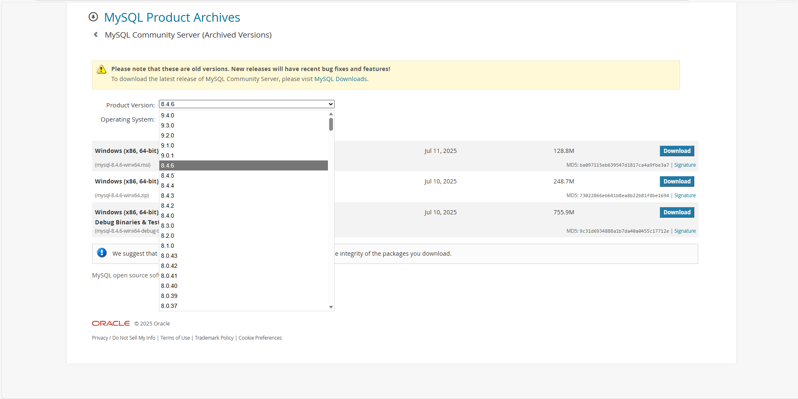
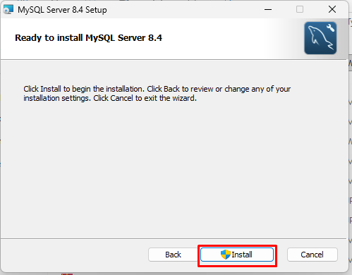
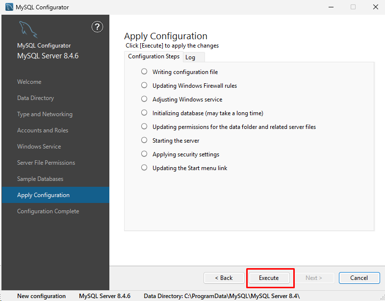
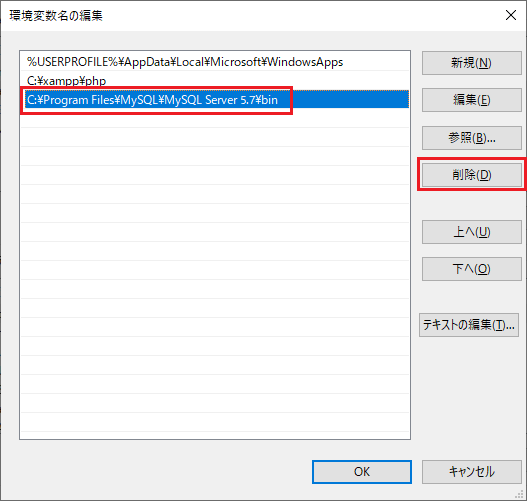

# MySQL 설치 절차
Exment에서 MySQL을 쓰기 위해 MySQL을 설치하고 설정하는 절차입니다.  
※절차는 OS·버전·설치하는 시기 등에 따라 다를 수 있습니다.  

사용하는 서버에 맞추어 다음 중 하나를 보십시오.

| 서버 | 볼 곳 |
| ---- | ---- |
| Windows | 아래의 "MySQL 설정(Windows)" |
| Linux | 아래의 "MySQL 설정(Linux)"(MySQL5.7이 이미 있는지 없는지에 따라 절차가 나뉩니다) |

## MySQL 설정(Windows)

- 권장: 업그레이드하기 전에 [데이터베이스 백업](https://dev.mysql.com/doc/refman/8.4/en/mysqldump-sql-format.html)을 받으십시오.

- (MySQL이 시작되어 있는 경우) 관리자로 명령 프롬프트를 열고 MySQL을 멈춥니다.  
시작 버튼 오른쪽에 있는 "검색 창"에 "명령 프롬프트"라고 입력합니다.  
"가장 정확한 검색 결과"의 윗줄에 나오는 "명령 프롬프트"를 오른쪽 클릭합니다.  
나온 메뉴에서 "관리자 권한으로 실행"을 고릅니다.
   

~~~
net stop mysql57
net stop mysql80
~~~

- 다음 사이트를 열고 MySQL을 다운로드합니다.  
※MySQL Installer는 MySQL 8.0 계열에만 준비되어 있습니다. MySQL 8.1 이후(8.4 포함)는 MySQL Server를 MSI 또는 ZIP으로 다운로드하십시오.  
[MySQL Community Server Downloads](https://downloads.mysql.com/archives/community/)  

- Select Version에서 "8.4.X"를 고르고, OS는 Windows (x86, 64-bit)를 고릅니다.  

- 아래 중 하나를 다운로드합니다.
	- MSI Installer

- 다운로드한 MSI 파일을 실행하고, 화면의 안내(마법사)에 따라 설치합니다.
	- Welcome 화면에서 "Next"를 클릭합니다.

		
	- License Agreement에 동의하고 "Next"를 클릭합니다.

		
	- Setup Type은 "Complete"를 고릅니다.

		
	- "Install"을 클릭합니다.

		
	- 설치가 끝나면 "Finish"를 클릭합니다.

		

- MSI의 설치가 끝나면 MySQL Server Configurator가 자동으로 열립니다.
	- "Welcome to the MySQL Server Configurator"에서 "Next"를 클릭합니다.

		

- Data Directory는 처음 값 그대로 "Next"를 클릭합니다.

	

- Type and Networking:
	- Config Type: Development Computer
	- Connectivity: TCP/IP (기본 포트는 3306)
	- "Next"를 클릭합니다.

		

- Accounts and Roles: root 사용자의 비밀번호를 정하고 "Next"를 클릭합니다.

	

- Windows Service: 서비스 이름(예: MySQL84)을 정하고 "Next"를 클릭합니다.

	

- Server File Permissions는 처음 값 그대로 "Next"를 클릭합니다.

	

- Sample Databases는 건너뛰고 "Next"를 클릭합니다.

	

- Apply Configuration에서 "Execute"를 클릭하고, 끝나면 "Next" "Finish"를 클릭합니다.

	

- my.ini를 고칩니다. (C:\ProgramData\MySQL\MySQL Server 8.4\my.ini)

~~~
# 아래 내용을 끝에 추가

local-infile=1
~~~

- MySQL을 다시 시작합니다. (서비스 이름은 환경에 따라 다릅니다)

~~~
net stop MySQL84
net start MySQL84
~~~

### 환경 변수 추가 

- 탐색기에서 "내 PC"를 오른쪽 클릭하고 "속성"을 클릭합니다.

- "고급 시스템 설정"을 클릭합니다.

- "환경 변수"를 클릭합니다.  

- "사용자 변수"의 "Path"를 클릭하고 "편집"을 클릭합니다.  

- "C:\Program Files\MySQL\MySQL Server 5.7\bin" 줄이 있을 때는 삭제합니다.

- "새로 만들기"를 클릭하고 다음 줄을 추가합니다.  
 "C:\Program Files\MySQL\MySQL Server 8.4\bin"   

- 입력했으면 열려 있는 대화 상자를 모두 "확인"으로 닫습니다.  

## MySQL 설정(Linux)
Linux에 MySQL을 설치하는 절차입니다.  
※필요하면 명령 앞에 sudo를 붙이십시오.  
※설치하는 곳이 CentOS8·RHEL8 등일 때는 yum이 아니라 dnf 명령을 쓰십시오.

MySQL5.7이 이미 들어 있는지 없는지에 따라 절차가 다릅니다.

| 지금의 상태 | 볼 곳 |
| ---- | ---- |
| MySQL5.7이 들어 있다 | "MySQL5.7이 있는 경우(MySQL5.7→MySQL8.4로 업데이트)" |
| MySQL5.7이 들어 있지 않다 | "MySQL5.7이 없는 경우(MySQL8.4의 새 설치)" |

### MySQL5.7이 있는 경우(MySQL5.7→MySQL8.4로 업데이트)
- MySQL5.7의 패키지를 삭제합니다.
~~~
sudo killall mysqld; sudo killall mysqld_safe;
sudo rpm -e --nodeps mysql57-community-release
sudo yum remove mysql mysql-server mysql-client mysql-common mysql-devel mysql-community-client-plugins -y
~~~

- MySQL8.4를 설치하고 시작합니다.

※OS의 버전에 따라 rpm이 다릅니다.

예를 들어 AlmaLinux9.5의 경우,
 

~~~
[root@localhost ~]# uname -a
Linux localhost.localdomain 5.14.0-503.11.1.el9_5.x86_64 #1 SMP PREEMPT_DYNAMIC Tue Nov 12 09:26:13 EST 2024 x86_64 x86_64 x86_64 GNU/Linux
~~~

이면,
 

~~~
sudo rpm -ivh https://dev.mysql.com/get/mysql84-community-release-el9-2.noarch.rpm
~~~

이 됩니다.
 

~~~
# CENTOS STREAM의 경우

rpm -ivh https://dev.mysql.com/get/mysql84-community-release-el9-2.noarch.rpm
rpm --import https://repo.mysql.com/RPM-GPG-KEY-mysql-2023
dnf clean packages
dnf update -y

# mysql-community-server를 설치하고 시작한다
dnf install mysql-community-server -y
systemctl start mysqld
systemctl enable mysqld
~~~

~~~
# CENTOS8의 경우
sudo rpm -ivh https://dev.mysql.com/get/mysql84-community-release-el8-2.noarch.rpm
sudo rpm --import https://repo.mysql.com/RPM-GPG-KEY-mysql-2023

# 이것을 실행해서 mysql-community-server가 있는지 확인합니다
sudo yum search mysql-community-server

# 위 명령에서 "Error: Unable to find a match: mysql-community-server"처럼 없다는 메시지가 나온 경우에는 먼저 아래 명령을 실행하십시오
sudo yum -y module disable mysql

# mysql-community-server를 설치하고 시작한다
sudo yum -y install mysql-community-server
sudo systemctl enable mysqld.service
~~~

- my.cnf를 수정합니다.

~~~
vi /etc/my.cnf

# 아래 내용을 끝에 추가

local-infile=1
~~~

- MySQL을 시작합니다.

~~~
sudo systemctl start mysqld
~~~

### MySQL5.7이 없는 경우(MySQL8.4의 새 설치)
- MySQL8.4를 설치하고 시작합니다.

※OS의 버전에 따라 rpm이 다릅니다.

예를 들어 AlmaLinux9.5의 경우,
 

~~~
[root@localhost ~]# uname -a
Linux localhost.localdomain 5.14.0-503.11.1.el9_5.x86_64 #1 SMP PREEMPT_DYNAMIC Tue Nov 12 09:26:13 EST 2024 x86_64 x86_64 x86_64 GNU/Linux
~~~

이면,
 

~~~
sudo rpm -ivh https://dev.mysql.com/get/mysql84-community-release-el9-2.noarch.rpm
~~~

이 됩니다.
 

~~~
# CENTOSSTREAM의 경우

rpm -ivh https://dev.mysql.com/get/mysql84-community-release-el9-2.noarch.rpm
rpm --import https://repo.mysql.com/RPM-GPG-KEY-mysql-2023
dnf clean packages
dnf update -y

# mysql-community-server를 설치하고 시작한다
dnf install mysql-community-server -y
systemctl start mysqld
systemctl enable mysqld
~~~

~~~
# CENTOS 8의 경우
sudo rpm -ivh https://dev.mysql.com/get/mysql84-community-release-el8-2.noarch.rpm
sudo rpm --import https://repo.mysql.com/RPM-GPG-KEY-mysql-2023

# 이것을 실행해서 mysql-community-server가 있는지 확인합니다
sudo yum search mysql-community-server

# 위 명령에서 "Error: Unable to find a match: mysql-community-server"처럼 없다는 메시지가 나온 경우에는 먼저 아래 명령을 실행하십시오
sudo yum -y module disable mysql

# mysql-community-server를 설치하고 시작한다
sudo yum -y install mysql-community-server
sudo systemctl enable mysqld.service
sudo systemctl start mysqld
~~~

- MySQL의 초기 비밀번호를 확인합니다.

~~~
cat /var/log/mysqld.log | grep -i 'temporary password'

#아래와 같은 로그가 나오므로 비밀번호를 확인한다
2025-03-25T04:35:28.567119Z 6 [Note] [MY-010454] [Server] A temporary password is generated for root@localhost: et5k>Y.b0eJ.
~~~

- (선택) 비밀번호 정책을 끕니다.

~~~
vi /etc/my.cnf

#아래의 validate_password를 추가
[mysqld]
validate_password=OFF
~~~

- MySQL을 다시 시작합니다.

~~~
sudo systemctl restart mysqld
~~~

- MySQL의 초기 설정을 합니다. 아래 명령을 실행합니다.

~~~
mysql_secure_installation

Enter password for user root: (앞에서 복사한 비밀번호를 입력)

New password: (새 비밀번호를 입력)
Re-enter new password: (새 비밀번호를 입력)

Change the password for root? : n

Remove anonymous users? : y #익명 사용자 계정을 삭제
Disallow root login remotely? : y # 로컬 호스트 외에서 접속할 수 있는 root 계정을 삭제
Remove test database and access to it? : y # test 데이터베이스의 삭제
Reload privilege tables now? : y #privilege 테이블을 다시 읽음
~~~

- MySQL에 로그인합니다.

~~~
mysql -u root -p(비밀번호)
~~~
- my.cnf를 수정합니다.

~~~
vi /etc/my.cnf

# 아래 내용을 끝에 추가

local-infile=1
~~~

- MySQL을 다시 시작합니다.

~~~
sudo systemctl restart mysqld
~~~

- Exment용 데이터베이스와 사용자를 만듭니다.  
※여기서는 데이터베이스 이름을 "exment_database", 사용자를 "exment_user"라고 합니다.  
또 접속하는 쪽의 IP 주소를 "192.168.137.%"라고 합니다.

~~~
CREATE DATABASE exment_database;
CREATE USER 'exment_user'@'192.168.137.%' IDENTIFIED BY '(exment_user용 비밀번호)';
GRANT ALL ON exment_database.* TO 'exment_user'@'192.168.137.%';
FLUSH PRIVILEGES;
~~~

- 방화벽 설정에서, 접속하는 쪽의 IP 주소에서 오는 MySQL 접속만 허용합니다.  
※여기서는 접속하는 쪽의 IP 주소를 "192.168.137.%"라고 합니다.

~~~
firewall-cmd --permanent --new-zone=from_webserver
firewall-cmd --reload
firewall-cmd --permanent --zone=from_webserver --add-source="192.168.137.0/24"
firewall-cmd --permanent --zone=from_webserver --add-port=3306/tcp
firewall-cmd --zone=from_webserver --add-service=mysql
firewall-cmd --reload
~~~
