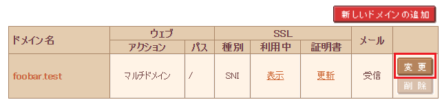

# 임대 서버(호스팅)에서 환경 구축
임대 서버에 Exment를 설치하는 절차입니다. 간단하게 환경을 만들어 운영하고 싶을 때의 선택지입니다.  
Xserver와 사쿠라 인터넷의 절차를 설명합니다.

| 사용하는 서버 | 볼 곳 |
|---|---|
| Xserver | [Xserver의 경우](/ko/install_rental?id=xserver의-경우) |
| 사쿠라 인터넷 | [사쿠라 인터넷의 경우](/ko/install_rental?id=사쿠라-인터넷의-경우) |

어느 쪽이든 큰 흐름은 같습니다.

1. Exment용 MySQL(데이터베이스)을 만든다
2. SSH로 서버에 접속하여 composer를 설치한다
3. 웹에 공개되지 않는 폴더에 Exment를 설치한다
4. Exment의 "public" 폴더만 웹에 공개한다
5. [설치 절차](/ko/quickstart)대로 설정을 마친다

## 임대 서버에서 구축할 때의 주의점
- Exment에는 다음 환경이 필요합니다.
    1. PHP 8.2 이상
    1. MySQL 8.0 이상(권장: 8.4)  
    또는 MariaDB 10.11 이상  
  특히 MySQL 버전은 임대 서버에 따라 조건을 충족하지 않는 경우가 있습니다.  
  사용하는 임대 서버가 조건을 충족하는지 먼저 확인하십시오.

- 임대 서버에는 웹에 공개하는 폴더가 정해져 있습니다(/home/username/www 나 /public_html 등).  
이 폴더 바로 아래에 Exment를 설치한 폴더를 그대로 넣지 마십시오. 데이터베이스 설정값이나 메일 비밀번호 등이 적힌 설정 파일 등이 외부에 공개되어 치명적인 정보 유출로 이어집니다.  
이 페이지의 절차는 공개해야 할 폴더만 웹에 공개하도록 되어 있습니다. 이 절차대로 공개하십시오.

- 임대 서버에서는 SSH로 접속한 뒤 먼저 composer를 설치하고, 그다음에 Exment를 설치합니다.

- 임대 서버의 환경이나 서버 쪽 버전 등에 따라서는 이 페이지의 절차로 정상적으로 설정되지 않는 경우가 있습니다.

- 이 페이지에는 Exment를 임대 서버에서 동작시키기 위한 절차만 적혀 있습니다.  
SSH, 데이터베이스 생성, Linux 명령 등 일반적인 IT 지식은 다루지 않습니다. 양해 바랍니다.

## 임대 서버에 설치하는 절차

### Xserver의 경우
※ X10 플랜에서 동작을 확인했습니다.

<iframe width="560" height="420" src="https://www.youtube.com/embed/RB6i0F2fev0" frameborder="0" allow="accelerometer; autoplay; encrypted-media; gyroscope; picture-in-picture" allowfullscreen></iframe>

**(1) MySQL을 만든다**

미리 Exment용 MySQL을 만들어 둡니다.

**(2) 명령에서 쓰는 PHP를 관리 화면과 같은 버전으로 맞춘다**

Xserver에서는 관리 화면에서 설정하는 PHP와, SSH로 접속하여 명령을 실행할 때의 PHP 버전이 다른 경우가 있습니다.  
그래서 명령에서 쓰는 PHP 버전을 설정합니다.

1. Xserver 관리 화면에서 "PHP Ver.切替"(PHP 버전 전환)를 클릭합니다.  
그런 다음 대상 도메인을 선택합니다.  
  
  

2. "PHPバージョン切替"(PHP 버전 전환)에 현재 버전이 적혀 있으므로 메모합니다.  
  

3. Xserver에 SSH로 접속합니다.

4. 다음 명령으로 Xserver에 들어 있는 PHP를 조사합니다.  
결과 중에서 메모한 버전의 PHP 경로를 복사합니다.

~~~ bash
find /opt/php-*/bin -type f -name 'php'

## /opt/php-8.2.9/bin/php ←이번 예에서는 이것
~~~

5. 폴더를 만들고, PHP로 가는 심볼릭 링크(다른 곳에 있는 파일을 가리키는 지름길 같은 것)를 만듭니다.

~~~
mkdir $HOME/bin
ln -s /opt/php-8.2.9/bin/php $HOME/bin/php
~~~

6. bashrc 파일을 고쳐서 이 PHP에 경로를 지정합니다.

~~~ bash
vi ~/.bashrc

## 아래 내용을 마지막 줄에 적고 ":wq!"로 저장한다
export PATH=$HOME/bin:$PATH

## 수정 내용을 반영한다
source ~/.bashrc
~~~

7. PHP 버전을 확인합니다. 관리 화면에 적힌 버전으로 되어 있으면 완료입니다.

~~~ bash
php --version
~~~

**(3) composer를 설치한다**

~~~ bash
cd ~
curl -sS https://getcomposer.org/installer | php -- --install-dir=$HOME/bin/
## 이름 변경
mv $HOME/bin/composer.phar $HOME/bin/composer
## 확인
composer --version
# Composer version 2.6.5 2023-10-06 10:11:52
~~~

**(4) Exment를 설치한다**

절대로 "$HOME/(도메인 이름)/public_html" 폴더 바로 아래에는 설치하지 마십시오. 데이터베이스 설정값이나 메일 비밀번호 등이 적힌 설정 파일 등이 외부에 공개되어 치명적인 정보 유출로 이어집니다.  
여기서는 "$HOME/(도메인 이름)/laravel" 폴더를 만들고 그 안에 Exment를 설치합니다.

~~~ bash
cd ~/(도메인 이름)
mkdir laravel
cd laravel
wget https://exment.net/downloads/en/exment.zip
unzip exment.zip
rm exment.zip
~~~

**(5) public 폴더만 공개한다**

"$HOME/(도메인 이름)/public_html"을 방금 만든 "$HOME/(도메인 이름)/laravel/exment/public" 폴더로 가는 심볼릭 링크로 만듭니다.  
이렇게 하면 Laravel 본체와 설정값은 웹에 공개되는 폴더 밖에 둔 채로, laravel의 public 폴더만 public_html에 있게 됩니다.

~~~ bash
## 기본 public_html 삭제
rm -r $HOME/(도메인 이름)/public_html
ln -s $HOME/(도메인 이름)/laravel/exment/public $HOME/(도메인 이름)/public_html
~~~

**(6) 설치를 진행한다**

이제 Exment를 열 준비가 되었습니다.  
[설치 절차](/ko/quickstart)대로 설정을 마치십시오.  
※ v7.2.1 이후에는 이 URL로 Exment가 열립니다. `.env`의 `ADMIN_ROUTE_PREFIX`에 "admin"이 있는 사이트(이전 버전에서 설치한 사이트)는 URL 끝에 "/admin"을 붙이십시오.  

#### 명령과 cron에서 쓰는 PHP
Xserver에서는 웹(관리 화면의 "PHP Ver.切替"에서 선택한 PHP)과, SSH나 cron에서 `php`라고 입력했을 때의 PHP가 다릅니다.

- SSH에서 `php`라고 입력하면 `~/bin/php`(위에서 링크한 PHP)가 동작합니다. 링크하지 않았을 때는 서버의 표준 PHP(오래된 버전일 수 있습니다)가 동작합니다.
- cron은 `~/.bashrc`를 읽지 않습니다. `php`만 쓰면 서버의 표준 PHP(8.0 등)가 동작하여 Exment는 동작하지 않습니다.

그러므로 artisan 명령과 cron은 **관리 화면과 같은 버전의 PHP를 전체 경로로** 실행하십시오.

- 예(PHP 8.3일 때): `/usr/bin/php8.3`, 또는 위의 `find`로 찾은 `/opt/php-8.3.x/bin/php`
- 관리 화면에서 PHP 버전을 바꾸면 `~/bin/php` 링크와 cron의 경로도 같은 버전으로 바꿉니다.

[작업 스케줄](/ko/additional_task_schedule)은 Xserver 관리 화면의 "Cron設定"(Cron 설정)에서 다음과 같이 설정합니다(`(서버 ID)`와 `(도메인 이름)`은 자신의 것으로 바꿉니다).

~~~
* * * * * cd /home/(서버 ID)/(도메인 이름)/laravel/exment && nice -n 15 /usr/bin/php8.3 artisan schedule:run >> /dev/null 2>&1
~~~

큐([알림 처리의 지연 실행](/ko/additional_queue))는 임대 서버에서는 항상 동작하는 워커를 둘 수 없습니다. `.env`의 `QUEUE_CONNECTION`은 `sync`(설치했을 때의 값) 그대로 두십시오. `database`로 할 때는 cron으로 매분, 쌓인 작업을 처리합니다.

~~~
* * * * * cd /home/(서버 ID)/(도메인 이름)/laravel/exment && nice -n 15 /usr/bin/php8.3 artisan queue:work --stop-when-empty --max-time=50 >> /dev/null 2>&1
~~~

#### PHP 버전을 올릴 때의 대응
PHP 버전을 바꿀 때는 다음 절차로 진행하십시오.

- 버전을 올리는 작업 중에는 Exment에 접속할 수 없습니다.
- 아래 예는 PHP7.4에서 PHP8.2로 업데이트하는 절차입니다.
- 환경, 도입한 시기, 버전, 설치 방법에 따라 절차가 다른 경우가 있습니다.

1. Xserver 관리 화면에서 "PHP Ver.切替"(PHP 버전 전환)를 클릭합니다.  
그런 다음 대상 도메인을 선택합니다.

2. "PHPバージョン切替"(PHP 버전 전환)에서 새 버전으로 바꾸고 "変更"(변경)을 클릭합니다.  
  

3. Xserver에 SSH로 접속합니다.

4. 다음 명령으로 현재 PHP 버전을 확인합니다.  
(이 시점에서는 오래된 버전이 표시됩니다.)

~~~ 
php --version
~~~

5. PHP로 가는 심볼릭 링크를 해제합니다.

~~~
unlink $HOME/bin/php
~~~

6. "PHPバージョン切替"(PHP 버전 전환)에서 선택한 버전의 경로를 조사합니다.

~~~ bash
find /opt/php-*/bin -type f -name 'php'

## /opt/php-8.2.9/bin/php  ←이번 예에서는 이것
~~~

7. 조사한 경로로 심볼릭 링크를 만듭니다.

~~~
ln -s /opt/php-8.2.9/bin/php $HOME/bin/php
~~~

8. PHP 버전을 확인합니다. 새 버전으로 되어 있으면 성공입니다.

~~~ 
php --version
~~~

### 사쿠라 인터넷의 경우
※ 스탠더드 플랜에서 동작을 확인했습니다.  
※ 사쿠라 인터넷에서는 "composer" 실행이 도중에 끝나 버리는 경우가 있습니다.  
그래서 "nice -n 20 composer"처럼 "nice -n 20"을 붙여서 실행합니다.

**(1) MySQL을 만든다**

미리 Exment용 MySQL을 만들어 둡니다.

**(2) 공개할 폴더를 바꾼다**

1. 사쿠라 인터넷 관리 메뉴의 "ドメイン/SSL設定"(도메인/SSL 설정)에서 바꿀 도메인을 선택합니다.  
  

2. "マルチドメインの対象のフォルダ"(멀티 도메인의 대상 폴더)에서 지정 폴더를 바꿉니다. 여기서는 "/exment"로 합니다.  
  

**(3) SSH로 접속하여 셸과 경로를 설정한다**

1. 사용하는 ID와 비밀번호로 SSH 접속을 합니다.

2. 셸을 바꿉니다.

~~~
which bash
#  /usr/local/bin/bash

chsh -s /usr/local/bin/bash
# Password:  ## 비밀번호를 입력한다
# chsh: user information updated
~~~

3. .bash_profile을 고칩니다.

~~~ bash
vi .bash_profile

## 아래 내용을 적고 ":wq!"로 저장한다
PATH=$PATH:$HOME/bin:$HOME/usr/local/bin
export PATH
~~~

4. 한 번 SSH를 끊고 다시 SSH로 접속합니다.

**(4) composer를 설치한다**

~~~ bash
cd ~
mkdir -p usr/local/bin/
curl -sS https://getcomposer.org/installer | php -- --install-dir=usr/local/bin/
## 이름 변경
mv usr/local/bin/composer.phar usr/local/bin/composer
## 확인
nice -n 20 composer --version
# Composer version 2.6.5 2023-10-06 10:11:52
~~~

**(5) Exment를 설치한다**

절대로 "$HOME/www/" 폴더 바로 아래에는 설치하지 마십시오. 데이터베이스 설정값이나 메일 비밀번호 등이 적힌 설정 파일 등이 외부에 공개되어 치명적인 정보 유출로 이어집니다.  
여기서는 "$HOME/laravel" 폴더를 만들고 그 안에 Exment를 설치합니다.

~~~ bash
cd ~
mkdir laravel
cd laravel
wget https://exment.net/downloads/en/exment.zip
unzip exment.zip
rm exment.zip
~~~

**(6) public 폴더만 공개한다**

"$HOME/www/exment"를 방금 만든 "$HOME/laravel/exment/public" 폴더로 가는 심볼릭 링크로 만듭니다.  
이렇게 하면 Laravel 본체와 설정값은 웹에 공개되는 폴더 밖에 둔 채로, laravel의 public 폴더만 www 폴더 안에 있게 됩니다.

~~~
ln -s $HOME/laravel/exment/public $HOME/www/exment
~~~

**(7) 설치를 진행한다**

이제 Exment를 열 준비가 되었습니다.  
[설치 절차](/ko/quickstart)대로 설정을 마치십시오.  
※ v7.2.1 이후에는 이 URL로 Exment가 열립니다. `.env`의 `ADMIN_ROUTE_PREFIX`에 "admin"이 있는 사이트(이전 버전에서 설치한 사이트)는 URL 끝에 "/admin"을 붙이십시오.  

#### PHP 버전을 올릴 때의 대응
PHP 버전을 바꿀 때는 다음 절차로 진행하십시오.

- 버전을 올리는 작업 중에는 Exment에 접속할 수 없습니다.
- 환경, 도입한 시기, 버전, 설치 방법에 따라 절차가 다른 경우가 있습니다.

1. 사쿠라 인터넷 관리 화면에서 "スクリプト設定"(스크립트 설정) → "言語のバージョン設定"(언어 버전 설정)을 클릭합니다.  
  

2. "PHPのバージョン"(PHP 버전)에서 새 버전으로 바꾸고 "保存"(저장)을 클릭합니다.  
  

3. 사쿠라 인터넷에 SSH로 접속합니다.

4. PHP 버전을 확인합니다. 새 버전으로 되어 있으면 성공입니다.

~~~ bash
php --version
~~~
