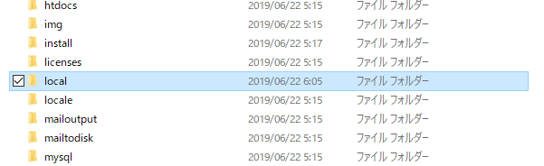
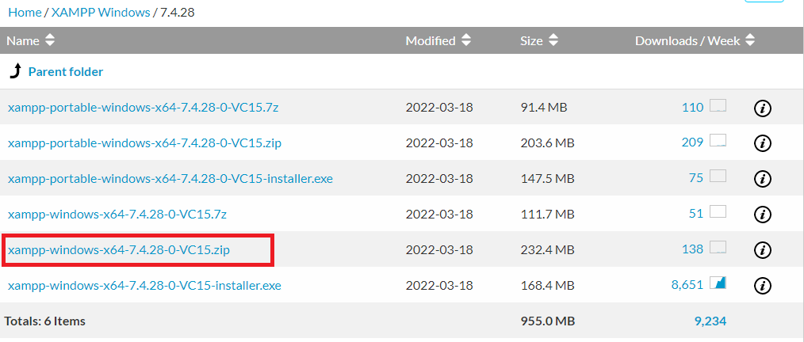

# XAMPP로 환경 구축
XAMPP를 써서 Windows PC에 Exment를 움직이는 환경을 만드는 절차입니다.  
XAMPP는 PHP·Apache·MySQL을 한꺼번에 설치할 수 있는 소프트웨어입니다. 개발용 환경을 처음부터 만들 때 권장합니다.

## 주의점
- **XAMPP로 하는 설치는 개발·검증용으로만 이용하십시오. 운영 환경으로는 이용하지 않기를 권장합니다.** 

## 설치 절차
다음 순서로 진행합니다.

1. XAMPP를 설치하고 Apache와 MySQL을 움직인다
2. mysql 명령을 쓸 수 있게 한다(환경 변수)
3. 데이터베이스를 만든다
4. Exment용 URL을 만든다(서브도메인 설정)
5. Exment를 설치한다

### XAMPP 설치 절차
1. 다음 사이트에서 XAMPP를 다운로드합니다.  
[XAMPP 다운로드](https://www.apachefriends.org/jp/download.html)

2. "PHP8.2" 이상의 것을 골라 다운로드하십시오.  

3. XAMPP의 설치를 진행합니다.  

4. 도중에 XAMPP의 구성 요소를 고르는 화면이 나옵니다. Apache, MySQL을 고릅니다.  
"phpMyAdmin"에도 체크합니다.  
※그 밖의 것은 원하는 대로 체크하십시오  
그 뒤 "Next"를 클릭합니다.  

5. 나머지는 화면대로 진행하여 설치를 마칩니다.

6. 설치가 끝나면 XAMPP 제어판을 시작합니다.  

7. 맨 위의 "Apache"와 "MySQL" 줄의 "Start"를 클릭합니다.  

8. 방화벽의 설정이 나온 경우는 "허용"을 클릭합니다.  

9. 이것으로 Apache가 움직입니다.  

#### 【주의점】
- OS를 다시 시작했을 때는 다시 XAMPP 제어판을 시작하여 Apache를 다시 시작해야 합니다.

### 환경 변수 추가
명령 프롬프트에서 mysql을 실행하려면 "환경 변수"에 경로를 지정해야 합니다.

1. 탐색기에서 "PC"를 오른쪽 클릭하고 "속성"을 클릭합니다.  

2. "고급 시스템 설정"을 클릭합니다.  

3. "환경 변수"를 클릭합니다.  

4. "사용자 변수"의 "Path"를 클릭하고 "편집"을 클릭합니다.  

5. "새로 만들기"를 클릭하고 다음 줄을 추가합니다.

~~~
C:\xampp\mysql\bin  
~~~

6. 입력했으면 열려 있는 대화 상자를 모두 "확인"으로 닫습니다.

##### XAMPP 아래의 Mysql을 실행하는 경우
- XAMPP 안의 Mysql을 실행하는 경우는 [Exment 설치](/ko/install_xampp?id=Exment-설치) 절차 때에, 실행 파일이 있는 폴더까지의 경로를 Exment의 루트 디렉터리에 있는 .env에 추가하십시오.

~~~
#예  
EXMENT_MYSQL_BIN_DIR="C:/xampp/mysql/bin"
~~~

#### 데이터베이스 만들기
1. XAMPP 제어판을 시작하고 "MySQL" 줄의 "Admin"을 클릭합니다.  

2. 왼쪽 메뉴의 "새로 만들기"를 클릭합니다.  

3. "데이터베이스 만들기" 줄에서 원하는 데이터베이스 이름을 영숫자로 입력하고 "만들기"를 클릭합니다.  

이것으로 데이터베이스가 만들어졌습니다.

### 서브도메인 설정
보통의 설정에서는 "C:\xampp\htdocs" 폴더 안에 Exment의 프로젝트 파일을 두면 Exment를 쓸 수 있습니다.  
그러나 그대로 두면, 예를 들어 [http://localhost/exment/.env](http://localhost/exment/.env)의 URL을 열었을 때 데이터베이스의 정보가 들어 있는 설정 파일이 화면에 표시되어 버리는 등 큰 문제가 있습니다.  
그러므로 이 문제가 일어나지 않게 하는 설정을 강하게 권장합니다. 다음 절차로 설정하십시오.

1. 폴더 "C:\xampp"에 폴더 "local"을 만듭니다.  

2. "C:\xampp\apache\conf\extra\httpd-vhosts.conf"를 엽니다.

3. 파일의 맨 끝에 다음 내용을 추가합니다. **※DocumentRoot의 끝에 "/public"이 필요합니다**  

~~~
<VirtualHost *:80>
    DocumentRoot "C:/xampp/htdocs"
    ServerName localhost
</VirtualHost>

<VirtualHost *:80>
  DocumentRoot "C:/xampp/local/exment/public"
  ServerName exment.localapp
</VirtualHost>

<Directory "C:\xampp\local\exment\public">
  Allow from all
  AllowOverride All
  Require all granted
</Directory>
~~~

4. "C:\WINDOWS\system32\drivers\etc\hosts"를 열고 다음과 같이 편집합니다.  
※이 파일은 직접 편집할 수 없습니다. 바탕 화면 등에 복사하여 편집한 뒤, 원래 위치에 덮어쓰십시오.  

~~~
127.0.0.1       localhost
127.0.0.1       exment.localapp
~~~

5. XAMPP 제어판에서 Apache를 다시 시작합니다. "Apache" 줄의 "Stop" 버튼을 클릭한 뒤 다시 "Start"를 클릭하십시오.  

6. 이것으로 다음 URL로 Exment를 열 수 있게 됩니다.  
http://exment.localapp

### Exment 설치
Exment의 [설치 절차](/ko/quickstart)대로 Exment를 설치합니다.  
Exment의 설치는 보통 "C:\xampp\local" 폴더 안에서 합니다.  
여기에서는 "C:\xampp\local\exment" 폴더 안에 설치한 것으로 합니다.  

- 설치 도중에 데이터베이스의 설정을 입력하는 화면이 있습니다. 다음과 같이 입력하십시오.
    - 데이터베이스 유형: MariaDB
    - 호스트 이름: 127.0.0.1
    - 포트: 3306
    - 데이터베이스: (위에서 만든 데이터베이스 이름)
    - 사용자 이름: root
    - 비밀번호: (빈칸)

## PHP 버전 업 시의 대응
PHP의 버전을 바꿀 때는 다음 절차로 하십시오.

- 버전 업 작업 중에는 Exment에 접속할 수 없게 됩니다.
- 아래의 예는 PHP7.4에서 PHP8.2로 업데이트하는 절차입니다. XAMPP 전체는 업데이트하지 않고 PHP만 바꿔 넣는 방법입니다.
- 환경이나 도입한 시기, 버전이나 설치 방법에 따라 절차가 다른 경우가 있습니다.

1. 작업 준비로 Apache와 MySQL을 멈추고 XAMPP 제어판을 종료합니다.

2. 지금 쓰고 있는 XAMPP 안의 PHP 폴더(기본값은 C:\xampp\php)와 Apache 폴더(기본값은 C:\xampp\apache)를 백업합니다. 폴더의 이름을 바꾸거나 다른 곳에 복사하는 등 원하는 방법으로 하면 됩니다.

3. 새 XAMPP를 ZIP 형식으로 다운로드합니다.  

   1. [XAMPP 다운로드](https://www.apachefriends.org/jp/download.html)에 접속합니다
   2. OS나 쓰고 싶은 PHP의 버전에 맞추어 파일을 다운로드합니다.  
      > 그때 installer.exe가 아니라 zip 파일을 고르십시오. (압축을 풀 수 있는 환경이 있으면 7z 파일이어도 됩니다)
      

   3. ZIP 파일의 압축을 풀고, 풀린 폴더 바로 아래에 있는 PHP 폴더와 Apache 폴더를 XAMPP 아래에 복사합니다.  

4. 필요하면 php.ini 파일을 고칩니다.  
※원래의 ini 파일을 바꾸었던 경우는 새 ini 파일에도 같은 변경이 필요합니다. 백업한 php.ini와 새 php.ini를 비교하여 설정값 등을 추가하십시오.  

5. XAMPP 제어판을 시작합니다.

6. Apache의 config 버튼을 누르고 풀다운에서 "Apache(httpd-xampp.conf)"를 고릅니다. 
   

7. httpd-xampp.conf를 편집합니다. 
   1. 먼저 "php7_module"을 모두 "php_module"로 바꾸십시오.
   2. 남은 "php7"을 모두 "php8"로 바꾸십시오.
   

8. Shell 버튼을 눌러 명령 화면을 열고 PHP의 버전이 새로워졌는지 확인합니다.

~~~
php -v
~~~

9. "Apache"와 "MySQL" 줄의 "Start"를 클릭합니다.  

   > "Apache"의 "Start" 때에 오류가 나는 경우가 있습니다.  
   그때는 같은 줄의 오른쪽에 있는 "Logs" → "Apache(error.log)"를 여십시오.  
   로그의 최신 줄에 "PHP Warning: 'vcruntime140.dll'..."이라고 출력되어 있으면 "Visual C++ 재배포 가능 패키지"를 설치해야 합니다.  
   [Microsoft의 다운로드 사이트](https://visualstudio.microsoft.com/downloads/)에 접속하여 맨 아래까지 스크롤 → "Other Tools, Frameworks, and Redistributables"를 엽니다.	  
   "Microsoft Visual C++ Redistributable for Visual Studio 2022"의 다운로드 버튼을 클릭하여 설치 프로그램을 받고 → 실행하십시오.
