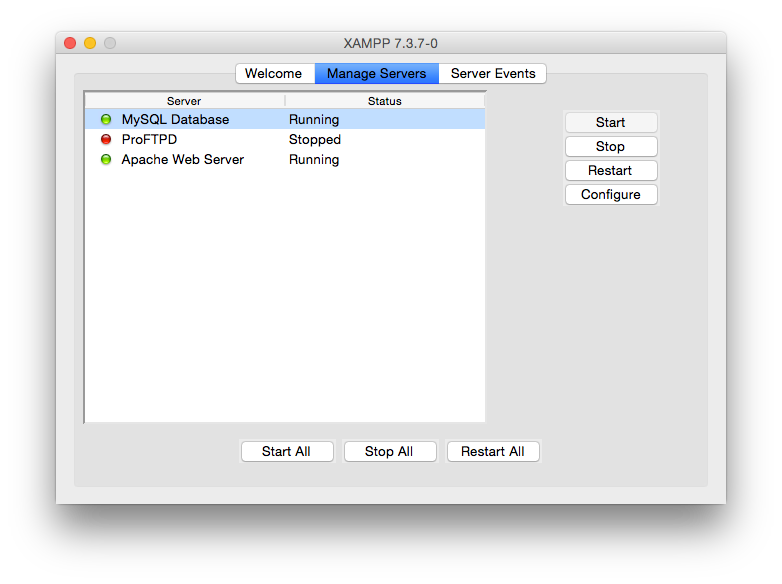

# XAMPP로 환경 구축
XAMPP를 사용하여 Mac에 Exment가 동작하는 환경을 만드는 절차입니다.  
XAMPP는 PHP·Apache·MySQL을 한꺼번에 설치할 수 있는 소프트웨어입니다. 개발용 환경을 처음부터 만들 때 권장합니다.

## 주의점
- **XAMPP를 이용한 설치는 개발·검증용으로만 사용하십시오. 운영 환경으로는 사용하지 않는 것을 권장합니다.** 

## 설치 절차
다음 순서로 진행합니다.

1. XAMPP를 설치하고 Apache와 MySQL을 실행한다
2. mysql 명령을 쓸 수 있게 한다(환경 변수)
3. 데이터베이스를 만든다
4. Exment용 URL을 만든다(서브도메인 설정)
5. Exment를 설치한다

### XAMPP 설치 절차
1. 다음 사이트에서 XAMPP를 내려받습니다.  
[XAMPP 다운로드](https://www.apachefriends.org/jp/download.html)  

2. "OS X용 XAMPP" 중에서 "PHP8.2"인 것을 골라 내려받으십시오.  

3. XAMPP 설치를 진행합니다.  

4. XAMPP의 구성 요소를 선택하는 화면에서는 둘 다 체크하고 Next를 누릅니다.  

5. 나머지는 화면에 따라 Next를 눌러 설치를 마칩니다.

6. 설치가 끝나면 LaunchPad의 XAMPP(기타)에 manager-osx라는 앱이 있습니다. 거기서 XAMPP를 실행할 수 있습니다.  

7. XAMPP를 실행했으면 Manage Servers를 클릭합니다.  

8. MySQL과 Apache의 Start 버튼을 클릭하여 Status를 Running으로 만듭니다.  

#### 주의점
- OS를 다시 시작했을 때는 XAMPP 제어판을 다시 실행하고 Apache를 다시 시작해야 합니다.  

### 환경 변수 추가
터미널에서 mysql을 실행하려면 터미널의 설정 파일 .bash_profile에 Path를 추가로 적습니다.

1. 다음 명령으로 .bash_profile을 엽니다.

~~~
vi .bash_profile
~~~

2. 열린 화면에서 키보드의 i를 눌러 입력 모드(왼쪽 아래에 INSERT라고 표시됩니다)로 만듭니다. 그런 다음 아래와 같이 Path를 입력합니다.

~~~
export PATH="/Applications/XAMPP/xamppfiles/bin:$PATH"
~~~

3. 저장하고 닫기 위해 키보드의 Esc를 누른 뒤 :wq를 입력합니다.  

4. 마지막으로 다음 명령으로 .bash_profile을 읽어 들여 Path를 적용합니다.

~~~
source ~/.bash_profile
~~~

#### 데이터베이스 생성
1. XAMPP 제어판을 실행한 뒤 웹 브라우저에서 다음 URL을 열어 phpMyadmin에 접속합니다.

http://localhost/phpmyadmin/index.php  

2. 왼쪽 메뉴의 "새로 만들기"를 클릭합니다.  

3. "데이터베이스 만들기" 행에서 원하는 데이터베이스 이름을 영문·숫자로 입력하고 "만들기"를 클릭합니다.  

이것으로 데이터베이스가 만들어졌습니다.

### 서브도메인 설정
보통의 설정에서는 "/Applications/XAMPP/htdocs" 폴더 안에 Exment의 프로젝트 파일을 두면 Exment를 사용할 수 있습니다.  
하지만 그대로 두면, 예를 들어 [http://localhost/exment/.env](http://localhost/exment/.env) URL을 열었을 때 데이터베이스 정보가 들어 있는 설정 파일이 화면에 표시되는 등 큰 문제가 있습니다.  
그러므로 이 문제가 생기지 않게 하는 설정을 강력히 권장합니다. 다음 절차로 설정하십시오.

1. 폴더 "/Applications/XAMPP"에 폴더 "local"을 만듭니다.  

2. "/Applications/XAMPP/xamppfiles/etc/extra/httpd-xampp.conf"를 엽니다.

3. 파일 끝에 다음 내용을 추가합니다. **※ DocumentRoot의 끝에 "/public"이 필요합니다**  

~~~
<VirtualHost *:80>
    DocumentRoot "/Applications/XAMPP/xamppfiles/htdocs"
    ServerName localhost
</VirtualHost>

<VirtualHost *:80>
  DocumentRoot "/Applications/XAMPP/local/exment/public"
  ServerName exment.localapp
</VirtualHost>

<Directory "/Applications/XAMPP/local/exment/public">
  Allow from all
  AllowOverride All
  Require all granted
</Directory>  
~~~

4. "/Applications/XAMPP/xamppfiles/etc/httpd.conf"를 열고 문자열 검색으로 다음 내용을 찾습니다.

~~~
User daemon
Group daemon
</IfModule>
~~~

이 내용을 다음과 같이 고칩니다.

~~~
User (Mac의 로그인 사용자 이름)
Group daemon
</IfModule>
~~~

5. "/etc/hosts"를 편집합니다.  
터미널에서 다음 명령을 입력합니다.  
※ 비밀번호를 물어보므로 로그인 사용자의 비밀번호를 입력하십시오

~~~
sudo vi /etc/hosts
~~~

hosts 파일에 다음 항목을 추가하십시오.

~~~
127.0.0.1       localhost
127.0.0.1       exment.localapp
~~~

6. XAMPP 제어판에서 Apache를 다시 시작합니다.  

### Exment 설치
Exment의 [설치 절차](/ko/quickstart)대로 Exment를 설치합니다.  
Exment 설치는 보통 "/Applications/XAMPP/local" 폴더 안에서 진행합니다.  
여기서는 "/Applications/XAMPP/local/exment" 폴더 안에 설치한 것으로 합니다.  

- 설치 도중에 데이터베이스 설정을 입력하는 화면이 있습니다. 다음과 같이 입력하십시오.
    - 데이터베이스 유형: MariaDB
    - 호스트 이름: 127.0.0.1
    - 포트: 3306
    - 데이터베이스: (위에서 만든 데이터베이스 이름)
    - 사용자 이름: root
    - 비밀번호: (빈칸)

