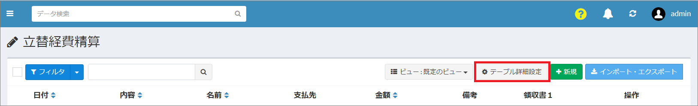

# JAN 바코드 설정
테이블마다 JAN 바코드를 읽어 들였을 때의 동작(어느 폼을 열지, 저장한 다음 어느 화면을 표시할지)을 정하는 화면의 설명입니다.

설정 순서는 다음과 같습니다.

1. JAN 바코드 설정 화면을 엽니다
2. 설정하고 저장합니다
3. "활성화" 버튼을 누릅니다

## JAN 바코드 기능의 개요
JAN 바코드 기능의 개요는 [공식 사이트의 게시글](https://exment.net/release_v6-2-0/)을 참고하십시오.

## 페이지 표시
- 사용자 정의 테이블 목록에서 설정할 테이블에 체크하고, 오른쪽 위의 "테이블 상세 설정"을 클릭합니다.  

> ※ 그 사용자 정의 테이블의 데이터 목록 화면이나 데이터 등록 화면에서 바로 이동할 수도 있습니다. 그 경우에도 오른쪽 위의 "테이블 상세 설정"을 클릭하십시오.  

- 테이블 상세 설정 화면에서 JAN 바코드 설정 아이콘을 클릭하면 JAN 바코드 설정 화면이 표시됩니다.  

## JAN 바코드의 설정 항목

### JAN 바코드 읽기
JAN 바코드를 읽어 들였을 때의 동작을 설정합니다. 

- #### 등록 폼  
JAN 바코드를 읽어 들인 다음에 열 등록 폼을 고릅니다.  
그 테이블에 등록된 사용자 정의 폼 중에서 고를 수 있습니다. 

- #### 데이터 등록 후 액션  
데이터를 등록한 다음에 표시할 화면을 고릅니다.  
TOP 화면, 목록 화면, 상세 화면, 편집 화면, 카메라 실행 화면 중에서 고를 수 있습니다.

- #### 편집 폼
JAN 바코드를 읽어 들인 다음에 열 편집 폼을 고릅니다.  
그 테이블에 등록된 사용자 정의 폼 중에서 고를 수 있습니다.

- #### 데이터 편집 후 액션
데이터를 편집한 다음에 표시할 화면을 고릅니다.  
TOP 화면, 목록 화면, 상세 화면, 편집 화면, 카메라 실행 화면 중에서 고를 수 있습니다.

설정했으면 "저장" 버튼을 클릭합니다.  

### JAN 바코드 설정을 활성화하기  
- 그 테이블에서 JAN 바코드 기능을 쓸 수 있게 하려면 "활성화"해야 합니다. 한 번 저장한 다음, 페이지 오른쪽 위의 "활성화" 버튼을 클릭하십시오.  
- 2차원 바코드와 JAN 바코드는 둘 중 하나만 활성화할 수 있습니다.  
2차원 바코드를 활성화한 동안에는 JAN 바코드 기능의 "활성화" 버튼이 나오지 않아 활성화할 수 없습니다. 마찬가지로 JAN 바코드를 활성화한 동안에는 2차원 바코드를 활성화할 수 없습니다.  

### JAN 바코드 설정을 비활성화하기  
- JAN 바코드로 관리하는 것을 그만둘 때, 또는 다른 테이블에서 JAN 바코드 관리를 하고 싶을 때는 페이지 오른쪽 위의 "비활성화" 버튼을 클릭하십시오.  
- 활성화되어 있던 동안에 연결한 JAN 바코드의 정보는 남습니다. 그래서 JAN 바코드를 읽어 들이면 이 테이블의 데이터가 나옵니다.  

## Exment에서 카메라 화면 실행
- Exment의 대시보드에서 2차원/JAN 바코드를 읽어 들이기 위한 카메라 화면을 실행할 수 있습니다.  

- 대시보드에 아이템 "2차원/JAN 바코드"를 추가하는 절차는 [대시보드](/ko/dashboard)를 참고하십시오.
