# LINE 연동
Exment와 회사의 LINE 공식 계정을 연결하는 기능입니다.  
Exment의 알림을 LINE으로 받을 수 있습니다. LINE에 도착한 알림 카드의 버튼으로 워크플로의 액션(승인 등)도 실행할 수 있습니다.  
이 페이지에서는 연결하기 위한 설정과 알림을 만드는 방법을 설명합니다.

- LINE과 메일로 직원의 안부를 확인하는 기능은 [안부 확인](/ko/safety_check)을 확인해 주십시오.
- LINE 연동은 v7.0.0부터 사용할 수 있습니다.

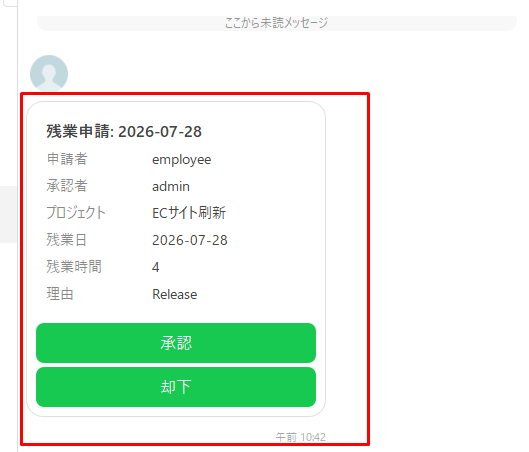

## LINE 연동으로 할 수 있는 것
- **LINE 계정 연동**: 각 사용자가 자신의 LINE 계정과 Exment의 사용자를 연동합니다. LINE으로 알림을 받으려면 이 연동이 필요합니다.
- **LINE 알림**: [알림](/ko/notify)의 실행 액션으로 "LINE"을 선택하면 LINE으로 메시지를 보냅니다. 텍스트 외에 카드 형식(Flex Message)으로 보낼 수도 있습니다.
- **LINE에서 워크플로 실행**: 알림 카드에 "승인", "반려" 등의 액션 버튼을 표시합니다. 버튼을 누르면 LINE에서 그대로 액션을 실행할 수 있습니다.
- **LINE 전송 기록**: LINE 알림이나 안부 확인으로 보낸 메시지를 성공·실패와 관계없이 기록합니다.

## 설정 순서
다음 순서로 설정합니다. 5만은 알림을 받는 각 사용자가 합니다.

| 순서 | 내용 | 작업자 |
| --- | --- | --- |
| 1 | [LINE 공식 계정을 준비한다](/ko/line?id=LINE-공식-계정-준비) | 관리자 |
| 2 | [채널 정보를 Exment의 시스템 설정에 입력한다](/ko/line?id=시스템-설정) | 관리자 |
| 3 | [Webhook URL을 LINE에 등록한다](/ko/line?id=Webhook-설정) | 관리자 |
| 4 | [작업 스케줄을 설정한다](/ko/additional_task_schedule)("시간 경과" 알림을 사용하는 경우) | 서버 관리자 |
| 5 | [LINE 계정을 연동한다](/ko/line?id=LINE-계정-연동) | 각 사용자 |
| 6 | [LINE Flex 템플릿을 만든다](/ko/line?id=LINE-Flex-템플릿)(카드 형식으로 보내는 경우) | 관리자 |
| 7 | [알림을 설정한다](/ko/line?id=LINE-알림-설정) | 관리자 |

## 동작 요건
- Messaging API(프로그램에서 LINE 메시지를 보내고 받는 구조)를 사용하도록 설정한 LINE 공식 계정이 필요합니다. Exment의 메시지는 이 계정에서 보내집니다.
- LINE 서버에서 Exment의 Webhook URL에 접속할 수 있어야 합니다. Exment를 인터넷에서 접속할 수 있고 유효한 SSL 인증서를 설정한 "https://" URL로 공개해 주십시오.
- 실행 트리거 "시간 경과"의 알림을 사용하는 경우에는 [작업 스케줄](/ko/additional_task_schedule) 설정이 필요합니다.

> LINE 공식 계정에는 요금제마다 한 달에 보낼 수 있는 메시지 수의 상한이 있습니다.  
Exment에서 보내는 알림은 받는 사람 1명당 1통으로 셉니다. 사용자의 조작에 대한 답장("LINE 계정 연동이 완료되었습니다!" 등)은 세지 않습니다.  
자세한 내용은 LINE 공식 계정의 요금제를 확인해 주십시오.

## LINE 공식 계정 준비

### Messaging API 사용 설정
1. [LINE Official Account Manager](https://manager.line.biz)에서 LINE 공식 계정을 만듭니다. 기존 계정을 사용할 수도 있습니다.
2. "설정"(Settings) → "Messaging API"에서 Messaging API를 사용하도록 설정합니다. 프로바이더를 선택(또는 생성)하면 LINE 공식 계정에 Messaging API 채널이 만들어집니다.

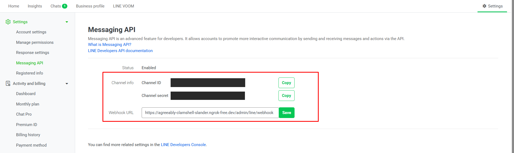

### 채널 정보 확인
Exment에 설정할 아래 3가지 값을 확인하여 적어 둡니다.

| 값 | 확인하는 곳 | 용도 |
| --- | --- | --- |
| 채널 시크릿 | LINE Official Account Manager의 "설정"(Settings) → "Messaging API", 또는 [LINE Developers 콘솔](https://developers.line.biz/console/)의 "채널 기본 설정"(Basic settings) 탭 | LINE에서 오는 데이터(Webhook)의 서명 검증 |
| 채널 액세스 토큰(장기) | LINE Developers 콘솔에서 채널을 선택하고, "Messaging API 설정"(Messaging API) 탭의 "채널 액세스 토큰"(Channel access token)에서 [발행(Issue)]을 클릭 | 메시지 전송 |
| 기본 ID | LINE Official Account Manager의 계정 이름 옆, 또는 LINE Developers 콘솔의 "Messaging API 설정" 탭의 "봇의 기본 ID"(Bot basic ID). "@"로 시작하는 ID입니다 | 계정 연동용 QR 코드 생성 |

※채널 시크릿과 채널 액세스 토큰은 제3자가 알지 못하도록 관리해 주십시오.

### 응답 설정
- LINE Official Account Manager의 "설정"(Settings) → "응답 설정"(Response settings)에서 "Webhook"(Webhooks)을 켭니다.
- 자동 응답 메시지를 설정한 경우에는 중지할 것을 권장합니다. Exment는 사용자가 보낸 텍스트 메시지에 답장합니다. 자동 응답 메시지가 켜진 채로 있으면 Exment의 답장과 별도로 자동 응답 메시지도 보내집니다.

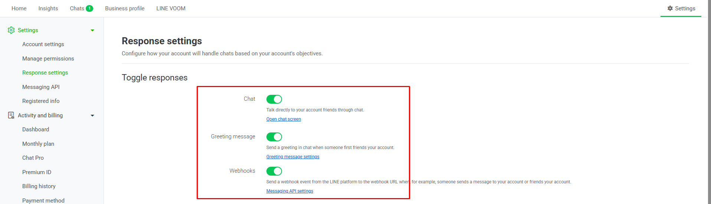

## 시스템 설정
확인한 3가지 값을 Exment에 입력합니다.

**(1) 시스템 설정의 상세 설정 열기**

왼쪽 메뉴의 "관리자 설정" → "시스템 설정"을 클릭하고, 오른쪽 위 버튼에서 [상세 설정]으로 전환합니다.  
아래 URL로도 표시할 수 있습니다.

~~~
http(s)://(Exment의 URL)/system?advanced=1
~~~

> ※URL은 "/admin"이 붙지 않는 표준 설정(v7.2.1 이상에서 새로 설치한 사이트)의 경우입니다. `.env` 의 `ADMIN_ROUTE_PREFIX` 에 값이 있는 경우(이전 버전에서 설치한 사이트는 "admin")에는 사이트 URL 뒤에 그 값을 붙여 주십시오(예: `http(s)://(Exment의 URL)/admin/system?advanced=1`). 자세한 내용은 [URL에 포함된 "admin"의 변경·삭제](/ko/additional_prefix)를 참조하십시오.

**(2) "LINE 설정"에 입력하기**

"LINE 설정"에 아래 항목을 입력하고 [저장]을 클릭합니다.

| 항목 | 내용 |
| --- | --- |
| 채널 액세스 토큰 | LINE Developers 콘솔에서 발행한 채널 액세스 토큰(장기)을 입력합니다. |
| 채널 시크릿 | 채널 시크릿을 입력합니다. |
| LINE 공식 계정 Basic ID | 기본 ID를 "@"부터 입력합니다. |
| Webhook URL | LINE에 등록할 Webhook URL이 표시됩니다. 입력은 할 수 없습니다. |

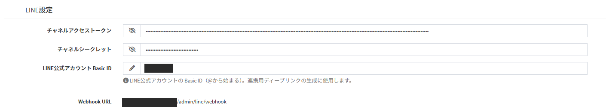

- 채널 액세스 토큰과 채널 시크릿은 저장한 뒤에는 가려진 글자로 표시됩니다.
- 이 값들은 ".env" 파일에서도 설정할 수 있습니다. 양쪽에 다 있는 경우에는 시스템 설정 화면에서 저장한 값이 우선합니다. 자세한 내용은 [설정값](/ko/line?id=설정값)을 확인해 주십시오.

## Webhook 설정
Webhook은 LINE에서 일어난 일을 LINE이 Exment에 알려 주는 구조입니다. 사용자가 연동 코드를 보내거나 알림 카드의 버튼을 눌렀을 때 그 내용이 Exment로 보내집니다.

1. LINE Developers 콘솔에서 채널을 선택하고 "Messaging API 설정"(Messaging API) 탭을 엽니다.
2. "Webhook URL"의 [편집(Edit)]을 클릭하고, 시스템 설정의 "LINE 설정"에 표시된 Webhook URL을 붙여 넣은 뒤 [업데이트(Update)]를 클릭합니다.
3. "Webhook 사용"(Use webhook)을 켭니다.
4. [검증(Verify)]을 클릭하고 "성공"(Success)이라고 표시되는지 확인합니다.

Webhook URL은 아래 형식입니다.

~~~
https://(Exment의 URL)/line/webhook
~~~

- Webhook URL은 LINE Official Account Manager의 "설정"(Settings) → "Messaging API"에서도 설정할 수 있습니다.
- Webhook URL에는 "https://"로 시작하고 유효한 SSL 인증서를 설정한 URL만 등록할 수 있습니다.
- Exment의 [IP 필터 설정](/ko/additional_ip_filter)은 Webhook URL에는 적용되지 않습니다. 방화벽 등으로 접속을 제한하고 있는 경우에는 LINE 서버에서 접속할 수 있도록 설정해 주십시오.

## LINE 계정 연동
LINE으로 알림을 받는 사용자는 각자 자신의 LINE 계정과 Exment의 사용자를 연동합니다.  
**LINE 계정을 연동하지 않은 사용자에게는 LINE 알림이 보내지지 않습니다.** LINE 알림을 사용하기 전에 사용자에게 연동을 부탁해 주십시오.

### 연동하기
**(1) "LINE 연동" 화면 열기**

Exment에 로그인하고, 오른쪽 위의 사용자 메뉴(자신의 이름)를 열어 [LINE 연동]을 클릭합니다.

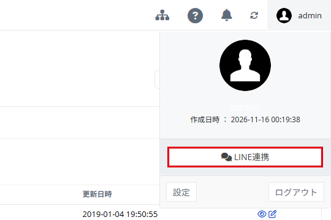

아래 URL로도 표시할 수 있습니다.

~~~
http(s)://(Exment의 URL)/line/link
~~~

- v7.1.0 이상에서는 "LINE 연동"이 왼쪽 메뉴가 아니라 오른쪽 위의 사용자 메뉴에 표시됩니다. 표시되는 것은 [시스템 설정](/ko/line?id=시스템-설정)에서 LINE 공식 계정의 기본 ID를 설정했을 때뿐입니다.
- v7.0에서는 왼쪽 메뉴 맨 위의 "LINE 연동"에서 엽니다(v7.1.0으로 업데이트하면 맨 위에 있는 이 메뉴는 삭제됩니다. 직접 옮긴 메뉴는 그대로 남습니다).

**(2) QR 코드 표시하기**

[QR 코드 생성]을 클릭합니다. 연동용 QR 코드가 표시됩니다.

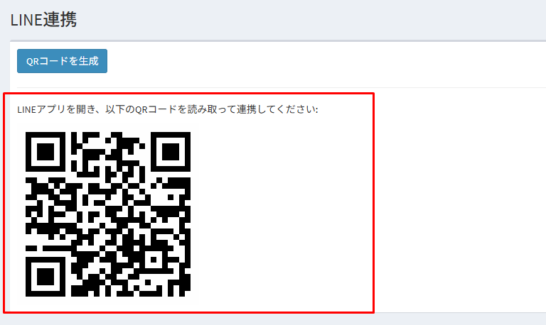

**(3) LINE 앱으로 읽어서 보내기**

- 스마트폰의 LINE 앱으로 QR 코드를 읽습니다.  
LINE 공식 계정과의 대화 화면이 열리고, "LINK (연동 코드)"가 입력된 상태가 됩니다.  
※LINE 공식 계정을 친구로 추가하지 않은 경우에는 화면의 안내에 따라 친구로 추가해 주십시오.

- 그대로 메시지를 보냅니다. "LINE 계정 연동이 완료되었습니다!"라고 답장이 오면 연동은 완료입니다.

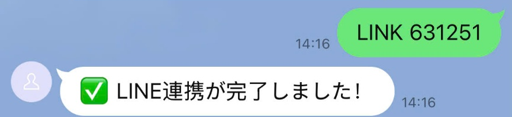

**(4) 연동되었는지 확인하기**

"LINE 연동" 화면을 다시 열면 "LINE 계정 연동됨"이라고 표시됩니다.

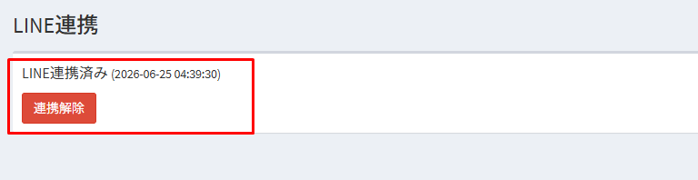

**잘 연동되지 않을 때**

- **연동 코드의 기한**: 연동 코드의 유효 기간은 초기 설정으로 10분입니다. 기한이 지난 경우에는 다시 [QR 코드 생성]을 클릭해 주십시오.
- **LINE 계정 하나는 사용자 1명과만 연동할 수 있습니다**. 이미 연동된 LINE 계정에서 연동 코드를 보내면 "이 LINE 계정은 이미 다른 계정과 연동되어 있습니다. 변경하려면 먼저 웹에서 연동을 해제해 주십시오."라고 답장이 옵니다. 다만 연동된 사용자가 삭제된 경우에는 이전의 연동이 자동으로 해제되어 다른 사용자와 연동할 수 있습니다.
- **잘못된 코드의 횟수**: 잘못된 연동 코드를 보낼 수 있는 것은 초기 설정으로 5회까지입니다. 처음 잘못된 코드를 보낸 뒤 10분(초기 설정) 안에 5회 틀리면, 그 10분이 지날 때까지 연동할 수 없습니다. 이 동안에는 올바른 연동 코드를 보내도 "연동 코드가 올바르지 않거나 만료되었습니다. 확인 후 다시 시도해 주십시오."라고 답장이 옵니다.

### 연동 해제하기
"LINE 연동" 화면에서 [연동 해제]를 클릭합니다.  
스마트폰이나 LINE 계정을 바꾼 경우에는 연동을 해제한 뒤 다시 연동해 주십시오.

## LINE Flex 템플릿
LINE 알림을 카드 형식(Flex Message)으로 보낼 때 카드의 내용을 정하는 템플릿입니다.  
알림 설정에서 템플릿을 선택하지 않으면 텍스트 메시지가 보내집니다(템플릿은 필요 없습니다).

### 템플릿 만들기
**(1) 목록 화면 열기**

아래 URL에 접속하여 "LINE Flexテンプレート"(LINE Flex 템플릿)의 데이터 목록 화면을 엽니다.  
왼쪽 메뉴에 추가하는 경우에는 [메뉴](/ko/menu)에서 메뉴 종류 "테이블"을 선택하여 추가해 주십시오.

~~~
http(s)://(Exment의 URL)/data/line_flex_template
~~~

**(2) 템플릿 만들기**

[새로 만들기]를 클릭하고, 아래 항목을 입력하여 저장합니다.

| 항목 | 내용 |
| --- | --- |
| Flexキー (Flex 키) | 템플릿을 식별하기 위한 키입니다(예: ot_request). "safety_check"는 [안부 확인](/ko/safety_check)에서 사용하므로 사용하지 마십시오. |
| テンプレート名 (템플릿 이름) | 템플릿의 이름입니다. 알림 설정의 "LINE Flex 템플릿" 선택 항목에 표시됩니다. |
| タイトル (제목) | 카드의 머리글입니다. 변수를 사용할 수 있습니다. 비어 있는 경우에는 데이터의 표제를 표시합니다. |
| 本文項目 (본문 항목) | 카드의 본문에 표시할 항목입니다. 한 줄에 한 항목을 "표시 이름 = 값" 형식으로 입력합니다. |
| 説明 (설명) | 템플릿의 설명입니다. LINE에는 표시되지 않습니다. |

- 새로 만들 때 "タイトル"(제목)과 "本文項目"(본문 항목)에는 워크플로 실행 알림용 초깃값(상태, 액션 이름 등)이 입력되어 있습니다. 데이터의 생성·업데이트 알림 등에 사용하는 경우에는 내용을 바꿔 주십시오.
- "安否確認"(안부 확인) 템플릿(Flex 키 "safety_check")은 [안부 확인](/ko/safety_check)을 설치할 때 자동으로 만들어집니다. 알림 설정의 "LINE Flex 템플릿"에서는 선택하지 마십시오. 또한 편집·삭제하지 마십시오.

### 본문 항목 쓰는 법
한 줄에 한 항목을 씁니다. "="의 왼쪽에 표시 이름, 오른쪽에 값을 입력합니다. 값에는 변수를 사용할 수 있습니다.  
아래는 초과 근무 신청 카드의 예입니다.

~~~
신청자 = ${created_user}
승인자 = ${value:approver}
프로젝트 = ${value:project}
초과 근무일 = ${value:ot_date}
초과 근무 시간 = ${value:ot_hours}
이유 = ${value:reason}
~~~

- 값이 비게 되는 줄은 카드에 표시되지 않습니다.
- "本文項目"(본문 항목)이 비어 있는 경우, 워크플로 실행 알림에서는 상태·액션 이름 등의 표준 항목을 표시합니다.

### 사용할 수 있는 변수
[매개변수 변수](/ko/params)를 사용할 수 있습니다. 주요 변수는 아래와 같습니다.

| 변수 | 내용 |
| --- | --- |
| ${value} | 데이터의 표제 |
| ${value:(열 이름)} | 데이터의 열 값(예: ${value:approver}) |
| ${created_user} | 데이터를 만든 사용자 이름 |
| ${table_view_name} | 테이블 표시 이름 |
| ${workflow:status_name} | 액션 실행 후의 상태 이름 ※1 |
| ${workflow:status_from_name} | 액션 실행 전의 상태 이름 ※1 |
| ${workflow:action_name} | 실행된 액션 이름 ※1 |
| ${workflow:action_user} | 액션을 실행한 사용자 ※1 |
| ${workflow:comment} | 액션을 실행할 때 입력한 코멘트 ※1 |
| ${notify_target_column_key} | "대상 날짜 열"의 열 이름 ※2 |
| ${notify_target_column_value} | "대상 날짜 열"의 값 ※2 |

※1 실행 트리거 "워크플로"의 알림에서만 사용할 수 있습니다.  
※2 실행 트리거 "시간 경과"의 알림에서만 사용할 수 있습니다.

### 카드의 버튼
카드의 버튼은 템플릿에 설정하지 않아도 자동으로 추가됩니다.

| 버튼 | 표시되는 조건 |
| --- | --- |
| 워크플로의 액션("승인", "반려" 등) | 아래 조건을 모두 만족하는 경우에 표시됩니다. ·데이터에 워크플로가 설정되어 있고, 받는 사람이 실행할 수 있는 액션이 있다 ·받는 사람이 그 액션을 아직 실행하지 않았다 ·액션의 "코멘트"가 "필수"가 아니다 ·액션 실행 후에 다음 작업 사용자를 선택할 필요가 없다(다음 상태에, 실행 가능 사용자가 "이전 액션의 실행 사용자가 선택"인 액션이 없다)※"다음 상태로 진행하는 조건"이 "1명 이상 실행"인 액션만 판정합니다. 그 밖의 액션은 [워크플로 설정](/ko/line?id=워크플로-설정)을 확인해 주십시오. |
| 상세 보기 | Exment의 URL이 "https://"인 경우에 표시됩니다. 누르면 데이터의 상세 화면을 엽니다. |

자세한 내용은 [LINE에서 워크플로의 액션 실행하기](/ko/line?id=LINE에서-워크플로의-액션-실행하기)를 확인해 주십시오.

## LINE 알림 설정
[알림](/ko/notify) 설정 화면의 "알림 액션 설정"에서 아래 항목을 설정합니다.  
알림 설정 화면을 여는 방법은 [알림](/ko/notify)을 확인해 주십시오.

| 항목 | 내용 |
| --- | --- |
| 실행 액션 | "LINE"을 선택합니다. |
| 알림 대상 | 알림을 보낼 사용자를 선택합니다(필수). "사용자" 열("사용자 정의 열: (열 이름)"으로 표시됩니다), "지정한 사용자", "지정한 조직", "작성자" 등을 선택할 수 있습니다. |
| LINE Flex 템플릿 | 카드 형식으로 보내는 경우에 [LINE Flex 템플릿](/ko/line?id=LINE-Flex-템플릿)을 선택합니다. 비어 있는 경우에는 텍스트로 보냅니다. |

- 텍스트로 보내는 경우, 메시지는 "알림 템플릿"의 제목과 본문으로 만들어집니다.
- "지정한 조직"을 선택한 경우에는 조직에 속한 모든 사용자에게 보내집니다.
- 알림 대상 중 LINE 계정을 연동하지 않은 사용자에게는 보내지지 않습니다. 이 경우 오류가 되지 않으며, [LINE 전송 기록](/ko/line?id=LINE-전송-기록)에도 기록되지 않습니다.
- LINE 알림은 데이터 저장 등의 처리가 끝난 직후에 보내집니다. [알림 처리의 지연 실행](/ko/additional_queue)(큐)은 사용하지 않습니다.
- 전송에 실패해도 자동으로 다시 보내지 않습니다. 전송 결과는 [LINE 전송 기록](/ko/line?id=LINE-전송-기록)에서 확인할 수 있습니다.

### 예 1: 데이터를 만들거나 업데이트할 때 알리기
- 실행 트리거: "데이터 생성/업데이트"
- 알림 조건 설정: "작성", "업데이트"에 체크
- 실행 액션: "LINE"
- 알림 대상: "사용자 정의 열: 담당자"
- LINE Flex 템플릿: 만든 템플릿

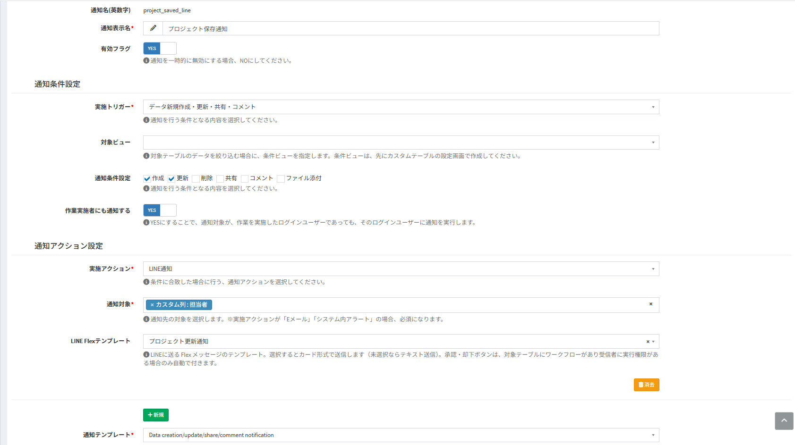

데이터가 저장되면 LINE에 아래와 같은 카드가 도착합니다.

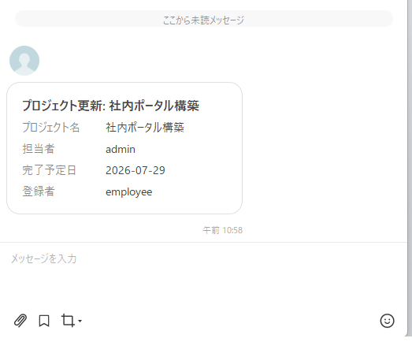

※초기 설정에서는 데이터를 저장한 사용자 자신에게는 알리지 않습니다. 자신에게도 알리는 경우에는 "작업 실행자에게도 알림"을 YES로 해 주십시오.

### 예 2: 조직의 구성원에게 알리기
"알림 대상"에서 "지정한 조직"을 선택하고, "수신 조직"에서 조직을 선택합니다.  
조직에 속한 사용자 중 LINE 계정을 연동한 사용자에게 보내집니다.

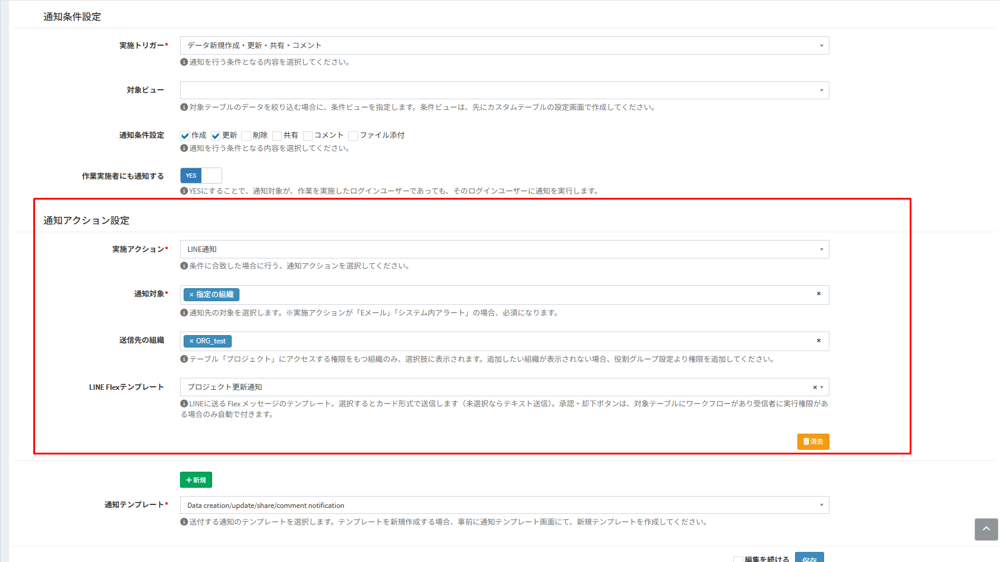

※선택 항목에는 그 테이블에 대한 접근 권한이 있는 조직만 표시됩니다.

### 예 3: 기한 전날에 리마인드하기
- 실행 트리거: "시간 경과"
- 대상 날짜 열: 기준으로 할 날짜의 열(예: 완료 예정일)
- 알림일: "1"
- 알림 전후: "전"
- 알림 시간: 알림을 보낼 시각(0~23)
- 실행 액션: "LINE"

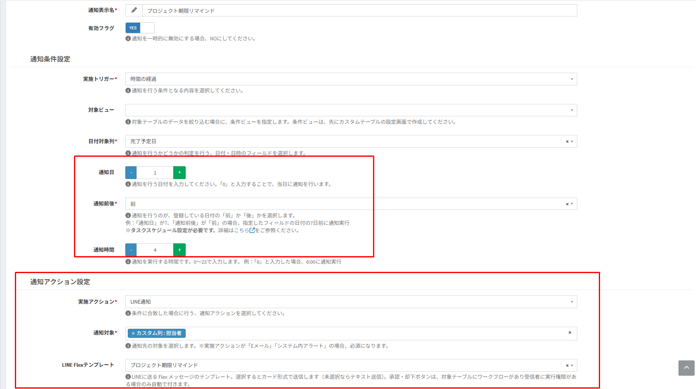

지정한 시각에 아래와 같은 카드가 도착합니다.

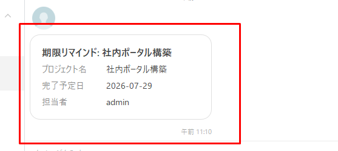

- "시간 경과" 알림을 실행하려면 [작업 스케줄](/ko/additional_task_schedule) 설정이 필요합니다. 알림은 "알림 시간"에 지정한 시각의 00분에 실행됩니다.
- 설정을 확인하기 위해 바로 실행하고 싶은 경우에는 아래 명령을 실행해 주십시오. "알림 시간"의 설정과 관계없이 알림이 실행됩니다.

~~~
php artisan exment:notify --name=(알림 이름(영숫자))
~~~

- 명령을 반복해서 실행한 경우 등에 같은 리마인드가 중복해서 보내지지 않게 하려면 설정값 "LINE_DEDUPE_MINUTES"를 설정해 주십시오. 자세한 내용은 [설정값](/ko/line?id=설정값)을 확인해 주십시오.

## LINE에서 워크플로의 액션 실행하기
LINE에 도착한 알림 카드의 버튼으로 워크플로의 액션을 실행할 수 있습니다.  
여기서는 승인자가 초과 근무 신청을 LINE으로 승인하는 예로 설명합니다. 워크플로의 설정 방법은 [워크플로 설정](/ko/workflow_setting)을 확인해 주십시오.

할 일은 다음 3가지입니다.

1. 워크플로의 액션을 LINE에서 실행할 수 있는 설정으로 한다([워크플로 설정](/ko/line?id=워크플로-설정))
2. 승인자에게 LINE 알림을 보내는 설정을 한다(아래의 "알림 설정")
3. 도착한 카드의 버튼을 누른다(아래의 "LINE에서 승인하기")

### 워크플로 설정
워크플로 설정의 "액션 설정"에서, LINE에서 실행할 액션을 아래와 같이 설정합니다.

- 실행 가능 사용자: 액션을 실행할 사용자(예: "사전에 설정"으로, 테이블의 "승인자" 열)
- 코멘트: "선택" 또는 "사용 안 함"

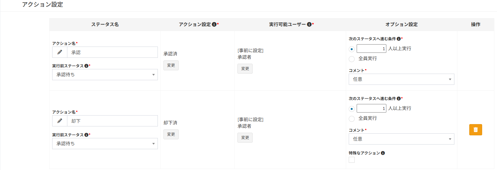

**LINE에서 실행할 수 없는 액션**

다음 액션은 Exment의 화면에서 실행해 주십시오.

- **"코멘트"가 "필수"인 액션**: LINE의 카드에 버튼이 표시되지 않습니다. 코멘트를 입력해야 하기 때문입니다.
- **실행 후에 다음 작업 사용자를 선택해야 하는 액션**(다음 상태에, 실행 가능 사용자가 "이전 액션의 실행 사용자가 선택"인 액션이 있는 경우): "다음 상태로 진행하는 조건"에 따라 다음과 같이 됩니다.

| "다음 상태로 진행하는 조건" | LINE의 카드 |
| --- | --- |
| "1명 이상 실행" | 버튼이 표시되지 않습니다. |
| 2명 이상, 또는 "전원 실행" | 버튼이 표시됩니다. 상태가 진행되지 않는 실행(예: 3명이 승인하는 경우의 1번째·2번째 사람)은 LINE에서 실행할 수 있습니다. 상태가 진행되는 실행(예: 3번째 사람)에서 버튼을 누른 경우에는 액션이 실행되지 않고, "이 액션은 다음 작업 사용자를 선택해야 합니다. 웹에서 처리해 주십시오."라고 답장이 옵니다. |

### 알림 설정
승인자에게 LINE 알림을 보내는 알림 설정을 합니다. **"LINE Flex 템플릿"은 반드시 선택해 주십시오**. 텍스트로 보낸 경우에는 버튼이 표시되지 않습니다.

- **데이터를 만들 때 알리는 경우**: 테이블의 알림 설정에서 실행 트리거 "데이터 생성/업데이트", 알림 조건 설정 "작성", 알림 대상 "사용자 정의 열: 승인자", 실행 액션 "LINE"을 설정합니다.
- **액션을 실행할 때 다음 작업 사용자에게 알리는 경우**: 워크플로의 알림 설정에서 실행 액션 "LINE", 알림 대상 "다음 작업 사용자"를 설정합니다.

### LINE에서 승인하기
**(1)** 신청자가 승인자를 선택하여 초과 근무 신청 데이터를 만듭니다.

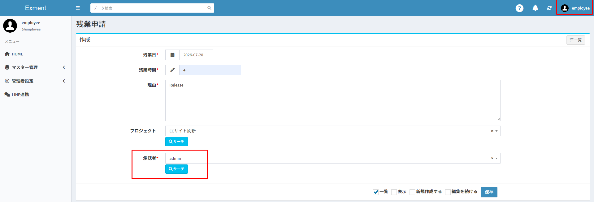

**(2)** 승인자의 LINE에 "승인", "반려" 버튼이 붙은 카드가 도착합니다.  
버튼을 누르면 액션이 실행되고, "처리했습니다: 승인"이라고 답장이 옵니다.

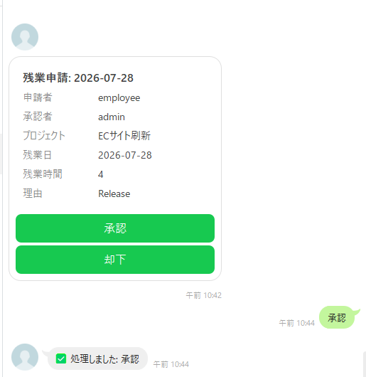

**(3)** Exment의 데이터 상태가 업데이트됩니다.

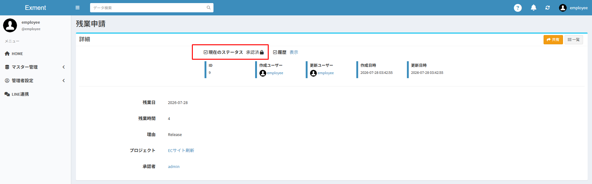

액션은 LINE 계정을 연동한 사용자로서 실행됩니다. 버튼을 누른 시점에 그 사용자가 액션을 실행할 수 있는지를 다시 확인합니다.

실행할 수 없었을 때는 다음과 같이 답장이 옵니다.

| 답장 | 이유 |
| --- | --- |
| "이 액션은 사용할 수 없거나 이미 처리되었습니다." | 다른 사용자가 이미 처리한 경우나 같은 액션을 이미 실행한 경우 등, 액션을 실행할 수 없는 경우입니다. |
| "이 액션은 다음 작업 사용자를 선택해야 합니다. 웹에서 처리해 주십시오." | 다음 작업 사용자의 선택이 필요한 경우입니다. Exment의 화면에서 실행해 주십시오. |
| "이 액션은 코멘트 입력이 필요합니다. 웹에서 처리해 주십시오." | 카드를 보낸 뒤에 액션의 "코멘트"를 "필수"로 바꾼 경우입니다. |
| "로그인이 활성화되지 않은 계정입니다." | 로그인 사용자로 설정되지 않은 사용자는 LINE에서 액션을 실행할 수 없습니다. |

## LINE 전송 기록
LINE 알림이나 [안부 확인](/ko/safety_check)으로 보낸 메시지는 성공·실패와 관계없이 "LINE送信履歴"(LINE 전송 기록) 테이블에 기록됩니다.  
사용자의 조작에 대한 답장("LINE 계정 연동이 완료되었습니다!", "처리했습니다: 승인" 등)은 기록되지 않습니다.  
아래 URL에 접속하면 목록을 표시할 수 있습니다.

~~~
http(s)://(Exment의 URL)/data/line_send_log
~~~

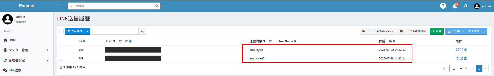

| 열 | 내용 |
| --- | --- |
| LINEユーザーID (LINE 사용자 ID) | 받는 쪽의 LINE 사용자 ID입니다. |
| メッセージ種別 (메시지 종류) | "text"(텍스트) 또는 "flex"(카드)입니다. |
| 送信Flexテンプレート (전송 Flex 템플릿) | 카드를 보내는 데 사용한 LINE Flex 템플릿입니다. |
| 件名 (제목) | 메시지의 제목입니다. 카드의 경우에는 타이틀입니다. |
| 本文 (본문) | LINE으로 보낸 메시지의 데이터(JSON 형식)입니다. 카드의 경우에는 Flex Message의 내용이 모두 기록됩니다. |
| 送信対象ユーザー (전송 대상 사용자) | 받는 쪽의 Exment 사용자입니다. |
| 送信日時 (전송 일시) | 메시지를 보낸 일시입니다. |
| 送信結果 (전송 결과) | "success"(성공) 또는 "failed"(실패)입니다. |
| エラー内容 (오류 내용) | 전송에 실패한 경우의 이유입니다(예: "HTTP 400 …"). |

- LINE 계정을 연동하지 않은 사용자에게는 보내지 않으므로 기록도 남지 않습니다. 알림이 도착하지 않는 경우에는 먼저 LINE 계정의 연동을 확인해 주십시오.
- 목록에 표시할 열은 [사용자 정의 뷰](/ko/view)에서 바꿀 수 있습니다.

## 설정값
".env" 파일에서 아래 설정을 바꿀 수 있습니다. 자세한 내용은 [설정값 목록](/ko/config)을 확인해 주십시오.

| 설정 키 | 기본값 | 내용 |
| --- | --- | --- |
| LINE_CHANNEL_ACCESS_TOKEN | (없음) | 채널 액세스 토큰입니다. 시스템 설정 화면에서 저장한 값이 우선합니다. |
| LINE_CHANNEL_SECRET | (없음) | 채널 시크릿입니다. 시스템 설정 화면에서 저장한 값이 우선합니다. |
| LINE_OA_BASIC_ID | (없음) | 기본 ID입니다. 시스템 설정 화면에서 저장한 값이 우선합니다. |
| LINE_DEDUPE_MINUTES | 0 | "시간 경과"의 LINE 알림에서, 같은 사용자에게 같은 데이터에 대한 LINE 메시지를 보낸 뒤 이 시간(분) 동안은 다시 보내지 않습니다. 다른 알림 설정으로 보낸 메시지나 전송에 실패한 메시지도 대상입니다. 0인 경우 이 기능은 꺼져 있습니다. |
| LINE_LINK_CODE_TTL_MINUTES | 10 | 연동 코드의 유효 기간(분)입니다. |
| LINE_LINK_MAX_ATTEMPTS | 5 | 잘못된 연동 코드를 보낼 수 있는 횟수입니다. 이 횟수를 넘으면 일정 시간 동안 연동할 수 없게 됩니다. |
| LINE_LINK_ATTEMPT_DECAY_MINUTES | 10 | 잘못된 연동 코드의 전송 횟수를 세는 시간(분)입니다. 처음 잘못된 코드를 보낸 뒤 이 시간 안에 "LINE_LINK_MAX_ATTEMPTS"의 횟수만큼 틀리면, 이 시간이 지날 때까지 연동할 수 없습니다. |
| LINE_HTTP_TIMEOUT | 10 | LINE 서버와 통신할 때의 타임아웃 시간(초)입니다. |
| LINE_API_BASE | https://api.line.me | LINE Messaging API의 URL입니다. 보통은 바꾸지 마십시오. |

※"LINE_DEDUPE_MINUTES"에 의해 보내지 않은 알림은 LINE 전송 기록에는 기록되지 않습니다. "storage/logs/laravel.log"에 "LINE reminder skipped by dedupe"라고 기록됩니다.

## 잘 동작하지 않는 경우
| 현상 | 주요 원인 | 대처 |
| --- | --- | --- |
| Webhook의 [검증(Verify)]이 성공하지 않는다 | ·Webhook URL이 "https://"가 아니거나, SSL 인증서가 유효하지 않다 ·인터넷에서 Exment에 접속할 수 없다 ·채널 시크릿이 올바르지 않다 | Webhook URL과 서버의 공개 설정, 시스템 설정의 "채널 시크릿"을 확인해 주십시오. |
| 연동 코드를 보내도 답장이 오지 않는다 | ·"Webhook 사용"(Use webhook)이 꺼져 있다 ·Webhook URL이 올바르지 않다 | [Webhook 설정](/ko/line?id=Webhook-설정)을 확인해 주십시오. |
| [QR 코드 생성]을 클릭하면 "LINE 공식 계정의 기본 ID가 설정되어 있지 않습니다. "설정: 시스템"의 "시스템 설정"에서 설정해 주십시오."라고 표시된다 | 기본 ID가 설정되어 있지 않다 | 시스템 설정의 "LINE 공식 계정 Basic ID"를 입력해 주십시오. |
| "연동 코드가 올바르지 않거나 만료되었습니다. 확인 후 다시 시도해 주십시오."라고 답장이 온다 | ·연동 코드의 유효 기간이 지났거나, 코드가 틀렸다 ·잘못된 연동 코드를 계속 보내서 일시적으로 연동할 수 없게 되었다 | [QR 코드 생성]을 클릭하고 새 QR 코드를 읽어 주십시오. 일시적으로 연동할 수 없게 된 경우에는 시간(초기 설정으로 10분)을 두고 나서 보내 주십시오. |
| "이 LINE 계정은 이미 다른 계정과 연동되어 있습니다. 변경하려면 먼저 웹에서 연동을 해제해 주십시오."라고 답장이 온다 | 그 LINE 계정은 이미 Exment의 사용자와 연동되어 있다 | 연동된 사용자로 Exment에 로그인하고, "LINE 연동" 화면에서 [연동 해제]를 클릭한 뒤 다시 연동해 주십시오. |
| "계정을 연동하려면 "LINK &lt;code&gt;" 형식으로 보내 주십시오."라고 답장이 온다 | LINE 계정을 연동하지 않은 사용자가 연동 코드가 아닌 메시지를 보냈다 | [LINE 계정 연동](/ko/line?id=LINE-계정-연동)의 순서로 QR 코드를 읽어서 연동해 주십시오. |
| "잘못된 명령입니다."라고 답장이 온다 | LINE 계정을 연동한 사용자가 연동 코드가 아닌 메시지를 보냈다 | 이상이 아닙니다. Exment는 연동 코드가 아닌 메시지에는 응답하지 않습니다. 안부 확인의 추가 응답에 대해서는 [안부 확인](/ko/safety_check)을 확인해 주십시오. |
| LINE 알림이 도착하지 않고, LINE 전송 기록에도 기록이 없다 | 알림 대상 사용자가 LINE 계정을 연동하지 않았다 | 사용자에게 [LINE 계정 연동](/ko/line?id=LINE-계정-연동)을 부탁해 주십시오. |
| LINE 전송 기록의 전송 결과가 "failed"가 된다 | ·채널 액세스 토큰이 올바르지 않거나 유효하지 않다 ·사용자가 LINE 공식 계정을 차단하고 있다 ·한 달의 전송 수 상한에 이르렀다 | "エラー内容"(오류 내용)을 확인해 주십시오. 채널 액세스 토큰을 다시 발행한 경우에는 시스템 설정에 다시 입력해 주십시오. |
| 카드에 "승인", "반려" 버튼이 표시되지 않는다 | ·액션의 "코멘트"가 "필수" ·"다음 상태로 진행하는 조건"이 "1명 이상 실행"인 액션에서, 실행 후에 다음 작업 사용자의 선택이 필요하다(다음 상태에 "이전 액션의 실행 사용자가 선택"인 액션이 있다) ·받는 사람이 그 액션을 실행할 수 없거나 이미 실행했다 ·데이터가 이미 처리되었다 ·LINE Flex 템플릿을 선택하지 않았다 | [LINE에서 워크플로의 액션 실행하기](/ko/line?id=LINE에서-워크플로의-액션-실행하기)를 확인해 주십시오. |
| "시간 경과"의 LINE 알림이 보내지지 않는다 | ·작업 스케줄이 동작하지 않고 있다 ·"알림 시간"이 서버의 시각과 맞지 않는다 ·"LINE_DEDUPE_MINUTES"에 의해 보내지지 않았다 | [작업 스케줄](/ko/additional_task_schedule)을 확인해 주십시오. "php artisan exment:notify"로 알림을 실행하여 확인할 수도 있습니다. |
| "상세 보기" 버튼이 표시되지 않는다 | Exment의 URL이 "https://"가 아니다 | Exment를 "https://" URL로 운용해 주십시오. |
