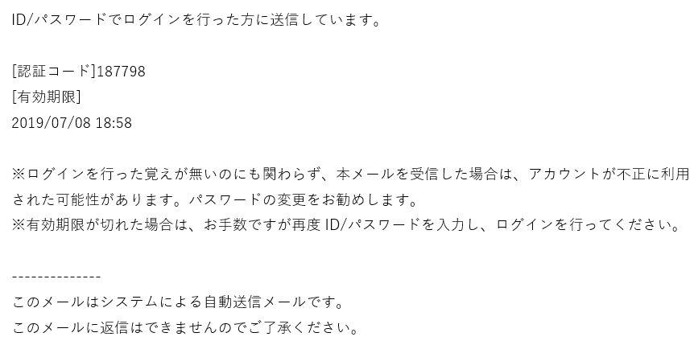
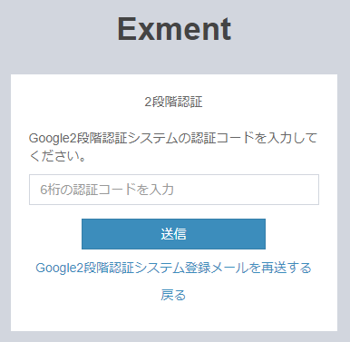
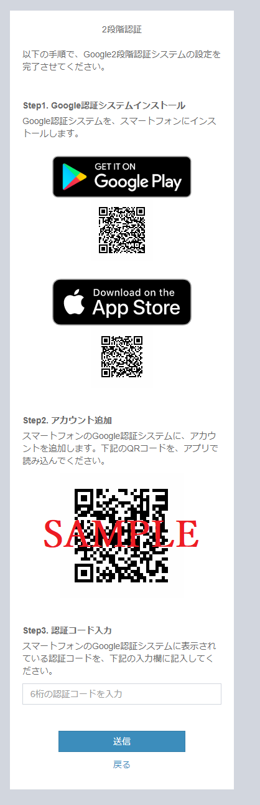

# 로그인(2단계 인증)
2단계 인증을 써서 Exment에 로그인하는 방법입니다.  
2단계 인증을 쓸 수 있게 하는 설정은 관리자가 합니다([2단계 인증 시스템 설정](/ko/login_2factor_setting)).

## 2단계 인증의 방식
지금 쓸 수 있는 2단계 인증의 방식은 다음 2가지입니다.  
어느 방식을 쓰고 있는지는 관리자에게 문의하십시오.

##### 이메일
ID/비밀번호로 로그인한 뒤, 등록한 메일 주소로 인증 코드의 메일이 옵니다.  
그 인증 코드를 화면에 입력하면 로그인이 끝납니다.

##### Google 인증 시스템
ID/비밀번호로 로그인한 뒤, Google 인증 시스템을 써서 2단계 인증을 합니다.

### 2단계 인증 절차(이메일)

- 로그인 화면에서 ID/비밀번호를 입력하고 [로그인] 버튼을 누릅니다.
  

- 2단계 인증 화면으로 바뀌고 인증 코드의 입력 칸이 나옵니다.
  

- 로그인한 사용자의 메일 주소로 인증 코드가 오니 확인합니다.
  

### 2단계 인증 절차(Google 인증 시스템)

- 로그인 화면에서 ID/비밀번호를 입력하고 [로그인] 버튼을 누릅니다.
  

- 2단계 인증 화면으로 바뀌고 인증 코드의 입력 칸이 나옵니다.
  

- 처음 로그인할 때는 먼저 Google 인증 시스템의 설정이 필요합니다.  
[제출] 버튼을 누르면 등록한 메일 주소로 Google 인증 시스템의 등록을 위한 메일을 보냅니다.
  

- 로그인한 사용자의 메일 주소로 Google 인증 시스템의 등록용 URL이 오니 누릅니다.  
  

- URL을 누르면 2단계 인증 시스템을 설치하는 화면으로 바뀝니다. step1~3을 하십시오.  
인증 코드를 올바르게 입력하고 전송하면 2단계 인증에서의 로그인이 끝납니다.

  

> 2단계 인증에서 인증 코드의 입력을 일정 횟수 이상 틀리면, 인증을 한 통신에서의 로그인이 차단됩니다. 주의하십시오.
