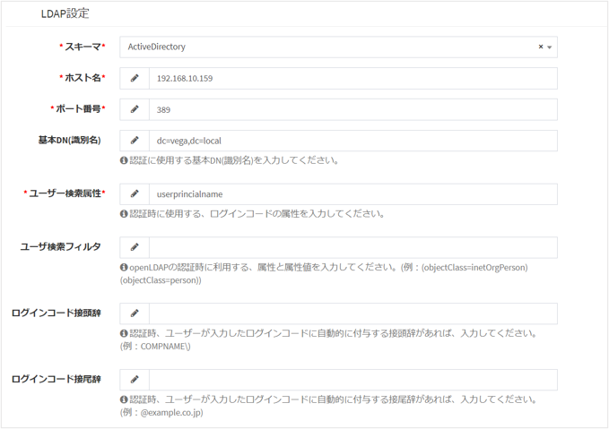

# 싱글 사인온(LDAP)
LDAP를 사용한 싱글 사인온(SSO)의 설정 방법입니다.  
Exment에서는 [로그인 설정](/ko/login_setting)에서 싱글 사인온을 추가할 수 있습니다. 추가하면 Exment 전용 로그인 비밀번호를 관리하지 않아도 공급자(여기서는 LDAP 서버)의 ID와 비밀번호로 로그인할 수 있습니다.

설정은 다음 2가지를 순서대로 진행합니다.

1. **서버 준비**(PHP 확장 기능과 라이브러리를 설치한다) … "서버·공급자 설정"
2. **화면에서 설정**(로그인 설정 화면에서 공급자를 추가한다) … "화면에서 설정"

#### 주의점
- **이 매뉴얼은 LDAP를 잘 아는 분을 위한 절차입니다. 각 공급자의 설정 방법 등은 각 자료를 참조하십시오.**


## 서버·공급자 설정
로그인 설정 화면에서 공급자를 추가하기 전에, 서버에서 명령을 실행하여 확장 기능을 설치해야 합니다.

### Windows의 경우

1. php.ini 파일을 엽니다.  
※ php.ini 파일의 위치는 서버의 설치 방식에 따라 다릅니다.

2. 다음 내용을 추가합니다.

```
extension=ldap
```

3. PHP를 다시 시작합니다.

4. 다음 명령을 실행합니다.

```
composer require directorytree/ldaprecord
```
※ Exment v7.0.0 이후에서 사용하는 라이브러리입니다. Exment v6.x 이전을 사용하는 경우에는 대신 "composer require adldap2/adldap2-laravel"을 실행하십시오.  


### Linux(CentOS)의 경우

> 패키지를 추가해야 하므로 임대 서버 등에서는 도입할 수 없는 경우가 있습니다.

1. 다음 명령을 실행하여 패키지를 설치합니다.  
※ 먼저 [Linux로 환경 구축](/ko/install_linux) 등에서 진행하는 epel 업데이트와 rpm 설치를 마치십시오.

```
sudo dnf install php-ldap
```

2. php.ini 파일을 엽니다.  
※ php.ini 파일의 위치는 서버의 설치 방식에 따라 다릅니다.

3. 다음 내용을 추가합니다.

```
extension=ldap.so
```


4. 다음 명령을 실행합니다.

```
composer require directorytree/ldaprecord
sudo service httpd restart
```
※ Exment v7.0.0 이후에서 사용하는 라이브러리입니다. Exment v6.x 이전을 사용하는 경우에는 대신 "composer require adldap2/adldap2-laravel"을 실행하십시오.  


## 화면에서 설정
서버 설정이 끝나면 [로그인 설정 화면](/ko/login_setting)에서 공급자를 추가합니다.

1. 관리자 계정으로 시스템 설정 화면을 엽니다.  
페이지 오른쪽 위의 "로그인 설정" 버튼으로 로그인 설정 화면을 엽니다.  
  

2. 신규 버튼을 눌러 로그인 설정을 만듭니다. 입력하는 항목은 아래와 같습니다.

- **LDAP 이름(영숫자)** : 다른 것과 겹치지 않도록 영숫자로 입력하십시오.

### LDAP 설정
LDAP의 설정을 입력하십시오.  
(Active Directory의 경우)
  

(openLDAP의 경우)
  

### 매핑 설정
공급자가 돌려주는 필드 이름과 Exment의 "사용자" 테이블의 필드 이름을 대응시켜야 합니다.  

  

공급자가 돌려주는 필드 이름을 입력하십시오.

  

적는 방법은 3가지입니다.

| 적는 방법 | 사용할 때 | 예 |
|---|---|---|
| 필드 이름을 그대로 적는다 | 필드 1개를 그대로 쓴다 | |
| 쉼표로 구분하여 여러 개 적는다 | 후보가 몇 개 있고, 값이 있는 것을 앞에서부터 차례로 쓴다 | seimei,username |
| ${필드 이름} 형식으로 여러 개 적는다 | 여러 필드를 조합하여 쓴다 | ${last_name} ${first_name} |

#### 필드 이름을 그대로 적기
공급자가 돌려주는 필드 이름을 그대로 적습니다.
  

#### 필드 이름을 쉼표로 구분하여 여러 개 적기
쓰고 싶은 필드의 후보가 몇 개 있을 때는 공급자가 돌려주는 필드 이름을 쉼표로 구분하여 적습니다.  
쉼표로 구분한 맨 앞부터 차례로 값을 찾고, 값이 있으면 그 값을 사용합니다.  
(예: 가능하면 성명 필드 "seimei"를 사용하고 싶지만 공급자 쪽에서 필수 항목이 아니므로, "seimei"에 값이 있으면 그 값을, 없으면 "username"을 사용자 이름으로 사용한다 → seimei,username 이라고 적는다)
  

#### 필드 이름을 ${필드 이름} 형식으로 여러 개 적기
공급자가 돌려주는 사용자 정보를 여러 개 조합하여 Exment의 사용자 정보로 쓰고 싶을 때의 방법입니다. ${필드 이름} 형식으로 필드를 여러 개 적으십시오.  
(예: "성명" 필드는 공급자에 없지만 "성(last_name)"과 "이름(first_name)" 필드가 각각 있으므로 "성 이름"으로 조합하여 사용한다 → ${last_name} ${first_name} 이라고 적는다)
  


### 사용자 설정
로그인한 사용자를 어떻게 다룰지 설정합니다.

  

#### 계정 검색 열
SSO로 가져온 계정의 어느 열을 사용하여 Exment 계정을 찾을지 설정합니다.

#### 사용자 새로 만들기
- YES인 경우: 로그인한 사용자가 Exment에 없을 때, 로그인 정보를 사용하여 Exment 사용자를 새로 만듭니다.
- NO인 경우: 먼저 Exment에 사용자를 만들어 두어야 합니다. 로그인한 사용자가 Exment에 없을 때는 오류가 표시됩니다.

#### 역할 그룹 설정
YES인 경우, Exment 사용자를 새로 만들 때 역할 그룹에 연결할 수 있습니다.  

#### 사용자 정보 업데이트
YES인 경우, 다시 로그인했을 때 사용자 이름 등의 사용자 정보를 업데이트합니다.


- 데이터를 1번 이상 저장하면 "활성화" 버튼과 "로그인 테스트" 버튼이 표시됩니다.

- 사용 여부를 YES로 하면 로그인 화면에 SSO 인증용 버튼이 표시됩니다.  

(Active Directory의 경우)

  

(openLDAP의 경우)

  


### 로그인 버튼 설정
로그인 화면에 표시하는 로그인 버튼을 설정합니다.  

  


### 활성화와 로그인 테스트
- 데이터를 1번 이상 저장하면 "활성화" 버튼과 "로그인 테스트" 버튼이 표시됩니다.

  

#### 활성화
- 활성화를 실행하면 로그인 화면에 SSO 인증용 버튼이 표시됩니다.  
※ 보통의 "로그인" 버튼을 표시하고 싶지 않은 경우에는 [로그인 설정](/ko/login_setting)에서 "기본 로그인 표시"를 "NO"로 하십시오.  
  


#### 로그인 테스트
- "로그인 테스트" 버튼을 클릭하면 설정한 로그인 정보로 로그인을 테스트할 수 있습니다. 로그인 설정을 활성화하지 않았어도 테스트할 수 있습니다.  

  


- "로그인" 버튼을 클릭하면 설정이 올바른지 테스트할 수 있습니다.  
결과는 "실행 결과" 항목에 표시됩니다.

  

  
  
[←로그인 설정으로 돌아가기](/ko/login_setting)
