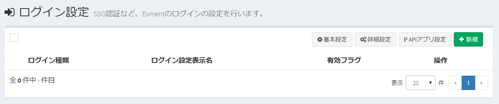
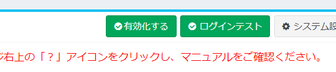
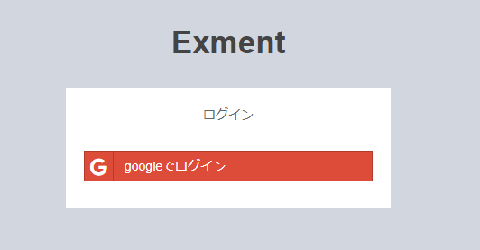
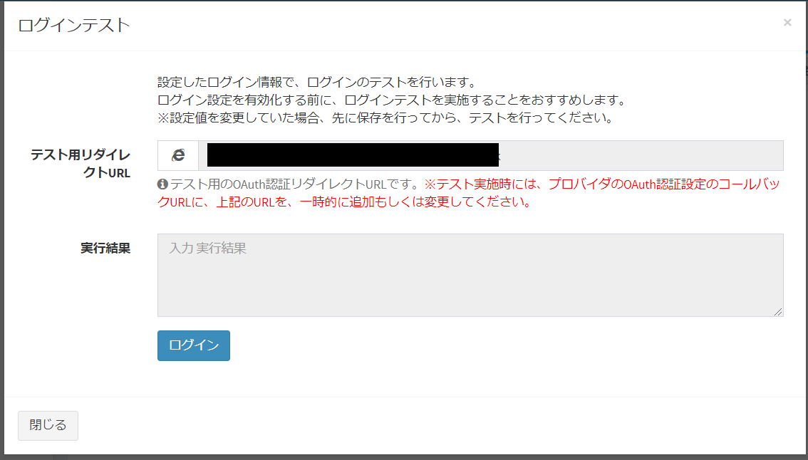

# 싱글 사인온(SAML)
SAML을 쓴 싱글 사인온(SSO)의 설정 방법입니다.  
Exment에서는 [로그인 설정](/ko/login_setting)에서 싱글 사인온을 추가할 수 있습니다. 추가하면 Exment 전용 로그인 비밀번호를 관리하지 않아도 공급자(로그인을 맡는 서비스)의 ID와 비밀번호로 로그인할 수 있습니다.

설정은 다음 2가지 순서로 합니다.

1. **서버와 공급자의 준비**(라이브러리를 설치하고 공급자 쪽에 애플리케이션을 만든다) … "서버·공급자 설정"
2. **화면에서 설정**(로그인 설정 화면에서 공급자를 추가한다) … "화면에서 설정"

#### 주의점
- **이 매뉴얼은 SAML에 익숙한 분을 위한 절차입니다. 각 공급자의 설정 방법 등은 각각의 자료를 참조하십시오.**
- 이 매뉴얼이나 Exment의 페이지에서는 "SAML"이라고 적고 있지만 실제로는 SAML2를 쓰고 있습니다.

## 서버·공급자 설정
로그인 설정 화면에서 공급자를 추가하기 전에, 서버에서 명령을 실행하여 확장 기능을 설치해야 합니다.

1. 다음 명령을 Exment의 루트 디렉터리에서 실행합니다.

~~~
composer require aacotroneo/laravel-saml2
~~~

2. 각 SAML 공급자에서 Exment용 애플리케이션을 만듭니다.  
※callback URL은 다음과 같습니다.  
http(s)://(Exment의 URL)/saml/login/(나중에 추가할 SAML 이름)/acs  

> ※URL은 "/admin"이 붙지 않는 표준 설정(v7.2.1 이후에 새로 설치한 사이트)의 경우입니다. `.env`의 `ADMIN_ROUTE_PREFIX`에 값이 있는 경우(이전 버전에서 설치한 사이트는 "admin")는 사이트의 URL 뒤에 그 값을 더하십시오(예: `http(s)://(Exment의 URL)/admin/saml/login/(나중에 추가할 SAML 이름)/acs`). 자세한 내용은 [URL에 포함된 "admin"의 변경·삭제](/ko/additional_prefix)를 보십시오.

3. [화면에서 설정](/ko/login_saml?id=화면에서-설정)을 합니다.

## 화면에서 설정
서버의 설정이 끝나면 [로그인 설정 화면](/ko/login_setting)에서 공급자를 추가합니다.

1. 관리자 계정으로 시스템 설정 화면을 엽니다.  
페이지 오른쪽 위의 "로그인 설정" 버튼에서 로그인 설정 화면을 엽니다.  
  

2. 새로 만들기 버튼을 눌러 로그인 설정을 만듭니다. 입력할 항목은 아래와 같습니다.

- **SAML 이름(영숫자)** : 콜백 URL 등에서 쓰는 공급자 이름입니다. 다른 것과 겹치지 않도록 영숫자로 입력하십시오.

  

### IdP 설정
IdP의 설정을 입력하십시오.
  

### SP 설정
SP의 설정을 입력하십시오.
  

### 옵션 설정
옵션의 설정을 입력하십시오.
  

### 매핑 설정
공급자가 돌려주는 필드 이름과 Exment의 "사용자" 테이블의 필드 이름을 대응시켜야 합니다.  

  

공급자가 돌려주는 필드 이름을 입력하십시오.

  

적는 방법은 3가지가 있습니다.

| 적는 방법 | 쓸 때 | 예 |
|---|---|---|
| 필드 이름을 그대로 적는다 | 1개의 필드를 그대로 쓴다 | |
| 쉼표로 구분하여 여러 개 적는다 | 후보가 몇 개 있고, 값이 있는 것을 앞에서부터 차례로 쓴다 | seimei,username |
| ${필드 이름} 형태로 여러 개 적는다 | 여러 필드를 조합하여 쓴다 | ${last_name} ${first_name} |

#### 필드 이름을 그대로 적기
공급자가 돌려주는 필드 이름을 그대로 적습니다.
  

#### 필드 이름을 쉼표로 구분하여 여러 개 적기
쓰고 싶은 필드의 후보가 몇 개 있을 때는 공급자가 돌려주는 필드 이름을 쉼표로 구분하여 적습니다.  
쉼표로 구분한 맨 앞부터 차례로 값을 찾고, 값이 있으면 그 값을 씁니다.  
(예: 될 수 있으면 성명 필드 "seimei"를 쓰고 싶지만 공급자 쪽에서 필수 항목이 아니므로, "seimei"에 값이 있으면 그 값을, 없으면 "username"을 사용자 이름으로 쓴다 → seimei,username이라고 적는다)
  

#### 필드 이름을 ${필드 이름} 형식으로 여러 개 적기
공급자가 돌려주는 사용자 정보를 여러 개 조합하여 Exment의 사용자 정보로 쓰고 싶을 때의 적는 방법입니다. ${필드 이름} 형태로 필드를 여러 개 적으십시오.  
(예: "성명" 필드는 공급자에 없지만 "성(last_name)", "이름(first_name)" 필드가 각각 있으므로 "성 이름"으로 조합하여 쓴다 → ${last_name} ${first_name}이라고 적는다)
  

### 사용자 설정
로그인한 사용자를 어떻게 다룰지 설정합니다.

  

#### 계정 검색 열
SSO로 가져온 계정의 어느 열을 써서 Exment의 계정을 찾을지 설정합니다.

#### 사용자 새로 만들기
- YES의 경우: 로그인한 사용자가 Exment에 없었을 때, 로그인 정보를 써서 Exment의 사용자를 새로 만듭니다.
- NO의 경우: 먼저 Exment에 사용자를 만들어 두어야 합니다. 로그인한 사용자가 Exment에 없었을 때는 오류가 표시됩니다.

#### 역할 그룹 설정
YES의 경우, Exment의 사용자를 새로 만들 때 역할 그룹에 연결할 수 있습니다.  

#### 사용자 정보 업데이트
YES의 경우, 다시 로그인했을 때 사용자 이름 등의 사용자 정보를 업데이트합니다.

- 데이터를 1번 이상 저장하면 "활성화" 버튼과 "로그인 테스트" 버튼이 표시됩니다.

- 사용 여부를 YES로 하면 로그인 화면에 SSO 인증용 버튼이 표시됩니다.  
※보통은 사용자 ID와 비밀번호를 입력하는 기본 로그인 폼도 함께 표시됩니다. [SSO 설정](/ko/system_setting)에서 그림처럼 표시하지 않게 할 수도 있습니다.  

### 로그인 버튼 설정
로그인 화면에 표시할 로그인 버튼을 설정합니다.  

  

### 활성화와 로그인 테스트
- 데이터를 1번 이상 저장하면 "활성화" 버튼과 "로그인 테스트" 버튼이 표시됩니다.

  

#### 활성화
- 활성화를 실행하면 로그인 화면에 SSO 인증용 버튼이 표시됩니다.  
  

#### 로그인 테스트
- "로그인 테스트" 버튼을 클릭하면 설정한 로그인 정보로 로그인을 테스트할 수 있습니다. 로그인 설정을 활성화하지 않았어도 테스트할 수 있습니다.  
**그때는 "테스트용 리디렉션 URL"에 표시된 URL을 공급자의 SAML 인증 설정의 콜백 URL에 일시적으로 추가하거나 변경하십시오.**

  

- "로그인" 버튼을 클릭하면 설정이 올바른지 테스트할 수 있습니다.  
결과는 "실행 결과" 항목에 표시됩니다.

  

  
  
  
[←로그인 설정으로 돌아가기](/ko/login_setting)
