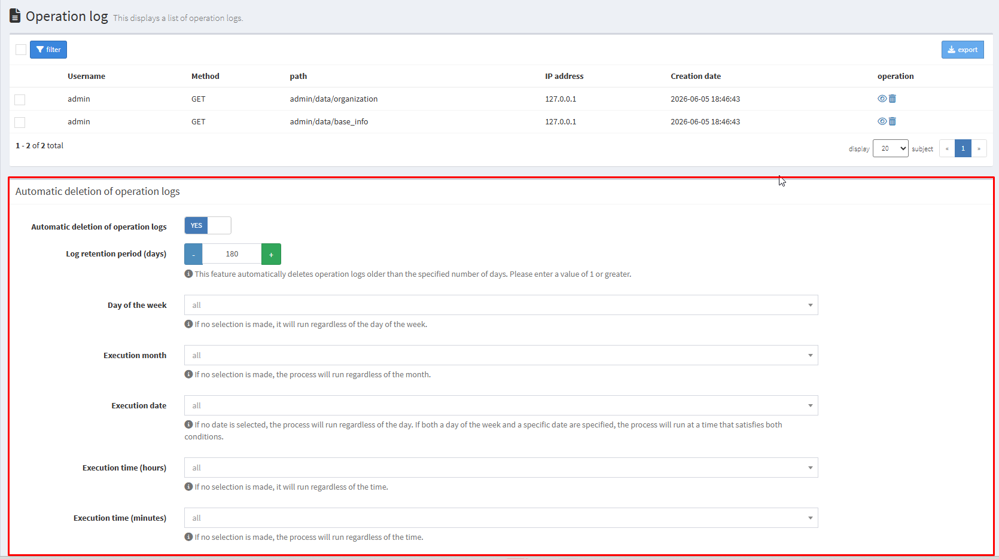

# 로그
Exment가 남기는 기록(로그)을 보는 방법과 설정하는 방법입니다.  
"누가, 언제, 무엇을 했는지"를 조사하고 싶을 때는 작업 로그를, 오류의 원인을 조사하고 싶을 때는 로그 파일을 봅니다.

## 로그 종류
Exment의 로그는 2종류가 있습니다.

| 종류 | 내용 | 보는 곳 |
| --- | --- | --- |
| **작업 로그** | 각 사용자가 화면에서 조작한 내용입니다. | Exment의 화면(시스템 관리자) |
| **로그 파일 출력** | 주로 오류가 발생했을 때의 기록입니다. | 서버의 파일 |


## 작업 로그
각 사용자가 화면에서 조작한 내용을 Exment의 화면에 목록으로 표시합니다.  
기록하는 것은 주로 다음 조작입니다.

- 화면 표시, 데이터의 새로 추가·업데이트·삭제 등
- API의 인증, 실행


### 확인 방법
작업 로그 화면은 시스템 관리자가 엽니다. 여는 방법은 2가지입니다.

- 아래 URL을 입력합니다.  
http(s)://(Exment의 URL)/auth/logs    

> ※URL은 "/admin"이 붙지 않는 표준 설정(v7.2.1 이상에서 새로 설치한 사이트)의 경우입니다. `.env` 의 `ADMIN_ROUTE_PREFIX` 에 값이 있는 경우(이전 버전에서 설치한 사이트는 "admin")에는 사이트 URL 뒤에 그 값을 붙여 주십시오(예: `http(s)://(Exment의 URL)/admin/auth/logs`). 자세한 내용은 [URL에 포함된 "admin"의 변경·삭제](/ko/additional_prefix)를 참조하십시오.

- 또는 메뉴에 "작업 로그"를 추가하여 거기에서 엽니다.  
"작업 로그"는 기본 설정에서는 메뉴에 표시되지 않습니다. 추가하려면 "관리자 설정" > "메뉴" 페이지를 열고, 메뉴 종류 "시스템 메뉴"를 선택합니다. 대상에 "작업 로그"가 표시되므로 선택하여 저장해 주십시오.

작업 로그의 목록 화면이 표시됩니다.

  

행을 클릭하면 그 조작의 상세가 표시됩니다.  

  

### 각 항목에 대하여

- ##### 사용자 이름  
조작한 사용자입니다. ※로그인하지 않은 상태에서의 조작은 빈칸이 됩니다.

- ##### 메서드
HTTP 요청의 메서드 종류입니다.

- ##### 경로
HTTP 요청의 대상 URI입니다.  
※GET 메서드의 쿼리 문자열(URL의 "?" 뒤)은 이 항목에는 나오지 않습니다. "입력/쿼리"에 나옵니다.

- ##### IP 주소
조작한 단말의 IP 주소입니다.

- ##### 입력/쿼리
HTTP 요청의 쿼리 문자열 또는 POST 값입니다.  

- ##### 작성 일시
조작한 일시입니다.


### 기타
- "입력/쿼리" 중 아래 항목의 값은 기밀 정보이므로, 문자열 "***"로 바꾸어(마스킹하여) 저장합니다.
    - password
    - password_confirmation
    - current_password
    - _token
    - verify_code
    - access_token
    - refresh_token
    - system_line_channel_token
    - system_line_channel_secret

※위 항목은 아래 "기밀 정보의 마스킹"에 있는 `config/exment.php` 의 설정과 관계없이 항상 마스킹됩니다.  
※"system_line_channel_token", "system_line_channel_secret"은 v7.0.0 이상에서 마스킹됩니다.


### 기밀 정보의 마스킹
※이 설정은 Exment v7.0.0 이상에서 사용할 수 있습니다. v6.x에서는 위 "기타"에 적은 항목(LINE의 2개 항목 제외)만 마스킹됩니다.

작업 로그에는 사용자가 입력한 값, API에서 보낸 값, URL의 경로에 포함된 값이 기록될 수 있습니다.

인증 정보 등의 기밀 정보가 그대로 저장되지 않도록, Exment는 작업 로그를 기록할 때 설정한 항목과 URL 경로의 값을 마스킹합니다("***"로 바꿉니다).

마스킹 설정은 아래 파일의 `operation_log` 섹션에서 바꿀 수 있습니다.

`config/exment.php`

아래는 `config/exment.php` 에 적혀 있는 `operation_log` 의 기본값입니다. (주석은 일부 생략했습니다)

```php
'operation_log' => [
    // 모든 화면에서 마스킹하는 항목 이름
    'mask_columns' => [
        // SSO (OAuth / SAML)
        'oauth_client_id',
        'oauth_client_secret',
        'saml_sp_privatekey',
        // 시스템 설정 (reCAPTCHA의 시크릿 키, SMTP의 비밀번호)
        'recaptcha_secret_key',
        'system_mail_password',
        // Meilisearch의 API 키
        'meili_key',
        // LINE Messaging API의 채널 정보
        'system_line_channel_token',
        'system_line_channel_secret',
        // 플러그인의 데이터베이스 접속 비밀번호
        'custom_password',
        // 플러그인(CRUD 페이지)의 인증 정보
        'crud_auth_key',
        'crud_auth_password',
    ],

    // 특정 화면·API에서만 마스킹하는 항목 이름
    'mask_columns_by_uri' => [
        // API 설정 화면
        'api_setting*' => ['id', 'secret', 'client_api_key'],
        // OAuth의 토큰 취득 API
        'oauth/*' => ['client_id', 'api_key', 'client_secret'],
        // 비밀번호 재설정 화면
        'auth/reset*' => ['token'],
    ],

    // 바로 뒤의 경로 세그먼트를 마스킹하는 URI 접두사
    'mask_path_prefixes' => [
        'api_setting' => true,
        'oauth/clients' => true,
        // 비밀번호 재설정 토큰. 삭제하거나 true로 바꾸지 마십시오
        'auth/reset' => false,
    ],
],
```

<span class="red">※`config/exment.php` 에 `operation_log` 를 적은 경우, Exment 본체의 기본값과는 합쳐지지 않고, 적은 내용으로 기본값 전체가 바뀝니다.</span>  
마스킹 대상을 추가·변경하는 경우에는 위의 기본값을 모두 적은 뒤에 항목을 추가·변경해 주십시오.  
특히 `mask_path_prefixes` 의 `'auth/reset' => false` 는 삭제하지 마십시오. 삭제하면 비밀번호 재설정 토큰이 마스킹되지 않고 기록됩니다.

#### mask_columns

- 어느 화면·API에서나 항상 마스킹하는 항목 이름을 지정합니다.
- API 키나 클라이언트 시크릿 등 항상 기밀 정보로 다루는 값에 사용해 주십시오.
- 여기에서 지정한 항목 이름을 사용자 정의 테이블의 보통 업무 데이터 항목으로 쓰고 있는 경우에도 그 값은 마스킹됩니다.

#### mask_columns_by_uri

- 특정 화면 또는 API에서만 마스킹하는 항목 이름을 지정합니다.
- 배열의 키에는 `admin` 접두사로부터의 상대 URI 패턴을 지정합니다. 와일드카드 `*` 를 사용할 수 있습니다.
- `id`, `secret`, `client_id`, `api_key`, `token` 처럼 다른 화면에서는 보통의 업무 데이터로 쓰일 수 있는 항목 이름에 사용해 주십시오.
- 일치한 항목은 중첩된 값 안까지 포함하여 모두 마스킹됩니다.

#### mask_path_prefixes

- URL의 경로 안에 기밀 정보가 들어가는 경우에 사용합니다. `admin` 접두사로부터의 상대 URI 접두사를 지정하면, 그 바로 뒤의 경로 세그먼트("/"로 구분한 다음 부분)를 마스킹합니다.
- 배열의 값으로 마스킹 방법을 지정합니다.
    - `true`: 값이 13자 이상인 경우에는 앞 8자만 남기고 그 뒤를 `***` 로 바꿉니다. 12자 이하인 경우에는 값 전체를 `***` 로 바꿉니다. 추적이 필요한 레코드 ID 등에 사용합니다.
    - `false`: 값 전체를 `***` 로 바꿉니다. 비밀번호 재설정 토큰 등 완전히 숨겨야 하는 값에 사용합니다.
- 예를 들어 `auth/reset` 을 `false` 로 설정한 경우, URL에 포함된 비밀번호 재설정 토큰 전체가 `***` 로 바뀝니다.

#### 주의 사항

- 마스킹은 새로 만들어지는 작업 로그에 적용됩니다.
- <span class="red">기존 작업 로그는 Exment를 업그레이드할 때 자동으로 마스킹되지 않습니다.</span>기존 작업 로그에도 현재 설정을 적용하는 경우에는 데이터베이스의 백업을 받은 뒤에 아래 명령을 실행해 주십시오. 마스킹한 값은 되돌릴 수 없습니다.

```
php artisan exment:patchdata patch_log_opelation
```

※명령 이름의 "opelation"은 오타가 아닙니다. 위와 같이 입력해 주십시오.
- `config/exment.php` 는 Exment의 업그레이드(`php artisan exment:update`)로는 덮어쓰이지 않습니다. 그래서 새 버전에서 기본 마스킹 대상이 늘어나도, 이미 `operation_log` 를 적어 둔 환경에는 반영되지 않습니다. 업그레이드할 때 `operation_log` 의 설정을 위의 기본값과 비교하여, 부족한 마스킹 대상을 수동으로 추가해 주십시오.
- 항상 기밀 정보가 되는 값에는 `mask_columns` 를 사용해 주십시오. 특정 화면이나 API에서만 기밀 정보가 되는 값에는 `mask_columns_by_uri` 또는 `mask_path_prefixes` 를 사용해 주십시오(보통의 업무 데이터를 잘못 마스킹하지 않기 위해서입니다).


### 작업 로그 자동 삭제
작업 로그 화면의 아래쪽에서 오래된 작업 로그를 자동으로 삭제하는 설정을 할 수 있습니다.

  

#### 자동 삭제 사용하기
- 작업 로그의 자동 삭제를 켜거나 끕니다.
- 켜면 보존 기간보다 오래된 로그가 자동으로 삭제됩니다.
- 끄면 로그는 자동으로 삭제되지 않습니다.
- 기본값은 "NO"입니다.


#### 로그 보존 기간(일)
- 작업 로그를 보존할 일수를 지정합니다.
- 지정한 일수보다 오래된 로그는 자동으로 삭제됩니다.
- 1 이상의 값을 입력해 주십시오.
- 이 설정은 "작업 로그 자동 삭제"가 YES인 경우에만 표시됩니다.
- 기본값은 "180"입니다.


#### 실행 요일
- 자동 삭제를 실행할 요일을 지정합니다.
- 선택하지 않은 경우, 요일과 관계없이 실행합니다.
- 플레이스홀더는 "모두"입니다.


#### 실행 월
- 자동 삭제를 실행할 월을 지정합니다.
- 선택하지 않은 경우, 월과 관계없이 실행합니다.
- 플레이스홀더는 "모두"입니다.


#### 실행일
- 자동 삭제를 실행할 날을 지정합니다.
- 선택하지 않은 경우, 날과 관계없이 실행합니다.
- 실행 요일과 실행일을 모두 지정한 경우에는 두 조건을 모두 만족하는 일시에 실행합니다.
- 플레이스홀더는 "모두"입니다.


#### 실행 시간(시)
- 자동 삭제를 실행할 시각(시)을 지정합니다.
- 선택하지 않은 경우, 시간과 관계없이 실행합니다.
- 플레이스홀더는 "모두"입니다.


#### 실행 시간(분)
- 자동 삭제를 실행할 시각(분)을 지정합니다.
- 선택하지 않은 경우, 분과 관계없이 실행합니다.
- 플레이스홀더는 "모두"입니다.


#### 자동 삭제를 끄려면
1. "작업 로그 자동 삭제"를 "NO"로 설정합니다.
2. "저장"을 클릭합니다.

저장한 뒤 자동 삭제가 꺼집니다.


### 작업 로그의 오래된 데이터 삭제
플러그인(배치)을 사용하여 오래된 작업 로그를 삭제할 수도 있습니다.  
일정한 날짜(기본값으로는 14일)보다 오래된 작업 로그를 물리 삭제합니다(되돌릴 수 없습니다).  
아래 링크에서 플러그인(배치)을 도입해 주십시오.  
[플러그인 - 작업 로그 오래된 로그 삭제](https://github.com/exment-git/plugin-sample/tree/main/batch/OperationLogDelete)


## 로그 파일 출력  
주로 오류가 발생했을 때 서버의 로그 파일에 기록합니다.  
※아래 "설정값 추가"의 설정을 하면 오류 이외의 내용도 출력할 수 있습니다.

### 확인 방법
1. Exment를 설치한 서버에서 아래 폴더를 엽니다.  
(Exment의 루트 폴더)/storage/logs  

2. laravel.log 파일을 확인해 주십시오.

### 설정값 추가
- [설정값](/ko/config)을 바꾸면 아래 내용도 로그 파일에 출력할 수 있습니다. 설정 순서는 [설정값](/ko/config)을 확인해 주십시오.

- ##### 요청 값 출력
    - 설정 키 : EXMENT_DEBUG_MODE_REQUEST
    - 기본값 : false
    - 역할 : true로 하면 Exment로 온 요청 값을 로그로 출력합니다.  

- ##### SQL 로그 출력
    - 설정 키 : EXMENT_DEBUG_MODE_SQL
    - 기본값 : false
    - 역할 : true로 하면 Exment가 실행한 SQL 문을 로그로 출력합니다.

- ##### SQL 로그 출력 - 함수 표시
    - 설정 키 : EXMENT_DEBUG_MODE_SQLFUNCTION
    - 기본값 : false
    - 역할 : "EXMENT_DEBUG_MODE_SQL"이 true일 때 이것도 true로 하면, SQL 문과 함께 호출한 쪽의 함수 목록을 로그로 출력합니다.

### 기타
- Laravel(Exment가 사용하는 프레임워크)에는 로그 파일로의 출력 외에도 아래와 같은 기능이 있습니다.
    - Slack 등 다른 곳에 로그를 출력한다
    - 로그의 형식을 바꾼다
    - 로그의 출력 파일을 매일 바꾼다

- 이 설정들은 [Laravel의 로그 매뉴얼](https://readouble.com/laravel/12.x/ja/logging.html)(일본어)에 따라 해 주십시오.
