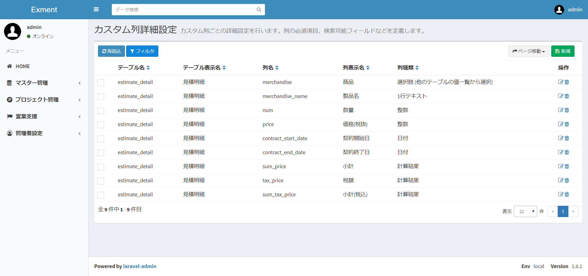
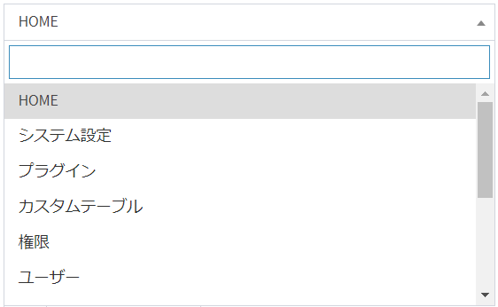
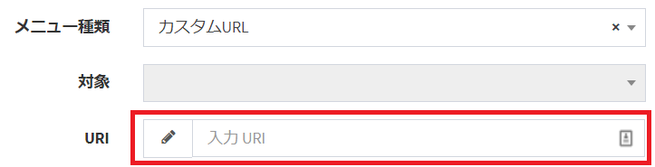
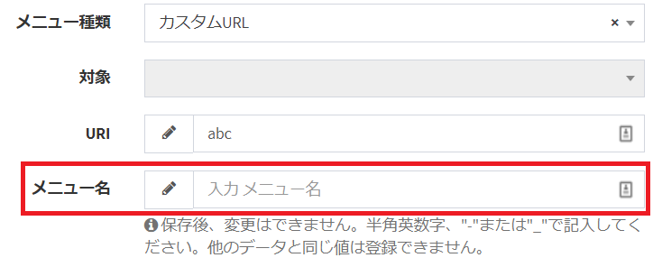

# 메뉴
화면 왼쪽에 나오는 메뉴를 추가·정렬·편집·삭제하는 페이지입니다.

| 하고 싶은 일 | 볼 곳 |
|---|---|
| 메뉴에 항목을 추가한다 | 메뉴 새로 추가 |
| 메뉴의 순서를 바꾼다 | 순서 정렬 |
| 상위 계층을 정해 둔 역할 그룹의 사람에게만 보여 준다 | 표시할 역할 그룹 |
| 업데이트한 뒤, 메뉴를 v7.2.1부터의 표준 순서로 맞춘다 | 표준 순서로 정리 |

## 개요
로그인하면 화면 왼쪽에 메뉴가 표시됩니다.  
메뉴에는 "시스템에서 준비한 페이지", "플러그인 페이지", "각 테이블로 가는 페이지", "임의의 URL"을 여는 항목을 추가할 수 있습니다.  
※메뉴 항목은 로그인한 사용자가 표시할 수 있는 페이지의 것만 표시됩니다.


※v7.1.0 이후, 시스템 관리자가 쓰는 "안부 확인" "로그인 설정" "API 설정" "시스템 성능 로그"는 "관리자 설정" 안에 표시됩니다. "LINE 연동"은 왼쪽 메뉴가 아니라 오른쪽 위의 사용자 메뉴에 표시됩니다([LINE 연동](/ko/line)). v7.0에서 업데이트한 경우, 메뉴가 맨 위에 있을 때만 이동합니다. 직접 옮긴 메뉴는 그대로입니다.


### v7.2.1부터의 메뉴 순서
v7.2.1부터 왼쪽 메뉴는 일의 분류(상위 계층)마다 모입니다. 순서는 [기능 맵](https://exment.net/en/feature-map/)과 같습니다.

```
대시보드
그룹웨어 ▸ 파일 공유·메일(Groupware)
신청·승인 ▸ 미처리 작업·품의서·경비 정산 …(동봉 템플릿 "신청 팩")
프로젝트 ▸ プロジェクト管理(프로젝트 관리. 공식 플러그인)
IT 지원 ▸ ITサポート(IT 지원. 공식 플러그인)
마스터 ▸ 기본 정보·조직·사용자·공지
설정: 데이터와 화면 ▸ 사용자 정의 테이블·스튜디오·메뉴·워크플로·알림 템플릿·알림·표시 프리셋·템플릿
설정: 사용자와 권한 ▸ 로그인 사용자·역할 그룹·로그인 설정·API 설정·작업 로그
설정: 시스템 ▸ 시스템 설정·기능 관리·플러그인·백업·튜닝·유지보수 모드
```

- 새로 설치한 사이트는 이 모양이 됩니다.
- v7.1 이전에서 업데이트한 사이트는 Exment가 둔 그대로인 메뉴만 움직입니다(관리자 설정의 안이 Exment의 순서 그대로, "마스터 관리"가 위에서 3번째 그대로, 파일 공유가 맨 위 그대로일 때). 직접 옮긴 메뉴·붙인 이름·플러그인의 메뉴는 그대로입니다. 관리자 설정 안에 다른 메뉴가 들어 있는 사이트는 관리자 설정을 나누지 않습니다.
- 공식 플러그인(프로젝트 관리·IT 지원·Groupware)과 동봉 템플릿은 각 분류 아래에 메뉴를 둡니다(분류가 없으면 만듭니다). 맨 위에 있는 메뉴만 옮겨집니다.
- 안에 표시할 수 있는 메뉴가 없는 분류는 표시되지 않습니다([기능 관리](/ko/feature)에서 끈 기능의 메뉴는 표시되지 않습니다).

#### 표준 순서로 정리
업데이트해도 순서가 바뀌지 않은 사이트(메뉴를 정렬한 사이트, 관리자 설정 안에 다른 메뉴가 있는 사이트)는 "메뉴" 화면의 [표준 순서로 정리]로 위의 모양으로 정리할 수 있습니다.
- 누르면, 어느 메뉴가 어디로 움직이는지의 목록이 나옵니다. 확인한 뒤 [정리]를 누릅니다.
- 움직이는 것은 Exment와 공식 플러그인의 메뉴뿐입니다. 직접 만든 메뉴·테이블의 메뉴·그 밖의 메뉴는 원래 자리에 원래 순서 그대로 남습니다(관리자 설정 안에 있던 것은 "설정: 시스템"의 마지막으로). 지우는 메뉴는 없습니다.
- "HOME" "마스터 관리" "관리자 설정"의 이름은 Exment가 붙인 이름 그대로일 때만 "대시보드" "마스터" "설정: 시스템"으로 바꿉니다.
- 정리하기 전의 메뉴를 남겨 두므로, 같은 화면의 [되돌리기]로 되돌릴 수 있습니다.
- 시스템 관리자만 쓸 수 있습니다.


## 메뉴 관리
메뉴를 추가·정렬·편집·삭제하는 방법입니다.  

### 목록 화면 표시
왼쪽 메뉴에서 "메뉴"를 클릭합니다.  
또는 아래의 URL에 접속하십시오.  
그러면 메뉴 설정 화면이 표시됩니다.  
http(s)://(Exment의 URL)/auth/menu  
현재 시스템에 등록된 메뉴의 목록이 표시됩니다.


> ※URL은 "/admin"이 붙지 않는 표준 설정(v7.2.1 이후에 새로 설치한 사이트)의 경우입니다. `.env`의 `ADMIN_ROUTE_PREFIX`에 값이 있는 경우(이전 버전에서 설치한 사이트는 "admin")에는 사이트의 URL 뒤에 그 값을 붙이십시오(예: `http(s)://(Exment의 URL)/admin/auth/menu`). 자세한 내용은 [URL에 포함된 "admin"의 변경·삭제](/ko/additional_prefix)를 보십시오.

### 메뉴 새로 추가
"메뉴"의 목록 화면에서, 페이지 오른쪽의 "만들기" 상자에 필요한 사항을 입력합니다.  


#### 상위
추가할 메뉴의 상위가 되는 항목을 선택합니다. 최상위에 메뉴를 추가하는 경우에는 "ROOT"를 선택하십시오.


#### 메뉴 종류
추가할 메뉴의 종류를 다음 중에서 선택합니다.
- <span class="heading_smaller_than_h5">시스템 메뉴</span>  
Exment에서 준비한 메뉴 항목을 추가하고 싶은 경우에 선택합니다.  

- <span class="heading_smaller_than_h5">플러그인</span>  
사용자가 업로드한 플러그인을 메뉴에 표시하고 싶은 경우에 선택합니다.  

- <span class="heading_smaller_than_h5">테이블 데이터</span>  
사용자 정의 테이블의 데이터를 목록으로 표시하는 화면을 메뉴에 표시하고 싶은 경우에 선택합니다.  

- <span class="heading_smaller_than_h5">상위 계층</span>  
그 메뉴 아래에 하위 계층을 목록으로 표시하는 경우에 선택합니다.  

- <span class="heading_smaller_than_h5">사용자 정의 URL</span>  
임의의 URL을 메뉴에 추가하는 경우에 선택합니다.


#### 대상
추가할 메뉴의 항목을 선택합니다. "메뉴 종류"에 따라 표시되는 항목이 바뀝니다.
- 메뉴 종류가 "시스템 메뉴"인 경우: Exment에서 준비한 페이지의 목록이 표시됩니다.


- 메뉴 종류가 "플러그인"인 경우: 사용자가 업로드한 플러그인의 목록이 표시됩니다.
- 메뉴 종류가 "테이블 데이터"인 경우: 사용자 정의 테이블의 목록이 표시됩니다.


- 메뉴 종류가 "상위 계층" "사용자 정의 URL"인 경우: 선택할 수 없게 됩니다.


#### URI
클릭했을 때 여는 URI입니다.
- 메뉴 종류가 "시스템 메뉴" "플러그인" "테이블 데이터" "상위 계층"인 경우: 표시만 됩니다. 적을 필요가 없습니다.  


- 메뉴 종류가 "사용자 정의 URL"인 경우: 클릭했을 때 여는 URI를 적으십시오.  
※실제로 여는 페이지의 URL은 아래와 같이 됩니다.
http(s)://(Exment의 URL)/(적은 URI)


> v3.0.2 미만에서 처음 설치한 사이트에서는 URI에 등록할 수 있는 글자 수의 상한이 50자 미만으로 설정되어 있었습니다. 그보다 긴 URI를 등록하는 경우, [버그 수정: 메뉴의 URL 글자 수가 50자까지](/patch/menu_uri_length)(영어)로 대응하십시오.


#### 메뉴 이름
메뉴의 이름을 반각 영숫자로 적습니다. 다른 메뉴와 같은 이름은 쓸 수 없습니다.  
화면에는 표시되지 않는 항목입니다.
- 메뉴 종류가 "시스템 메뉴" "플러그인" "테이블 데이터"인 경우: "대상"을 선택하면 자동으로 적힙니다.  
※같은 메뉴 항목이 이미 등록되어 있을 때는 이름이 겹쳐서 저장할 수 없습니다. 값을 변경하십시오.


- 메뉴 종류가 "상위 계층" "사용자 정의 URL"인 경우: 다른 값과 겹치지 않도록, 원하는 반각 영숫자로 적으십시오.  



#### 메뉴 표시 이름
왼쪽 메뉴에 표시할 이름을 적습니다.  
※메뉴 종류가 "시스템 메뉴" "플러그인" "테이블 데이터"인 경우, "대상"을 선택하면 자동으로 적힙니다.  

#### 아이콘
왼쪽 메뉴에 표시할 아이콘을 적습니다.  
※메뉴 종류가 "시스템 메뉴" "플러그인" "테이블 데이터"인 경우, "대상"을 선택하면 자동으로 적힙니다.  

#### 표시할 역할 그룹
(v7.2.1 이후. 메뉴 종류가 "상위 계층"일 때만)  
고른 역할 그룹의 사람에게만 이 상위 계층을 안의 메뉴와 함께 표시합니다. 비어 있을 때는 지금까지처럼 모두에게 표시합니다(안의 메뉴는 각각의 권한으로 표시됩니다). 시스템 관리자에게는 항상 표시됩니다.  
예를 들어 "신청·승인"을 신청자와 승인자에게만, "경리" 분류를 경리 담당자에게만 표시할 수 있습니다.  
※표시를 나눌 뿐이며, 권한은 바뀌지 않습니다. 안의 테이블이나 화면은 각각의 권한으로 열 수 있습니다.  
※템플릿으로 내보내면 역할 그룹은 이름으로 적힙니다. 가져온 사이트에 같은 이름의 역할 그룹이 있으면 그것에 이어집니다.

### 저장
설정을 적었으면 [전송]을 클릭하십시오.  
※저장한 뒤, 브라우저를 다시 읽어 들이거나 다시 한 번 Exment에 접속하면 왼쪽 메뉴에 항목이 반영됩니다.

### 순서 정렬
저장해 둔 메뉴 항목의 순서는 목록 화면에서 바꿀 수 있습니다.

1. 항목을 드래그 앤 드롭하여 순서를 정렬합니다.
2. 끝나면 [저장]을 클릭하십시오.
  


### 편집
메뉴를 편집할 때는 그 행의 [편집] 링크를 클릭하십시오.  


### 삭제
메뉴를 삭제할 때는 그 행의 [삭제] 링크를 클릭하십시오.  


> v7.2.1보다 전에 설치한 사이트에서는 **작업 로그 목록**은 메뉴 항목에 표시되지 않습니다. 필요한 경우에는 목록에서 설정하십시오. v7.2.1 이후에 새로 설치한 사이트에서는 "설정: 사용자와 권한"에 표시됩니다.
