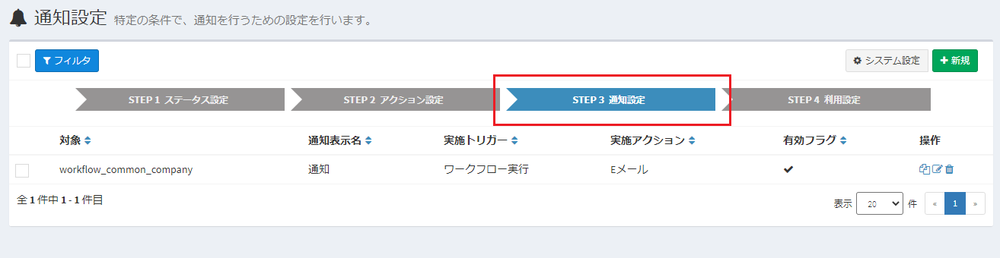

# 알림·메일 전송 설정
정해 둔 조건이 되었을 때, 사용자나 지정한 메일 주소에 메일 등으로 알리는 "알림"을 설정하는 페이지입니다.

알림은 다음 3가지를 정해서 만듭니다.

| 정하는 것 | 내용 | 볼 곳 |
|---|---|---|
| 알림 트리거 | 언제 알릴지(데이터를 만들었을 때, 날짜가 다가왔을 때 등) | 알림 트리거의 종류 |
| 알림 액션 | 무엇으로 알릴지(이메일, 시스템 내 알림, Slack 등)와 누구에게 알릴지(알림 대상) | 알림 액션의 종류 |
| 알림 템플릿 | 제목·본문 | [알림 템플릿](/ko/mail) |

**※이 기능으로 메일을 전송하는 경우, [메일 설정](/ko/system_setting)을 해야 합니다.**

## 알림 트리거의 종류
알림 트리거는 "언제 알릴지"의 계기입니다. 현재 아래의 종류가 있습니다.

### 시간 경과
데이터에 등록한 날짜에서, 정해 둔 일수만큼 앞(또는 뒤)의 날이 되면 알림이 실행됩니다.  
예: 계약 갱신일이 "7/31"이고, 설정에서 "10일 전에 알림"으로 해 둔 경우, "7/21"에 메일을 전송합니다.    
**※이 기능을 실행하는 경우, 미리 [작업 스케줄](/ko/additional_task_schedule) 설정을 해야 합니다.**

### 데이터 생성/업데이트
다음 때에 알림이 실행됩니다. 데이터의 변경을 빨리 알고 싶을 때 쓰십시오.  

- 데이터를 새로 만들었을 때
- 데이터를 업데이트했을 때
- 데이터에 댓글이 달렸을 때
- 데이터에 파일이 첨부되었을 때
- 데이터가 공유되었을 때  
  
※초기 설정에서는 데이터의 업데이트 등을 한 로그인 사용자 자신에게는 알리지 않습니다. 바꿀 때는 [설정값 변경](/ko/config)의 "알림 대상이 로그인 사용자인 경우, 알림을 건너뛴다"를 설정하십시오.  
※데이터 가져오기 때는 알리지 않습니다. 대량의 알림이나 메일이 전송될 우려가 있기 때문입니다.

### 버튼
데이터 상세 화면에 알림용 버튼이 표시됩니다.  
버튼을 눌러, 지정한 사용자나 메일 주소에 메시지를 전송합니다.  
저장해 둔 파일을 첨부할 수도 있습니다.

  
  

### 워크플로
워크플로가 실행되었을 때, 데이터의 작성자나 다음 실행 사용자에게 알릴 수 있습니다.

### 공개 폼 데이터 등록 완료 시, 오류 시
공개 폼에서 일반 사용자가 데이터를 입력했을 때와 오류가 발생했을 때, 일반 사용자 또는 관리자에게 알림을 전송할 수 있습니다.  
※공개 폼에 대해서는 [공개 폼 설정](/ko/publicform)을 확인하십시오.

## 알림 액션의 종류
알림 액션은 "무엇으로 알릴지"입니다. 현재 아래의 종류가 있습니다.  
알림 설정 화면에서는 누구에게 알릴지의 "알림 대상"도 설정합니다.

### 이메일
특정 이메일 주소로 메일을 전송합니다.

#### 알림 대상(필수)

- ##### 시스템 관리자
시스템 관리자에게 메일을 전송합니다.

- ##### 권한이 있는 사용자
대상 데이터의 권한이 있는 사용자에게 메일을 전송합니다.

- ##### 작성자
대상 데이터를 만든 사용자에게 메일을 전송합니다.

- ##### 지정한 이메일 주소
입력한 메일 주소로 메일을 전송합니다. 메일 주소는 여러 개 지정할 수 있습니다.

- ##### 이메일 열
알림 대상 데이터에 사용자 정의 열 "이메일 주소"가 있을 때, 그 이메일 주소로 메일을 전송합니다.

- ##### 사용자 열
알림 대상 데이터에 사용자 정의 열 "사용자"가 있을 때, 그 사용자 열에 설정된 사용자에게 메일을 전송합니다.

- ##### 선택 (테이블에서) 안의 이메일 주소 열
데이터의 사용자 정의 테이블에 사용자 정의 열 "선택 (테이블에서)"가 있고, 그 참조 대상 테이블에 이메일 주소 열이 있을 때, 그 이메일 주소로 메일을 전송합니다.

- ##### 지정한 사용자
선택한 사용자에게 알림을 전송합니다.  
※그 테이블에 권한이 있는 사용자만 선택지 후보로 표시됩니다. 권한이 없는 사용자에게는 알릴 수 없습니다.

- ##### 지정한 조직
선택한 조직에 알림을 전송합니다.  
※그 테이블에 권한이 있는 조직만 선택지 후보로 표시됩니다. 권한이 없는 조직에는 알릴 수 없습니다.

### 시스템 내 알림
대상 사용자가 로그인하면, 페이지 오른쪽 위의 알림 아이콘에 알림이 표시됩니다. 
  

#### 알림 대상(필수)

- ##### 시스템 관리자
시스템 관리자에게 알림을 전송합니다.

- ##### 권한이 있는 사용자
대상 데이터의 권한이 있는 사용자에게 알림을 전송합니다.

- ##### 작성자
대상 데이터를 만든 사용자에게 알림을 전송합니다.

- ##### 사용자 열
알림 대상 데이터에 사용자 정의 열 "사용자"가 들어 있는 경우, 그 사용자에게 알림을 전송합니다.

- ##### 지정한 사용자
선택한 사용자에게 알림을 전송합니다.  
※그 테이블에 권한이 있는 사용자만 선택지 후보로 표시됩니다. 권한이 없는 사용자에게는 알릴 수 없습니다.

- ##### 지정한 조직
선택한 조직에 알림을 전송합니다.  
※그 테이블에 권한이 있는 조직만 선택지 후보로 표시됩니다. 권한이 없는 조직에는 알릴 수 없습니다.

### Slack
Slack에 알림을 전송합니다.  
※알리려면 Webhook의 URL이 필요합니다. URL을 얻는 방법은 [Webhook에 알리는 경우의 설정](/ko/notify_webhook)을 참조하십시오.

#### 멘션 설정
Slack의 알림에 멘션(상대를 지명하는 표기)을 붙일 수 있습니다. 멘션에는 다음 설정이 있습니다.

- ##### 전체 멘션
Slack 알림에, 전체를 멘션하는 "@here"를 추가합니다.

- ##### 개별 멘션
Slack 알림에 개별 멘션을 추가합니다.  
멘션에 쓰는 Slack의 사용자 ID는 따로 설정해 두어야 합니다.  
Slack ID 설정 방법은 [Slack ID 설정 방법](/ko/notify_webhook)을 확인하십시오.

#### 멘션 대상

- ##### 시스템 관리자
시스템 관리자에게 알림을 전송합니다.

- ##### 권한이 있는 사용자
대상 데이터의 권한이 있는 사용자에게 알림을 전송합니다.

- ##### 작성자
대상 데이터를 만든 사용자에게 알림을 전송합니다.

- ##### 사용자 열
알림 대상 데이터에 사용자 정의 열 "사용자"가 있을 때, 그 사용자 열에 설정된 Slack ID로 멘션을 전송합니다.

### Microsoft Teams
Microsoft Teams에 알림을 전송합니다.  
※알리려면 Webhook의 URL이 필요합니다. URL을 얻는 방법은 [Webhook에 알리는 경우의 설정](/ko/notify_webhook)을 참조하십시오.  
※Microsoft Teams에서는 멘션을 추가할 수 없습니다.

### LINE
LINE 공식 계정에서 사용자의 LINE으로 알림을 전송합니다. 카드 형식(Flex Message)으로 전송할 수도 있습니다.  
※알림을 받는 사용자는 미리 LINE 계정을 연동해야 합니다. LINE 공식 계정의 준비나 계정 연동의 방법은 [LINE 연동](/ko/line)을 확인하십시오.

#### 알림 대상(필수)
"시스템 내 알림"과 마찬가지로, 시스템 관리자, 권한이 있는 사용자, 작성자, 사용자 열, 지정한 사용자, 지정한 조직 등에서 선택합니다.  
※LINE 계정을 연동하지 않은 사용자에게는 알림이 전송되지 않습니다.

## 목록 화면 표시
v4.2.0부터 알림 설정 화면의 위치가 바뀌었습니다. 알림 트리거의 종류에 따라 다음 곳에서 엽니다.

- 시간 경과, 데이터 생성/업데이트, 버튼  
→사용자 정의 테이블의 테이블 상세 설정 대화 상자에서 알림 설정 버튼을 클릭하십시오.
  

- 워크플로  
→워크플로 설정의 Step3에서 설정하십시오.
  

## 새로 만들기 
1. 목록 화면 오른쪽 위의 [만들기] 버튼을 클릭합니다.

2. 알림을 새로 만드는 화면이 표시되므로, 필요한 사항을 입력합니다.  
※입력할 내용은 아래의 "설정 항목 상세"를 참조하십시오.

3. [전송] 버튼을 클릭합니다. 알림 설정이 만들어집니다.

## 편집
- 편집하고 싶은 행의 [편집] 링크를 클릭하십시오.  
편집 화면이 열려, 설정을 변경할 수 있습니다.  

  

## 복제
- 복제하고 싶은 행의 [복제] 링크를 클릭하십시오.  
그 행의 설정값이 들어간 상태로, 새로 만드는 화면이 열립니다.

  

## 삭제
알림을 삭제하고 싶은 경우, 해당하는 행의 [삭제] 링크를 클릭하십시오.  

  

## 설정 항목 상세
"알림 이름", 언제 알릴지의 "알림 조건 설정", 무엇으로 알릴지의 "알림 액션 설정"을 설정합니다.  

### 알림 이름 설정

#### 알림 이름(영숫자)
- 시스템에서 쓰는 알림의 이름입니다.  
플러그인(트리거)의 트리거 조건에서 알림 실행 직전이나 알림 실행 후를 설정할 때 등에 씁니다.
- 쓸 수 있는 것은 반각 영숫자와 기호 "-", "_"입니다.
- 글자 수는 30자 이내이며, 다른 알림에서 쓰고 있는 알림 이름은 쓸 수 없습니다.

#### 알림 표시 이름
- 알림의 표시용 이름을 나타냅니다.

### 알림 조건 설정

  

#### 실행 트리거
알림의 계기를 선택합니다. 자세한 내용은 위의 [알림 트리거의 종류](/ko/notify?id=알림-트리거의-종류)를 확인하십시오.

#### 대상 뷰
알릴 데이터를 좁히기 위한 [조건 뷰](/ko/view)를 선택합니다.

### 알림 조건 설정(시간 경과)

#### 대상 날짜 열
알릴지 여부를 정하는 바탕이 되는, 날짜의 사용자 정의 열을 선택합니다.  
선택할 수 있는 사용자 정의 열의 종류는 "날짜" "일시"입니다.  
※선택한 사용자 정의 테이블에 "날짜" "일시"가 들어 있지 않은 경우, 선택지는 표시되지 않습니다.

#### 알림일
알림을 보낼 날짜를 입력하십시오. "0"이라고 입력하면 당일에 알립니다.

#### 알림 전후
알림을 보내는 것이 등록한 날짜의 "전"인지 "후"인지를 선택합니다.  
예: "알림일"이 7, "알림 전후"가 "전"인 경우, 지정한 필드의 날짜의 7일 전에 알림 실행

#### 알림 시간
알림을 실행하는 시간입니다. 0~23으로 입력합니다.  
예: "6"이라고 입력한 경우, 6:00에 알림 실행

### 알림 조건 설정(데이터 생성/업데이트)

#### 알림 조건 설정
알림을 보내는 조건을 설정합니다.
  

### 알림 조건 설정(버튼)

#### 버튼 표시 이름
화면에 표시할 버튼의 이름을 적습니다.

### 알림 조건 설정(워크플로)

#### 실행 후 상태
알림을 전송할 상태를 선택하십시오. 액션 실행 후의 상태를 참조합니다. ※비어 있는 경우에는 모두가 대상이 됩니다.

#### 실행 액션
알림을 전송할 액션을 선택하십시오. ※비어 있는 경우에는 모두가 대상이 됩니다.

### 알림 액션 설정

알림의 액션을 선택합니다. 여러 개 선택할 수 있습니다.  
액션의 자세한 내용은 [알림 액션의 종류](/ko/notify?id=알림-액션의-종류)를 확인하십시오.

  

### LINE Flex 템플릿
실행 액션이 "LINE"인 경우에, LINE으로 전송할 카드의 템플릿을 선택합니다. 선택하지 않는 경우에는 텍스트로 전송합니다.  
템플릿을 만드는 방법은 [LINE 연동](/ko/line)을 확인하십시오.

### 알림 템플릿
보낼 알림의 템플릿을 선택합니다. 새 템플릿을 쓸 때는 먼저 알림 템플릿 화면에서 만들어 두십시오.  
알림 템플릿에 대한 자세한 내용은 [알림 템플릿](/ko/mail)을 참조하십시오.  
  
  
>  **파일을 첨부한 알림을 보내는 경우, [알림 시 첨부 파일의 암호화](/ko/notify_encript) 설정을 하면 첨부 파일이 암호화됩니다.**

## 알림에 시간이 걸리는 경우
알림의 처리는 메일이든 WebHook이든 시간이 매우 오래 걸립니다.  
상급자용 기능이지만, [알림의 지연 실행](/ko/additional_queue)을 쓰면 알림이 끝나기를 기다리지 않고 다음 처리로 넘어갑니다.

## 알림(시간 경과)의 명령 실시
실행 트리거 "시간 경과"의 알림은 명령을 써서, "알림 시간"의 설정과 관계없이 원할 때 수동으로 실행할 수 있습니다.  
아래의 명령 중 하나를 실행하십시오.  

~~~
# 알림 ID 지정
php artisan exment:notify 1

# notify_name(알림 이름(영숫자)) 지정
php artisan exment:notify --name=task_limit_date_notify
~~~

  
