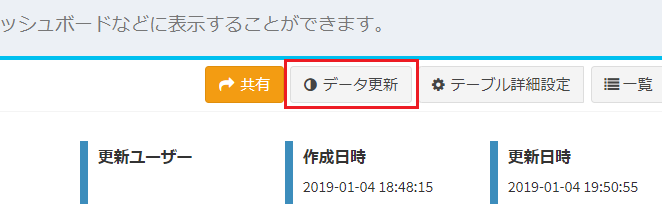
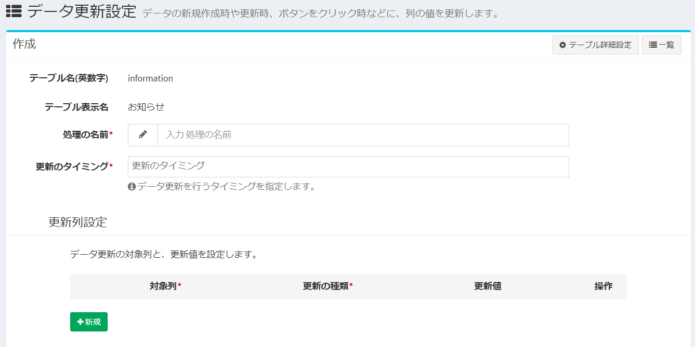

# 일괄 업데이트 설정
"버튼을 클릭했을 때", "데이터를 새로 만들었을 때" 등, 정해 둔 계기(트리거)로 데이터의 값을 한꺼번에 바꿔 쓰는 설정입니다.  
예를 들어 다음과 같이 쓸 수 있습니다.  

- 테이블 "작업 정보"의 데이터 상세 화면에 "완료" 버튼을 표시하고, 클릭하면 사용자 정의 열 "상태"의 값을 완료로 한다.
- 데이터를 업데이트했을 때 사용자 정의 열 "담당자"의 값을 자동으로 로그인 사용자로 한다.

설정 순서는 다음과 같습니다.

1. 일괄 업데이트 설정 화면을 엽니다("설정 화면").
2. ［새로 만들기］에서 언제(업데이트 시점)·어느 열을·어떤 값으로 할지 정하고 저장합니다("새로 추가", "입력 항목의 상세").
3. 정한 시점에 업데이트가 실행됩니다("업데이트 실행").

> 이 기능은 v3.5.0 미만에서는 "데이터 일괄 업데이트"라는 이름이었습니다. v3.5.0부터 기능을 넓혔습니다.  
더 복잡한 조건이나 내용으로 업데이트하고 싶을 때는 [플러그인(버튼)](/ko/plugin_quickstart_button)이나 [플러그인(이벤트)](/ko/plugin_quickstart_event)를 만드십시오.

## 업데이트 시점의 종류

- ##### 목록 화면에서 버튼을 누를 때

  

데이터 목록 화면에 버튼이 추가됩니다.  
목록 화면의 체크박스에 체크하고 버튼을 클릭하면, 체크한 데이터를 설정한 내용으로 업데이트합니다.

- ##### 데이터 상세 화면에서 버튼을 누를 때

  

데이터 상세 화면에 버튼이 나옵니다.  
버튼을 클릭하면 설정한 내용으로 데이터를 업데이트합니다.

- ##### 데이터를 새로 만들 때
사용자가 화면이나 API, 가져오기 등으로 데이터를 새로 만들었을 때, 설정한 내용으로 데이터를 업데이트합니다.

- ##### 데이터를 업데이트할 때
사용자가 화면이나 API, 가져오기 등으로 데이터를 업데이트했을 때, 설정한 내용으로 데이터를 추가로 업데이트합니다.

## 설정 화면
1. 사용자 정의 테이블 목록에서 설정하고 싶은 테이블 하나에 체크하고, 오른쪽 위의 "테이블 상세 설정"을 클릭합니다.  

  

- 또는 메뉴에서 설정하고 싶은 테이블을 고른 다음, 같은 방법으로 오른쪽 위의 "테이블 상세 설정"을 클릭합니다.  
※ 그 테이블을 미리 메뉴에 표시해 두어야 합니다.  

  

2. 그다음 그 사용자 정의 테이블의 "일괄 업데이트 설정"을 엽니다.

  

3. 일괄 업데이트 설정 화면이 표시됩니다.

  

## 새로 추가
1. "일괄 업데이트 설정" 화면에서 페이지 오른쪽 위의 ［새로 만들기］ 버튼을 클릭합니다.

2. 일괄 업데이트 설정의 새로 추가 화면이 표시됩니다. 필요한 내용을 입력합니다.

  

## 저장
설정을 입력했으면 ［전송］을 클릭하십시오.

## 편집
일괄 업데이트 설정을 편집하려면 그 행의 ［편집］ 링크를 클릭하십시오.  

## 삭제
일괄 업데이트 설정을 삭제하려면 그 행의 ［삭제］ 링크를 클릭하십시오.  

## 입력 항목의 상세

### 기본 설정

  

- ##### 처리 이름
이 일괄 업데이트 설정의 이름입니다.

- ##### 업데이트 시점
언제 데이터를 업데이트할지 고릅니다.  
이 페이지 위쪽의 "업데이트 시점의 종류"를 보고 고르십시오.

- ##### 버튼 레이블
화면의 버튼에 표시할 문구입니다.  
※ "업데이트 시점"이 "목록 화면에서 버튼을 누를 때", "데이터 상세 화면에서 버튼을 누를 때"일 때만 나옵니다.

- ##### 버튼 아이콘
화면의 버튼에 표시할 아이콘입니다.  
※ "업데이트 시점"이 "데이터 상세 화면에서 버튼을 누를 때"일 때만 나옵니다.

- ##### 버튼 HTML class
화면의 버튼에 붙일 HTML의 class입니다.  
※ "업데이트 시점"이 "데이터 상세 화면에서 버튼을 누를 때"일 때만 나옵니다.

- ##### 워크플로로 편집할 수 없는 데이터에도 버튼 표시
보통, 워크플로의 상태가 "데이터 편집 불가"인 데이터에는 데이터 상세 화면에 버튼을 표시하지 않습니다.  
YES로 하면 이런 데이터에도 버튼을 표시합니다. 기본값은 NO입니다.  
버튼이 나오는 것은 그 데이터를 편집할 권한이 있는 사용자뿐입니다.  
※ "업데이트 시점"이 "데이터 상세 화면에서 버튼을 누를 때"일 때만 나옵니다.

- ##### 사용 여부
일괄 업데이트 설정을 잠시 멈추고 싶을 때나, 만들다 만 설정을 일단 저장할 때는 "사용 여부"를 NO로 하십시오.  

### 업데이트 열 설정

  

업데이트할 열과 업데이트 값을 설정합니다.  

- ##### 대상 열
업데이트할 열을 고릅니다.  

- ##### 업데이트 유형
대상 열의 사용자 정의 열 유형이 "날짜", "시각", "날짜 및 시각", "사용자", "조직"일 때는 "고정 값", "시스템 값" 중 하나를 고를 수 있습니다.  
그 밖의 경우에는 "고정 값"뿐입니다.

- ##### 업데이트 값
    - 업데이트 유형이 "고정 값"일 때는 업데이트하고 싶은 값을 입력하십시오.
    - 업데이트 유형이 "시스템 값"일 때는 대상 열의 사용자 정의 열 유형에 따라 다음 선택지가 나옵니다.

| 대상 열의 사용자 정의 열 유형 | 선택지 |
|---|---|
| "날짜", "시각", "날짜 및 시각" | "실행 일시" |
| "사용자" | "로그인 사용자", "작성자" |
| "조직" | "소속 조직" |

### 업데이트 조건

  

이 업데이트 설정을 실행할 수 있는 데이터의 조건을 지정합니다. 조건을 충족했을 때만 업데이트를 실행할 수 있습니다.  
※ 조건을 1건도 설정하지 않았을 때는 모든 데이터에서 업데이트를 실행할 수 있습니다.  

### 입력 대화상자 설정

  

업데이트를 실행할 때 대화 상자를 표시하여, 대상 열의 업데이트 값을 직접 입력할 수 있게 합니다.  
※ "업데이트 시점"이 "목록 화면에서 버튼을 누를 때", "데이터 상세 화면에서 버튼을 누를 때"일 때만 고를 수 있습니다.

## 업데이트 실행
설정이 끝나면, 설정 항목 "업데이트 시점"에서 정한 시점에 업데이트가 실행됩니다.  

### 업데이트 내용
- 데이터의 값을 설정 항목 "업데이트 열 설정"에서 정한 값으로 합니다.  
다만 업데이트 유형이 "시스템 값"일 때는 다음 값이 됩니다.  

    - 업데이트 값이 "실행 일시"인 경우, 그 업데이트 처리를 실행한 실행 일시를 넣음
    - 업데이트 값이 "로그인 사용자"인 경우, 그 업데이트 처리를 실행한 로그인 사용자의 ID를 넣음
    - 업데이트 값이 "작성자"인 경우, 그 데이터를 만든 사용자의 ID를 넣음
    - 업데이트 값이 "소속 조직"인 경우, 그 업데이트 처리를 실행한 로그인 사용자가 소속된 조직의 ID를 넣음  
    ※ 로그인 사용자가 여러 조직에 소속되어 있고 업데이트할 열이 "다중 선택 허용" 설정이 아닐 때는, 첫 번째 조직이 그 데이터에 저장됩니다.

- 설정 항목 "입력 대화상자 설정"에서 대상 테이블 열을 골랐을 때는 업데이트 값을 입력하는 대화 상자가 나옵니다.  

  

    
### 업데이트 조건
- "업데이트 조건"에서 설정한 조건을 충족하지 않는 데이터는 업데이트를 실행할 수 없습니다.  
- "업데이트 시점"이 "목록 화면에서 버튼을 누를 때"인 경우, 조건을 충족하지 않는 데이터에 체크하고 업데이트 버튼을 클릭하면 오류가 나옵니다. 그때는 조건을 충족한 다른 데이터도 업데이트하지 않습니다.
