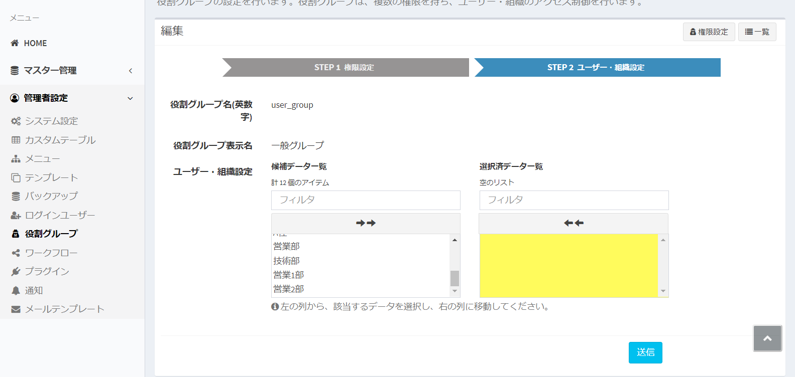

# 조직
회사의 부나 과 같은 "조직"을 Exment에 등록하고 관리하는 페이지입니다.  
조직을 등록해 두면, 권한·폼·워크플로·데이터 공유를 조직마다 정할 수 있습니다.

> 조직을 설정하기 전에 [Exment의 역할·권한 개요](/ko/permission) 페이지를 확인하시기를 권장합니다.

이 페이지의 내용은 다음과 같습니다.

| 알고 싶은 것 | 볼 곳 |
|---|---|
| 조직을 등록하기·고치기·지우기 | 조직 관리 |
| 등록한 조직을 어디에서 쓰는가 | 조직을 쓰는 곳 |
| 상위 조직·하위 조직을 어디까지 포함하는가 | 조직 계층에 대하여 |

## 조직 관리
조직을 등록·편집·삭제하는 방법입니다.

### 목록 화면 표시
왼쪽 메뉴에서 "조직"을 클릭합니다.  
또는 아래의 URL에 접속하십시오.  
그러면 조직 관리 화면이 표시됩니다.  
http(s)://(Exment의 URL)/data/organization  
현재 시스템에 등록된 조직의 목록이 표시됩니다.
  

> ※URL은 "/admin"이 붙지 않는 표준 설정(v7.2.1 이후에 새로 설치한 사이트)의 경우입니다. `.env`의 `ADMIN_ROUTE_PREFIX`에 값이 있는 경우(이전 버전에서 설치한 사이트는 "admin")에는 사이트의 URL 뒤에 그 값을 붙이십시오(예: `http(s)://(Exment의 URL)/admin/data/organization`). 자세한 내용은 [URL에 포함된 "admin"의 변경·삭제](/ko/additional_prefix)를 보십시오.
  
※[설정값](/ko/config)에서 "EXMENT_SHOW_ORGANIZATION_TREE=true"로 하면 계층이 표시됩니다.

### 조직 새로 추가
1. "조직"의 목록 화면에서 페이지 오른쪽 위의 [만들기] 버튼을 클릭합니다.
2. 새로 추가하는 화면이 표시되므로, 필요한 사항을 입력합니다.  
※항목 "상위 조직"에는 그 조직의 상위 계층을 선택하십시오.

### 저장
입력이 끝나면 [전송]을 클릭하십시오.

### 편집
조직을 고칠 때는 그 행의 [편집] 링크를 클릭하십시오.  

### 삭제
조직을 지울 때는 그 행의 [삭제] 링크를 클릭하십시오.  

## 조직을 쓰는 곳
등록한 조직은 다음 곳에서 쓸 수 있습니다.

| 쓰는 곳 | 할 수 있는 일 |
|---|---|
| 역할 그룹 | 조직에 소속된 사용자가 페이지에 접근할 수 있는지를 정합니다 |
| 여러 폼 전환 | 조직에 소속된 사용자에게 정해 둔 폼을 쓰게 합니다 |
| 워크플로 | 조직에 소속된 사용자가 워크플로의 액션을 실행할 수 있습니다 |
| 사용자 정의 데이터의 공유 | 조직에 소속된 사용자가 공유한 데이터를 편집·열람할 수 있습니다 |

#### 역할 그룹 
역할 그룹에 조직을 설정할 수 있습니다.

- 이 설정에 따라, 조직에 소속된 사용자가 페이지에 접근할 수 있는지 없는지가 제어됩니다.  
이 이미지는 위가 사용자가 접근할 수 있는 경우, 아래가 사용자가 접근할 수 없는 경우입니다.

#### 여러 폼 전환 
여러 폼을 전환하는 조건에 조직을 설정할 수 있습니다.  
로그인 사용자가 그 조직에 소속되어 있으면 폼이 사용됩니다.

#### 워크플로 
워크플로의 작업 사용자 설정에 조직을 설정할 수 있습니다.  
로그인 사용자가 그 조직에 소속되어 있으면 워크플로의 액션을 실행할 수 있습니다.

#### 사용자 정의 데이터의 공유 
사용자 정의 데이터의 공유 대상에 조직을 설정할 수 있습니다.  
로그인 사용자가 그 조직에 소속되어 있으면 사용자 정의 데이터의 권한이 주어져, 데이터를 편집하거나 열람할 수 있게 됩니다.

## 조직 계층에 대하여
Exment에서는 아래 그림처럼 조직에 상위와 하위의 계층을 붙일 수 있습니다.

### (상급자용)계층의 종류
조직에 계층이 있을 때, "그 조직에 소속된 사용자"를 어디까지 포함할지는 다음 4가지 중에서 고릅니다.  
여기에서는 예로 "**영업부**"를 기준으로 설명합니다.

| 종류 | 포함하는 조직 | 예(영업부를 기준으로 했을 때) |
|---|---|---|
| 사용자가 소속된 조직 | 대상 조직만 | 영업부장 |
| 상위 계층의 조직을 포함 | 대상 조직과 그 상위 계층의 조직 | 영업부장, A사 사장 |
| 하위 계층의 조직을 포함 | 대상 조직과 그 하위 계층의 조직 | 영업부장, 영업1부 사용자A, 영업2부 사용자B |
| 상위 및 하위 계층의 조직을 포함 | 대상 조직과 그 상위 계층·하위 계층의 조직 | 영업부장, A사 사장, 영업1부 사용자A, 영업2부 사용자B |

#### 사용자가 소속된 조직

대상 조직 자체에 소속된 사용자만입니다.  
예의 경우, 영업부에 소속된 사람은 "영업부장"뿐입니다.

#### 상위 계층의 조직을 포함

대상 조직과 그 상위 계층의 조직입니다.  
예의 경우, 영업부에 소속된 "영업부장"과, 그 상위 계층인 "A사"에 소속된 "A사 사장"이 해당합니다.

#### 하위 계층의 조직을 포함

대상 조직과 그 하위 계층의 조직입니다.  
예의 경우, 영업부에 소속된 "영업부장"과, 그 하위 계층인 "영업1부" "영업2부"에 소속된 "영업1부 사용자A" "영업2부 사용자B"가 해당합니다.

#### 상위 및 하위 계층의 조직을 포함

대상 조직과 그 상위 및 하위 계층의 조직입니다.  
예의 경우, 영업부에 소속된 "영업부장"과, 그 상위 계층인 "A사"에 소속된 "A사 사장", 그 하위 계층인 "영업1부" "영업2부"에 소속된 "영업1부 사용자A" "영업2부 사용자B"가 해당합니다.

<h4 id="kaisou_syurui">(상급자용)계층의 종류 설정</h4>

계층을 어디까지 포함할지는 "시스템 설정" > "조직 설정"에서 설정합니다.

- 계층을 설정할 수 있는 것은 "역할 그룹" "사용자 정의 데이터의 공유"뿐입니다.
- "폼 표시 조건 설정" "워크플로"에서는 사용자가 소속된 조직만 대상입니다.

### 데이터 공유 설정
[사용자 정의 데이터의 데이터 공유 설정](/ko/data_details)을 쓰면, 다른 조직도 그 데이터에 접근할 수 있게 됩니다.

#### 사용자 정의 데이터를 공유했을 때의 유효 범위
- 조직에 데이터를 공유한 경우, 그 조직에 소속된 사용자가 접근할 수 있습니다.
- 상위 조직·하위 조직에 소속된 사용자가 접근할 수 있는지는 위의 "계층의 종류 설정 > 조직 계층 설정(데이터)"로 정해집니다.
- 다른 계열의 조직은 접근할 수 없습니다.

<h4 id="kyouyu_jidou">(상급자용)데이터 저장 시 자동 공유</h4>

사용자 정의 데이터를 새로 만들면, 만든 데이터에 자동으로 공유 설정이 붙습니다.

- 표준에서는 "로그인 사용자"에게만 공유 설정이 붙습니다.
- 설정을 바꾸면, 로그인 사용자가 소속된 조직에도 공유 설정이 붙습니다.
- 이 설정은 "시스템 설정" > "조직 설정"에서 합니다.

각 설정의 내용은 다음과 같습니다.

##### (1)로그인 사용자만
사용자 정의 데이터를 새로 만들 때, 로그인 사용자에게만 공유됩니다.  
- **예**: "영업1부 사용자A"가 데이터를 새로 만들 때, 사용자 "영업1부 사용자A"만 접근할 수 있다.  

##### (2)로그인 사용자와 소속 조직
사용자 정의 데이터를 새로 만들 때, 로그인 사용자와 **소속 조직**에 공유됩니다.  
- **예**: "영업1부 사용자A"가 데이터를 새로 만들 때, 사용자 "영업1부 사용자A"와 조직 "영업1부"에 공유된다.  
→결과적으로, 조직 "영업1부"에 소속된 사용자 "영업1부 사용자B"도 접근할 수 있다

