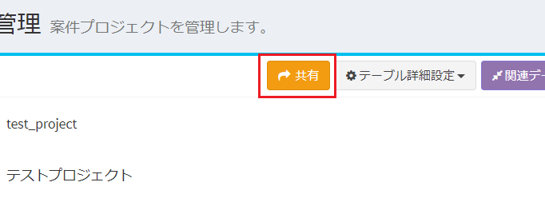
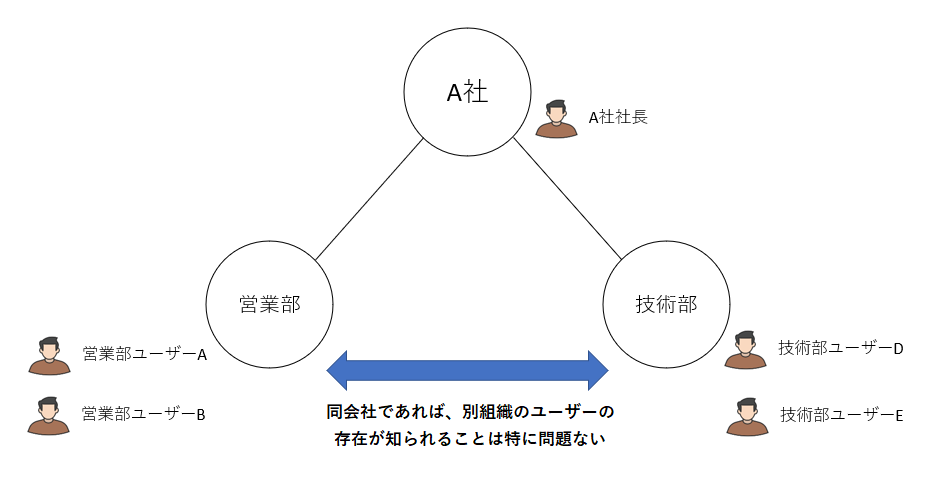

# 역할·권한의 개요
Exment의 역할·권한의 개요를 설명합니다.  
권한은 정해진 데이터나 페이지를 정한 사용자만 조작(액션)할 수 있게 하기 위한 중요한 개념입니다.

- 새로 추가한 사용자는 처음 설정에서는 로그인해도 대부분의 기능을 쓸 수 없습니다.  
- 시스템 관리자는 추가한 사용자에게 알맞은 역할·권한을 설정해야 합니다.

권한은 다음 3가지 단위로 관리합니다. 자세한 내용은 아래의 "권한의 관리 단위"를 참고하십시오.

| 단위 | 정할 수 있는 것(예) | 설정하는 곳 |
|---|---|---|
| (1) 시스템 전체 | 사이트 이름을 바꾼다, 로그인 사용자를 관리한다 | [시스템 설정](/ko/system_setting)의 "시스템 관리자", [역할 그룹](/ko/role_group)의 "시스템 권한" |
| (2) 테이블 단위 | 그 테이블의 설정을 바꾼다, 테이블의 데이터를 편집·열람한다 | [테이블 설정](/ko/table), [역할 그룹](/ko/role_group)의 "테이블 권한" |
| (3) 데이터 단위 | 특정 데이터만 편집·열람한다 | [데이터 상세 화면](/ko/data_details)의 "공유" 등 |  

## 권한을 쓸지 여부
권한 설정을 쓰지 않을 때는 [시스템 설정](/ko/system_setting)에서 "권한 관리 사용"을 No로 바꾸십시오.  
쓰지 않을 때는 모든 사용자가 모든 조작을 할 수 있습니다.  

## 권한이 있고 없음에 따른 차이(한 예)
권한이 있는지 없는지에 따라 사용자가 할 수 있는 조작이나 화면의 표시가 달라집니다.

##### ■권한이 있는 메뉴만 표시된다
→ 로그인 사용자의 메뉴에는 권한이 있는 항목만 나옵니다.  

##### ■접근 오류가 된다  
→ 권한이 없는 페이지를 열려고 하면 접근 오류가 됩니다.

##### ■데이터 폼의 선택지에 항목이 표시되지 않는다  
→ 열이 "선택 (테이블에서)"인 경우, 참조 대상 테이블의 권한이 없으면 선택지가 나오지 않습니다.  

## 권한의 관리 단위
Exment에서 권한을 관리하는 단위는 주로 다음 3가지입니다.

- 시스템 전체
- 테이블 단위
- 데이터 단위

### 전체 그림

### (1) 시스템 전체

Exment의 시스템 설정을 조작하는 권한입니다.  
예를 들어 다음과 같은 조작입니다.  

- 사이트 이름을 변경한다.
- 로그인 사용자를 관리한다.
- 모든 테이블의 작성·편집·열람 등을 한다.

#### 권한 설정 방법

##### 시스템 관리자 설정
[시스템 설정](/ko/system_setting)에서 "시스템 관리자"를 추가·변경할 수 있습니다. "시스템 관리자"는 시스템의 모든 조작을 할 수 있습니다.

##### 그 밖의 시스템 설정
시스템 관리자가 아닌 사용자도 [역할 그룹](/ko/role_group)을 부여하면 시스템 전체의 조작을 할 수 있습니다.  
시스템 조작의 권한은 [역할 그룹](/ko/role_group)에서 "시스템 권한"을 추가·변경하십시오.

### (2) 테이블 단위

Exment에서 만드는 테이블의 권한입니다.  
테이블마다 권한을 설정합니다. 설정한 내용에 따라 각 사용자가 할 수 있는 조작이 달라집니다.  
테이블의 권한이 전혀 없는 사용자는 그 테이블의 어느 페이지도 열 수 없습니다.  
  
예를 들어 다음과 같은 조작입니다.  

- 열 추가 등, 그 테이블의 설정을 변경한다.
- 테이블 안의 모든 데이터를 편집할 수 있다.
- 테이블 안의 모든 데이터를 열람할 수 있고, 자신이 담당하는 데이터를 편집할 수 있다.
- 테이블 안의, 자신이 담당하는 데이터를 열람할 수 있다.

#### 권한 설정 방법

##### 모든 사용자 일괄 설정
역할이나 조직 등과 관계없이 모든 사용자에게 편집, 열람 등의 권한을 부여합니다. 테이블 안의 모든 데이터가 대상입니다. [테이블 설정](/ko/table)에서 바꿀 수 있습니다.

##### 그 밖의 테이블 설정
사용자마다 다른 권한을 부여할 때는 [역할 그룹](/ko/role_group)을 사용합니다.  
테이블 조작의 권한은 [역할 그룹](/ko/role_group)에서 "테이블 권한"을 추가·변경하십시오.

### (3) 데이터 단위

데이터 1건마다의 권한입니다.  
데이터 단위로 권한을 부여하면 "모든 데이터가 아니라 특정 데이터만 보여 주고 싶다" 같은 세밀한 사용법이 가능합니다.  
예를 들어 다음과 같은 조작입니다.

- 특정 데이터를 편집한다.
- 특정 데이터를 열람한다.

#### 권한 설정 방법

##### 데이터를 새로 만들었을 때의 기본 동작
사용자가 데이터를 저장하면 그 사용자 자신에게 그 데이터의 편집 권한이 자동으로 부여됩니다. (사용자가 무언가를 할 필요는 없습니다)

##### 데이터를 새로 만들었을 때, 데이터 작성자의 소속 조직에도 권한을 추가하기
데이터를 만든 사용자뿐 아니라 그 사용자가 소속된 조직에도 자동으로 공유할 수 있습니다.  

- 예: 영업부의 사용자가 만든 데이터는 자동으로 영업부의 모든 사람에게도 공유한다

설정 방법은 [조직 설정](/ko/organization)을 확인하십시오.

##### 나중에 직접 권한을 추가(공유)
만들어 둔 데이터를 다른 사용자와 공유할 수 있습니다. 권한은 열람·편집 중에서 고를 수 있습니다.  
[데이터 상세 화면](/ko/data_details)에서 "공유"를 고르십시오.

  

##### 데이터를 새로 만들거나 업데이트할 때, 열에 설정된 사용자·조직에도 권한을 추가하기
Exment에서는 사용자 정의 열로 "사용자", "조직" 열을 추가할 수 있습니다.  
화면이나 API로 데이터를 새로 만들거나 업데이트했을 때, 이 "사용자", "조직" 열에 들어 있는 사용자·조직에 자동으로 데이터를 공유할 수 있습니다.  

- 예: "작업 관리" 테이블의 "담당자" 열에 넣은 사용자에게는, 데이터를 저장했을 때 자동으로 그 데이터의 편집 권한을 부여한다

설정 방법은 [데이터 자동 공유 설정](/ko/table)을 확인하십시오.

#### 데이터가 많은 테이블에서의 표시 속도
데이터 단위의 권한(데이터 공유)으로 데이터를 볼 수 있는 사용자는, 목록 화면을 열 때마다 "어느 데이터를 봐도 되는지"를 1건씩 확인합니다. 그래서 **데이터 공유로 볼 수 있는 데이터가 매우 많으면**(예: 수만 건), 특히 **좁히기가 없는 목록**의 표시에 시간이 걸립니다.  
(v7.1.0에서의 측정 예: 9만 건의 테이블에서, 9만 건 모두를 데이터 공유로 볼 수 있는 사용자의 경우, 좁히기가 없는 목록의 표시에 약 1.3초. 전체 데이터의 열람 권한을 가진 사용자는 약 0.4초)

테이블의 데이터를 **모두** 보여 주고 싶은 사용자에게는 데이터 공유가 아니라 [역할 그룹](/ko/role_group)의 "테이블 권한"에서 "전체 데이터 열람"(또는 "전체 데이터 편집")을 부여하십시오. 데이터를 1건씩 확인할 필요가 없어져 표시가 빨라집니다.

※ "전체 데이터 열람"을 부여하면 그 테이블의 **앞으로 추가될 데이터도 포함하여 모든 데이터**를 볼 수 있게 됩니다. 일부 데이터만 보여 주고 싶은 경우에는 지금까지와 같이 데이터 공유를 사용하십시오.

## 조직·사용자 설정
Exment의 조직·사용자 설정의 개요입니다.  

#### 조직을 쓸지 여부
조직 설정을 쓰지 않을 때는 [시스템 설정](/ko/system_setting)에서 "조직 관리 사용"을 No로 바꾸십시오.

#### 조직의 계층 설정
Exment에서는 조직을 계층으로 관리할 수 있습니다.  

조직에 [역할 그룹 설정](/ko/role_group)이나 데이터 공유를 했을 때, 조직 계층의 "부모·자식", "부모", "자식"을 포함할지 여부를 지정할 수 있습니다.  
설정 방법은 [조직 설정](/ko/organization)을 확인하십시오.

#### 다른 조직의 사용자·조직 정보를 가져오는 범위에 대하여
Exment를 사내 포털 사이트처럼 쓸 때는 "어느 사용자가 쓰고 있는지", "어느 조직·어느 회사가 등록되어 있는지"가 다른 사용자에게 보여도 큰 문제가 되지 않습니다.

그러나 Exment를 사외의 사용자도 쓰게 할 때는, 다른 회사의 사용자 정보를 가져오고 열람할 수 있는 것이 문제가 될 수 있습니다.

  
[외부 포털 사이트용 설정](/ko/multiuser)을 하면 다른 회사의 사용자 정보를 가져오고 열람하는 것을 제한할 수 있습니다.

## 관련 페이지
- [시스템 설정](/ko/system_setting)
- [역할 그룹 설정](/ko/role_group)
- [데이터 상세 화면](/ko/data_details)
- [조직 설정](/ko/organization)
- [외부 포털 사이트용 설정](/ko/multiuser)  
