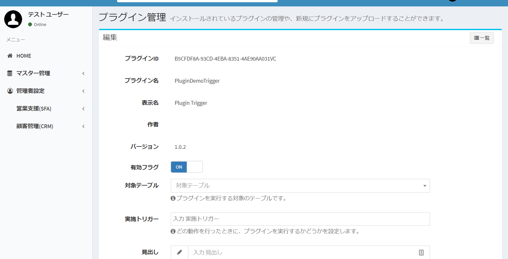

# 플러그인
플러그인은 Exment에 기능을 더하기 위한 프로그램입니다.
이 페이지에서는 플러그인의 종류와 업로드·설정·삭제·권한을 다루는 방법을 설명합니다.

- 설치 방법을 바로 알고 싶은 분은 "[관리 방법](/ko/plugin?id=관리-방법)"을 참조하십시오.
- Exceed One이 만든 공식 플러그인은 [공식 플러그인](/ko/plugin_official)을 참조하십시오.
- 플러그인을 직접 만드는 분은 [플러그인 개발 방법](/ko/plugin_quickstart)을 참조하십시오.

## 플러그인이란
Exment의 표준 기능만으로는 업무에 부족할 때, 화면에서 프로그램(zip 파일)을 업로드하여 기능을 추가할 수 있습니다. 이것이 "플러그인"입니다.  
플러그인에는 현재 아래의 종류가 있습니다.    

- [버튼](/ko/plugin?id=버튼)
- [이벤트](/ko/plugin?id=이벤트)
- [페이지](/ko/plugin?id=페이지)
- [대시보드](/ko/plugin?id=대시보드)
- [뷰](/ko/plugin?id=뷰)
- [CRUD 페이지](/ko/plugin?id=CRUD-페이지)
- [배치](/ko/plugin?id=배치)
- [API](/ko/plugin?id=API)
- [유효성 검사](/ko/plugin?id=유효성-검사)
- [스크립트](/ko/plugin?id=스크립트)
- [스타일](/ko/plugin?id=스타일)
- [가져오기](/ko/plugin?id=가져오기)
- [내보내기](/ko/plugin?id=내보내기)
- [문서 출력](/ko/plugin?id=문서-출력)
- [Docurain(PDF 출력)](/ko/plugin?id=docurain)
- [트리거 ※권장하지 않음](/ko/plugin?id=트리거)

#### 버튼
Exment의 목록 화면 또는 폼 화면에 버튼을 추가하고, 클릭했을 때 처리를 할 수 있습니다.  
※구현 방법은 [여기](/ko/plugin_quickstart_button)를 참조해 주십시오.  
  
버튼을 낼 수 있는 곳은 아래 4곳입니다.    
##### 목록 화면의 메뉴 버튼
데이터 목록 화면의 위쪽에 버튼을 추가하고, 클릭했을 때 이벤트를 발생시킵니다.

##### 데이터 상세 화면의 메뉴 버튼
데이터 상세 화면의 위쪽에 버튼을 추가하고, 클릭했을 때 이벤트를 발생시킵니다.

##### 데이터 새로 만들기 화면의 메뉴 버튼
데이터의 새로 만들기 화면의 위쪽에 버튼을 추가하고, 클릭했을 때 이벤트를 발생시킵니다.

##### 데이터 업데이트 화면의 메뉴 버튼
데이터의 업데이트 화면의 위쪽에 버튼을 추가하고, 클릭했을 때 이벤트를 발생시킵니다.

   

#### 이벤트
Exment의 화면에서 특정 조작을 했을 때 실행되어, 값의 업데이트 등의 처리를 할 수 있습니다.  
※구현 방법은 [여기](/ko/plugin_quickstart_event)를 참조해 주십시오.  
  
특정 조작이란 아래의 것입니다.    

- ##### 로드 시작 시  
페이지의 로드 처리의 맨 처음에 처리가 시작됩니다. (모든 처리보다 먼저 실행되는 것은 아닙니다)  

- ##### 저장 직전  
데이터의 저장 직전에 처리가 시작됩니다.  

- ##### 저장 후  
데이터의 저장 후에 처리가 시작됩니다.  

- ##### 삭제 후  
데이터의 삭제 후에 처리가 시작됩니다.  

- ##### 워크플로 실행 직전  
워크플로 실행의 직전에 처리가 시작됩니다.  

- ##### 워크플로 실행 후  
워크플로 실행 후에 처리가 시작됩니다.  

- ##### 알림 실행 직전  
알림 실행의 직전에 처리가 시작됩니다.  

- ##### 알림 실행 후  
알림 실행 후에 처리가 시작됩니다.  

#### 페이지
Exment에 새 화면을 만들 수 있습니다.  
표준 기능과는 전혀 다른 페이지를 쓰고 싶은 경우에 이용해 주십시오.  
※구현 방법은 [여기](/ko/plugin_quickstart_page)를 참조해 주십시오.    

   

#### 대시보드
Exment의 대시보드에 새 화면을 만들 수 있습니다.  
대시보드의 아이템으로 독자적인 페이지를 사용하고 싶은 경우에 이용해 주십시오. 
※구현 방법은 [여기](/ko/plugin_quickstart_dashboard)를 참조해 주십시오.

   

#### 뷰
Exment의 사용자 정의 데이터 목록 화면에 새 디자인이나 독자적인 기능을 만들어 추가할 수 있습니다.  
표준으로 준비된 뷰인 목록·집계·캘린더 뷰와 전혀 다른 기능을 사용하고 싶은 경우에 이용해 주십시오.  
※구현 방법은 [여기](/ko/plugin_quickstart_view)를 참조해 주십시오.  

   

#### CRUD 페이지
Exment의 목록·상세·새로 만들기·업데이트·삭제와 거의 같은 화면 구성으로 새 페이지를 만듭니다.  
외부의 데이터를 Exment에 가져오지 않고 Exment의 화면에서 관리할 수 있습니다. 여러 엔드포인트에도 대응할 수 있습니다.    
※구현 방법은 [여기](/ko/plugin_quickstart_crud)를 참조해 주십시오.  

   

#### 배치
정기적인 처리를 자동으로 실행하고 싶은 경우에 사용할 수 있습니다.  
상태의 일괄 업데이트 등 특정 처리를 한 번에 실행하고 싶은 경우에도 사용할 수 있습니다.    
※구현 방법은 [여기](/ko/plugin_quickstart_batch)를 참조해 주십시오.

#### API
Exment에 새 API를 만들 수 있습니다.  
[API 레퍼런스](https://exment.net/reference/ja/webapi.html)(일본어)에 없는 기능을 추가하는 경우에 이용해 주십시오.  
※구현 방법은 [여기](/ko/plugin_quickstart_api)를 참조해 주십시오.

#### 스크립트
독자적인 스크립트(javascript)를 실행할 수 있습니다.  
현재 지원하는 것은 데이터 목록 화면 표시 때, 데이터 상세 화면 표시 때, 데이터 새로 만들기 화면 표시 때·업데이트 화면 표시 때입니다.  
※구현 방법은 [여기](/ko/plugin_quickstart_script)를 참조해 주십시오.

   

#### 스타일
독자적인 스타일(스타일시트·css)을 설정하여 디자인을 바꿀 수 있습니다.  
※구현 방법은 [여기](/ko/plugin_quickstart_style)를 참조해 주십시오.

   

#### 유효성 검사
사용자 정의 테이블의 유효성 검사(입력값의 체크)를 독자적으로 구현하고 싶은 경우에 사용할 수 있습니다.  
복잡한 체크나 항목끼리의 관련 체크를 구현하는 경우에 이용해 주십시오.    
※구현 방법은 [여기](/ko/plugin_quickstart_validate)를 참조해 주십시오.

   

#### 가져오기
사용자 정의 데이터의 가져오기 처리를 독자적으로 구현하고 싶은 경우에 사용할 수 있습니다.  
독자적인 형식의 파일을 가져오는 경우나 특수한 변환 처리를 구현하는 경우에 이용해 주십시오.  
※구현 방법은 [여기](/ko/plugin_quickstart_import)를 참조해 주십시오.

   

#### 내보내기
사용자 정의 데이터 목록의 내보내기를 독자적으로 구현하고 싶은 경우에 사용할 수 있습니다.  
독자적인 형식의 파일을 내보내는 경우나 특수한 변환 처리를 구현하는 경우에 이용해 주십시오.  
출력 형식은 Excel 외에 그 밖의 형식으로도 출력할 수 있습니다.  
※구현 방법은 [여기](/ko/plugin_quickstart_export)를 참조해 주십시오.

   

#### 문서 출력
견적서나 장표 등 독자적인 문서 자료를 만들 수 있습니다.  
바탕이 되는 템플릿은 Excel 형식이고, 출력도 Excel 형식입니다.    
※구현 방법은 [여기](/ko/plugin_quickstart_document)를 참조해 주십시오.
※PDF 형식으로 출력하려면 [Docurain 플러그인](/ko/plugin_quickstart_docurain)을 검토해 주십시오.  

   

<h4 id="docurain"><a href="#/ko/plugin?id=docurain" data-id="Docurain(PDF 출력)" class="anchor">Docurain(PDF 출력)</a></h4>

Excel과 json만으로 장표를 개발할 수 있는 클라우드 장표 엔진 **Docurain** 을 사용하여 PDF 출력을 합니다.  
바탕이 되는 템플릿은 Excel 형식이고, 출력은 PDF 형식입니다.    
※구현 방법은 [여기](/ko/plugin_quickstart_docurain)를 참조해 주십시오.

#### 트리거
※v3.2.0부터 권장하지 않게 되었습니다.  
앞으로는 "버튼" 또는 "이벤트"로 구현해 주십시오.

## 공식 플러그인
Exceed One이 만들고 지원하는 공식 플러그인입니다. GitHub의 [exceedone/exment-plugins](https://github.com/exceedone/exment-plugins)에서 다운로드할 수 있습니다.  
설치 방법은 [공식 플러그인](/ko/plugin_official)을 참조하십시오.

| 플러그인 | 할 수 있는 것 |
| --- | --- |
| [프로젝트 관리](/ko/plugin_pm) | 프로젝트와 과제(티켓)의 관리. 과제의 트리 표시·마일스톤·보드·간트 차트·Wiki·코멘트·알림 등 |
| [IT 지원](/ko/plugin_it_support) | 헬프데스크. 메일·접수 폼·전화로 온 의뢰를 티켓으로 관리하고, 진행 상황을 고객과 로그인 없이 공유 |
| [Groupware](/ko/plugin_groupware) | 웹 메일과, 파일 공유의 Office 파일을 브라우저에서 열기·편집하기 |

## 관리 방법
### 페이지 표시
- 왼쪽 메뉴에서 "플러그인"을 선택합니다.  
또는 아래 URL에 접속해 주십시오.  
http(s)://(Exment의 URL)/plugin  
플러그인 화면이 표시됩니다.    
  

> ※URL은 "/admin"이 붙지 않는 표준 설정(v7.2.1 이상에서 새로 설치한 사이트)의 경우입니다. `.env` 의 `ADMIN_ROUTE_PREFIX` 에 값이 있는 경우(이전 버전에서 설치한 사이트는 "admin")에는 사이트 URL 뒤에 그 값을 붙여 주십시오(예: `http(s)://(Exment의 URL)/admin/plugin`). 자세한 내용은 [URL에 포함된 "admin"의 변경·삭제](/ko/additional_prefix)를 참조하십시오.

### 플러그인 업로드
1. [파일 선택]을 클릭하고, 플러그인의 zip 파일을 선택합니다.
2. [업로드]를 클릭합니다.
3. 끝나면 페이지 아래의 목록에 플러그인의 정보가 표시됩니다.

    

### 플러그인 관리
플러그인의 사용·사용 안 함, 플러그인의 트리거나 페이지의 URI 등의 정보를 바꿉니다.  
목록에서 바꾸고 싶은 플러그인 행의 [편집] 링크를 클릭해 주십시오.  
  

플러그인 관리 페이지가 표시됩니다.    
  

### 관리 항목

##### 사용 여부
그 플러그인을 시스템에서 사용할지 여부를 전환합니다.  
YES로 하면 사용하게 됩니다. NO로 하면 사용하지 않게 되어 시스템에서 실행되지 않습니다.    
※플러그인을 업로드할 때는 기본값으로 YES가 되어 있습니다. 다만 플러그인 종류가 "배치"인 경우에는 업로드할 때 기본값으로 NO가 되어 있습니다.

##### 대상 테이블
플러그인을 실행할 대상인 사용자 정의 테이블을 지정합니다.  
설정한 테이블의 페이지를 표시한 경우에 플러그인이 실행됩니다.  

##### 실행 트리거
어떤 조작을 했을 때 플러그인을 실행할지 설정합니다.
설정한 조작을 했을 때 플러그인이 실행됩니다.    

##### 버튼 레이블
"목록 화면의 메뉴 버튼" 또는 "폼의 메뉴 버튼"을 표시할 때 버튼에 표시할 레이블을 설정합니다.

##### 버튼 아이콘
"목록 화면의 메뉴 버튼" 또는 "폼의 메뉴 버튼"을 표시할 때 버튼에 표시할 아이콘을 설정합니다.

##### 버튼의 HTML class
"목록 화면의 메뉴 버튼" 또는 "폼의 메뉴 버튼"을 표시할 때 버튼의 HTML에 붙일 class를 설정합니다.

## 플러그인 삭제
플러그인을 삭제하려면 목록 화면에서 그 플러그인 행의 [삭제] 링크를 클릭해 주십시오.  
  
※[삭제]를 하면 플러그인의 파일 자체가 삭제됩니다.  
일시적으로 멈추고 싶을 뿐인 경우에는 삭제하지 말고 "사용 여부"를 NO로 설정해 주십시오.    

## 역할 권한 관리

플러그인의 설정을 바꿀 수 있는 사용자·조직과 플러그인을 이용할 수 있는 사용자·조직을 권한으로 나눌 수 있습니다.  
예를 들어 아래와 같은 설정을 할 수 있습니다.

- 특정 부서나 상사만 플러그인의 페이지에 접근할 수 있다
- 특정 부서나 상사만 문서 출력을 할 수 있다

### 관리 방법

#### 역할 그룹에 의한 관리
- [역할 그룹 설정](/ko/role_group) 페이지에 접속합니다.  
- "플러그인 권한 설정" 항목에서 관리하고 싶은 플러그인의 권한을 설정합니다.  

  

##### 권한 목록
- **설정 변경** : 설정 변경을 가진 플러그인의 경우, 이 플러그인의 설정을 바꿀 수 있습니다.  
※플러그인의 삭제나 업로드는 할 수 없습니다. 삭제를 하는 경우에는 "플러그인 전체 관리"를 추가해 주십시오.
- **사용·접근** : 플러그인을 실제로 이용하거나 페이지에 접근할 수 있습니다. 플러그인의 종류에 따라 제어하는 내용이 다릅니다.    
    - **버튼, 문서 출력** : 화면에 표시하는 버튼의 표시·숨김이 제어됩니다.
    - **페이지, 대시보드** : 페이지에 접근할 수 있는지가 바뀝니다.
    - **API** : API를 실행할 수 있는지가 바뀝니다. (접근할 수 없는 경우, 403 오류가 발생합니다.)
    - **가져오기, 내보내기** : 데이터의 가져오기·내보내기를 실행할 수 있는지가 제어됩니다.
    - **그 밖의 것** : 역할 그룹으로 제어할 수 없습니다. 모든 사용자에 대해 실행됩니다.
    
#### 플러그인별 관리
역할 그룹을 쓰지 않고 그 플러그인을 모든 사용자가 쓰게 하는 방법입니다.

- 플러그인의 편집 화면을 엽니다.

- "모든 사용자가 사용 가능"을 YES로 하고 저장합니다.    
(플러그인의 종류가 버튼, 문서 출력, 페이지, 대시보드, API, 가져오기, 내보내기인 경우에만 항목이 표시됩니다.)

  

- 역할 그룹 설정과 관계없이 모든 사용자가 그 플러그인을 이용·접근할 수 있게 됩니다.  

> 하위 호환을 위해, v3.2.0 미만에서 업로드한 플러그인은 이 "모든 사용자가 사용 가능"이 YES로 되어 있습니다.  
v3.2.0 이상에서 업로드한 플러그인에서는 기본값으로 NO가 됩니다.

## 기타
플러그인의 개발 방법에 대해서는 [플러그인 개발 방법](/ko/plugin_quickstart)을 참조해 주십시오.
