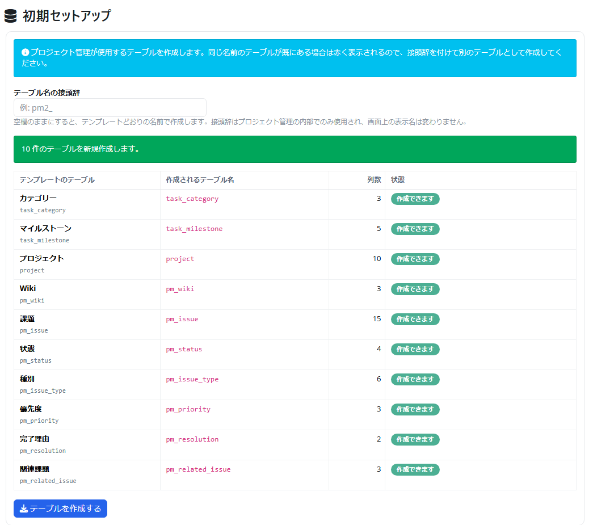
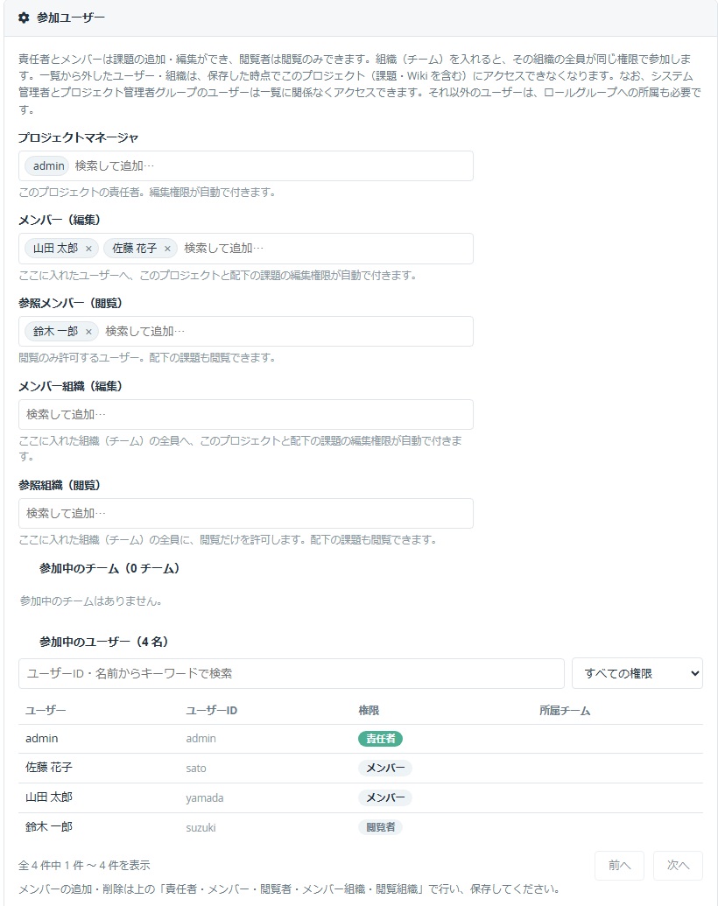
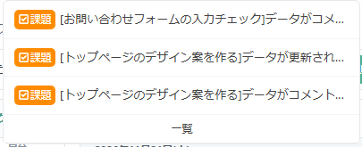
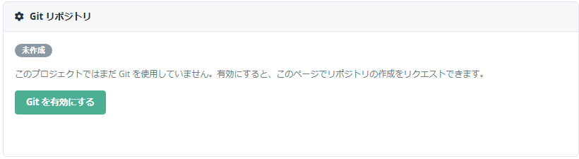

# 프로젝트 관리(공식 플러그인)

"프로젝트 관리"(「プロジェクト管理」)는 Exceed One이 만들고, 테스트하고, 지원하는 Exment의 **공식 플러그인**입니다.  
프로젝트와 티켓(과제)을 Exment의 테이블 위에서 관리할 수 있습니다. 무료로 사용할 수 있습니다.

- 소스 코드·설명: [exceedone/exment-plugins(project-management)](https://github.com/exceedone/exment-plugins/tree/main/project-management)
- 라이선스: GPL-3.0(Exment와 같음)
- 소개 페이지: [프로젝트 관리(exment.net)](https://exment.net/en/project-management/)(영어)
- 플러그인 목록에 나오는 이름: Exment Plugin PM（プロジェクト管理）. zip·내부 이름은 `ExmentPM` 입니다(1.2.0까지는 `PmPortal`, 1.3.0은 `ExmentPluginPM`).


?> 이 플러그인의 화면은 일본어뿐입니다. 이 페이지에서는 화면의 글자를 일본어 그대로 적고 한국어 뜻을 붙였습니다. 예: 「設定」(설정).

## 할 수 있는 것

| 기능 | 내용 |
| --- | --- |
| 프로젝트 | 프로젝트마다 과제·보드·간트 차트·Wiki·파일을 모읍니다. 구성원은 관리자·멤버·열람자의 3종류입니다(Exment의 역할 그룹을 사용합니다). |
| 과제 | 목록(필터·빠른 필터), 부모·자식의 트리 표시, 목록에서의 직접 편집, 일괄 업데이트, 첨부 파일. 본문은 Markdown으로 쓸 수 있고, 이미지도 붙여 넣을 수 있습니다. 저장한 뒤에는 페이지 전체를 다시 읽지 않고 목록과 상세를 그 자리에서 다시 그립니다(1.6.5부터). |
| 과제의 역할 | 담당자 외에 부담당자·관리자·리뷰어와 난이도(쉬움·보통·어려움)를 붙일 수 있습니다. 과제의 상세에는 등록한 사람도 나옵니다. 부담당자·관리자·리뷰어에게도 담당자와 마찬가지로 업데이트 알림이 갑니다(1.6.0부터). |
| 마일스톤 | 마일스톤별 과제의 관리와 번다운 차트. |
| 보드·간트 차트 | 과제를 상태별 보드나 간트 차트로 표시합니다. |
| Wiki·파일 | 프로젝트의 자료를 Wiki와 파일로 공유합니다. |
| Word·Excel·PowerPoint | 과제·코멘트·Wiki·프로젝트의 파일의 「表示」(표시)로, 다운로드하지 않고 화면 안에서 열 수 있습니다. 편집할 수 있는 사람은 그대로 편집·저장도 할 수 있습니다(1.7.0·1.7.1부터. [Groupware](https://github.com/exceedone/exment-plugins/tree/main/groupware) 0.4.0 이상과 WebGPU를 쓸 수 있는 브라우저가 필요합니다). 들어 있지 않을 때는 지금까지와 같이 다운로드입니다. |
| 코멘트 | 과제에 코멘트를 쓸 수 있습니다. 알리고 싶은 사용자를 지정(멘션)하거나 확인(리뷰)을 의뢰할 수 있습니다. |
| 읽음·안 읽음 | 누가 과제를 읽었는지 알 수 있습니다. 아직 보지 않은 과제는 목록에서 색이 붙습니다. |
| 알림 | 화면의 벨 알림과, 과제의 등록·코멘트·「メールで知らせる」(메일로 알리기) 버튼으로 보내는 메일입니다(메일은 Exment의 메일 설정으로 보냅니다). |
| 설정 | ⚙ 설정에서 포털의 설정과 데이터 구조의 업데이트를 합니다. 시스템 관리자는 프로젝트를 코멘트·변경 이력·첨부 파일까지 ZIP으로 내보내고 다른 Exment에 가져오는 "데이터 이전"을 사용할 수 있습니다(먼저 확인만 하고, 그다음에 씁니다). 가져온 과제에는 이전 원본의 과제 키·URL·등록자와 사용자 정의 속성도 나옵니다(1.5.0부터). |

## 동작 요건
- Exment 7.0 이상(PHP 8.2 이상)
- 메일로 알리는 기능을 사용할 때는 Exment의 메일 전송 설정이 필요합니다([메일 전송 설정](/ko/mailsend_setting)). 벨 알림만이라면 설정은 필요 없습니다.
- 화면은 일본어뿐입니다.

## 설치
※Exment v7.2.1 이상에서는 프로젝트 관리가 Exment와 함께 들어 있습니다. 다운로드와 업로드는 필요 없으며, "관리자 설정" → "기능 관리"의 "무료 공식 플러그인"에서 "사용(설치)"을 누릅니다. 그 뒤 "[3. 초기 설정](/ko/plugin_pm?id=3.-초기-설정)"으로 진행해 주십시오. 기능 관리에서 설치한 시점에는 왼쪽 메뉴에 「プロジェクト管理」(프로젝트 관리)가 아직 없습니다(초기 설정 뒤에 나옵니다). 자세한 내용은 [공식 플러그인](/ko/plugin_official)을 참조하십시오.


### 1. 다운로드
GitHub의 [Releases](https://github.com/exceedone/exment-plugins/releases)에서 최신 zip을 다운로드합니다. 압축은 풀지 않습니다.

- 최신 버전은 [Releases](https://github.com/exceedone/exment-plugins/releases)의 "ExmentPM-v(버전)" 안의 `ExmentPM-(버전).zip` 입니다.

※녹색의 "Code → Download ZIP" 버튼은 사용하지 마십시오. 리포지토리 전체의 zip이며, Exment에서는 읽을 수 없습니다.

※Exment SaaS(`*.exments.com`)를 사용하는 경우에는 다운로드가 필요 없습니다. [Exment SaaS의 경우](/ko/plugin_pm?id=Exment-SaaS의-경우)를 참조하십시오.

### 2. 업로드
- 시스템 관리자로 Exment에 로그인합니다.
- "관리자 설정" → "플러그인"을 열고, "플러그인 업로드"에서 다운로드한 zip을 선택하여 "업로드"를 누릅니다. 자세한 내용은 [플러그인](/ko/plugin)을 확인해 주십시오.


- 아래 목록에 "ExmentPM"이 나오면 업로드는 끝입니다. 이 시점에는 아직 테이블도 메뉴도 만들어지지 않았습니다.

### 3. 초기 설정
- 시스템 관리자로 `/plugins/exment_pm` 을 엽니다(URL에 "/admin"이 붙는 사이트에서는 `/admin/plugins/exment_pm`).
- 「初期セットアップ」(초기 설정) 화면이 나옵니다. 만들어지는 테이블의 목록을 확인하고 「テーブルを作成する」(테이블 만들기)를 누릅니다.



- 같은 이름의 테이블이 이미 있을 때는 빨갛게 표시됩니다. 「テーブル名の接頭辞」(테이블 이름의 접두사. 예: `pm2_`)를 넣으면 다른 이름의 테이블로 만들 수 있습니다. 화면에 나오는 이름은 바뀌지 않습니다.
- 끝나면 프로젝트 관리의 대시보드가 열립니다. 왼쪽 메뉴에 「プロジェクト管理」(프로젝트 관리)가 하나 늘어납니다(1.4.1부터). 평소에는 여기에서 엽니다.
- 초기 설정으로 다음 것도 만들어집니다.
    - 역할 그룹: プロジェクト管理者グループ(프로젝트 관리자 그룹)·プロジェクトメンバーグループ(프로젝트 멤버 그룹)·プロジェクト閲覧者グループ(프로젝트 열람자 그룹)
    - 알림: 課題の登録・更新通知(과제의 등록·업데이트 알림. 벨)
    - 우선순위(至急 긴급·高 높음·中 보통·低 낮음)와 완료 이유(対応済み 대응 완료·対応しない 대응하지 않음·無効 무효·重複 중복·再現しない 재현되지 않음·保留 보류)

※초기 설정은 시스템 관리자만 할 수 있습니다.  
※샘플 프로젝트나 과제는 만들어지지 않습니다.

## 처음 설정

처음 사용할 때는 다음 순서로 설정합니다.

1. 사용할 사람을 역할 그룹에 넣는다
2. 프로젝트를 만든다
3. 프로젝트에 멤버를 넣는다
4. 상태·종류 등을 프로젝트에 맞게 고친다(그대로도 쓸 수 있습니다)
5. 알림을 확인한다

### 1. 사용할 사람을 역할 그룹에 넣기
프로젝트 관리를 사용하는 사람은 어느 한 역할 그룹에 들어 있어야 합니다. 들어 있지 않은 사람은 메뉴에 「プロジェクト管理」(프로젝트 관리)가 나오지 않고, 열면 「権限がありません。」(권한이 없습니다.)라고 나옵니다(시스템 관리자는 넣지 않아도 사용할 수 있습니다).

"관리자 설정" → "역할 그룹"에서, 초기 설정으로 만들어진 다음 그룹에 사용자나 조직을 넣습니다. 자세한 내용은 [역할 그룹](/ko/role_group)을 참조하십시오.

| 역할 그룹 | 이름(영숫자) | 할 수 있는 것 |
| --- | --- | --- |
| プロジェクト管理者グループ (프로젝트 관리자 그룹) | `pm_admin_group` | 모든 프로젝트와 과제를 보거나 고칠 수 있습니다. 상태·종류·우선순위 등의 목록도 고칠 수 있습니다. |
| プロジェクトメンバーグループ (프로젝트 멤버 그룹) | `pm_member_group` | 참가한 프로젝트에서 과제를 추가·편집할 수 있습니다. |
| プロジェクト閲覧者グループ (프로젝트 열람자 그룹) | `pm_viewer_group` | 참가한 프로젝트를 보기만 합니다. |


※역할 그룹에 넣는 것만으로는 프로젝트가 보이지 않습니다. "3. 프로젝트에 멤버 넣기"도 해 주십시오.

### 2. 프로젝트 만들기
- 프로젝트 관리의 대시보드에서 「＋プロジェクトの追加」(프로젝트 추가)를 누릅니다(화면 위쪽의 「プロジェクト」(프로젝트) 메뉴 안에도 있습니다).
- 「プロジェクト名」(프로젝트 이름)과 「プロジェクトキー」(프로젝트 키)를 넣고 「作成する」(만들기)를 누릅니다.
    - 프로젝트 키는 과제 번호의 앞에 붙습니다(예: `WEB` 이면 `WEB-1`). 영문 대문자로 시작하고, 영문 대문자·숫자·`_` 만으로, 32자까지입니다.
    - 「親プロジェクト」(부모 프로젝트)를 선택하면 프로젝트를 계층으로 만들 수 있습니다.


- 만들면 그 프로젝트의 「設定」(설정) 탭이 열립니다. 만든 사람이 프로젝트 매니저(책임자)가 됩니다.

※프로젝트를 만들 수 있는 것은 프로젝트 테이블에 데이터를 추가할 수 있는 사람입니다(시스템 관리자, 프로젝트 관리자 그룹 등).

### 3. 프로젝트에 멤버 넣기
프로젝트의 「設定」(설정) 탭 → 「参加ユーザー」(참가 사용자)에서 누가 참가할지를 정하고 「保存する」(저장)을 누릅니다.

| 항목 | 내용 |
| --- | --- |
| プロジェクトマネージャ (프로젝트 매니저) | 프로젝트의 책임자입니다. 과제의 추가·편집과 프로젝트 설정의 변경을 할 수 있습니다. |
| メンバー（編集） (멤버, 편집) | 과제를 추가·편집할 수 있습니다. |
| 参照メンバー（閲覧） (참조 멤버, 열람) | 보기만 합니다. |
| メンバー組織（編集）・参照組織（閲覧） (멤버 조직, 편집·참조 조직, 열람) | 조직(팀)을 넣으면 그 조직의 모든 사람이 같은 권한으로 참가합니다. |



- 목록에서 뺀 사람은 저장한 때부터 그 프로젝트(과제·Wiki 포함)를 열 수 없게 됩니다.
- 시스템 관리자와 프로젝트 관리자 그룹의 사람은 이 목록에 들어 있지 않아도 모든 프로젝트를 열 수 있습니다.
- 프로젝트의 설정을 바꿀 수 있는 것은 프로젝트 매니저와 프로젝트 관리자 그룹의 사람(과 시스템 관리자)입니다.

### 4. 상태·종류 등의 목록(마스터)
과제에서 선택하는 항목의 목록은 그대로 사용할 수 있습니다. 프로젝트에 맞게 이름이나 색, 순서를 고칠 수 있습니다.

| 목록 | 정하는 단위 | 고치는 곳 | 처음 값 |
| --- | --- | --- | --- |
| 状態 (상태) | 프로젝트마다 | 프로젝트의 「設定」→「状態」 | 未対応 미대응·処理中 처리 중·レビュー中 리뷰 중·処理済み 처리 완료·完了 완료 |
| 種別 (종류) | 프로젝트마다 | 프로젝트의 「設定」→「種別」 | タスク 작업·バグ 버그·要望 요청·改善 개선·その他 기타 |
| カテゴリー (카테고리) | 프로젝트마다 | 프로젝트의 「設定」→「カテゴリー」 | (없음) |
| マイルストーン (마일스톤) | 프로젝트마다 | 프로젝트의 「設定」→「マイルストーン」 | (없음) |
| 優先度 (우선순위) | 모든 프로젝트에서 공통 | ⚙ プロジェクト管理の設定 →「課題の選択肢」 | 至急·高·中·低 |
| 完了理由 (완료 이유) | 모든 프로젝트에서 공통 | ⚙ プロジェクト管理の設定 →「課題の選択肢」 | 対応済み·対応しない·無効·重複·再現しない·保留 |

- 상태의 「完了扱い」(완료로 취급)에 체크하면, 그 상태의 과제는 번다운이나 기한 초과의 판정에서 "완료"로 셉니다.
- 사용 중인 행은 지울 수 없습니다.


**⚙ プロジェクト管理の設定**(프로젝트 관리의 설정)은 프로젝트 관리 화면의 오른쪽 위에 있는 「⚙ 設定」에서 엽니다. 모든 프로젝트에 공통되는 설정 화면이며, 시스템 관리자만 열 수 있습니다(다른 사람에게는 「⚙ 設定」이 나오지 않습니다).


### 5. 알림
알림에는 화면 오른쪽 위의 벨과 메일의 2가지가 있습니다.

**벨(아무것도 하지 않아도 도착합니다)**
- 과제가 등록·업데이트되거나 코멘트가 붙으면 담당자·「お知らせ先」(알림 대상)의 사람·과제를 만든 사람에게 갑니다. 변경한 본인에게는 가지 않습니다.
- 코멘트를 쓸 때 「お知らせしたい人」(알리고 싶은 사람)에서 선택한 사람과, 과제를 「ウォッチ」(워치)하고 있는 사람에게도 갑니다.
- 코멘트에서 `@` 를 붙여 멤버의 이름을 쓰면 그 사람에게 갑니다(멘션).
- 「確認を依頼する」(확인 의뢰)에 체크하면, 선택한 사람에게 「【確認依頼】」(확인 의뢰) 알림이 갑니다. 상대가 「確認しました」(확인했습니다)를 누르면 코멘트를 쓴 사람에게 갑니다.
- 과제를 볼 권한이 없는 사람에게는 가지 않습니다.




**메일(보낼 때 선택합니다)**  
메일은 자동으로 보내지 않습니다. 다음 중 하나로 보냅니다.
- 과제나 코멘트를 등록할 때 「メールでも知らせる」(메일로도 알리기)에 체크합니다. 벨을 받는 사람에게 같은 내용을 메일로도 보냅니다.
- 과제 화면의 「…その他」(기타) → 「メールで知らせる」(메일로 알리기)에서 보낼 상대를 선택하고 「送信」(전송)을 누릅니다. 과제를 볼 권한이 있는 사람에게만 보냅니다. 본문의 발췌와 과제로 가는 링크가 붙습니다.


- 메일은 Exment의 메일 전송 설정으로 보냅니다. 먼저 [메일 전송 설정](/ko/mailsend_setting)을 끝내 주십시오.
- 사용자에게 메일 주소가 없으면 그 사람에게는 보내지 않습니다.
- 벨 알림 「課題の登録・更新通知」(과제의 등록·업데이트 알림)는 Exment의 [알림 설정](/ko/notify) 화면에서 볼 수 있습니다.

### 6. AI와 Git 연동(사용하는 경우만)
둘 다 처음에는 꺼져 있습니다. 사용하지 않아도 프로젝트 관리는 평소대로 쓸 수 있습니다.

**AI 자동 입력**  
과제 화면에 「AI で自動入力」(AI로 자동 입력) 버튼이 나옵니다. 누르면 비어 있는 「種別」(종류), 「カテゴリー」(카테고리), 「優先度」(우선순위)를 AI가 채웁니다. 저장하기 전에 사람이 확인하고 고칠 수 있습니다.
- AI는 TypeSafe(외부 서비스)를 사용합니다. 과제의 제목과 상세가 TypeSafe의 서버로 보내집니다. 메일 주소와 전화번호는 보내기 전에 가립니다.
- 시스템 관리자가 "관리자 설정" → "플러그인" → "Exment Plugin PM"의 설정 화면의 「AI 自動入力（TypeSafe）」(AI 자동 입력)에 API 키를 넣습니다(서버의 환경 변수 `TYPESAFE_KEY` 가 있으면 그쪽을 사용합니다).
- 프로젝트의 「設定」→「AI 自動入力」에서 「AI 自動入力を使う」(AI 자동 입력 사용)에 체크하고 저장합니다. 「接続テスト」(연결 테스트)로 연결되는지 확인할 수 있습니다.
- 「担当者も自動入力する」(담당자도 자동 입력)을 켜면 비어 있는 담당자도 넣습니다. 담당자는 AI가 아니라 규칙으로 고릅니다(카테고리의 기본 담당자, 없으면 완료되지 않은 과제가 가장 적은 멤버).


**Git 리포지토리**  
프로젝트마다 Git 리포지토리(Gitea·Forgejo)를 만들어 달라고 하여 사용할 수 있게 합니다.
- 서버 관리자가 Git 서버의 접속 대상을 서버의 환경 변수(`PMPORTAL_GIT_PROVIDER`·`PMPORTAL_GIT_API_URL`·`PMPORTAL_GIT_API_TOKEN` 등)에 설정합니다. 화면에서는 설정할 수 없습니다.
- 프로젝트의 「設定」→「Git リポジトリ」에서 「Git を有効にする」(Git 사용)을 누르고, 프로젝트 매니저가 「リポジトリ名」(리포지토리 이름)을 넣어 「リポジトリの作成をリクエスト」(리포지토리 생성 요청)을 누릅니다. Git 서버가 설정되어 있지 않으면 「作成待ち」(생성 대기)인 채로 있습니다.
- 리포지토리가 만들어지면 각자 「HTTP クローン用パスワードを発行」(HTTP 클론용 비밀번호 발급)을 눌러 비밀번호를 받습니다. 비밀번호는 한 번만 표시됩니다.



## 업데이트
- 새 버전의 zip을 다운로드하고, 설치와 같은 순서로 업로드합니다. 플러그인이 바뀌고, 데이터는 그대로 남습니다.
- 시스템 관리자로 프로젝트 관리의 「⚙ 設定」을 열고 「データ構造の更新」(데이터 구조의 업데이트)을 봅니다. 업데이트가 필요할 때는 관리자에게만 화면 위에 「データ構造の更新があります」(데이터 구조의 업데이트가 있습니다)라고 나옵니다(1.6.4부터). 누르면 설정 화면이 열립니다.
    - 「すでに最新の構造です。」(이미 최신 구조입니다.)이면 아무것도 하지 않아도 됩니다.
    - 「データ構造の更新が必要です。」(데이터 구조의 업데이트가 필요합니다.)라고 나오면, 데이터베이스의 백업을 받은 뒤에 「更新を実行する」(업데이트 실행)을 누릅니다. 이 업데이트는 되돌릴 수 없습니다.


※Exment SaaS에서는 [Exment SaaS의 경우](/ko/plugin_pm?id=Exment-SaaS의-경우)도 참조하십시오.

### 1.4.0으로 올릴 때(PmPortal·ExmentPluginPM을 설치한 경우)
1.4.0에서 내부 이름이 `ExmentPM` 으로, 주소가 `/plugins/exment_pm` 으로 바뀌었습니다. 이미 PmPortal(1.2.0까지)이나 ExmentPluginPM(1.3.0)을 설치한 Exment에서는 zip을 그대로 업로드하면 "UUID는 존재하지만 플러그인 이름이 올바르지 않습니다"라고 나오고 멈춥니다. [README의 "ExmentPM으로의 이전"](https://github.com/exceedone/exment-plugins/blob/main/project-management/README.md#moving-to-exmentpm-from-pmportal-or-exmentpluginpm--exmentpm-への移行) 순서를 한 번만 해 주십시오. 오래된 주소(`/plugins/pm_portal/...`)로 가는 링크나 북마크는 열 수 없게 됩니다.

※Exment SaaS에서는 운영 측이 한꺼번에 하므로 이용자가 할 작업은 없습니다.

※v1.2.0부터 데이터 이전 기능은 이 플러그인에 들어갔습니다. 이전 버전에서 데이터 이전 플러그인을 따로 설치한 경우에는 업데이트 뒤에 "관리자 설정" → "플러그인"에서 삭제해도 됩니다.

## 다른 Exment에서의 이전
프로젝트를 과제·Wiki·코멘트·변경 이력·첨부 파일까지 다른 Exment로 옮길 수 있습니다.  
「⚙ プロジェクト管理の設定」의 「データ移行」(데이터 이전)을 이전 원본과 이전 대상 양쪽에서 사용합니다. **시스템 관리자만** 사용할 수 있습니다.


### 시작하기 전에
- 이전 원본과 이전 대상 양쪽에 이 플러그인을 설치하고 초기 설정을 끝냅니다. 가능하면 같은 버전으로 맞춥니다.
- 이전 대상의 프로젝트·과제·Wiki·마일스톤·카테고리 등의 테이블은 **비어** 있어야 합니다(번호를 그대로 이어받기 위해서입니다). 새로 준비한 Exment로 옮기는 사용 방법입니다.
- 이전 대상에 사용자를 먼저 만들어 둡니다.
- 데이터베이스는 MySQL·MariaDB만 지원합니다.
- 이전 대상 데이터베이스의 백업을 받습니다.

### 1. 내보내기(이전 원본에서 실행)
- 옮길 프로젝트에 체크합니다. 부모·자식 프로젝트는 부모도 함께 선택합니다.
- 「ZIP を書き出す」(ZIP 내보내기)를 누르면 `pm-migrate-날짜-시각.zip` 이 다운로드됩니다.
- Git의 비밀번호와 AI의 기록은 내보내지 않습니다.

### 2. 가져오기(이전 대상에서 실행)
1. 「移行ファイル(ZIP)」(이전 파일)에서 내보낸 ZIP을 선택합니다.
2. 「ユーザー対応表」(사용자 대응표)에, 이전 원본의 사용자를 이전 대상의 어느 사용자로 할지를 씁니다. 한 줄에 한 사람씩 `이전 사용자 코드=새 사용자 코드` 로 씁니다. `*=사용자 코드` 줄은 쓰지 않은 모든 사람에게 사용합니다.
    ```
    yamada=t.yamada
    sato=h.sato
    *=admin
    ```
    담당자·멤버·코멘트를 쓴 사람·변경 이력의 실행자 등이 여기에서 바뀝니다. 이전 대상에 없는 사용자 코드를 쓰면 오류가 됩니다.
3. 「マスター（ステータス・課題種別・優先度・完了理由）」(마스터: 상태·과제 종류·우선순위·완료 이유)에서, 이전 대상에 다른 내용의 행이 있었을 때의 동작을 선택합니다.
    - 「移行先に違う内容の行があれば止める」(이전 대상에 다른 내용의 행이 있으면 멈춘다. 처음 값)
    - 「移行先の行を削除して、移行元の内容で置き換える」(이전 대상의 행을 삭제하고 이전 원본의 내용으로 바꾼다)
4. 「確認のみ（書き込まない）」(확인만, 쓰지 않음)을 누릅니다. 쓸 예정인 건수와 오류·주의가 표시됩니다.
5. 문제가 없으면 「移行先のデータベースのバックアップを取り、…確認しました」(이전 대상 데이터베이스의 백업을 받고 … 확인했습니다)에 체크하고 「実行（書き込む）」(실행, 쓰기)을 누릅니다.
    - 오류가 있으면 쓰지 않습니다.
    - 도중에 실패했을 때는 모두 취소합니다.

※코멘트 안에 쓴 `@사용자 이름` 은 바뀌지 않습니다.  
※조직의 권한은 옮겨지지 않습니다. 이전 대상에서 프로젝트의 「参加ユーザー」(참가 사용자)를 확인해 주십시오.

## Exment SaaS의 경우
Exment SaaS(`*.exments.com`)에서는 zip의 다운로드나 업로드가 필요 없습니다.

1. 테넌트의 시스템 관리자가 "관리자 설정" → "[기능 관리](/ko/feature)"의 "무료 공식 플러그인"에서 프로젝트 관리의 "사용(설치)"을 누릅니다. 설치와 초기 설정(테이블 만들기)까지 자동으로 이루어집니다.
2. 왼쪽 메뉴의 「プロジェクト管理」(프로젝트 관리. `/plugins/exment_pm`)를 엽니다. 그 뒤는 [처음 설정](/ko/plugin_pm?id=처음-설정)과 같습니다.

- 주소는 `https://(테넌트 이름).exments.com/plugins/exment_pm` 입니다(`/admin` 은 붙지 않습니다).
- 새 버전으로 올리는 것은 운영 측입니다. 새 버전으로 올릴 때 운영 측이 데이터 구조의 업데이트까지 하므로, 테넌트의 관리자가 「更新を実行する」(업데이트 실행)을 누를 필요는 없습니다.

## 자주 묻는 질문·막히기 쉬운 곳

### 메뉴에 「プロジェクト管理」가 나오지 않는다·「権限がありません。」라고 나온다
그 사용자가 프로젝트 관리의 역할 그룹에 들어 있지 않습니다. 시스템 관리자가 "관리자 설정" → "역할 그룹"에서 프로젝트 관리자 그룹·프로젝트 멤버 그룹·프로젝트 열람자 그룹 중 하나에 넣어 주십시오([사용할 사람을 역할 그룹에 넣기](/ko/plugin_pm?id=1.-사용할-사람을-역할-그룹에-넣기)).

### 화면은 열리지만 프로젝트가 나오지 않는다
그 프로젝트의 「参加ユーザー」(참가 사용자)에 들어 있지 않습니다. 프로젝트 매니저나 시스템 관리자가 「設定」→「参加ユーザー」에서 넣고 저장해 주십시오.

### 메뉴에 「プロジェクト管理」가 2개 있다
1.4.0까지를 새로 설치하면, 안의 테이블(프로젝트·과제·마일스톤·카테고리)을 여는 폴더 「プロジェクト管理」도 만들어졌습니다. 1.4.1로 업데이트하고 「データ構造の更新」(데이터 구조의 업데이트)을 누르면, 플러그인이 만든 이 폴더와 메뉴는 없어집니다(관리자가 추가한 메뉴는 남습니다). 테이블의 화면과 데이터는 그대로 남습니다.

### 「⚙ 設定」이 보이지 않는다
「⚙ 設定」(프로젝트 관리의 설정)은 시스템 관리자에게만 나옵니다. 프로젝트별 설정은 프로젝트의 「設定」 탭에서 합니다.

### 업데이트했는데 화면이 이상하다·새 기능이 나오지 않는다
「⚙ 設定」→「データ構造の更新」을 확인해 주십시오. 「データ構造の更新が必要です。」라고 나와 있으면, 백업을 받은 뒤에 「更新を実行する」를 누릅니다. 1.6.4부터는 업데이트가 필요할 때 관리자에게만 화면 위에 「データ構造の更新があります」라고 나옵니다.

### 메일이 도착하지 않는다
- 메일은 자동으로 보내지 않습니다. 「メールでも知らせる」에 체크하거나 「メールで知らせる」로 보냅니다.
- Exment의 [메일 전송 설정](/ko/mailsend_setting)이 되어 있는지, 상대 사용자에게 메일 주소가 있는지 확인해 주십시오.

### 초기 설정에서 테이블이 빨갛게 표시된다
같은 이름의 테이블이 이미 있습니다. 「テーブル名の接頭辞」(테이블 이름의 접두사)를 넣어 다른 이름으로 만들어 주십시오.

### 1.4.0으로 올렸더니 이전의 링크가 열리지 않는다
1.4.0에서 주소가 `/plugins/pm_portal` 에서 `/plugins/exment_pm` 으로 바뀌었습니다(URL에 "/admin"이 붙는 사이트에서는 `/admin/plugins/pm_portal` 에서 `/admin/plugins/exment_pm`). 오래된 주소로 가는 링크나 북마크는 "404 not found"가 됩니다. 메뉴·벨·새로 보내는 메일은 새 주소로 되어 있습니다. 과제의 본문·코멘트·Wiki에 쓴 링크는 [README](https://github.com/exceedone/exment-plugins/blob/main/project-management/README.md)의 `tools/rewrite-old-links.php` 로 바꿀 수 있습니다.

### 플러그인의 이름이 다르다(PmPortal·ExmentPluginPM)
같은 플러그인입니다. 이름이 PmPortal(1.2.0까지) → ExmentPluginPM(1.3.0) → ExmentPM(1.4.0부터)으로 바뀌었습니다. 오래된 이름인 채로 설치되어 있는 Exment를 1.4.0으로 올릴 때는 [1.4.0으로 올릴 때](/ko/plugin_pm?id=1.4.0으로-올릴-때(PmPortal·ExmentPluginPM을-설치한-경우))를 참조하십시오.

## 관련 항목
- [플러그인](/ko/plugin)
- [역할 그룹](/ko/role_group)
- [메일 전송 설정](/ko/mailsend_setting)
- [알림](/ko/notify)
- [README(GitHub)](https://github.com/exceedone/exment-plugins/blob/main/project-management/README.md)
