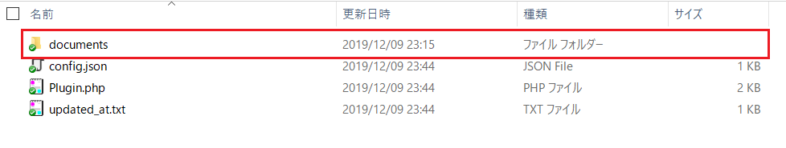
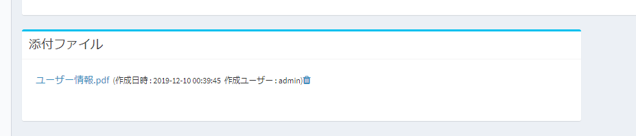
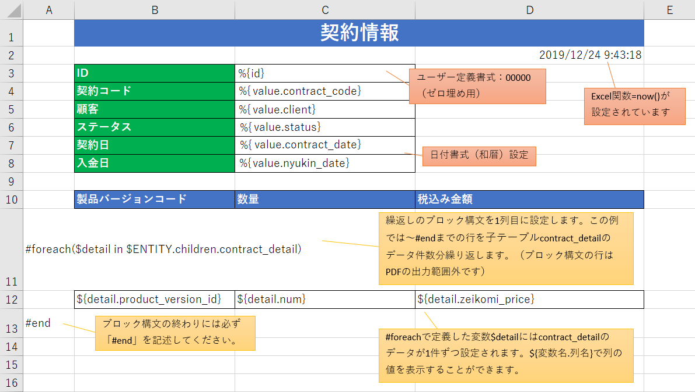

# 문서 출력(Docurain)
클라우드 장표 엔진 **Docurain**을 사용하여 장표를 PDF로 출력하는 방법입니다. Docurain은 Excel과 json만으로 장표를 개발할 수 있습니다.

> Excel 형식으로의 출력은 [플러그인(문서 출력)](/ko/plugin_quickstart_document)을 참조해 주십시오.

## Docurain이란
Docurain은 Excel과 json만으로 장표를 개발할 수 있는 클라우드 장표 엔진입니다.  
다양한 레이아웃의 장표를 Excel 파일의 템플릿에서 만들 수 있습니다. PDF 형식의 출력에도 대응합니다.
[Docurain의 사이트는 여기](https://docurain.jp/)

> Docurain은 루트42 주식회사가 개발·운용하는 서비스입니다.
이용하려면 라이선스 토큰이 필요합니다. 요금은 장표 출력 횟수에 따른 종량 과금입니다. (시험용 토큰의 발행은 가능합니다.)
Exment의 개발·운용 회사인 주식회사 카지토리는 Docurain의 대리점입니다. 시험 이용의 요청, 신청, 문의는 [여기](https://exment.net/docurain)에서 부탁드립니다.

## 실행 방법
1. [Docurain 플러그인](https://github.com/exment-git/plugin-sample/tree/main/docurain/Docurain)을 다운로드합니다.

2. Exment의 플러그인으로 업로드합니다.
순서는 [플러그인 업로드](/ko/plugin)를 참조해 주십시오.

3. 업로드한 뒤, Docurain 플러그인의 행을 클릭하여 플러그인 설정 화면으로 들어갑니다.

  

4. 아래의 내용을 입력합니다.

- 대상 테이블: Docurain을 실행할 대상의 테이블

  

- 토큰: Docurain 실행 토큰. 토큰 발행은 [문의](https://exment.net/inquiry)에서 문의해 주십시오

  

- 테이블 이름과 장표 파일 이름 목록: 장표를 출력할 테이블 이름, 템플릿 파일 이름, 출력할 장표 파일 이름, 버튼의 레이블을 쉼표로 구분하여 입력해 주십시오. 여러 개 있는 경우에는 줄 바꿈으로 구분해 주십시오.
※템플릿 파일 이름에 일본어는 사용할 수 없습니다. (장표 파일 이름과 버튼 레이블에는 사용할 수 있습니다)  
※장표 파일 이름을 생략한 경우에는 템플릿 파일 이름이 됩니다.  
※버튼의 레이블을 생략한 경우에는 플러그인 공통으로 설정한 레이블이 됩니다.  
※장표 파일 이름에는 날짜 등의 [매개변수](/ko/params)를 포함할 수 있습니다.

  

5. 압축을 푼 폴더 안의 "documents" 폴더 안에, 장표의 바탕이 되는 Excel 파일을 배치합니다.
여러 장표를 Docurain으로 만드는 경우에는 여러 Excel 파일을 documents에 배치해 주십시오.
※폴더 경로는 "(프로젝트 루트 폴더)/storage/app/plugins/Docurain/documents"가 됩니다.
※장표를 만드는 방법은 아래의 "템플릿 Excel 파일 만들기"를 확인해 주십시오.

  
  

6. 여기까지의 설정이 끝나면, "대상 테이블"에서 선택한 테이블에 버튼이 표시됩니다.

  

7. 버튼을 클릭하면 장표가 만들어집니다.

  

### 템플릿 Excel 파일 만들기
장표의 바탕이 되는 Excel 파일을 만듭니다.  
※Excel 파일의 이름에 일본어는 사용할 수 없습니다. 확장자는 반드시 xlsx로 부탁드립니다.  
※템플릿 파일의 매개변수는 보통의 Exment의 매개변수 작성법과는 다릅니다. Docurain 전용의 작성법이 필요합니다.

#### 매개변수
템플릿의 Excel 파일에 설정하는 매개변수입니다.
Excel의 셀에 정해진 형식의 변수를 입력해 두면, 장표를 출력할 때 여러 가지 값으로 변환됩니다.

##### 시스템 값
| 항목 | 설명 |
| ---- | ---- |
| %{system.site_name} | 시스템의 사이트 이름 |
| %{system.site_name_short} | 시스템의 사이트 이름(약칭) |
| %{system.system_mail_from} | 시스템의 보낸 사람 |
| %{system.system_url} | 시스템의 홈 URL |
| %{system.login_url} | 시스템의 로그인 URL |

##### 데이터
| 항목 | 설명 |
| ---- | ---- |
| %{id} | 대상 데이터의 ID가 설정됩니다. (예: 123) |
| %{suuid} | 대상 데이터의 suuid(Short UUID. 20자리의 무작위 문자열))가 설정됩니다. |
| %{value_url} | 대상 데이터를 표시하는 링크가 설정됩니다. |
| %{value.(열 이름)} | 대상 데이터의 열의 값이 설정됩니다. (예: 사용자 데이터에 대해 %{value.user_code}라고 적은 경우, 사용자 코드가 설정된다) |
| %{select_table.(열 이름).(참조하는 테이블의 열 이름)} | "열 이름"에 해당하는 열이 "선택 (테이블에서)", "사용자", "조직"인 경우, 참조하는 열의 값이 설정됩니다. (예: "계약 정보(contract)" 테이블에 "고객(client)" 열이 있고 "고객 정보(client)" 테이블을 참조하는 경우, %{select_table.client.client_code}라고 설정하면 "고객 정보(client)" 테이블의 고객 코드(client_code)를 표시할 수 있다) |
| %{parent.(참조하는 테이블의 열 이름)} | 상위 테이블의 열의 값이 설정됩니다. (예: "계약 명세 정보(contract_detail)" 테이블에서 상위인 "계약 정보(contract)" 테이블의 계약 코드(contract_code)를 참조하는 경우, %{parent.contract_code}라고 적으면 계약 코드가 설정된다) |
| $ENTITY.children.(하위 테이블 이름) | "#foreach" 등의 블록 구문을 사용하여 하위 테이블의 정보를 설정합니다. 하위 테이블의 정보는 여러 개 있는 경우가 있으므로, %{children.(하위 테이블 이름).(하위 테이블의 열 이름)}처럼 설정할 수는 없습니다. 아래에서 한 가지 예를 설명합니다. |

#### 설정 예
##### 기본 규칙
- 일반적인 EXCEL 함수나 서식 설정을 사용할 수 있습니다.  
- A열은 로직 기술 전용의 열입니다. #if나 #foreach, #set 등의 블록 구문을 적습니다.

##### ※템플릿의 한 가지 예   

- 위 템플릿을 출력한 결과의 PDF입니다.   

#### 샘플 템플릿 다운로드
[사용자 정보](https://exment.net/downloads/product/plugin/Docurain/user.xlsx)  
[제품 버전 정보](https://exment.net/downloads/product/plugin/Docurain/product_version.xlsx)  
[계약 정보](https://exment.net/downloads/product/plugin/Docurain/contract.xlsx)  
※제품 버전 정보와 계약 정보를 사용하려면, 미리 "제품 판매 회사용 템플릿"을 가져와야 합니다.

### 오류에 대하여
- 출력을 실행한 뒤에 오류가 표시되는 경우가 있습니다.
그 경우에는 오류의 내용을 확인하고 대응해 주십시오.

- "HTTP 상태 코드"가 "413"인 오류는, Docurain의 클라우드 서비스 쪽에서 서비스 허용값을 변경해야 합니다.
그 경우에는 [여기](https://exment.net/docurain)에서 문의해 주십시오.
