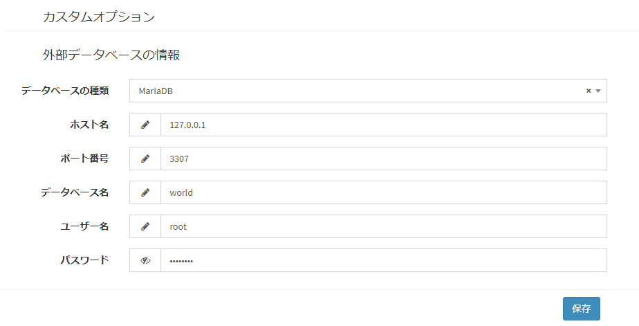

# 플러그인(이벤트)
Exment의 화면에서 특정 조작(데이터의 저장, 워크플로의 실행 등)을 했을 때 실행되어, 값의 업데이트 등의 처리를 할 수 있습니다.  
이 페이지에서는 플러그인(이벤트)을 만드는 방법을 설명합니다. config.json과 Plugin.php를 만들고, zip으로 압축하여 업로드합니다.  

> 이 기능은 v3.2.0부터 추가되었습니다.

## 이벤트의 종류

| 이름 | 종류 | 설명 |
| ---- | ---- | ---- |
| loading | 로드 시작 시 | 페이지의 로드 처리의 맨 처음에 처리가 시작됩니다. |
| loaded | 로드 완료 시 | 페이지의 로드 처리의 맨 끝에 처리가 시작됩니다. |
| saving | 저장 직전 | 데이터의 저장 직전에 처리가 시작됩니다. |
| saved | 저장 후 | 데이터의 저장 후에 처리가 시작됩니다. |
| deleted | 삭제 후 | 데이터의 삭제 후에 처리가 시작됩니다. |
| workflow_action_executing | 워크플로 실행 직전 | 워크플로 실행의 직전에 처리가 시작됩니다. |
| workflow_action_executed | 워크플로 실행 후 | 워크플로 실행 후에 처리가 시작됩니다. |
| notify_executing | 알림 실행 직전 | 알림 실행의 직전에 처리가 시작됩니다. |
| notify_executed | 알림 실행 후 | 알림 실행 후에 처리가 시작됩니다. |

## 만드는 방법

### config.json 만들기
- 아래의 config.json 파일을 만듭니다.  

~~~ json
{
    "plugin_name": "PluginDemoEvent",
    "uuid": "fa7de170-992a-11e8-b568-0800200c9a66",
    "plugin_view_name": "Plugin Event",
    "description": "플러그인 이벤트를 실행하는 테스트입니다.",
    "author": "(Your Name)",
    "version": "1.0.0",
    "plugin_type": "event",
    "event_triggers": "loaded"
}
~~~

- plugin_name은 반각 영숫자로 적어 주십시오.
- uuid는 32문자+하이픈의, 합계 36자의 문자열입니다. 플러그인을 고유하게 하는 데 사용합니다.  
아래 URL 등에서 만들어 주십시오.  
https://www.famkruithof.net/uuid/uuidgen
- plugin_type은 event라고 적어 주십시오.  
- event_triggers를 처음부터 지정하는 경우, "이벤트의 종류"의 이름을 쉼표로 구분하여 입력해 주십시오.
- target_tables를 처음부터 지정하는 경우, 사용자 정의 테이블의 테이블 이름을 쉼표로 구분하여 입력해 주십시오.

### PHP 파일 만들기
- 아래와 같은 PHP 파일을 만듭니다. 이름은 "Plugin.php"로 해 주십시오.

~~~ php
<?php
namespace App\Plugins\PluginDemoEvent;

use Exceedone\Exment\Services\Plugin\PluginEventBase;
class Plugin extends PluginEventBase
{
    /**
     * Plugin Trigger
     */
    public function execute()
    {
        \Log::debug('Event called!');
        return true;
    }
}
~~~
- namespace는 **App\Plugins\\(플러그인 이름의 파스칼 케이스)** 로 해 주십시오. [자세한 내용은 여기](/ko/plugin_quickstart)

- 플러그인 관리 화면에서 등록한 트리거의 조건에 맞은 경우에 플러그인이 호출되어, Plugin.php 안의 execute 함수가 실행됩니다.  

- Plugin 클래스는 클래스 PluginEventBase를 상속하고 있습니다.  
PluginEventBase는 호출한 쪽의 사용자 정의 테이블 $custom_table, 테이블 값 $custom_value 등의 프로퍼티를 가지고 있으며,  
execute 함수가 호출된 시점에 그 프로퍼티에 값이 대입됩니다.  
프로퍼티의 상세에 대해서는 [플러그인 레퍼런스](/ko/plugin_reference)를 참조해 주십시오.  

### zip으로 압축
위 2개 파일을 최소 구성으로 하여 zip으로 압축합니다.  
zip 파일 이름은 "(plugin_name).zip"으로 해 주십시오.  
- PluginDemoEvent.zip
    - config.json
    - Plugin.php
    - (기타, 필요한 PHP 파일, 이미지 파일 등)

### 샘플 플러그인
[외부 데이터베이스 연동](https://github.com/exment-git/plugin-sample/tree/main/event/PluginSyncCity)  
- 사용자 정의 데이터를 저장했을 때 외부 데이터베이스와 연동하는 샘플입니다.  
- Exment의 도시 테이블에서 추가·업데이트·삭제를 하면 외부 데이터베이스의 city 테이블에 반영됩니다.  
- 사전 준비로 아래의 처리를 순서대로 실행해 주십시오.
    1. Exment의 관리자 설정 → 템플릿에서 [템플릿](https://exment.net/downloads/sample/template/city_template.zip)을 가져옵니다.  
    2. 외부 데이터베이스를 만듭니다. 이 플러그인에서는 MySQL의 샘플 데이터베이스 "world"를 사용합니다. [공식 사이트](https://dev.mysql.com/doc/index-other.html)에서 zip을 다운로드한 뒤, 사용하는 MySQL(또는 MariaDB) 환경에서 압축을 푼 SQL을 실행해 주십시오.
  
    3. Exment의 관리자 설정 → 플러그인에서 [플러그인](https://github.com/exment-git/plugin-sample/tree/main/event/PluginSyncCity)을 업로드합니다.  
    4. 플러그인의 설정 화면을 열고, 2.에서 설정한 외부 데이터베이스의 접속 정보를 입력 → 저장해 주십시오.    
  
