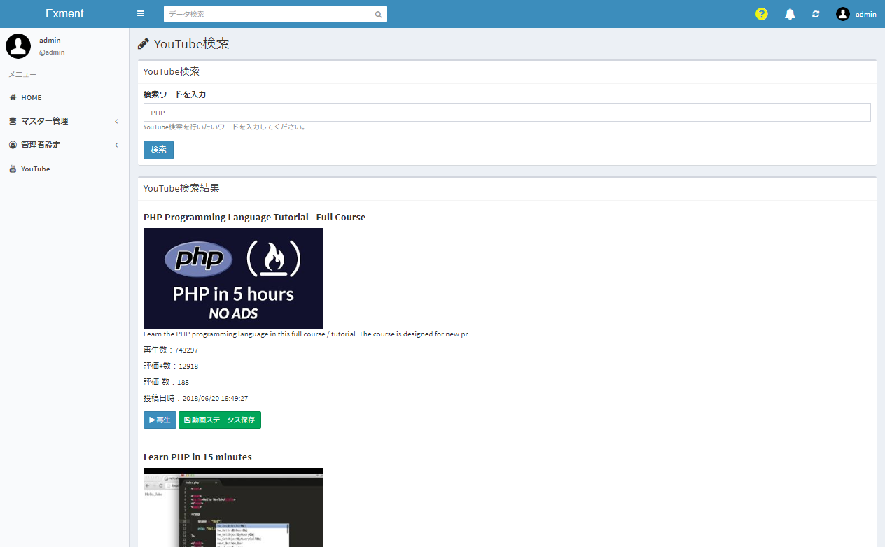

## 플러그인(페이지)
Exment에 새 화면을 만들 수 있습니다.  
표준 기능과는 전혀 다른 페이지를 쓰고 싶은 경우에 이용해 주십시오.  
이 페이지에서는 YouTube를 검색하는 페이지를 예로, 플러그인(페이지)을 만드는 방법을 설명합니다.  

## 시작하기 전에
Exment의 플러그인 페이지는 PHP 프레임워크 [Laravel](http://laravel.jp/)(일본어)과 관리 화면 라이브러리 [exment-admin-core](https://github.com/exceedone/exment-admin-core)(laravel-admin / open-admin을 바탕으로 한 라이브러리, v6.x 이전은 laravel-admin)를 사용하여 개발합니다.  
페이지를 개발하는 경우에는 특히 Laravel의 지식이 있는 분이 개발할 것을 권장합니다.

※관리 화면 라이브러리의 클래스는 Exment v7.0.0 이상의 네임스페이스("ExmentAdminCore\Admin")로 적었습니다.  
v6.x 이전을 사용하는 경우에는 "Encore\Admin"으로 바꿔 읽어 주십시오. 자세한 내용은 [여기](/update/v7_0_0)(영어)를 확인해 주십시오.

## 만드는 방법

### 샘플
여기서는 샘플로 아래의 페이지를 만듭니다.
- YouTube에서 데이터를 검색하기 위한 검색 바를 표시한다.  
- 입력한 검색 값으로 YouTube 검색을 하여 상위 20건을 표시한다.  
- "등록" 버튼을 클릭한 동영상의 동영상 ID와 제목, 설명문, 링크, 재생 수, 좋아요 수, 싫어요 수를 테이블 "YouTube"에 등록한다.  

   

※실행하려면 YouTube의 액세스 키가 필요합니다. [여기](https://qiita.com/shinkai_/items/10a400c25de270cb02e4)(일본어)를 참고하여 키를 받아 주십시오.  
  
※미리 [여기](https://exment.net/downloads/sample/template/YouTube.zip)의 템플릿을 가져와 주십시오.

- 샘플 플러그인 [여기](https://github.com/exment-git/plugin-sample/tree/main/page/YouTubeSearch)  

### config.json 만들기
- 아래의 config.json 파일을 만듭니다.  

~~~ json

{
    "plugin_name": "YouTubeSearch",
    "plugin_view_name" : "YouTube 검색",
    "description": "YouTube를 검색하고, 재생 수 등을 데이터로 저장합니다.",
    "uuid":  "c6d8daa0-c255-11e9-bb97-0800200c9a66",
    "author":  "(Your Name)",
    "version": "1.0.0",
    "plugin_type": "page",
    "route": [
        {
            "uri": "",
            "method": [
                "get"
            ],
            "function": "index"
        },
        {
            "uri": "list",
            "method": [
                "get"
            ],
            "function": "list"
        },
        {
            "uri": "save",
            "method": [
                "post"
            ],
            "function": "save"
        }
    ]
}

~~~

- plugin_name은 반각 영숫자로 적어 주십시오.
- uuid는 32문자+하이픈의, 합계 36자의 문자열입니다. 플러그인을 고유하게 하는 데 사용합니다.  
아래 URL 등에서 만들어 주십시오.  
https://www.famkruithof.net/uuid/uuidgen
- plugin_type은 page라고 적어 주십시오.  
- route는 실행할 URL의 엔드포인트와 그 HTTP 메서드, Controller 안의 메서드를 목록으로 정의합니다.
    - uri: 페이지 표시를 위한 uri입니다. 실제 URL은 "http(s)://(Exment의 URL)/plugins/(플러그인 관리 화면에서 설정한 URL)/(지정한 uri)"가 됩니다.  
    - method: HTTP 메서드입니다. get,post,put,delete로 적어 주십시오.
    - function: 실행할 Controller 안의 메서드
    - 예: 플러그인 관리 화면에서 설정한 URL이 "youtube_search", config.json에서 지정한 uri가 "list", 지정한 method가 "get"인 경우, "http(s)://(Exment의 URL)/plugins/youtube_search/list(메서드: GET)".
- route에는 반드시 uri가 빈 것("")을 포함해 주십시오. 메뉴에서 플러그인의 페이지로 이동할 때 이 엔드포인트에 접속합니다.

> ※URL은 "/admin"이 붙지 않는 표준 설정(v7.2.1 이상에서 새로 설치한 사이트)의 경우입니다. `.env` 의 `ADMIN_ROUTE_PREFIX` 에 값이 있는 경우(이전 버전에서 설치한 사이트는 "admin")에는 사이트 URL 뒤에 그 값을 붙여 주십시오(예: `http(s)://(Exment의 URL)/admin/plugins/youtube_search/list`). 자세한 내용은 [URL에 포함된 "admin"의 변경·삭제](/ko/additional_prefix)를 참조하십시오.

### Plugin 파일 만들기

#### 메인 로직 만들기
아래와 같은 PHP 파일을 만듭니다. 파일 이름은 "Plugin.php"로 해 주십시오.

~~~ php
<?php

// (1)
namespace App\Plugins\YouTubeSearch;

use ExmentAdminCore\Admin\Widgets\Box;
use Exceedone\Exment\Model\CustomTable;
use Exceedone\Exment\Services\Plugin\PluginPageBase;
use GuzzleHttp\Client;

class Plugin extends PluginPageBase
{
    // (3)
    protected $useCustomOption = true;

    /**
     * (2) Index
     *
     * @return void
     */
    public function index()
    {
        return $this->getIndexBox();
    }

    /**
     * (2) YouTube 결과 목록 표시
     *
     * @return void
     */
    public function list()
    {
        $html = $this->getIndexBox()->render();

        // 문자열 검색
        $client = new Client([
            'base_uri' => 'https://www.googleapis.com/youtube/v3/',
        ]);

        $method = 'GET';
        $uri = "search?part=id&type=video&maxResults=20&key=" . $this->plugin->getCustomOption('access_key') 
            . "&q=" . urlencode(request()->get('youtube_search_query')); //검색
        $options = [];
        $response = $client->request($method, $uri, $options);

        $list = json_decode($response->getBody()->getContents(), true);
        $ids = collect(array_get($list, 'items', []))->map(function($l){
            return array_get($l, 'id.videoId');
        })->toArray();

        // id로 상세를 검색
        $client = new Client([
            'base_uri' => 'https://www.googleapis.com/youtube/v3/',
        ]);

        $method = 'GET';
        $uri = "videos?part=id,snippet,statistics&key=" . $this->plugin->getCustomOption('access_key') 
            . "&id=" . implode(',', $ids); //검색
        $options = [];
        $response = $client->request($method, $uri, $options);

        $list = json_decode($response->getBody()->getContents(), true);
        
        $html .= new Box("YouTube 검색 결과", view('exment_you_tube_search::list', [
            'items' => array_get($list, 'items', []),
            // (5)
            'item_action' => $this->plugin->getRouteUri('save'),
        ])->render());

        return $html;
    }

    /**
     * (2) 데이터 저장
     *
     * @return void
     */
    public function save(){
        $request = request();
        $model = CustomTable::getEloquent('youtube')->getValueModel();
        $model->setValue('youtubeId', $request->get('youtubeId'));
        $model->setValue('description', $request->get('description'));
        $model->setValue('viewCount', $request->get('viewCount'));
        $model->setValue('likeCount', $request->get('likeCount'));
        $model->setValue('dislikeCount', $request->get('dislikeCount'));
        $model->setValue('url', $request->get('url'));
        $model->setValue('title', $request->get('title'));
        $model->setValue('publishedAt', $request->get('publishedAt'));
        $model->save();

        admin_toastr(trans('admin.save_succeeded'));
        return redirect()->back()->withInput();
    }

    /**
     * 검색 상자 가져오기
     *
     * @return void
     */
    protected function getIndexBox(){
        // (3) YouTube 액세스 키의 체크
        $hasKey = !is_null($this->plugin->getCustomOption('access_key'));

        // (4)
        return new Box("YouTube 검색", view('exment_you_tube_search::index', [
            'action' => $this->plugin->getRouteUri('list'),
            'youtube_search_query' => request()->get('youtube_search_query'),
            'hasKey' => $hasKey,
        ]));
    }
    
    /**
     * (3) 플러그인의 편집 화면에서 설정하는 옵션. 액세스 키를 입력하게 한다
     *
     * @param [type] $form
     * @return void
     */
    public function setCustomOptionForm(&$form)
    {
        $form->text('access_key', '액세스 키')
            ->help('YouTube의 액세스 키를 입력해 주십시오.');
    }
}
~~~

- (1) namespace는 **App\Plugins\\(플러그인 이름의 파스칼 케이스)** 로 해 주십시오. [자세한 내용은 여기](/ko/plugin_quickstart)  
또한 클래스 이름은 "Plugin"으로 하고, PluginPageBase를 상속해 주십시오.

- (2) 클래스 안의 public 메서드 이름은 config.json의 function에 적은 이름이 됩니다.  

- (3) 함수 "public function setCustomOptionForm(&$form)"은 플러그인의 설정 화면에 표시되는 항목입니다.  
이번 경우에는 YouTube Data API를 실행하는 데 필요한 액세스 키를 화면에서 설정할 수 있게 됩니다.  

※사용자 정의 설정을 사용하려면 "protected $useCustomOption = true;"를 추가해 주십시오.  
※설정한 값을 가져오려면 함수 "$this->plugin->getCustomOption('매개변수 이름')"을 사용해 주십시오.

- (4) 뷰를 사용하는 경우, 뷰 이름의 접두사로 "exment_(플러그인 이름의 스네이크 케이스)::"를 추가해 주십시오.  

- (5) 플러그인의 엔드포인트를 가져오고 싶은 경우, 함수 "$this->getRouteUri('엔드포인트 이름')"을 사용해 주십시오.  
※URL 전체 경로를 가져오고 싶은 경우, admin_url($this->getRouteUri('엔드포인트 이름'))을 사용해 주십시오.

#### (선택)뷰에 대하여
뷰를 분리하는 경우, blade 파일은 폴더 "resources/views" 아래에 저장해 주십시오.  

#### (선택)css, js, 그 밖의 정적 파일에 대하여
- css 파일은 폴더 "public/css"에 배치해 주십시오.  
- js 파일은 폴더 "public/js"에 배치해 주십시오.  
- 그 밖의 파일(이미지 파일 등)은 폴더 "public/assets"에 배치해 주십시오.  

### zip으로 압축
위 2개 파일을 최소 구성으로 하여 zip으로 압축합니다.  
zip 파일 이름은 "(plugin_name).zip"으로 해 주십시오.  
- YouTubeSearch.zip
    - config.json
    - Plugin.php
    - (기타, 필요한 PHP 파일, 이미지 파일 등)

### 기타
- 특정 ID 값의 데이터 상세를 표시하고 싶은 경우, config.json의 route에 아래와 같은 기술을 추가해 주십시오.  
"{id}"와 같이 uri를 지정할 수 있습니다.  

~~~ json

{
    "route": [
        {
            "uri": "show_details/{id}",
            "method": [
                "get"
            ],
            "function": "show_details"
        }
    ]
}

~~~

### 샘플 플러그인
※아래의 샘플 플러그인은 Exment v7.0.0 이상을 지원하며, 네임스페이스 "ExmentAdminCore\Admin"을 사용하고 있습니다.  
v6.x 이전을 사용하는 경우에는 "Plugin.php" 안의 "ExmentAdminCore\Admin"을 "Encore\Admin"으로 바꿔서 사용해 주십시오. 자세한 내용은 [여기](/update/v7_0_0)(영어)를 확인해 주십시오.

[YouTube 검색](https://github.com/exment-git/plugin-sample/tree/main/page/YouTubeSearch)  
※미리 [여기](https://exment.net/downloads/sample/template/YouTube.zip)의 템플릿을 가져와 주십시오.
