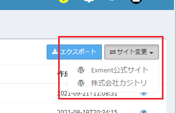
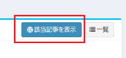

# 플러그인 레퍼런스(CRUD 페이지)
플러그인(CRUD 페이지)을 개발하는 분을 위한 페이지입니다.  
CRUD 페이지의 클래스에서 쓸 수 있는 함수·속성을 정리했습니다.

**함수에 붙은 표시의 뜻**

| 표시 | 뜻 |
| ---- | ---- |
| ★ | 거의 반드시 정의해야 합니다 |
| ☆ | 경우에 따라 정의해야 합니다 |

- 이 페이지는 CRUD 페이지 전용입니다. 다른 종류의 플러그인은 [플러그인 레퍼런스](/ko/plugin_reference)를 확인해 주십시오.
- 사용자 정의 테이블·사용자 정의 열·사용자 정의 데이터의 함수는 [함수 레퍼런스](/ko/func_reference)를 확인해 주십시오.
- 주로 플러그인 개발자가 정의하는 것을 실었습니다. 시스템이 쓰는 것으로, 개발자가 바꾸지 않았으면 하는 것은 뺐습니다.
- 관리 화면 라이브러리의 클래스는 Exment v7.0.0 이후의 네임스페이스("ExmentAdminCore\Admin")로 적혀 있습니다. v6.x 이전을 이용하는 경우에는 "Encore\Admin"으로 바꿔 읽어 주십시오. 자세한 내용은 [업데이트 절차 v7.0.0(영어)](/update/v7_0_0)를 확인해 주십시오.

## PluginCrudBase
플러그인(CRUD 페이지)의 추상 클래스입니다. CRUD 페이지 플러그인을 개발할 때는 이 클래스를 상속해 주십시오.  

- namespace Exceedone\Exment\Services\Plugin
- trait Exceedone\Exment\Services\Plugin\PluginBase
- trait Exceedone\Exment\Services\Plugin\PluginPageTrait

##### 속성

| 이름 | 종류 | 설명 |
| ---- | ---- | ---- |
| title | string | 각 페이지에 표시할 제목 |
| description | string | 각 페이지에 표시할 설명문 |
| icon | string | 각 페이지에 표시할 아이콘 |


### 함수 목록

#### ★getFieldDefinitions
열 정의를 연관 배열로 가져오는 함수입니다.  
- 반드시 "primary" => true인 키를 1개 추가해 주십시오. (현재 복합 키는 지원하지 않습니다)  
- "key"는 데이터 취득이나 HTML 각 요소의 name 등에 설정하는 항목 이름입니다. 영숫자로 입력해 주십시오.  
- "label"은 목록 화면 등의 항목 이름에 씁니다.  
- "grid"는 목록 화면에 표시할 항목에 설정해 주십시오. 표시 순서대로 정수를 적어 주십시오.
- "show"는 상세 화면에 표시할 항목에 설정해 주십시오. 표시 순서대로 정수를 적어 주십시오.
- "create"는 새로 만들기 화면에 표시할 항목에 설정해 주십시오. 표시 순서대로 정수를 적어 주십시오.
- "edit"는 편집 화면에 표시할 항목에 설정해 주십시오. 표시 순서대로 정수를 적어 주십시오.


##### 인수
없음


##### 반환값
| 종류 | 설명 |
| ---- | ---- |
| array | 열 정의의 배열 |


##### 예
``` php
/**
     * (2) 열 정의를 가져오기
     * Get fields definitions
     *
     * @return array|Collection
     */
    public function getFieldDefinitions()
    {
        return [
            ['key' => 'id', 'label' => 'ID', 'primary' => true, 'grid' => 1, 'show' => 1],
            ['key' => 'title', 'label' => '제목', 'grid' => 2, 'show' => 2, 'create' => 1, 'edit' => 1],
            ['key' => 'date', 'label' => '작성 일시', 'grid' => 3, 'show' => 3, 'create' => 2, 'edit' => 2],
            ['key' => 'content', 'label' => '본문', 'show' => 4, 'create' => 3, 'edit' => 3],
        ];
    }
```

---


#### getAuthType
CRUD 페이지의 인증 종류 문자열을 반환합니다.  
※Exment의 로그인과는 별도로, 이 CRUD 페이지에 접근하기 위한 인증을 설정할 수 있습니다. 접근하려는 서비스의 종류에 따라 인증 종류를 설정해 주십시오.


##### 인증 종류
| 반환 문자열 | 종류 | 설명 |
| ---- | ---- | ---- |
| (null) | 인증 없음 | CRUD 페이지 전용의 인증을 하지 않는 경우입니다. 기본값입니다. |
| key | 액세스 키 | 플러그인의 설정 페이지에서 액세스 키를 설정합니다. 액세스 키가 입력되어 있지 않으면 오류가 표시됩니다. |
| id_password | ID·비밀번호 | 플러그인의 설정 페이지에서 ID와 비밀번호를 설정합니다. ID와 비밀번호가 입력되어 있지 않으면 오류가 표시됩니다. |
| oauth | OAuth | 로그인 설정 화면에서 OAuth 설정을 합니다. 사용자가 CRUD 페이지에 접근할 때 OAuth 로그인을 합니다. OAuth 로그인에 성공한 경우에만 CRUD 페이지에 접근할 수 있습니다. 또한 액세스 토큰도 쓸 수 있습니다. |


##### 인수
없음

##### 반환값
| 종류 | 설명 |
| ---- | ---- |
| ?string | 인증 종류를 나타내는 문자열 |


##### 예
``` php
    /**
     * Get auth type.
     * Please set null or "key" or "id_password" or "oauth".
     *
     * @return string|null
     */
    public function getAuthType() : ?string
    {
        return 'oauth';
    }
```

---


#### enablePaginate
데이터 목록을 페이지네이션 형식으로 표시할지를 적습니다.  
데이터를 가져올 서비스가 페이지네이션 형식(데이터의 총수, 페이지 번호를 지정한 데이터 취득, 페이지별 데이터 취득)을 지원하면 true를 반환해 주십시오. 지원하지 않으면 false를 반환해 주십시오.

##### 인수
없음


##### 반환값
| 종류 | 설명 |
| ---- | ---- |
| boolean | 페이지네이션 형식을 지원하는지 여부. 기본값: true |


##### 예
``` php
     /**
     * Whether use paginate
     * Default: true
     *
     * @return bool
     */
    public function enablePaginate() : bool
    {
        return true;
    }
```

---


#### ★getPaginate
데이터 목록을 페이지네이션 형식으로 가져오는 함수입니다.  
가져온 데이터를 \Illuminate\Pagination\LengthAwarePaginator 형식으로 반환해 주십시오.  
또한 목록의 각 요소는 연관 배열로 하고, 이 연관 배열의 키 값은 getFieldDefinitions에서 설정한 키 값과 같게 해 주십시오.  
※함수 enablePaginate가 true인 경우에 구현해 주십시오.


##### 인수
| 이름 | 종류 | 설명 |
| ---- | ---- | ---- |
| $options | array | 목록 화면 표시에 쓰는 옵션 |
| $options['per_page'] | int | 1페이지에 표시할 건수 |
| $options['page'] | int | 페이지 번호 |
| $options['query'] | string | 검색할 때의 검색 문자열 |


##### 반환값
| 종류 | 설명 |
| ---- | ---- |
| LengthAwarePaginator | 검색 결과 모델 |


##### 예
``` php
    /**
     * (3) 데이터 목록(Paginate)을 가져오기
     * Get data paginate
     *
     * @return LengthAwarePaginator
     */
    public function getPaginate(array $options = []) : ?LengthAwarePaginator
    {
        $client = new Client([
            'base_uri' => $this->getSiteUrl(),
        ]);

        $query = [
            'per_page' => $options['per_page'] ?? 20,
            'page' => $options['page'] ?? 1
        ];

        if(array_has($options, 'query')){
            $query['search'] = array_get($options, 'query');
        }

        $response = $client->get('wp-json/wp/v2/posts', ['query' => $query]);

        $json = json_decode((string)$response->getBody());

        $result = collect($json)->map(function($j){
            $j = json_decode(json_encode($j), true);
            return (object)[
                'id' => array_get($j, 'id'),
                'title' => array_get($j, 'title.rendered'),
                'content' => array_get($j, 'content.rendered'),
                'date' => array_get($j, 'date'),
            ];
        });
        
        return new LengthAwarePaginator(
            $result, 
            array_get($response->getHeaders(), 'X-WP-Total')[0], 
            $query['per_page'],
            $query['page'],
            [
                'path' => $this->getFullUrl(),
            ]
        );
    }
```


---

#### ☆getList
데이터 목록을 가져오는 함수입니다.  
가져온 데이터를 Collection 형식으로 반환해 주십시오.  
또한 목록의 각 요소는 연관 배열로 하고, 이 연관 배열의 키 값은 getFieldDefinitions에서 설정한 키 값과 같게 해 주십시오.  
※함수 enablePaginate가 false인 경우에 구현해 주십시오.


##### 인수
| 이름 | 종류 | 설명 |
| ---- | ---- | ---- |
| $options | array | 목록 화면 표시에 쓰는 옵션 |
| $options['query'] | string | 검색할 때의 검색 문자열 |


##### 반환값
| 종류 | 설명 |
| ---- | ---- |
| \Illuminate\Support\Collection | 결과 목록 |


##### 예
``` php
    /**
     * (3) 데이터 목록을 가져오기
     * Get data list
     *
     * @return Collection
     */
    public function getList(array $options = []) : Collection
    {
        $client = new Client([
            'base_uri' => $this->getSiteUrl(),
        ]);

        if(array_has($options, 'query')){
            $query['search'] = array_get($options, 'query');
        }

        $token = $this->getOauthAccessToken();
        $response = $client->get('v1.0/me/todo/lists', [
            'query' => $query, 
            'headers' => [
                'Authorization' => "Bearer $token",
                'Accept'        => 'application/json',
            ]
        ]);

        $json = json_decode((string)$response->getBody());

        $result = collect($json->value)->map(function($j){
            $j = json_decode(json_encode($j), true);
            return (object)[
                'id' => array_get($j, 'id'),
                'displayName' => array_get($j, 'displayName'),
            ];
        });

        return $result;
    }
```


---


#### getChunkCount
데이터 목록을 페이지네이션 형식으로 가져올 때, 한 번에 가져올 건수를 반환합니다.  

##### 인수
없음


##### 반환값
| 종류 | 설명 |
| ---- | ---- |
| int | 한 번에 가져올 건수. 기본값: 1000 |


##### 예
``` php
    /**
     * Get max chunk count.
     *
     * @return int
     */
    public function getChunkCount() : int
    {
        return 1000;
    }
```


---

#### ★getData
지정한 ID의 데이터를 1건 가져와 반환합니다.  
또한 데이터의 각 요소는 연관 배열로 하고, 이 연관 배열의 키 값은 getFieldDefinitions에서 설정한 키 값과 같게 해 주십시오.  

##### 인수
| 이름 | 종류 | 설명 |
| ---- | ---- | ---- |
| $id | string | 데이터의 키 값 |
| $options | array | 현재 사용하지 않음. 예약 인수. |


##### 반환값
| 종류 | 설명 |
| ---- | ---- |
| array 또는 Collection | 가져온 데이터 |


##### 예
``` php
    /**
     * (3) 데이터 상세(1건의 데이터)를 가져오기
     * read single data
     *
     * @return array|Collection
     */
    public function getData($id, array $options = [])
    {
        $client = new Client([
            'base_uri' => $this->getSiteUrl(),
        ]);
        $response = $client->request('GET', "wp-json/wp/v2/posts/{$id}");
        $json = json_decode((string)$response->getBody());
        
        $j = json_decode(json_encode($json), true);
        return (object)[
            'id' => array_get($j, 'id'),
            'title' => array_get($j, 'title.rendered'),
            'content' => array_get($j, 'content.rendered'),
            'date' => array_get($j, 'date'),
        ];
    }
```


---

#### ★postCreate
데이터를 새로 만듭니다.  
반환값으로는 만든 데이터의 키 값을 반환해 주십시오.  

##### 인수
| 이름 | 종류 | 설명 |
| ---- | ---- | ---- |
| $posts | array | 사용자가 입력한 데이터. 연관 배열. |
| $options | array | 현재 사용하지 않음. 예약 인수. |


##### 반환값
| 종류 | 설명 |
| ---- | ---- |
| string | 만든 데이터의 키 값을 반환해 주십시오 |


##### 예
``` php
    /**
     * post create value
     *
     * @return mixed
     */
    public function postCreate(array $posts, array $options = [])
    {
        $client = new Client([
            'base_uri' => $this->getSiteUrl(),
        ]);

        // create Authorization header 
        $id_password = $this->getAuthIdPassword();
        $Authorization = "Basic " . base64_encode("{$id_password['id']}:{$id_password['password']}");

        $response = $client->request('POST', "wp-json/wp/v2/posts", [
            'headers' => [
                'Authorization' => $Authorization,
                //'Content-Type' => 'application/json',
            ],
            'form_params' => [
                'title' => array_get($posts, 'title'),
                'content' => array_get($posts, 'content'),
                'status' => 'publish',
            ],
        ]);
        $json = json_decode((string)$response->getBody());
        $j = json_decode(json_encode($json), true);
        return array_get($j, 'id');
    }

```


---

#### ★putEdit
데이터를 편집합니다.  
반환값으로는 편집한 데이터의 키 값을 반환해 주십시오.  

##### 인수
| 이름 | 종류 | 설명 |
| ---- | ---- | ---- |
| $id | string | 편집할 대상의 키 값 |
| $posts | array | 사용자가 입력한 데이터. 연관 배열. |
| $options | array | 현재 사용하지 않음. 예약 인수. |


##### 반환값
| 종류 | 설명 |
| ---- | ---- |
| string | 업데이트한 데이터의 키 값을 반환해 주십시오 |


##### 예
``` php
    /**
     * edit posted value
     *
     * @return mixed
     */
    public function putEdit($id, array $posts, array $options = [])
    {
        $client = new Client([
            'base_uri' => $this->getSiteUrl(),
        ]);

        // create Authorization header 
        $id_password = $this->getAuthIdPassword();
        $Authorization = "Basic " . base64_encode("{$id_password['id']}:{$id_password['password']}");

        $response = $client->request('POST', "wp-json/wp/v2/posts/{$id}", [
            'headers' => [
                'Authorization' => $Authorization,
                //'Content-Type' => 'application/json',
            ],
            'form_params' => [
                'title' => array_get($posts, 'title'),
                'content' => array_get($posts, 'content'),
                'status' => 'publish',
            ],
        ]);
        $json = json_decode((string)$response->getBody());
        $j = json_decode(json_encode($json), true);
        return array_get($j, 'id');
    }

```


---

#### ★delete
데이터를 삭제합니다.  

##### 인수
| 이름 | 종류 | 설명 |
| ---- | ---- | ---- |
| $id | string | 삭제할 대상의 키 값 |
| $options | array | 현재 사용하지 않음. 예약 인수. |


##### 반환값
없음


##### 예
``` php
    /**
     * delete value
     *
     * @param $id string
     * @return mixed
     */
    public function delete($id, array $options = [])
    {
        $client = new Client([
            'base_uri' => $this->getSiteUrl(),
        ]);

        // create Authorization header 
        $id_password = $this->getAuthIdPassword();
        $Authorization = "Basic " . base64_encode("{$id_password['id']}:{$id_password['password']}");

        $response = $client->request('DELETE', "wp-json/wp/v2/posts/{$id}", [
            'headers' => [
                'Authorization' => $Authorization,
                //'Content-Type' => 'application/json',
            ],
        ]);
    }
```


---

#### enableCreate
새로 만들기를 할 수 있는지 판정하여 boolean 형으로 반환합니다.  
연동 서비스가 새로 만들기를 지원하지 않거나, 사용자에 따라 새로 만들기를 못 하게 하려면 false를 반환해 주십시오.

##### 인수
| 이름 | 종류 | 설명 |
| ---- | ---- | ---- |
| $options | array | 현재 사용하지 않음. 예약 인수. |


##### 반환값
| 종류 | 설명 |
| ---- | ---- |
| boolean | 새로 만들기가 가능하면 true 반환. 기본값: true |

---


#### enableEditAll
편집을 할 수 있는지 판정하여 boolean 형으로 반환합니다.  
연동 서비스가 편집을 지원하지 않거나, 사용자에 따라 편집을 못 하게 하려면 false를 반환해 주십시오.

##### 인수
| 이름 | 종류 | 설명 |
| ---- | ---- | ---- |
| $options | array | 현재 사용하지 않음. 예약 인수. |


##### 반환값
| 종류 | 설명 |
| ---- | ---- |
| boolean | 편집이 가능하면 true 반환. 기본값: true |

---


#### enableEdit
지정한 데이터에 대해 데이터 편집을 할 수 있는지 판정하여 boolean 형으로 반환합니다.  
연동 서비스가 편집을 지원하지 않거나, 사용자에 따라 편집을 못 하게 하려면 false를 반환해 주십시오.

##### 인수
| 이름 | 종류 | 설명 |
| ---- | ---- | ---- |
| $value | mixed | ID에 해당하는 값. |
| $options | array | 현재 사용하지 않음. 예약 인수. |


##### 반환값
| 종류 | 설명 |
| ---- | ---- |
| boolean | 편집이 가능하면 true 반환. 기본값: true |

---


#### enableDeleteAll
데이터 삭제를 할 수 있는지 판정하여 boolean 형으로 반환합니다.  
연동 서비스가 삭제를 지원하지 않거나, 사용자에 따라 삭제를 못 하게 하려면 false를 반환해 주십시오.

##### 인수
| 이름 | 종류 | 설명 |
| ---- | ---- | ---- |
| $options | array | 현재 사용하지 않음. 예약 인수. |


##### 반환값
| 종류 | 설명 |
| ---- | ---- |
| boolean | 삭제가 가능하면 true 반환. 기본값: true |

---

#### enableDelete
지정한 데이터에 대해 데이터 삭제를 할 수 있는지 판정하여 boolean 형으로 반환합니다.  
연동 서비스가 삭제를 지원하지 않거나, 사용자에 따라 삭제를 못 하게 하려면 false를 반환해 주십시오.

##### 인수
| 이름 | 종류 | 설명 |
| ---- | ---- | ---- |
| $value | mixed | ID에 해당하는 값. |
| $options | array | 현재 사용하지 않음. 예약 인수. |


##### 반환값
| 종류 | 설명 |
| ---- | ---- |
| boolean | 삭제가 가능하면 true 반환. 기본값: true |

---


#### enableExport
데이터 내보내기를 할 수 있는지 판정하여 boolean 형으로 반환합니다.  
데이터 내보내기는 경우에 따라 서비스의 모든 데이터를 가져옵니다. 그러므로 대량 데이터의 취득 등에 주의해 주십시오.

##### 인수
| 이름 | 종류 | 설명 |
| ---- | ---- | ---- |
| $options | array | 현재 사용하지 않음. 예약 인수. |


##### 반환값
| 종류 | 설명 |
| ---- | ---- |
| boolean | 데이터 내보내기가 가능하면 true 반환. 기본값: false |

---


#### enableFreewordSearch
데이터 검색을 할 수 있는지 판정하여 boolean 형으로 반환합니다.  

##### 인수
| 이름 | 종류 | 설명 |
| ---- | ---- | ---- |
| $options | array | 현재 사용하지 않음. 예약 인수. |


##### 반환값
| 종류 | 설명 |
| ---- | ---- |
| boolean | 데이터 검색이 가능하면 true 반환. 기본값: false |

---


#### callbackGridTool
GRID(데이터 목록) 화면에서 페이지의 오른쪽 위에 고유의 버튼을 표시하고 싶을 때 등에 정의합니다.

##### 인수

| 이름 | 종류 | 설명 |
| ---- | ---- | ---- |
| $tools | \ExmentAdminCore\Admin\Widgets\Grid\Tools | 도구 |


##### 반환값
없음


##### 예
``` php
    /**
     * Callback tools. If add event, definition.
     * ※이 예의 경우: WordPress 목록 버튼을 표시하고, 데이터를 가져올 WordPress를 전환한다
     *
     * @param $tools
     * @return void
     */
    public function callbackGridTool($tools)
    {
        $menulist = [];

        foreach ($this->getSiteDefinitions() as $site) {
            $menulist[] = [
                'href' => admin_urls('plugins', $this->plugin->getOption('uri'), array_get($site, 'endpoint')),
                'label' => array_get($site, 'label'),
                'icon' => 'fa-wordpress',
            ];
        }
        $tools->prepend(view('exment::tools.menu-button', [
            'button_label' => '사이트 변경',
            'menulist' => $menulist,
        ])->render(), 'right');
    }

```

  

---


#### callbackShowTool
SHOW(데이터 상세) 화면에서 페이지의 오른쪽 위에 고유의 버튼을 표시하고 싶을 때 등에 정의합니다.

##### 인수

| 이름 | 종류 | 설명 |
| ---- | ---- | ---- |
| $id | string | 키 값 |
| $box | \ExmentAdminCore\Admin\Widgets\Box | Box |


##### 반환값
없음


##### 예
``` php
    /**
     * Callback show page tools. If add event, definition.
     *
     * @param Box $box
     * @return void
     */
    public function callbackShowTool($id, Box $box)
    {
        $box->tools(view('exment::tools.button', [
            'href' => $this->getSiteUrl() . "?p={$id}",
            'label' => '해당 글 표시',
            'icon' => 'fa-wordpress',
            'btn_class' => 'btn-primary',
            'target' => '_blank',
        ])->render());
    }
```

  

---


#### callbackFormTool
CREATE(데이터 새로 만들기) 화면 또는 EDIT(데이터 편집) 화면에서 페이지의 오른쪽 위에 고유의 버튼을 표시하고 싶을 때 등에 정의합니다.

##### 인수

| 이름 | 종류 | 설명 |
| ---- | ---- | ---- |
| $id | string | 키 값 |
| $box | \ExmentAdminCore\Admin\Widgets\Box | Box |


##### 반환값
없음


##### 예
``` php
    /**
     * Callback create or edit page tools. If add event, definition.
     *
     * @param Box $box
     * @return void
     */
    public function callbackFormTool($id, Box $box)
    {
        $box->tools(view('exment::tools.button', [
            'href' => $this->getSiteUrl() . "?p={$id}",
            'label' => '해당 글 표시',
            'icon' => 'fa-wordpress',
            'btn_class' => 'btn-primary',
            'target' => '_blank',
        ])->render());
    }
```

  

---


#### setForm
CREATE(데이터 새로 만들기) 화면 또는 EDIT(데이터 편집) 화면에서 데이터의 입력 폼을 직접 만들 때 작성합니다.  
※작성법은 기본적으로 관리 화면 라이브러리 "exment-admin-core"의 [폼](https://github.com/exceedone/exment-admin-core/blob/master/docs/en/model-form-fields.md)에 항목을 추가하는 방식입니다(바탕이 된 [laravel-admin의 폼](https://laravel-admin.org/docs/en/model-form-fields)과 같습니다). 입력 방법은 해당 페이지를 확인해 주십시오.  
※이 함수를 정의하지 않은 경우(null을 반환한 경우)에는, getFieldDefinitions 함수에서 CREATE 화면은 "create" 항목, EDIT 화면은 "edit" 항목이 정의된 열이 한 줄 텍스트 형식으로 표시됩니다.


##### 인수
| 이름 | 종류 | 설명 |
| ---- | ---- | ---- |
| $form | \ExmentAdminCore\Admin\Widgets\Form | 입력 폼 |
| $isCreate | bool | 새로 만들기이면 true |
| $options | array | 현재 사용하지 않음. 예약 인수. |


##### 반환값
| 종류 | 설명 |
| ---- | ---- |
| ?\ExmentAdminCore\Admin\Widgets\Form | 만든 폼. null을 반환하면 getFieldDefinitions 함수의 정의에서 입력 폼을 만듭니다. |


##### 예
``` php
    /**
     * set form info
     *
     * @return Form|null
     */
    public function setForm(Form $form, bool $isCreate, array $options = []) : ?Form
    {
        if(!$isCreate){
            $form->display('ID');    
        }
        $form->text('Name');

        // 국가 목록 가져오기
        $countries = \DB::connection('world')->table('country') ->pluck('Name', 'Code');
        $form->select('CountryCode')->options($countries);
        
        $form->number('Population');

        return $form;
    }
```

---


#### validate
CREATE(데이터 새로 만들기) 화면 또는 EDIT(데이터 편집) 화면에서 데이터를 저장하기 전의 유효성 검사를 정의하는 함수입니다.

##### 인수

| 이름 | 종류 | 설명 |
| ---- | ---- | ---- |
| $form | \ExmentAdminCore\Admin\Widgets\Form | 입력 폼 |
| $values | array | 사용자의 입력값 |
| $isCreate | bool | 새로 만들기이면 true |
| $id | string | 키 값 |


##### 반환값
| 종류 | 설명 |
| ---- | ---- |
| 다음 중 하나<br/>array<br/>\Illuminate\Support\MessageBag<br/>\Exceedone\Exment\Validator\ExmentCustomValidator | 유효성 검사 결과 |


##### 예
``` php
    // ※예 1. setForm 함수에서 폼에 유효성 검사를 추가하는 방법.
    // ※편의상 validate 함수 안에 예를 적었지만, 이 예의 경우에는 validate 함수를 정의하지 마십시오.
    /**
     * set form info
     *
     * @return Form|null
     */
    public function setForm(Form $form, bool $isCreate, array $options = []) : ?Form
    {
        if(!$isCreate){
            $form->display('ID');    
        }
        $form->text('Name')
            ->rules(['max:10']); // 추가

        // 국가 목록 가져오기
        $countries = \DB::connection('world')->table('country')->pluck('Name', 'Code');
        $form->select('CountryCode')->options($countries);
        
        $form->number('Population')
            ->rules([new \Exceedone\Exment\Validator\NumberMinRule(10)]);  // 추가

        return $form;
    }


    // ※예 2. Laravel의 유효성 검사를 쓰는 방법.
    /**
     * Validate form
     *
     * @param WidgetForm $form
     * @return array|MessageBag|ExmentCustomValidator
     */
    public function validate(WidgetForm $form, array $values, bool $isCreate, $id)
    {
        $validator = \Validator::make($values, 
        // 각 필드의 규칙을 정의
        [
            'Name' => 'max:10',
            'Population' => new \Exceedone\Exment\Validator\NumberMinRule(10),
        ], 
        // (선택)각 규칙의 메시지를 바꾸는 경우
        [
            'max' => ':attribute의 길이는 10자 이내여야 합니다.',
            'min' => ':attribute에는 10 이상의 값을 입력해 주십시오',
        ], 
        // (선택)각 필드의 이름을 바꾸는 경우
        [
            'Name' => '이름',
            'Population' => '인구(추정)',
        ]);
        return $validator;
    }
    

    // ※예 3. 개별로 유효성 검사를 하는 방법.
    // 오류가 있으면, 키가 필드 이름이고 값이 오류 메시지인 배열을 반환한다.
    /**
     * Validate form
     *
     * @param WidgetForm $form
     * @return array|MessageBag|ExmentCustomValidator
     */
    public function validate(WidgetForm $form, array $values, bool $isCreate, $id)
    {
        $errors = [];

        // 10자 이내인지 판정
        $Name = array_get($values, 'Name');
        if(!is_nullorempty($Name) && mb_strlen($Name) > 10){
            $errors['Name'] = '이름의 길이는 10자 이내여야 합니다.';
        }
        
        // 10 이상인지 판정
        $Population = array_get($values, 'Population');
        if(!is_nullorempty($Population) && intval($Population) < 10){
            $errors['Population'] = '인구(추정)에는 10 이상의 값을 입력해 주십시오';
        }
        
        return $errors;
    }
```

---

