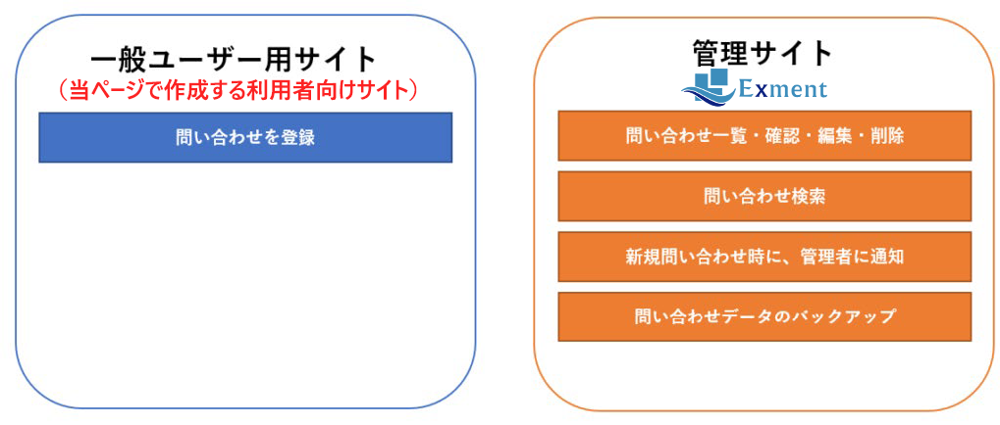

# 이용자용 사이트 구축

개발하는 분을 위한 페이지입니다.  
Exment에서는 엔드포인트(URL의 입구)를 바꾸어, Exment 사이트 외에 개발자가 직접 만든 일반 사용자용 사이트(이용자용 사이트)를 만들 수 있습니다.

이 페이지에서는 예로, Exment의 "공지사항" 테이블의 데이터를 다루는 다음 페이지를 만듭니다.

- 공지사항 데이터의 목록
- 공지사항 데이터의 상세 표시
- 공지사항 데이터의 새로 만들기
- 공지사항 데이터의 편집
- 공지사항 데이터의 삭제

만드는 순서는 다음과 같습니다.

1. 접근할 수 있는지 확인한다
2. 목록 페이지를 만든다(라우팅 → 컨트롤러 → 뷰)
3. 상세·새로 만들기·편집·삭제 페이지를 차례로 추가한다

## 접근 확인
이용자용 사이트는 Exment를 구축한 뒤에도 접근할 수 있습니다.

| URL의 끝 | 열리는 사이트 |
|---|---|
| "/admin" | 관리자 사이트(Exment) |
| "/" | 이용자용 사이트 |

- 이용자용 사이트를 "/"에 두려면 `.env`의 `ADMIN_ROUTE_PREFIX`를 "admin"으로 해 주십시오. v7.2.1 이후에 새로 설치한 환경은 기본적으로 Exment가 "/"에 있기 때문입니다. 자세한 내용은 [URL에 포함된 "admin"의 변경·삭제](/ko/additional_prefix)를 확인해 주십시오.

■엔드포인트 "/"

■엔드포인트 "/admin"

## 페이지 만들기
이용자용 사이트는 기본적으로 보통의 Laravel 시스템 개발과 같은 구성·순서로 만듭니다.  
아래 이미지는 Laravel의 루트 폴더 구성입니다. 이 중 주로 다음 폴더에 php 파일을 만들어 갑니다.

| 폴더 | 두는 것 |
|---|---|
| app/Http/Controllers | 컨트롤러 |
| routes | 엔드포인트 정보 |
| resources/views | 뷰. blade 문법으로 씁니다 |
| public | css, js, 이미지 등 |

#### routes: 라우팅
routes/web.php에 목록 페이지의 라우팅을 다음과 같이 씁니다.  
※그 밖의 라우팅 작성법은 [Laravel의 라우팅 설명(일본어)](https://readouble.com/laravel/8.x/ja/routing.html)을 확인해 주십시오.

~~~
<?php

use Illuminate\Support\Facades\Route;

/*
|--------------------------------------------------------------------------
| Web Routes
|--------------------------------------------------------------------------
|
| Here is where you can register web routes for your application. These
| routes are loaded by the RouteServiceProvider within a group which
| contains the "web" middleware group. Now create something great!
|
*/

//Route::get('/', function () {
//    return view('welcome');
//});

///// 목록 페이지
Route::get('/', [\App\Http\Controllers\IndexController::class, 'index']);
~~~

#### Controller: 컨트롤러
app/Http/Controllers 폴더에 IndexController.php를 만들고, 다음과 같이 씁니다.

- CustomTable: Exment의 "사용자 정의 테이블"에 해당하는 Model입니다.
- CustomTable::getEloquent('information')->getValueModel(): Exment의 테이블 데이터용 Model입니다. 사용자가 입력한 각 데이터를 나타냅니다.

※그 밖의 컨트롤러 작성법은 [Laravel의 컨트롤러 설명(일본어)](https://readouble.com/laravel/8.x/ja/controllers.html)을 확인해 주십시오.

~~~
<?php

namespace App\Http\Controllers;

use Illuminate\Routing\Controller as BaseController;
use Illuminate\Http\Request;
use Exceedone\Exment\Model\CustomTable;

class IndexController extends BaseController
{
    //목록 화면
    public function index(Request $request){
        $items = CustomTable::getEloquent('information')->getValueModel()->get();
        return view('index', [
            'items' => $items,
        ]);
    }
}
~~~

#### view: 뷰
뷰는 파일을 2개 만듭니다. 공통 틀(_layout.blade.php)과 목록의 내용(index.blade.php)입니다.

resources/views에 _layout.blade.php를 만들고, 다음과 같이 씁니다.  
~~~
<!DOCTYPE html>
<html lang="{{ str_replace('_', '-', app()->getLocale()) }}">
    <head>
        <meta charset="utf-8">
        <meta name="viewport" content="width=device-width, initial-scale=1">

        <title>Laravel</title>

        <!-- Fonts -->
        <link href="https://fonts.googleapis.com/css2?family=Nunito:wght@400;600;700&display=swap" rel="stylesheet">

        <!-- Styles -->
        

        
    </head>
    <body class="antialiased">
        

            @if (Route::has('login'))
                

                    @auth
                        <a href="{{ url('/home') }}" class="text-sm text-gray-700 dark:text-gray-500 underline">Home</a>
                    @else
                        <a href="{{ route('login') }}" class="text-sm text-gray-700 dark:text-gray-500 underline">Log in</a>

                        @if (Route::has('register'))
                            <a href="{{ route('register') }}" class="ml-4 text-sm text-gray-700 dark:text-gray-500 underline">Register</a>
                        @endif
                    @endauth
                

            @endif

            <main>
                @yield('content')
            </main>
        

    </body>
</html>

~~~

resources/views에 index.blade.php를 만들고, 다음과 같이 씁니다.  
※그 밖의 Blade 작성법은 [Laravel의 Blade 설명(일본어)](https://readouble.com/laravel/8.x/ja/blade.html)을 확인해 주십시오.

~~~
@extends('_layout')

@section('content')
    <h1>공지사항 목록</h1>
    <table>
        <thead>
            <tr>
                <th>ID</th>
                <th>제목</th>
                <th>작성 일시</th>
                <th>업데이트 일시</th>
                <th></th>
            </tr>
        </thead>

        <tbody>
        @foreach($items as $item)
            <tr>
                <td>{{$item->id}}</td>
                <td>{{$item->getValue('title', 'html')}}</td>
                <td>{{$item->created_at}}</td>
                <td>{{$item->updated_at}}</td>
                <td><a href="{{asset($item->id)}}">상세</a></td>
            </tr>
        @endforeach
        </tbody>
    </table>

    

        <a href="{{asset('/create')}}">새로 만들기</a>
    

@endsection
~~~

#### 결과 표시
여기까지 올바르게 되었다면, 다음과 같이 Exment의 "공지사항" 테이블의 데이터 목록이 표시됩니다.  
※"새로 만들기", "상세" 링크는 이 시점에서는 아직 열 수 없습니다. 이 뒤에서 만듭니다.

#### 데이터 상세 화면 만들기
데이터 상세 화면을 만듭니다. 다음 3개 파일에 내용을 추가합니다.

routes/web.php
~~~
///// 상세 페이지
Route::get('/{id}', [\App\Http\Controllers\IndexController::class, 'show']);
~~~

app/Http/Controllers/IndexController.php(index 함수 아래에 추가)
~~~
  //상세 화면
    public function show(Request $request, $id){
        $item = CustomTable::getEloquent('information')->getValueModel()->find($id);
        if(!$item){
            return redirect('');
        }
        return view('show', [
            'item' => $item,
        ]);
    }
~~~

resources/views/show.blade.php(새로 만들기)
~~~
@extends('_layout')

@section('content')
    <h1>데이터 상세</h1>
    <table>
        <tbody>
            <tr>
                <th>ID</th>
                <td>{{$item->id}}</td>
            </tr>
            <tr>
                <th>제목</th>
                <td>{{$item->getValue('title', 'html')}}</td>
            </tr>
            <tr>
                <th>본문</th>
                <td>{!! $item->getValue('body', 'html') !!}</td>
            </tr>
            <tr>
                <th>표시 플래그</th>
                <td>{!! $item->getValue('view_flg', 'html') !!}</td>
            </tr>
            <tr>
                <th>표시 순서</th>
                <td>{!! $item->getValue('order', 'html') !!}</td>
            </tr>
            <tr>
                <th>중요도</th>
                <td>{!! $item->getValue('priority', 'html') !!}</td>
            </tr>
            <tr>
                <th>작성 일시</th>
                <td>{{$item->created_at}}</td>
            </tr>
            <tr>
                <th>업데이트 일시</th>
                <td>{{$item->updated_at}}</td>
            </tr>
        </tbody>
    </table>

    

        <a href="{{asset('/')}}">목록으로 돌아가기</a>
    

@endsection
~~~

#### 결과 표시
올바르게 되었다면, 다음과 같이 Exment의 "공지사항" 테이블에서 지정한 ID의 데이터 상세가 표시됩니다.

#### 데이터 새로 만들기 화면
데이터 새로 만들기 화면을 만듭니다. 다음 3개 파일에 내용을 추가합니다.

routes/web.php(상세 페이지보다 위에 쓴다)
~~~
///// 새로 만들기 페이지
Route::get('/create', [\App\Http\Controllers\IndexController::class, 'create']);
Route::post('/', [\App\Http\Controllers\IndexController::class, 'store']);
~~~

app/Http/Controllers/IndexController.php(show 함수 아래에 추가)
~~~
    //새로 만들기 화면
    public function create(Request $request){
        return view('create');
    }

    //새로 등록 실행
    public function store(Request $request){
        //데이터 저장용 Model 만들기
        $custom_value = CustomTable::getEloquent('information')->getValueModel();

        //값 설정
        $custom_value->setValueStrictly([
            'title' => $request->get('title'),
            'body' => $request->get('body'),
            'view_flg' => $request->get('view_flg'),
            'order' => $request->get('order'),
            'priority' => $request->get('priority'),
        ]);

        //데이터 저장
        $custom_value->save();

        //해당 데이터로 리다이렉트
        return redirect($custom_value->id);
    }
~~~

resources/views/create.blade.php(새로 만들기)
~~~
@extends('_layout')

@section('content')
    <h1>데이터 새로 만들기</h1>

    <form method="post" action="{{asset('/')}}">
        @csrf
        <table>
            <tbody>
                <tr>
                    <th>제목</th>
                    <td><input type="text" name="title" value="{{old('title')}}" /></td>
                </tr>
                <tr>
                    <th>본문</th>
                    <td><textarea name="body">{{old('body')}}</textarea></td>
                </tr>
                <tr>
                    <th>표시 플래그</th>
                    <td>
                        <select name="view_flg">
                            <option value="0" selected>NO</option>
                            <option value="1">YES</option>
                        </select>
                    </td>
                </tr>
                <tr>
                    <th>표시 순서</th>
                    <td><input type="number" name="order" value="{{old('order')}}"></input></td>
                </tr>
                <tr>
                    <th>중요도</th>
                    <td>
                        <select name="priority">
                            <option value="{{old('priority')}}" selected></option>
                            <option value="1">매우 낮음</option>
                            <option value="2">낮음</option>
                            <option value="3">보통</option>
                            <option value="4">높음</option>
                            <option value="5">매우 높음</option>
                        </select>
                    </td>
                </tr>
            </tbody>
        </table>

        <button type="submit">제출</button>
          
        
        

            <a href="{{asset('/')}}">목록으로 돌아가기</a>
        

    </form>
@endsection
~~~

#### 결과 표시
올바르게 되었다면, 다음과 같이 Exment의 "공지사항" 테이블에 데이터를 추가하는 페이지가 표시됩니다.

#### 데이터 편집 화면
데이터 편집 화면을 만듭니다. 다음 5개 파일에 내용을 추가합니다(또는 고쳐 씁니다).

routes/web.php(상세 페이지보다 위에 쓴다)
~~~
///// 편집 페이지
Route::get('/edit/{id}', [\App\Http\Controllers\IndexController::class, 'edit']);
Route::put('/{id}', [\App\Http\Controllers\IndexController::class, 'update']);
~~~

app/Http/Controllers/IndexController.php(store 함수 아래에 추가)
~~~
 // 편집 화면
    public function edit(Request $request, $id){
        $item = CustomTable::getEloquent('information')->getValueModel()->find($id);
        if(!$item){
            return redirect('');
        }
        return view('edit', [
            'item' => $item,
        ]);
    }

    // 편집 실행
    public function update(Request $request, $id){
        // 데이터 저장용 Model 만들기
        $custom_value = CustomTable::getEloquent('information')->getValueModel()->find($id);

        // 값 설정
        $custom_value->setValueStrictly([
            'title' => $request->get('title'),
            'body' => $request->get('body'),
            'order' => $request->get('order'),
            'view_flg' => $request->get('view_flg'),
            'priority' => $request->get('priority'),
        ]);

        // 데이터 저장
        $custom_value->save();

        // 해당 데이터로 리다이렉트
        return redirect($custom_value->id);
    }
~~~

resources/views/edit.blade.php(새로 만들기)
~~~
@extends('_layout')

@section('content')
    <h1>데이터 편집</h1>

    <form method="post" action="{{asset('/' . $item->id)}}">
        @csrf
    <table>
        <tbody>
            <tr>
                <th>ID</th>
                <td>{{$item->id}}</td>
            </tr>
            <tr>
                <th>제목</th>
                <td><input type="text" name="title" value="{{old('title', $item->getValue('title', 'html'))}}" /></td>
            </tr>
            <tr>
                <th>본문</th>
                <td>
                    <textarea name="body">{{old('body', $item->getValue('body', 'html'))}}</textarea>
                </td>
            </tr>
            <tr>
                <th>표시 플래그</th>
                <td>
                    <select name="view_flg">
                    <option value="{{old('view_flg', $item->getValue('view_flg', 'html'))}}" selected>{{old('view_flg', $item->getValue('view_flg', 'html'))}}</option>
                            <option value="0">NO</option>
                            <option value="1">YES</option>
                    </select>
                </td>
            </tr>
            <tr>
                <th>표시 순서</th>
                <td>
                    <input type="number" name="order" value="{{old('order', $item->getValue('order', 'html'))}}"></input>
                </td>
            </tr>
            <tr>
                <th>중요도</th>
                <td>
                    <select name="priority">
                            <option value="{{old('priority', $item->getValue('priority', 'html'))}}" selected>{{old('priority', $item->getValue('priority', 'html'))}}</option>
                            <option value="1">매우 낮음</option>
                            <option value="2">낮음</option>
                            <option value="3">보통</option>
                            <option value="4">높음</option>
                            <option value="5">매우 높음</option>
                        </select>
                </td>
            </tr>
            <tr>
                <th>작성 일시</th>
                <td>{{$item->created_at}}</td>
            </tr>
            <tr>
                <th>업데이트 일시</th>
                <td>{{$item->updated_at}}</td>
            </tr>
        </tbody>
    </table>

        <button type="submit">제출</button>
          
        @method('PUT')
    </form>

    
    

        <a href="{{asset('/')}}">목록으로 돌아가기</a>
    

@endsection
~~~

resources/views/show.blade.php("목록으로 돌아가기"의 div 태그 위에 추가)
~~~
    

        <a href="{{asset('/edit/' . $item->id)}}">편집</a>  
    

~~~

resources/views/index.blade.php(td 태그의 내용을 고쳐 쓰기)
~~~
<td><a href="{{asset($item->id)}}">상세</a>&nbsp;&nbsp;<a href="{{asset('edit/'.$item->id)}}">편집</a></td>
~~~

#### 결과 표시

#### 데이터 삭제 화면
데이터를 삭제할 수 있게 합니다. 다음 4개 파일에 내용을 추가합니다(또는 고쳐 씁니다).

routes/web.php
~~~
///// 삭제
Route::get('/delete/{id}', [\App\Http\Controllers\IndexController::class, 'delete']);
~~~

app/Http/Controllers/IndexController.php(update 함수 아래에 추가)
~~~
// 삭제 실행
    public function delete(Request $request, $id){
        // 삭제할 데이터 가져오기
        $custom_value = CustomTable::getEloquent('information')->getValueModel()->find($id);

        // 데이터 삭제
        $custom_value->delete();

        // 목록으로 리다이렉트
        return redirect('/');
    }
~~~

resources/views/show.blade.php(첫 번째 div 태그의 내용을 고쳐 쓰기)
~~~
    

        <a href="{{asset('/edit/' . $item->id)}}">편집</a>
        &nbsp;&nbsp;<a href="{{asset('/delete/' . $item->id)}}">삭제</a>
    

~~~

resources/views/index.blade.php(td 태그의 내용을 고쳐 쓰기)
~~~
<td><a href="{{asset($item->id)}}">상세</a>&nbsp;&nbsp;<a href="{{asset('edit/'.$item->id)}}">편집</a>&nbsp;&nbsp;<a href="{{asset('/delete/' . $item->id)}}">삭제</a></td>
~~~

#### 결과 표시
