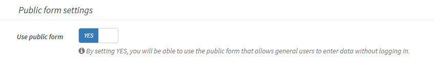
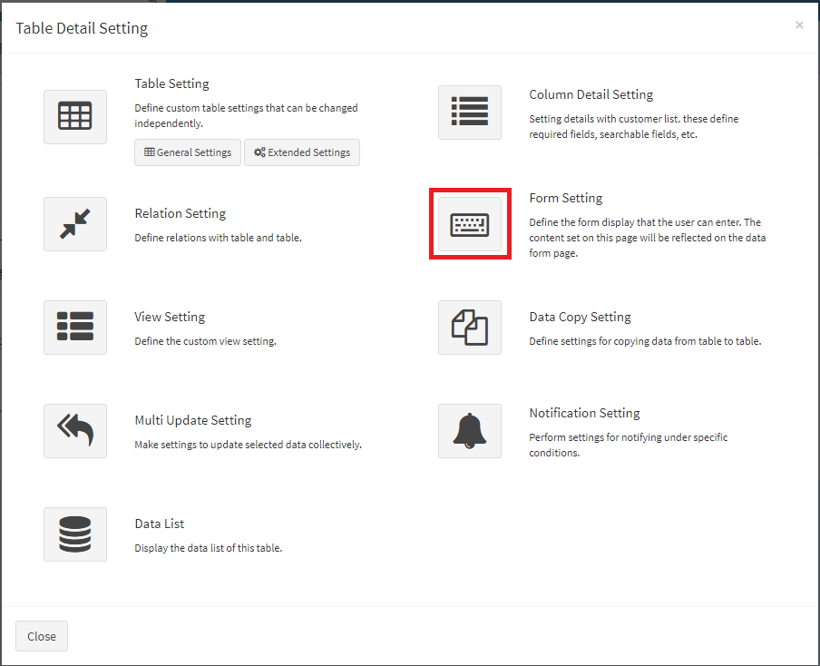
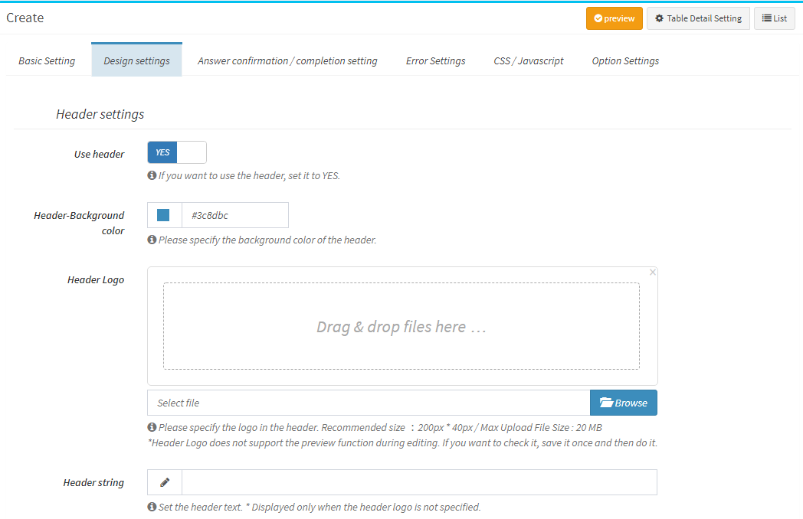
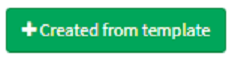

# 공개 폼 설정
로그인하지 않은 사람(일반 사용자)이 데이터를 입력할 수 있는 "공개 폼"을 설정하는 페이지입니다.  
설문·문의 폼·신청 폼 등을 만들고 URL을 공유하여, 외부에 널리 공개할 수 있습니다.

- 보통의 [데이터 폼 화면](/ko/data_form)은 미리 사용자를 준비하고, ID·비밀번호로 로그인하게 해야 합니다.
- 공개 폼은 로그인 없이 누구나 데이터를 입력할 수 있습니다.

## 공개 폼 설정의 사양에 대하여

<span class="red bold">공개 폼에서 입력한 데이터는, 공개 폼 설정을 등록한 사용자가 작성 사용자·업데이트 사용자로 등록됩니다.</span>  
데이터 입력 화면에서 다른 테이블의 선택지를 가져오거나 검색할 때의 역할·권한도, 공개 폼 설정을 등록한 사용자의 것이 됩니다.  
  
그러므로 시스템 관리자가 공개 폼을 등록하는 일은 피하십시오.  
뒤에 나오는 "<a href="#/ko/publicform?id=role_user">공개 폼 설정을 하는 사용자·역할 그룹 설정</a>"의 순서로, 새 사용자·역할 그룹을 설정하기를 권장합니다.   
  
또한 아래의 테이블은 공개 폼의 설정 대상이 아닙니다.  
- "사용자"나 "조직" 등의 마스터 테이블
- 테이블 설정에서 "1건만 등록 가능"으로 한 테이블


## 설정의 흐름
다음 순서로 설정합니다. 자세한 순서는 아래의 "설정 순서"를 보십시오.

1. 명령을 실행합니다. (Google reCAPTCHA를 쓰는 경우만)
2. 시스템 설정 화면에서 공개 폼을 쓸 수 있게 합니다.
3. [사용자 정의 폼 설정](/ko/form)에서 폼에 표시할 항목·제목 등을 설정합니다.
4. 공개 폼 설정을 하는 사용자·역할 그룹을 등록합니다.
5. 그 사용자로 로그인하여 공개 폼 설정을 합니다(디자인, 확인 화면, Google 애널리틱스 등).
6. 공개 폼을 활성화합니다. URL이 발급됩니다.

## 설정 순서

### 1. 명령 실행
공개 폼에서 Google reCAPTCHA(로봇에 의한 전송을 막는 구조)를 쓰는 경우에만 실행합니다.  
프로젝트의 루트 폴더에서, 쓰고 있는 Exment의 버전에 맞는 명령을 실행하십시오.  
※v7.0.0부터 Google reCAPTCHA의 라이브러리로 "google/recaptcha"를 씁니다. Exment v6.x 이전에서는 "arcanedev/no-captcha"를 씁니다.  

- Exment v7.0.0 이후의 경우

```
composer require google/recaptcha=^1.3.1
```

- Exment v6.x 이전의 경우

```
composer require arcanedev/no-captcha=^10.1
```

### 2. 시스템 설정 화면
- [시스템 설정 화면](/ko/system_setting)의 "STEP2 상세 설정"으로 이동하여, "공개 폼 사용"을 YES로 합니다.  
※기본으로는 NO로 되어 있습니다. 이것은 공개 폼을 쓰는 것을 명시적으로 선택하게 하기 위해서입니다.  



- Google reCAPTCHA를 쓸 때는 "Google reCAPTCHA" 항목을 V2 또는 V3로 설정하십시오.  
선택하면 사이트 키와 시크릿 키 항목이 표시됩니다. [Google reCAPTCHA의 관리 페이지](http://www.google.com/recaptcha/admin)에서 복사한 값을 설정하십시오.  
※설정한 뒤, 각 공개 폼 설정 화면에서 Google reCAPTCHA를 쓸지 여부를 선택합니다.  
※V3를 선택한 경우의 점수 임계값은 [설정값](/ko/config)에서 변경할 수 있습니다(기본값 0.5).


### 3. 사용자 정의 폼 설정
- [사용자 정의 폼 설정](/ko/form)에서 폼에 표시할 항목·제목 등을 설정합니다. 순서는 기본적으로 보통의 폼 설정과 같습니다.  
※이 설정은 관리자 등, 공개 폼 설정 사용자가 아닌 사람이 해도 괜찮습니다.

<h3 id="role_user"><a href="#/ko/publicform#role_user" data-id="role_user" class="anchor"><span>4. 공개 폼 설정을 하는 사용자·역할 그룹 설정</span></a></h3>
공개 폼 설정을 하는 사용자·역할 그룹을 등록합니다.  
공개 폼에서 전송된 데이터는 이 사용자가 등록·업데이트한 것으로 다룹니다.

- [역할 그룹 설정](/ko/role_group)을 새로 만듭니다.
    - "공개 폼 관리" 권한을 추가합니다.
	- 공개 폼을 설정하고 싶은 테이블에 대해 편집 권한을 추가합니다.
    - 그리고 그 공개 폼에서 접근하는 테이블의 열람 권한도 추가합니다.  

- 예: "문의" 테이블의 공개 폼을 설정할 예정이고, 문의 테이블에서는 "제품" "카테고리" 테이블의 모든 데이터를 참조하고 있는 경우:  
    - "문의" 테이블의 "공개 폼 관리" "담당 데이터 편집" 권한
    - "제품" "카테고리" 테이블의 "전체 데이터 열람" 권한


- 공개 폼을 관리하는 사용자를 추가합니다.
    - 역할 그룹은 위에서 만든 역할 그룹을 선택합니다.

- 위에서 만든 사용자로 로그인하고, 공개 폼 설정 화면을 열어 공개 폼을 등록하십시오.


### 5. 공개 폼 설정

- 사용자 정의 테이블 목록에서 설정하고 싶은 테이블에 체크를 1개 넣고, 오른쪽 위의 "테이블 상세 설정"을 클릭합니다.  

> ※ 대상 사용자 정의 테이블의 데이터 목록 화면이나 데이터 등록 화면에서도 열 수 있습니다. 그 경우에도 오른쪽 위의 "테이블 상세 설정"을 클릭하십시오.  

- 표시된 테이블 상세 설정 화면에서 폼 설정 아이콘을 클릭합니다.


- 폼 목록 화면의 아래쪽에 "공개 폼 설정" 상자가 있습니다.  
이 상자의 오른쪽 위에 있는 "＋만들기" 버튼을 클릭하십시오.


- 공개 폼 설정 화면이 열립니다. 필요한 항목을 설정하십시오. 설정의 내용은 다음과 같습니다.

#### 설정 내용 - 기본 설정


- ##### 대상 폼
공개 폼으로 설정할 폼을 선택합니다. 위의 "사용자 정의 폼 설정"에서 만든 폼을 선택하십시오.

- ##### 공개 폼 표시명
목록 화면 등에서 표시할 표시명을 입력하십시오.

- ##### 공개 유효 기간
폼을 공개하는 기간을 정할 때는 시작 일시와 종료 일시를 입력하십시오.  
※"시작 일시"만, "종료 일시"만 입력할 수도 있습니다. 둘 다 입력하지 않은 경우, 항상 유효합니다.  
※공개 유효 기간 밖에서는 이 공개 폼을 쓸 수 없습니다.


#### 설정 내용 - 디자인 설정


헤더·푸터를 쓸지 여부, 로고 이미지나 문구, 폼의 배경색 등의 디자인 요소를 설정합니다.  


#### 설정 내용 - 응답 확인·완료 설정
사용자가 폼의 입력을 마친 뒤에 표시하는 "응답 확인 화면"과 "완료 화면"의 설정입니다. 쓸지 여부와, 제목이나 문구를 정합니다.


- ##### 응답 확인 사용
YES인 경우, 사용자의 화면 이동이 아래와 같은 흐름이 됩니다.

```
입력 화면 → 확인 화면 → 완료 화면(데이터 등록)
```

※NO인 경우, 사용자의 화면 이동이 아래와 같은 흐름이 됩니다.

```
입력 화면 → 완료 화면(데이터 등록)
```

- ##### 확인 제목
응답 확인 화면의 제목 문구를 입력하십시오.

- ##### 확인 텍스트
확인 화면의 페이지 위쪽에 표시할 텍스트·HTML을 입력하십시오.  
※[파라미터](/ko/params)를 쓸 수 있습니다. 스크립트는 실행할 수 없습니다.


- ##### 완료 제목
완료 화면의 제목 문구를 입력하십시오.

- ##### 완료 텍스트
완료 화면의 페이지 위쪽에 표시할 텍스트·HTML을 입력하십시오.  
※[파라미터](/ko/params)를 쓸 수 있습니다. 스크립트는 실행할 수 없습니다.

- ##### 완료 링크 URL
완료 화면에 링크를 표시할 수 있습니다. 입력한 뒤에 다른 화면으로 이동시키고 싶은 경우에는 이동할 곳의 URL을 입력하십시오.  
※"완료 링크 텍스트"를 입력하지 않은 경우, 입력한 URL이 그대로 링크의 텍스트로 표시됩니다.

- ##### 완료 링크 텍스트
완료 화면에 링크를 표시할 수 있습니다. 입력한 뒤에 다른 화면으로 이동시키고 싶은 경우, 링크로 화면에 표시할 문구를 입력하십시오.  


#### 완료 알림(일반 사용자)
데이터를 입력한 일반 사용자에게, 등록이 끝난 뒤 메일을 보낼 수 있습니다.

- 로그인하지 않은 일반 사용자를 위한 알림이므로, 알림 방법은 이메일 전송뿐입니다.
- 알림 대상은 일반 사용자가 적은 이메일 주소뿐입니다.
- 이 기능을 쓰려면 사용자 정의 테이블에 열 종류: 이메일인 열이 필요합니다.

- ##### 일반 사용자에게 완료 알림
YES로 하면 완료 알림이 유효해집니다. 

- ##### 알림 템플릿
일반 사용자에게 보낼 알림 템플릿을 선택하십시오. 미리 [알림 템플릿 설정](/ko/mail)에서 새 템플릿을 만들어 두어야 합니다.  
※알림에는 [변수(파라미터)](/ko/params)를 쓸 수 있습니다. 변수를 쓰면, 등록한 데이터나 시스템 이름, 사용자의 입력값 등을 제목·본문에 넣을 수 있습니다.  

- ##### 알림 대상
알림 대상이 되는 메일 주소가 설정되어 있는 사용자 정의 열을 선택하십시오.  
예: 입력 항목에 "답장 받을 메일 주소" 열이 있는 경우, 이 열을 알림 대상으로 선택하면, 데이터 입력을 완료한 뒤 그 메일 주소로 알림이 전송됩니다.  


#### 완료 알림(관리자)
데이터의 입력이 끝난 뒤, 관리자에게 알림을 보낼 수 있습니다.  
※"관리자"라고 적었지만, 관리자 외에 Exment에 등록된 사용자나 Slack 등에도 알릴 수 있습니다.

- ##### 관리자에게 완료 알림
YES로 하면 완료 알림이 유효해집니다. 

- ##### 알림 템플릿
관리자에게 보낼 알림 템플릿을 선택하십시오. 미리 [알림 템플릿 설정](/ko/mail)에서 새 템플릿을 만들어 두어야 합니다.  
※알림에는 [변수(파라미터)](/ko/params)를 쓸 수 있습니다. 변수를 쓰면, 등록한 데이터나 시스템 이름, 사용자의 입력값 등을 제목·본문에 넣을 수 있습니다.  

- ##### 알림 대상
알림 대상을 선택하십시오.  
※알림 대상의 항목이나 설정 방법은 [알림 액션 설정](/ko/notify)을 확인하십시오.


#### 설정 내용 - 오류 설정
오류가 발생한 경우의 제어를 합니다.


- ##### 오류 제목
오류 화면의 제목 문구를 입력하십시오.

- ##### 오류 텍스트
오류 화면의 페이지 위쪽에 표시할 텍스트·HTML을 입력하십시오.  

- ##### 오류 링크 URL
오류 화면에 링크를 표시할 수 있습니다. 오류가 발생했을 때 다른 화면으로 이동시키고 싶은 경우에는 이동할 곳의 URL을 입력하십시오.  
※"오류 링크 텍스트"를 입력하지 않은 경우, 입력한 URL이 그대로 링크의 텍스트로 표시됩니다.

- ##### 오류 링크 텍스트
오류 화면에 링크를 표시할 수 있습니다. 오류가 발생했을 때 다른 화면으로 가는 링크를 표시하는 경우에는 화면에 표시할 문구를 입력하십시오.  

#### 오류 알림
오류가 발생했을 때 관리자에게 알릴 수 있습니다.  
※"관리자"라고 적었지만, 관리자 외에 Exment에 등록된 사용자나 Slack 등에도 알릴 수 있습니다.

- ##### 오류 알림 사용
YES로 하면, 오류가 발생한 경우에 관리자에게 알립니다.

- ##### 알림 템플릿
관리자에게 보낼 템플릿을 선택하십시오. 미리 [알림 템플릿 설정](/ko/mail)에서 새 템플릿을 만들어 두어야 합니다.  
※알림에는 [변수(파라미터)](/ko/params)를 쓸 수 있습니다. 변수를 쓰면, 등록한 데이터나 시스템 이름, 사용자의 입력값, 오류 내용 등을 제목·본문에 넣을 수 있습니다.  

- ##### 알림 대상
알림 대상을 선택하십시오.  
※알림 대상의 항목이나 설정 방법은 [알림 액션 설정](/ko/notify)을 확인하십시오.


#### CSS / Javascript
독자적인 CSS와 Javascript를 추가할 수 있습니다.


- ##### 사용자 정의 CSS
쓰고 싶은 CSS를 직접 적으십시오.  
※&lt;style&gt; 태그는 필요 없습니다. css의 내용만 적으십시오.

- ##### 플러그인(CSS)
설치되어 있는 플러그인(CSS)을 공개 폼에도 반영하는 경우, 플러그인의 이름을 선택하십시오.

- ##### 사용자 정의 Javascript
쓰고 싶은 Javascript를 직접 적으십시오.  
※&lt;script&gt; 태그는 필요 없습니다. Javascript의 내용만 적으십시오.  
※Javascript는 아래의 jquery 안에 추가됩니다.

``` javascript
<script data-exec-on-popstate>
    $(function () {
        (추가한 코드)
    });
</script>
```

- ##### 플러그인(Javascript)
설치되어 있는 플러그인(Javascript)을 공개 폼에도 반영하는 경우, 플러그인의 이름을 선택하십시오.


#### 설정 내용 - 옵션 설정
그 밖의 옵션 설정을 합니다.


- ##### URL에서 초기값 설정 허용
YES로 하면, URL의 쿼리 문자열의 값을 폼의 초기값으로 할 수 있습니다. 자세한 내용은 [URL에서 초기값 설정](/ko/publicform?id=url에서-초기값-설정)을 확인하십시오.

- ##### Google 애널리틱스
폼에 Google 애널리틱스를 설정하는 경우, "UA-" 또는 "G-"로 시작하는 Google Analytics의 태그를 입력하십시오.

- ##### Google reCAPTCHA 사용
Google reCAPTCHA를 쓰는 경우, YES로 하십시오.  
※시스템 설정 화면에서 Google reCaptcha의 키를 입력한 경우에만 유효합니다.


#### 미리 보기
- 설정한 내용으로 공개 폼의 미리 보기를 표시할 수 있습니다.  
※폼을 저장하지 않아도 미리 볼 수 있습니다.

- 화면 오른쪽 위의 "미리 보기" 버튼을 클릭하면, 다른 창에 공개 폼의 미리 보기 화면이 표시됩니다.  
※다른 창은 javascript로 엽니다. 브라우저의 설정에 따라서는 팝업이 차단됩니다. 그때는 차단을 해제하고 다시 버튼을 클릭하십시오.


#### 공개 폼 활성화하기
- 폼을 일반 사용자에게 공개하려면 "활성화"해야 합니다. 한 번 저장한 뒤 다시 편집 화면을 열고, 페이지 오른쪽 위의 "활성화" 버튼을 클릭하십시오.  


- 공개하는 폼이 다른 테이블을 참조하고 있는 경우, 일반 사용자가 그 테이블들의 데이터를 읽을 수 있게 됩니다.  
아래와 같은 확인 메시지가 표시되므로, 접근하는 테이블에 문제가 없는지 충분히 확인하십시오.  


- "다른 테이블에 대한 접근"이란, 주로 아래와 같은 것이 있습니다.
    - 공개 폼에 열 종류 "선택 (테이블에서)" "사용자" 등의 항목이 있는 경우, 선택지 후보로 데이터의 표시, 검색이 실시된다.
    - 공개 폼이 1:n의 하위 테이블인 경우, 상위 테이블의 데이터가 선택지로 표시·검색된다.


#### 활성화한 뒤, URL 등 표시
- 공개 폼을 활성화하면, 기본 설정에 아래의 항목이 추가됩니다.

- ##### 공개 폼 URL
공개 폼의 URL이 표시됩니다. 이 URL을 복사하여, 메일이나 자기 회사 사이트 등에서 일반 사용자에게 공유하십시오.  
※항목을 클릭하면 URL을 복사할 수 있습니다.

- ##### 실행 사용자
공개 폼을 등록한 사용자입니다. 이 공개 폼에서의 데이터 등록이나 참조는 모두 이 사용자의 권한으로 이루어집니다.  
※다른 사용자가 공개 폼 설정을 업데이트해도 실행 사용자는 바뀌지 않습니다. 바꿀 때는 다른 사용자로 로그인하여 새 공개 폼 설정을 만드십시오.


### 6. 공개 폼 사용
- 위에서 복사한 URL에 접속하면 공개 폼이 표시됩니다.  


- 공개 폼 설정을 "활성화"하지 않은 경우나 유효 기간 밖인 경우, 또는 URL에 잘못이 있는 경우에는 아래의 오류가 표시됩니다.  


### 7. 템플릿 이용
템플릿을 쓰면, 이미 만든 공개 폼의 설정값을 이어받아 새 공개 폼을 만들 수 있습니다.
>다음 항목은 수동으로 설정해야 합니다.<br />·헤더 로고<br />·Google 애널리틱스<br />·Google reCAPTCHA 사용

#### 내보내기
공개 폼 설정 화면의 [템플릿: 내보내기]를 클릭하면, 열려 있는 공개 폼이 템플릿으로 내보내집니다.


#### 템플릿에서 만들기
사용자 정의 폼 설정 화면의 공개 폼 설정에 있는 [+템플릿에서 만들기]를 클릭합니다.



##### 대상 폼
템플릿을 써서 공개 폼을 만들 때, 대상으로 할 폼을 선택합니다.

##### 공개 폼 표시명
만들 공개 폼의 화면 표시명을 입력합니다.

##### 업로드
공개 폼을 만드는 데 쓸 템플릿을 선택합니다.


## 그 밖의 상세 설정

### URL에서 초기값 설정
- 설정 "URL에서 초기값 설정 허용"을 YES로 하면, 공개 폼의 URL에 항목의 초기값을 적을 수 있게 됩니다.  
회사 이름이나 카테고리 등, URL을 공유하는 상대에 맞춘 값을 알고 있을 때, 미리 URL에 넣어 두면 입력하는 수고를 줄일 수 있습니다.

#### 붙이는 방법
아래와 같은 쿼리 문자열을 설정합니다.

```
http://(공개 폼까지의 URL)?value.(사용자 정의 열 이름)=(초기값)

여러 열에 대해 설정하는 경우에는 2번째 이후의 value는 & 로 잇습니다.
http://(공개 폼까지의 URL)?value.(사용자 정의 열 이름)=(초기값)&value.(사용자 정의 열 이름)=(초기값)


# 예
http://localhost/publicform/c4f31330-7a75-11eb-a8b0-279816836d79?value.title=안녕하세요

http://localhost/publicform/c4f31330-7a75-11eb-a8b0-279816836d79?value.client_name=주식회사ABC&value.category=초기 도입
```

- 예: 아래와 같은 폼이 있는 경우  


- 이 폼의 URL에 아래의 쿼리 문자열을 추가하면, 폼을 열었을 때 초기값이 설정됩니다.

```
http://localhost/publicform/ab3d55e4-1afc-d1de-ac1b-bc64c51d4d7d?value.title=문의에 대하여&value.body=여기는 본문입니다.
```


#### 사용자 정의 열 "선택 (테이블에서)" "사용자" "조직"에서, suuid(20자리의 무작위 문자열)로만 초기값을 넣을 수 있게 하고 싶은 경우
사용자 정의 열 "선택 (테이블에서)" "사용자" "조직"(이하, 간단히 "선택 (테이블에서)"라고만 적음)의 초기값은 보통 ID(정수의 일련번호)로 지정합니다.  
그러나 ID는 일련번호이므로, 폼을 공개한 상대가 URL의 파라미터를 고쳐 써서 다른 값을 쉽게 짐작할 수 있습니다.  
이 열들의 초기값을 ID가 아니라 suuid(20자리의 무작위 문자열)로 지정하게 하고 싶을 때는 다음과 같이 설정하십시오.  

- [Exment 설정값 목록](/ko/config)에서 "공개 폼의 'URL에서 초기값 설정'에서, ID가 아니라 suuid만 허용한다"의 설정을 합니다.  

``` .env
EXMENT_PUBLICFORM_URLPARAM_SUUID=true
```

- 이 설정으로, "선택 (테이블에서)" 열의 초기값을 suuid만 허용하게 됩니다.

- 또한 각 순서의 suuid는 아래의 순서로 확인하십시오.
    - 뷰의 "표시 열 선택"에서 내부 ID(20자리)를 선택한다
    - 데이터를 내보낸다

### URL에 포함된 "publicform"의 변경
- 공개 폼의 URL에 포함된 "publicform" 문자열을 바꾸는 순서입니다.  
※이 문자열은 모든 공개 폼에서 같아집니다. 폼마다 바꿀 수는 없습니다.

#### 변경 순서

- 변경에는 [설정값의 변경](/ko/config)을 합니다.

- Exment의 루트 디렉터리에서 ".env" 파일을 엽니다.

- 아래의 값을 추가합니다.

~~~
### "publicform"을 다른 이름으로 변경하는 경우
EXMENT_PUBLICFORM_ROUTE_PREFIX=afiewqbfwehghwb
# http://localhost/afiewqbfwehghwb/(UUID) 가 공개 폼의 URL이 된다
~~~

※또한 이 매뉴얼에서는 모두 "publicform"을 전제로 적고 있으므로 양해해 주십시오.


### 공개 폼 특유의 사양
그 밖의 공개 폼 특유의 사양입니다.  

- 사용자 정의 열 "선택 (테이블에서)" "사용자" "조직" 등에서 표시되는 "검색" 버튼은 공개 폼에서는 표시되지 않습니다.  

- 테이블 상세 설정의 "알림 설정"에서 등록할 수 있는, 실행 트리거 "데이터 신규 작성"의 알림은 공개 폼에서는 보내지 않습니다.  
공개 폼 설정에 "일반 사용자용" "관리자용" 알림이 따로 있어, 그것들과 이중으로 보내지 않도록 하기 위해서입니다.
