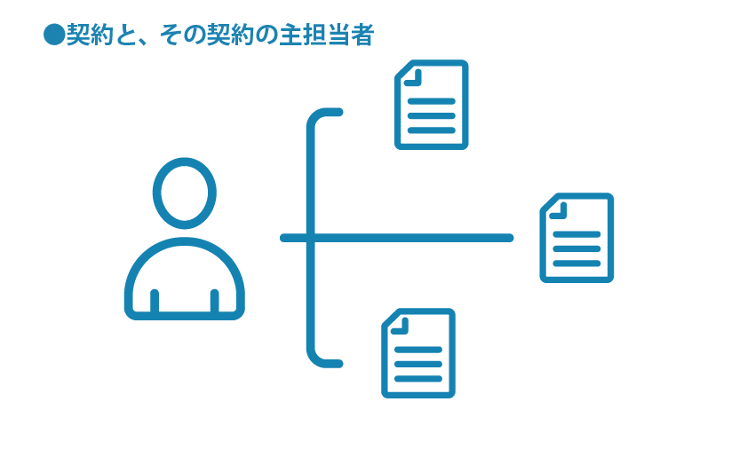
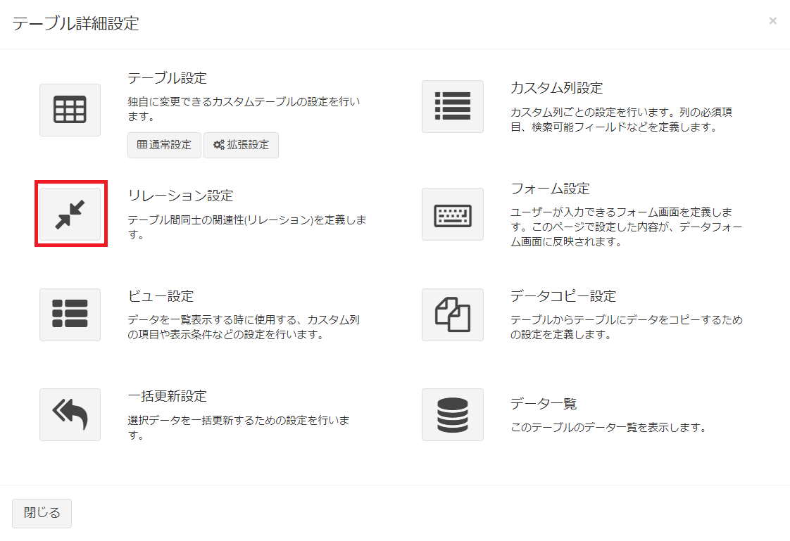

# 관계 설정
테이블과 테이블의 데이터에는 연결(관계, 릴레이션)이 있는 경우가 있습니다.  
예:
- 견적과 그 견적 명세 정보  
- 회사의 조직과 그 조직에 소속하는 사용자  

이 페이지에서는 테이블끼리의 연결을 어떻게 설정하는지를 설명합니다.

- 먼저 "어느 방법으로 연결할지"를 정합니다(아래의 "Exment의 관계 개념").
- 화면에서의 조작만 알고 싶을 때는 아래의 "관계 설정의 조작 방법"을 보십시오.

## Exment의 관계 개념
Exment에서 테이블끼리 연결하는 사고방식은 조금 복잡합니다.  
"1. 관계의 종류"와 "2. 설정 방법"의 2가지를 알아 두어야 합니다.  
화면에서 설정하기 전에 다음 내용을 읽으십시오.

### 1. 관계의 종류
데이터의 연결에는 보통 다음 2종류가 있습니다.  
#### 1대다
부모 테이블의 데이터 하나에 명세로서 자식 테이블의 여러 데이터가 연결된다   

- 예: 견적과 그 견적 명세  
"견적" 테이블에는 "견적일"이나 "고객 정보"나 "건명"을 등록한다. "견적 명세"에는 그 견적의 품명·수량·금액을 명세로서 여러 건 등록한다  

- 예: 계약과 그 계약의 주담당자  
한 명의 사용자가 여러 계약의 주담당자가 되는 일이 있으므로, 사용자와 계약은 1대다의 관계가 된다  

#### 다대다
여러 테이블(부모 테이블)의 데이터에 자식 테이블의 여러 데이터가 연결된다  

- 예: 조직과 그 조직에 소속하는 사용자  
사용자는 여러 조직에 소속하는 일이 있으므로(겸임 등), 다대다의 관계가 된다  
  

먼저 연결하고 싶은 데이터가 위의 어느 종류인지를 생각합니다.  

### 2. "(1) 관련 테이블 설정"과 "(2) 사용자 정의 열의 선택 (테이블에서)"
Exment에서 데이터를 연결하는 방법은 "(1) 관련 테이블"과 "(2) 선택 (테이블에서)"의 2가지입니다.  

##### (1) 관련 테이블 설정
이 페이지에서 설명하는 방법입니다.
"사용자 정의 테이블" 페이지에서 [관계 설정] 버튼을 눌러 등록합니다.    

##### (2) 사용자 정의 열의 선택 (테이블에서)
[사용자 정의 열](/ko/column) 화면에서 설정하는 방법입니다.  
사용자 정의 열의 열 종류 중 하나로 "선택 (테이블에서)"가 있습니다. 이 종류의 열을 만듭니다.  

이 설정을 하면 [데이터 폼 화면](/ko/data_form)에서 다른 테이블에서 값을 고를 수 있게 됩니다.  
예(고객은 테스트 데이터입니다):

>선택지로 목록에 표시되는 문구는 [사용자 정의 테이블 설정](/ko/table)의 "제목 표시 열 설정"에서 바꿀 수 있습니다.

### 관계 설정 방법의 결정
(1)과 (2) 중 어느 것을 쓸지는 헷갈리기 쉬운 부분입니다.
다음 기준으로 정하십시오.

| 관계의 종류 | 이럴 때 | 쓰는 방법 |
|---|---|---|
| 1대다 | 부모와 자식이 항상 한 세트. 부모를 지울 때는 자식도 지우는 것이 옳다(예: 견적과 견적 명세) | (1) 관계 설정 |
| 1대다 | 항상 한 세트라고는 할 수 없다. 참조하는 데이터를 지워도 참조하고 있는 데이터까지 지우는 것은 문제가 있다(예: 견적과 주담당자) | (2) 사용자 정의 열의 선택 (테이블에서) |
| 다대다 | 기본적으로 이쪽 | (1) 관계 설정 |

#### 1. 관계의 종류가 "1대다"인 경우
다음 2가지 기준으로 정하십시오.
1. **상위 데이터와 자식 데이터는 항상 한 세트이고 밀접한가**  
예를 들어 "견적" 테이블과 "견적 명세" 테이블에서는 견적 명세의 데이터에는 항상 견적의 데이터가 있고, 한 세트가 되어 있습니다.  
이럴 때는 "(1) 관계 설정"으로 연결합니다.  
한편 "견적" 테이블과 그 견적의 "주담당자"는 데이터의 참조 대상으로는 연결되어 있지만, 항상 한 세트인 것은 아닙니다.  
이럴 때는 "(2) 사용자 정의 열의 선택 (테이블에서)"로 연결합니다.  

2. **상위 데이터를 삭제할 때 자식 데이터를 삭제하는 것이 항상 옳은가**  
예를 들어 "견적" 테이블과 "견적 명세" 테이블에서는 부모인 "견적" 데이터를 지울 때는 자식인 "견적 명세" 데이터도 모두 지우는 것이 옳은 동작입니다.  
이럴 때는 "(1) 관계 설정"으로 연결합니다.  

한편 "견적" 테이블과 그 견적의 "주담당자"에서는 "주담당자"의 데이터를 지웠다고 해서 그 사람이 주담당자로 되어 있는 "견적" 데이터를 모두 지우는 것은 문제가 있습니다.  
이럴 때는 "(2) 사용자 정의 열의 선택 (테이블에서)"로 연결합니다.  

#### 2. 관계의 종류가 "다대다"인 경우
기본적으로는 "(1) 관계 설정"으로 연결하십시오.  
"(2) 사용자 정의 열의 선택 (테이블에서)"에서 "다중 선택 허용"을 해도 대응할 수 있지만, 데이터 검색에 약하다는 등의 과제가 있습니다.  

   
여기까지로 테이블을 어느 방법으로 연결할지가 정해집니다.  
다음은 "(1) 관련 테이블 설정"을 할 때의 절차입니다.  

## 관계 설정의 조작 방법

### 페이지 표시
- 사용자 정의 테이블 목록에서 설정하고 싶은 테이블에 하나만 체크를 넣고 오른쪽 위의 "테이블 상세 설정"을 누릅니다.  

- 또는 메뉴에서 설정하고 싶은 테이블을 고른 뒤, 마찬가지로 오른쪽 위의 "테이블 상세 설정"을 누릅니다.  
※ 그 테이블을 메뉴에 내보내는 설정이 먼저 필요합니다.  

- 나온 테이블 상세 설정 화면에서 관계 설정의 아이콘을 누릅니다.

- 이것으로 그 사용자 정의 테이블의 관계 설정 목록이 나옵니다.  

### 새로 추가
- "관계 설정" 화면에서 페이지 오른쪽 위의 [새로 만들기] 버튼을 누릅니다.

- 연결하는 자식 테이블과 관계의 종류를 고르고 "제출"을 누르십시오.
  

### 편집
관계를 편집하고 싶은 경우, 해당하는 행의 [편집] 링크를 클릭하십시오.  
  

### 삭제
관계를 삭제하고 싶은 경우, 해당하는 행의 [삭제] 링크를 클릭하십시오.  

