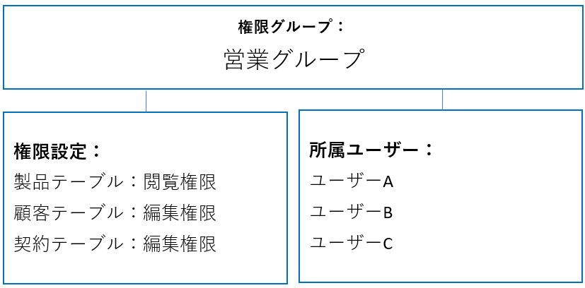

# 역할 그룹·권한 설정

"역할 그룹"은 누가 무엇을 해도 되는지(권한)를 정하는 구조입니다.  
이 페이지에서는 역할 그룹을 만들고, 권한을 정하고, 사용자·조직을 넣는 방법을 설명합니다.

- 역할 그룹을 쓰면, 특정 데이터나 페이지를 정해 둔 사용자만 다룰 수 있게 할 수 있습니다.
- 새로 추가한 사용자는 그대로는 로그인해도 대부분의 기능을 쓸 수 없습니다. 시스템 관리자가 그 사용자에게 맞는 역할 그룹을 할당하십시오.

> 역할 그룹을 설정하기 전에 [Exment의 역할·권한 개요](/ko/permission) 페이지를 확인하시기를 권장합니다.

## 역할 그룹의 개념도
사용자의 부서나 직책에 맞추어 할 수 있는 일을 정할 수 있습니다.  
예를 들어, 아래 그림처럼 부서나 직책마다 권한을 할당합니다.

## 초기 역할 그룹의 목록
설치했을 때부터 들어 있는 역할 그룹의 설명입니다.

### 전체 데이터 관리자 그룹
사용자가 등록한 모든 테이블의 데이터를 편집·열람할 수 있는 역할 그룹입니다.

### 사용자·조직 관리 그룹
사용자·조직 정보와 로그인 사용자의 설정을 관리하는 역할 그룹입니다.  
역할 그룹에 소속된 사용자·조직도 바꿀 수 있습니다.

### 공지 정보 관리 그룹
Exment에 처음부터 설치되어 있는 "공지 정보"에 데이터를 새로 만들고, 편집하고, 삭제할 수 있는 역할 그룹입니다.  

### 일반 그룹
위의 어느 것에도 해당하지 않는 사용자를 넣는 그룹입니다.  
※처음 설치한 상태에서는 특별히 권한이 설정되어 있지 않습니다.

## 역할 그룹의 데이터 구성
역할 그룹은 "(1)권한 설정"과 "(2)사용자·조직"의 2가지로 이루어져 있습니다.

### (1)권한 설정
권한(퍼미션)은 Exment에서 어떤 조작을 해도 되는지를 정하는 것입니다.  
예를 들어, 다음과 같은 권한이 있습니다.
##### 로그인 사용자의 관리   
각 사용자에게 로그인 권한을 주거나 비밀번호를 재설정하는 권한
##### 모든 데이터의 편집  
특정 테이블의 모든 데이터를 추가·편집·삭제할 수 있는 권한
##### 담당자 데이터의 열람
자신이 담당자로 되어 있는 데이터를 열람할 수 있는 권한
권한 설정은 역할 그룹마다 가집니다.

### (2)사용자·조직
역할 그룹에 소속되는 사용자·조직을 설정합니다.  
여기에 넣은 사용자는 로그인하면 그 역할 그룹의 권한으로 조작할 수 있게 됩니다.

## 설정 방법

### 설정의 전체 흐름
1. 역할 그룹을 만듭니다(역할 그룹 이름 등).
1. 그 역할 그룹으로 할 수 있는 일(권한)을 정합니다.
1. 그 역할 그룹에 소속되는 사용자·조직을 넣습니다.

※시스템 관리자의 설정은 [시스템 설정 페이지](/ko/system_setting)에서 하십시오.

### 목록
메뉴에 있는 "역할 그룹"을 클릭하십시오.  
만들어 둔 역할 그룹 설정의 목록 화면이 표시됩니다.  

### 역할 그룹 새로 만들기
1. 목록 화면 오른쪽 위의 [만들기] 버튼을 클릭합니다.

2. 역할 그룹을 새로 만드는 화면이 표시되므로, 필요한 사항을 입력하고 [전송]을 클릭합니다.  

3. 저장하면 목록 화면으로 돌아가고, 만든 역할 그룹이 표시됩니다.

### 권한 설정을 바꾸는 방법
1. 역할 그룹 목록 화면에서, 만든 역할 그룹의 행을 클릭합니다.  
또는 [권한 설정] 링크를 클릭합니다.

2. 권한 설정 화면이 표시되므로, 권한을 설정합니다. 권한의 종류는 아래의 "권한의 종류와 목록"을 보십시오.

### 권한의 종류와 목록
설정할 수 있는 권한에는 다음 종류가 있습니다.

| 종류 | 정할 수 있는 것 |
|---|---|
| 시스템 전체 | Exment 전체의 조작 |
| 역할 그룹 | 역할 그룹의 조작 |
| 플러그인 권한 설정 | 플러그인의 설정 변경·사용 |
| 마스터 권한 설정 | 마스터 데이터를 관리하는 테이블의 조작 |
| 테이블 권한 | 테이블마다의 조작 |

#### 시스템 전체
Exment 전체의 조작을 정할 수 있는 권한입니다.  

##### 권한 목록
- ##### 모든 테이블 관리  
사용자 정의 테이블을 추가하고, 모든 사용자 정의 테이블을 변경·삭제할 수 있습니다. 또한 사용자 정의 테이블의 모든 데이터를 추가·변경·삭제할 수 있습니다.
- ##### 모든 데이터 편집  
사용자 정의 테이블의 모든 데이터를 추가·변경·삭제할 수 있습니다.
- ##### 로그인 사용자 관리  
Exment에 로그인하는 사용자를 관리할 수 있습니다. 로그인 권한을 주거나 비밀번호를 재설정하는 등의 일을 할 수 있습니다.
- ##### 워크플로 설정  
워크플로의 설정을 변경할 수 있습니다.
- ##### API 애플리케이션 전체 관리  
모든 API 애플리케이션을 추가·변경·삭제할 수 있습니다.
- ##### API 애플리케이션 관리  
자신이 만든 API 애플리케이션만 추가·변경·삭제할 수 있습니다. ※다른 사용자가 만든 API 애플리케이션은 열람·추가·변경·삭제할 수 없습니다.
- ##### 플러그인 전체 관리
모든 플러그인을 추가·변경·삭제할 수 있습니다. 또한 플러그인을 사용할 수 있습니다.

#### 역할 그룹
역할 그룹의 조작을 정할 수 있는 권한입니다.  

##### 권한 목록
- ##### 역할 그룹 전체 관리  
역할 그룹 전체의 설정을 변경할 수 있습니다. 그룹의 추가·변경·삭제, 그룹의 권한 설정 변경, 사용자·조직의 설정 변경을 할 수 있습니다.
- ##### 권한 설정 변경  
역할 그룹의 권한 설정을 변경할 수 있습니다.
- ##### 사용자/조직 관리  
역할 그룹에 등록하는 사용자·조직의 설정을 변경할 수 있습니다.

#### 플러그인 권한 설정
Exment의 플러그인에 접근하는 권한을 할당할 수 있습니다.  
  
##### 권한 목록
- ##### 설정 변경
설정 변경이 있는 플러그인의 경우, 이 플러그인의 설정을 변경할 수 있습니다.  
※플러그인의 삭제나 업로드는 할 수 없습니다. 삭제하려면 "플러그인 전체 관리"를 추가하십시오.

- ##### 사용·접근
플러그인을 실제로 사용하거나 페이지에 접근할 수 있습니다. 플러그인의 종류에 따라 제어하는 내용이 다릅니다.

- **버튼, 문서 출력** : 화면에 표시하는 버튼의 표시·숨김이 제어됩니다.
- **페이지, 대시보드** : 페이지에 접근할 수 있는지가 바뀝니다.
- **API** : API를 실행할 수 있는지가 바뀝니다. (접근할 수 없는 경우 403 오류가 발생합니다.)
- **가져오기, 내보내기** : 데이터의 가져오기·내보내기를 실행할 수 있는지가 제어됩니다.
- **그 외** : 역할 그룹으로 제어할 수 없습니다. 모든 사용자에게 실행됩니다.
    

#### 마스터 권한 설정
Exment의 마스터 데이터를 관리하기 위한 테이블 권한을 할당할 수 있습니다.  
  
##### 권한 목록
- ##### 마스터 관리  
마스터의 정의를 변경할 수 있습니다. 또한 마스터 데이터를 추가·편집·삭제할 수 있습니다.
- ##### 시스템 뷰  
지정한 사용자 정의 테이블의 시스템 뷰를 관리할 수 있습니다.  
- ##### 데이터 편집  
마스터 데이터를 추가·편집·삭제할 수 있습니다.
- ##### 데이터 열람  
마스터 데이터를 열람할 수 있습니다. ※데이터의 편집·삭제는 할 수 없습니다.

#### 테이블 권한
Exment에서는 데이터를 관리하기 위한 테이블을 만들 수 있습니다.  
그 테이블마다 권한을 할당할 수 있습니다.  
예를 들어, 다음과 같이 씁니다.  
- 영업부의 사용자는 테이블 "영업 활동"의 모든 데이터를 편집·열람할 수 있다.
- 기술부의 사용자는 테이블 "기술 관리"의 모든 데이터를 편집·열람할 수 있다.
- 파트너 회사의 사용자는 테이블 "발주 의뢰"에서 자신에게 권한이 있는 데이터만 열람할 수 있다.  
  
##### 권한 목록
- ##### 테이블 관리  
지정한 사용자 정의 테이블에 대해, 테이블 정의나 폼의 수정 등을 할 수 있습니다.  
또한 지정한 사용자 정의 테이블의 모든 데이터를 추가·편집·삭제할 수 있는 권한입니다.
- ##### 폼 설정  
지정한 사용자 정의 테이블에 대해, 폼을 추가·편집·삭제할 수 있습니다.  
- ##### 공개 폼 관리  
지정한 사용자 정의 테이블에 대해, 공개 폼 설정을 추가·편집·삭제할 수 있습니다.  
※시스템 설정에서 "공개 폼 사용"을 YES로 한 경우에만 표시됩니다.  
※폼 자체의 추가·편집·삭제는 할 수 없습니다.  
- ##### 시스템 뷰  
지정한 사용자 정의 테이블의 시스템 뷰를 관리할 수 있습니다.  
- ##### 전체 데이터 편집  
지정한 사용자 정의 테이블의 모든 데이터를 추가·편집·삭제할 수 있는 권한입니다.
- ##### 전체 데이터 열람  
지정한 사용자 정의 테이블의 모든 데이터를 열람할 수 있는 권한입니다.  
※데이터의 편집·삭제는 할 수 없습니다.
- ##### 담당 데이터 편집  
지정한 사용자 정의 테이블에서, 로그인 사용자 자신이 담당자로 설정된 데이터를 추가·편집·삭제할 수 있는 권한입니다.  
- ##### 담당 데이터 열람  
지정한 사용자 정의 테이블에서, 로그인 사용자 자신이 담당자로 설정된 데이터를 열람할 수 있는 권한입니다.  
※데이터의 편집·삭제는 할 수 없습니다.
- ##### 데이터 공유  
자신이 편집 권한을 가진 데이터를 다른 사용자나 조직에 공유할 수 있는 권한입니다.  
- ##### 데이터 가져오기  
csv 형식 또는 Excel 형식의 파일에서, 지정한 사용자 정의 테이블로 데이터를 가져올 수 있습니다.  
- ##### 데이터 내보내기  
csv 형식 또는 Excel 형식의 파일로, 지정한 사용자 정의 테이블의 데이터를 내보낼 수 있습니다.  
- ##### 삭제된 데이터 표시  
논리 삭제된 데이터를 다시 표시할 수 있습니다. ※데이터를 복원하려면 그 데이터에 대한 편집 권한이 필요합니다.  

### 사용자·조직 설정 방법
역할 그룹에 소속되는 사용자·조직을 바꾸는 방법입니다.

- 목록 화면에서 사용자 링크를 클릭합니다.
  
또는 권한 설정 화면 오른쪽 위의 [사용자/조직 설정] 버튼을 클릭합니다.  
  

- 사용자·조직 설정 화면이 표시됩니다. 이 역할 그룹에 소속되는 사용자·조직을 등록하십시오.  

### 삭제
- 역할 그룹 목록 화면에서 [삭제] 링크를 클릭합니다.

### 기타

#### 여러 역할 그룹을 추가한 경우
한 명의 사용자나 하나의 조직에 여러 역할 그룹을 붙였을 때는, 각 역할 그룹의 권한을 모두 합친 것이 됩니다.

- 예: 사용자A
    - 역할 그룹X
        - 테이블1
            - 담당 데이터 편집
        - 테이블2
            - 담당 데이터 열람
        - 테이블3
            - 전체 데이터 열람
        
    - 역할 그룹Y
        - 테이블1
            - 전체 데이터 열람
        - 테이블4
            - 담당 데이터 편집

    - →최종적인 사용자A의 권한
        - 테이블1
            - 전체 데이터 열람
            - 담당 데이터 편집
        - 테이블2
            - 담당 데이터 열람
        - 테이블3
            - 전체 데이터 열람
        - 테이블4
            - 담당 데이터 편집
