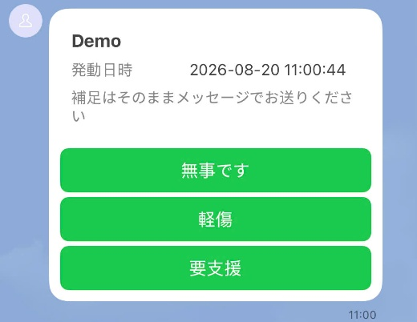
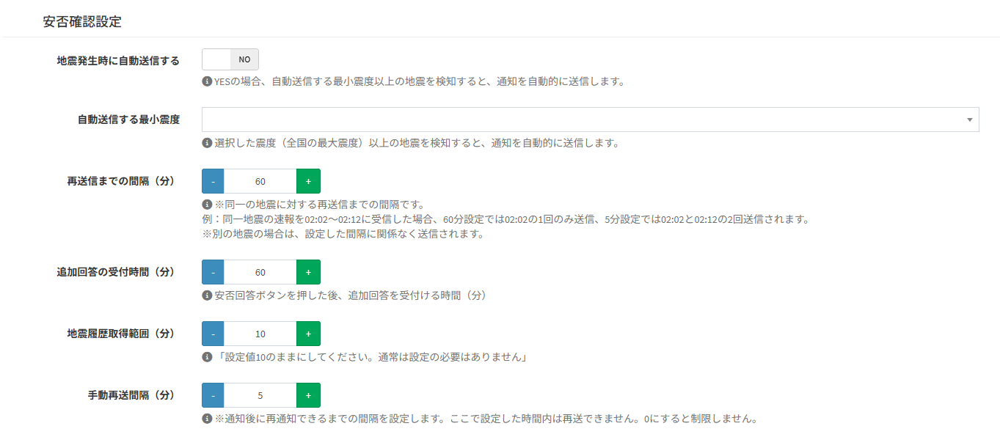
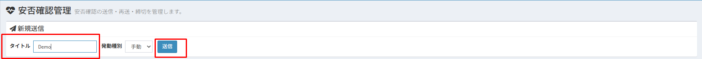
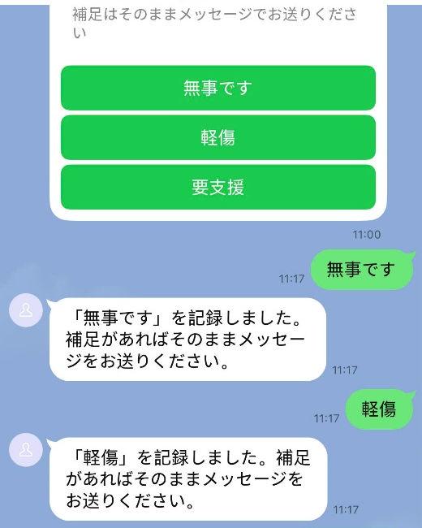
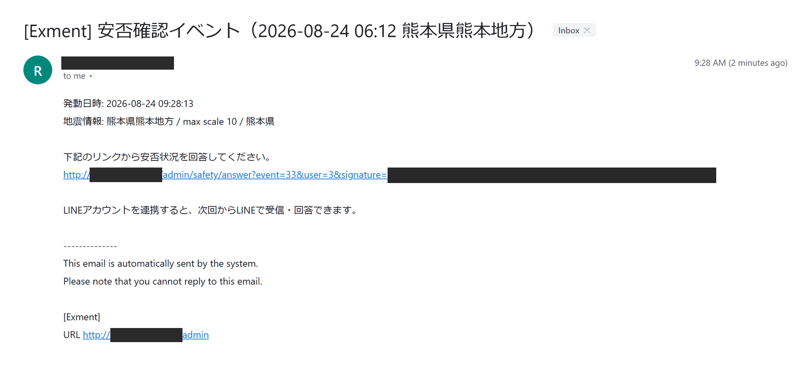
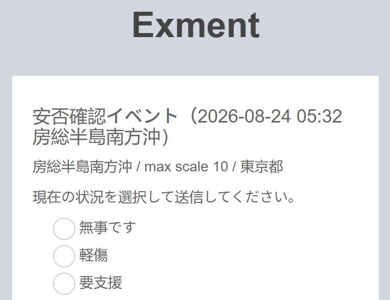
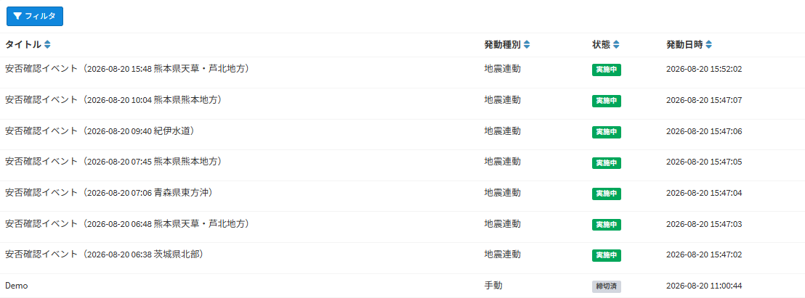
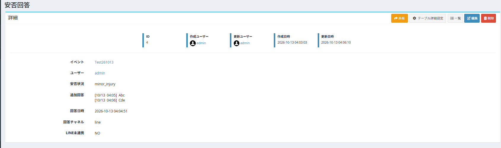
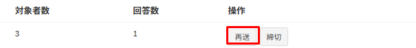
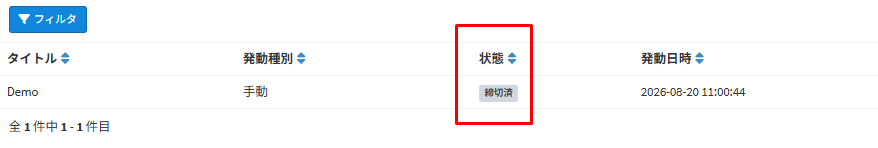

# 안부 확인
지진이나 태풍 등의 긴급 상황에서 직원이 무사한지를 LINE과 메일로 묻는 기능입니다.  
관리자가 화면에서 발송할 수 있습니다. 설정한 진도 이상의 지진이 일어났을 때 자동으로 발송할 수도 있습니다.  
응답 상황은 안부 확인 관리 화면과 안부 확인 응답 테이블에서 확인할 수 있습니다.  
※안부 확인은 v7.0.0부터 사용할 수 있습니다.

사용하기까지의 순서는 다음과 같습니다.

1. [사전 준비](/ko/safety_check?id=사전-준비)를 합니다(LINE·메일·작업 스케줄).
2. [안부 확인 설정](/ko/safety_check?id=안부-확인-설정)을 합니다(지진 때 자동으로 발송할지 등).
3. [안부 확인을 발송](/ko/safety_check?id=안부-확인-발송하기)합니다.
4. 직원이 [응답](/ko/safety_check?id=응답하기)합니다.
5. [응답 상황을 확인](/ko/safety_check?id=응답-상황-확인하기)하고, 필요하면 [재발송·마감](/ko/safety_check?id=재발송·마감)을 합니다.

## 안부 확인의 구조
- 안부 확인을 발송할 때마다 "안부 확인 이벤트" 데이터가 1건 만들어집니다.
- 동시에 모든 사용자에 대해 안부 상황이 "not_answered"(미응답)인 "안부 확인 응답" 데이터가 만들어집니다.
- 각 사용자에게는 아래 방법으로 발송됩니다. LINE과 메일을 모두 받은 사용자는 어느 쪽으로 응답해도 됩니다.

| 발송 방법 | 발송 대상 | 응답 방법 |
| --- | --- | --- |
| LINE | [LINE 계정을 연동](/ko/line)한 사용자 | 카드의 "무사합니다", "경상", "도움 필요" 버튼 |
| 메일 | 메일 주소가 등록된 사용자(LINE 계정을 연동한 사용자 포함) | 메일의 링크에서 여는 응답 화면(로그인 불필요) |

※LINE 계정을 연동하지 않았고 메일 주소도 등록되지 않은 사용자에게는 발송되지 않습니다.

### 발동 유형
안부 확인에는 아래의 발동 유형이 있습니다.

| 발동 유형 | 내용 |
| --- | --- |
| 수동 | 관리자가 안부 확인 관리 화면에서 발송합니다. 지진·태풍·화재 등 여러 가지 긴급 상황에서 사용할 수 있습니다. |
| 훈련 | 수동과 같은 방법으로 발송합니다. 발송하는 메시지의 제목 맨 앞에 "[훈련]"이 붙습니다. |
| 지진 연동 | 설정한 진도 이상의 지진이 발생한 경우에 자동으로 발송됩니다. |

## 사전 준비
사용 방법에 따라 필요한 준비가 달라집니다.

| 사용 방법 | 필요한 준비 |
| --- | --- |
| **LINE으로 발송하는 경우** | [LINE 연동](/ko/line) 설정(LINE 공식 계정 준비, 시스템 설정의 "LINE 설정", Webhook 설정)을 하고, 각 사용자가 LINE 계정을 연동하도록 합니다. |
| **메일로 발송하는 경우** | [메일 전송 설정](/ko/mailsend_setting)을 합니다. 아울러 [메일 설정](/ko/safety_check?id=메일-설정)을 확인해 주십시오. |
| **지진 발생 시 자동으로 발송하는 경우** | [작업 스케줄](/ko/additional_task_schedule) 설정이 필요합니다. 또한 Exment 서버에서 지진 정보를 가져오는 API(https://api.p2pquake.net)에 접속할 수 있어야 합니다. |

※안부 확인 관리 화면은 시스템 관리자 권한을 가진 사용자만 사용할 수 있습니다.

## 설치
안부 확인에서 사용하는 테이블과 메뉴는 Exment를 설치할 때·업데이트할 때 자동으로 만들어집니다.  
기존 환경에서는 [업데이트](/ko/update) 순서에 따라 "php artisan exment:update"를 실행해 주십시오.

아래가 만들어집니다.

| 종류 | 이름 | 내용 |
| --- | --- | --- |
| 테이블 | 안부 확인 이벤트 | 안부 확인을 발송할 때마다 데이터 1건이 만들어집니다. |
| 테이블 | 안부 확인 응답 | 안부 확인마다, 사용자마다 데이터 1건이 만들어집니다. |
| 메뉴 | 안부 확인 | 안부 확인의 발송·재발송·마감을 하는 화면입니다(이 페이지에서는 "안부 확인 관리 화면"이라고 부릅니다). |
| 알림 템플릿 | 안부 확인 메일 | 안부 확인 메일의 템플릿입니다. |
| LINE Flex 템플릿 | 안부 확인 | Flex 키는 "safety_check"입니다. 안부 확인의 LINE 카드 내용은 고정이므로, 이 템플릿을 편집해도 카드는 바뀌지 않습니다. 알림 설정에서 선택하거나 편집·삭제하지 마십시오. |

※만들어지지 않는 경우에는 "php artisan exment:patchdata line_safety_check"를 실행해 주십시오.

## 안부 확인 설정
1. 왼쪽 메뉴의 "관리자 설정" → "시스템 설정"을 클릭하고, 오른쪽 위 버튼에서 [상세 설정]으로 전환합니다.
2. "안부 확인 설정"("LINE 설정" 아래)에서 아래 항목을 설정하고 [저장]을 클릭합니다.

| 항목 | 내용 |
| --- | --- |
| 지진 발생 시 자동 전송 | YES인 경우, "자동 전송할 최소 진도" 이상의 지진이 발생하면 안부 확인을 자동으로 발송합니다. NO인 경우에는 안부 확인 관리 화면에서만 발송할 수 있습니다. 초깃값: NO |
| 자동 전송할 최소 진도 | 자동 발송의 기준으로 할 진도를 진도 4·진도 5약·진도 5강·진도 6약·진도 6강·진도 7 중에서 선택합니다. 지진 정보의 전국 최대 진도로 판정합니다. 지역으로 좁힐 수는 없습니다. 초깃값: 진도 5약 |
| 재전송 간격(분) | 같은 지진에 대해 다시 자동 발송하지 않는 시간(분)입니다. 지진 하나에 대해 속보·상세·정정 등 여러 지진 정보가 발표됩니다. 같은 지진으로 발송한 뒤 이 시간 안에 도착한 정보로는 발송하지 않습니다. 다른 지진의 경우에는 이 시간과 관계없이 발송합니다. 초깃값: 60 |
| 추가 응답 접수 시간(분) | LINE에서 응답 버튼을 누른 뒤 이어서 보낸 메시지를 "추가 응답"으로 기록하는 시간(분)입니다. 추가 응답을 보낼 때마다 접수 시간은 연장됩니다. 초깃값: 60 |
| 지진 이력 조회 범위(분) | 발표된 뒤 이 시간(분)이 지난 지진 정보로는 자동 발송하지 않습니다. 기능을 켠 직후나 작업 스케줄이 멈춰 있던 뒤에 과거의 지진으로 한꺼번에 발송되는 것을 막습니다. 보통은 "10"인 채로 바꾸지 마십시오. 초깃값: 10 |
| 수동 재전송 간격(분) | [재발송]을 실행한 뒤 다음 [재발송]을 실행할 수 있게 될 때까지의 시간(분)입니다. 0인 경우에는 제한하지 않습니다. 초깃값: 5 |

※"수동 재전송 간격(분)" 이외의 숫자 항목에서 0 또는 빈칸을 저장한 경우에는 초깃값이 사용됩니다.

## 메일 설정

### 응답용 링크
안부 확인 메일에는 응답 화면을 열기 위한 링크(응답용 링크)가 적힙니다. 아래 2가지에 주의해 주십시오.

- **직원이 열 수 있는 URL로 한다**: 응답용 링크는 Exment의 URL로 만들어집니다.
    - 지진 발생 시의 자동 발송에서는 ".env" 파일의 "APP_URL"이 사용됩니다. "APP_URL"에는 직원이 회사 밖에서도 접속할 수 있는 URL을 설정해 주십시오.
    - 화면에서 발송하는 경우에도 직원이 접속할 수 있는 URL로 Exment를 열어서 발송해 주십시오.
- **"APP_KEY"를 바꾸면 이미 보낸 링크는 무효가 된다**: 응답용 링크에는 ".env" 파일의 "APP_KEY"를 사용한 서명이 붙어 있습니다. 메일을 보낸 뒤에 "APP_KEY"를 바꾼 경우에는 [재발송]으로 새 링크를 보내 주십시오.

### 메일 템플릿
메일의 제목·본문은 [알림 템플릿](/ko/mail)의 "안부 확인 메일"에서 바꿀 수 있습니다. 초깃값은 아래와 같습니다.

~~~
제목:
[${system:site_name}] ${safety_title}

본문:
${safety_body}

아래 링크에서 안부 상황을 응답해 주십시오.
${answer_url}

LINE 계정을 연동하면 다음부터 LINE으로 수신하고 응답할 수 있습니다.
~~~

| 변수 | 내용 |
| --- | --- |
| ${safety_title} | 안부 확인의 제목입니다. 훈련의 경우에는 맨 앞에 "[훈련]"이 붙습니다. |
| ${safety_body} | 발동 일시와 지진 정보(지진 연동의 경우)입니다. |
| ${answer_url} | 응답용 링크입니다. |

※본문에서 "${answer_url}"을 삭제하면 메일에서 응답할 수 없게 됩니다. 반드시 남겨 주십시오.

## 안부 확인 발송하기

### 화면 열기
왼쪽 메뉴의 "관리자 설정" → "안부 확인"을 클릭합니다(v7.0에서는 왼쪽 메뉴의 맨 위에 있습니다). 아래 URL로도 표시할 수 있습니다.

~~~
http(s)://(Exment의 URL)/safety_check
~~~

> ※URL은 "/admin"이 붙지 않는 표준 설정(v7.2.1 이상에서 새로 설치한 사이트)의 경우입니다. `.env` 의 `ADMIN_ROUTE_PREFIX` 에 값이 있는 경우(이전 버전에서 설치한 사이트는 "admin")에는 사이트 URL 뒤에 그 값을 붙여 주십시오(예: `http(s)://(Exment의 URL)/admin/safety_check`). 자세한 내용은 [URL에 포함된 "admin"의 변경·삭제](/ko/additional_prefix)를 참조하십시오.

### 수동·훈련으로 발송하기
1. "새로 발송"의 "제목"에 안부 확인의 제목을 입력합니다(예: 태풍 15호 안부 확인).
2. "발동 유형"에서 "수동" 또는 "훈련"을 선택합니다.
3. [발송]을 클릭합니다. "안부 확인 발송을 시작했습니다."라고 표시되고, 목록에 "진행 중"인 안부 확인이 추가됩니다.
4. 발송은 화면이 표시된 뒤에 이루어집니다. 발송이 끝나면 목록의 "발송 수", "대상자 수"가 업데이트됩니다. 화면을 다시 읽어 들여 확인해 주십시오.

- **"훈련"도 모든 사용자에게 발송됩니다**. LINE의 메시지 수에도 포함됩니다.
- **[발송]을 반복해서 클릭하지 마십시오**. 같은 사용자가 앞서 실행한 발송이 끝날 때까지(최장 10분) 새 안부 확인은 발송할 수 없습니다. "이미 발송 처리 중입니다. 잠시 기다린 후 화면을 새로 고쳐 주십시오."라고 표시된 경우에는 앞의 발송을 처리하고 있습니다. 잠시 기다린 뒤 화면을 새로 고쳐 주십시오.
- 사용자 수가 많은 경우에는 발송이 끝날 때까지 시간이 걸릴 수 있습니다.

**알림 처리의 지연 실행(큐)을 사용하고 있는 경우**

- 발송 처리 자체는 큐 워커를 사용하지 않고 실행됩니다.
- [알림 처리의 지연 실행](/ko/additional_queue)을 설정한 경우에는 LINE·메일의 배달이 큐에서 실행되므로, 큐 워커를 실행해 둘 필요가 있습니다.
- 큐에서 실행한 경우, 전송에 실패한 메시지는 자동으로 다시 보내집니다(첫 전송을 포함하여 최대 3회까지 시도합니다). LINE은 LINE 서버의 혼잡(HTTP 429)이나 서버 오류(HTTP 5xx)로 실패한 경우에만 다시 보냅니다.

### 지진 발생 시 자동으로 발송하기
"안부 확인 설정"의 "지진 발생 시 자동 전송"을 YES로 하면, Exment는 매분 일본 기상청의 지진 정보를 P2P 지진 정보의 API에서 가져옵니다.  
아래 조건을 모두 만족하는 지진 정보가 있으면 발동 유형 "지진 연동"의 안부 확인을 자동으로 발송합니다.

- 전국의 최대 진도가 "자동 전송할 최소 진도" 이상이다
- 지진 정보가 발표된 뒤 "지진 이력 조회 범위(분)"이 지나지 않았다
- 같은 지진으로 "재전송 간격(분)" 이내에 발송하지 않았다

- 자동으로 발송한 안부 확인의 제목은 "안부 확인 이벤트((발생 일시) (진원지))"입니다.
- 진원지가 확정되기 전의 정보(진도 속보)로 발송한 경우, 진원지는 "진원 조사 중"으로 표시됩니다. 나중에 도착한 정보로 진원지가 확정되면 제목이 업데이트됩니다(다시 발송되지는 않습니다).

※자동 발송에는 [작업 스케줄](/ko/additional_task_schedule) 설정이 필요합니다. 작업 스케줄에 의해 명령 "exment:safetywatch"가 매분 실행됩니다.

## 응답하기
사용자가 응답하는 순서입니다. 직원에게 안내할 때 이용해 주십시오.

### LINE으로 응답하기
LINE 계정을 연동한 사용자에게는 "무사합니다", "경상", "도움 필요" 버튼이 붙은 카드가 도착합니다.

- **응답하기**: 버튼 중 하나를 누릅니다. ""무사합니다"을(를) 기록했습니다. 추가 내용이 있으면 메시지로 보내 주십시오."와 같이 답장이 옵니다.
- **응답 바꾸기**: 다시 한 번 다른 버튼을 누릅니다. 마지막에 누른 버튼의 내용이 기록됩니다.
- **상황 보충하기**: 버튼을 누른 뒤에 이어서 메시지를 보냅니다. "추가 응답을 기록했습니다."라고 답장이 오고, 메시지가 "추가 응답"으로 기록됩니다.

※추가 응답은 버튼을 누른 뒤, 또는 지난번 추가 응답을 보낸 뒤 "추가 응답 접수 시간(분)"(초기 설정으로 60분) 이내에 보내 주십시오. 접수 시간이 지난 경우에는 다시 한 번 버튼을 누른 뒤에 보내 주십시오.

### 메일로 응답하기
메일 주소가 등록된 사용자에게는 응답용 링크가 적힌 메일이 도착합니다.

1. 메일의 링크를 클릭합니다. 로그인하지 않고 응답 화면이 열립니다.
2. 현재 상황("무사합니다", "경상", "도움 필요")을 선택하고, 필요에 따라 "추가 응답(선택 사항)"을 입력한 뒤 [제출]을 클릭합니다.

3. "응답이 접수되었습니다"라고 표시되면 응답은 완료입니다.

- 같은 링크를 다시 열면 현재의 응답이 표시됩니다. 안부 확인이 마감될 때까지는 응답을 바꿀 수 있습니다.
- 응답용 링크에 유효 기간은 없습니다. 안부 확인이 마감되면 응답할 수 없게 됩니다.
- **안부 확인 메일은 다른 사람에게 전달하지 마십시오**. 링크를 알고 있으면 누구든지 그 사용자로서 응답할 수 있습니다.
- [IP 필터 설정](/ko/additional_ip_filter)을 한 경우에도 응답 화면은 회사 밖에서 열 수 있습니다.

응답 화면에 아래 메시지가 표시되는 경우가 있습니다.

| 메시지 | 내용 |
| --- | --- |
| 이 안부 확인은 마감되었습니다. | 안부 확인이 마감되었기 때문에 응답할 수 없습니다. |
| 이 링크는 유효하지 않습니다. 관리자에게 문의해 주십시오. | 링크가 올바르지 않습니다. 링크의 일부가 빠진 경우나 메일을 보낸 뒤에 "APP_KEY"가 바뀐 경우에 표시됩니다. |

## 응답 상황 확인하기

### 안부 확인 관리 화면
안부 확인 관리 화면의 목록에서 안부 확인별 상황을 확인할 수 있습니다.

| 열 | 내용 |
| --- | --- |
| 제목 | 안부 확인의 제목입니다. |
| 발동 유형 | "수동", "훈련", "지진 연동" 중 하나입니다. |
| 상태 | "진행 중" 또는 "마감됨"입니다. |
| 발동 일시 | 안부 확인을 발송한 일시입니다. |
| 발송 수 | 첫 발송에서 LINE 또는 메일 중 적어도 한쪽을 보낸 사용자의 수입니다. [재발송]으로는 바뀌지 않습니다. |
| 대상자 수 | 안부 확인의 대상이 된 사용자의 수입니다. |
| 응답 수 | 응답한 사용자의 수입니다. |
| 조작 | [재발송], [마감] 버튼입니다. 마감된 안부 확인에는 표시되지 않습니다. |

### 안부 확인 응답 테이블
사용자별 응답은 "안부 확인 응답" 테이블에서 확인할 수 있습니다.  
안부 확인 응답 테이블은 왼쪽 메뉴에 표시되지 않습니다. 아래 URL에 접속해 주십시오.

~~~
http(s)://(Exment의 URL)/data/safety_check_answer
~~~

| 열 | 내용 |
| --- | --- |
| 이벤트 | 응답 대상인 안부 확인입니다. |
| 사용자 | 응답하는 사용자입니다. |
| 안부 상황 | "not_answered"(미응답), "safe"(무사합니다), "minor_injury"(경상), "need_help"(도움 필요) 중 하나입니다. |
| 추가 응답 | 추가 응답의 내용입니다. 보낼 때마다 전송 일시(월/일 시:분)와 함께 덧붙여집니다. |
| 응답 일시 | 마지막으로 응답한 일시입니다. |
| 응답 채널 | 응답에 사용한 방법입니다. "line" 또는 "mail"입니다. |
| LINE 미연동 | 발송할 때 LINE 계정을 연동하지 않았던 경우에는 YES입니다. |

※"LINE 미연동"이 YES여도 메일로 응답한 경우가 있습니다. LINE으로도 메일로도 발송되지 않은 사용자를 확인하는 경우에는 "LINE 미연동"이 YES이고 메일 주소가 등록되지 않은 사용자를 확인해 주십시오.

#### 뷰 작성 예
안부 확인 응답 테이블에 [사용자 정의 뷰](/ko/view)를 만들면 상황을 확인하기 쉬워집니다.

- **미응답자 목록**: 뷰(목록 뷰)를 만들고, 데이터 표시 조건에 "안부 상황"이 "not_answered"인 조건을 설정합니다. "이벤트" 조건을 추가하면 특정 안부 확인으로 좁힐 수 있습니다.
- **안부 상황별 인원수**: 집계 뷰를 만들고, "안부 상황"으로 그룹화하여 건수를 표시합니다.

## 재발송·마감
안부 확인 관리 화면의 목록에서 안부 확인마다 [재발송], [마감]을 실행할 수 있습니다.

### 재발송
[재발송]을 클릭하고, 확인 대화 상자에서 [확인]을 클릭합니다. "재발송을 시작했습니다."라고 표시됩니다.

- **아직 응답하지 않은 사용자에게만** LINE과 메일을 다시 보냅니다. 응답한 사용자에게는 보내지 않습니다.
- 첫 발송 뒤에 추가된 사용자에게도 발송되며, "대상자 수"가 업데이트됩니다.
- 재발송도 화면이 표시된 뒤에 이루어집니다.

- 지난번 [재발송]으로부터 "수동 재전송 간격(분)"(초기 설정으로 5분)이 지날 때까지는 재발송할 수 없습니다. "재발송은 5분 이상 간격을 두고 실행해 주십시오."와 같이 표시됩니다.
- "발송 수"는 첫 발송 때의 값 그대로입니다. 최신 응답 상황은 "응답 수"나 안부 확인 응답 테이블에서 확인해 주십시오.

### 마감
[마감]을 클릭하고, 확인 대화 상자에서 [확인]을 클릭합니다.  
상태가 "마감됨"이 되고, 그 뒤로는 LINE·메일 어느 쪽으로도 응답할 수 없게 됩니다. 이미 기록된 응답은 그대로 남습니다.

- **마감한 안부 확인을 다시 "진행 중"으로 되돌릴 수는 없습니다**. 다시 한 번 안부를 확인하는 경우에는 새로 안부 확인을 발송해 주십시오.
- 마감한 뒤에 LINE의 버튼을 누르거나 메일의 링크를 열면 "이 안부 확인은 마감되었습니다."라고 표시됩니다.

## 잘 동작하지 않는 경우
| 현상 | 주요 원인 | 대처 |
| --- | --- | --- |
| 안부 확인 관리 화면에 "안부 확인 테이블이 설치되지 않았거나 불완전합니다."라고 표시된다 | 업데이트 또는 안부 확인 테이블의 생성이 끝나지 않았다 | "php artisan migrate"를 실행해 주십시오. 그래도 표시되는 경우에는 "php artisan exment:patchdata line_safety_check"를 실행해 주십시오. |
| 지진이 발생해도 자동으로 발송되지 않는다 | ·"지진 발생 시 자동 전송"이 NO ·작업 스케줄이 동작하지 않고 있다 ·전국의 최대 진도가 "자동 전송할 최소 진도" 미만 ·지진 정보가 "지진 이력 조회 범위(분)"보다 오래되었다 | 설정과 [작업 스케줄](/ko/additional_task_schedule)을 확인해 주십시오. "storage/logs/laravel.log"에서 "safety check"를 포함하는 로그를 확인해 주십시오. |
| 발송하고 한참 지나도 목록의 "발송 수", "대상자 수"가 업데이트되지 않는다 | ·발송 처리가 아직 끝나지 않았다 ·발송 처리에서 오류가 발생했다 | 잠시 기다린 뒤 화면을 다시 읽어 들여 주십시오. 업데이트되지 않는 경우에는 "storage/logs/laravel.log"에서 "safety check send failed", "safety check LINE dispatch failed" 등 "safety check"를 포함하는 로그를 확인해 주십시오. |
| 메일이 도착하지 않는다 | ·메일 전송 설정이 올바르지 않다 ·사용자에게 메일 주소가 등록되어 있지 않다 | 시스템 설정의 테스트 메일 전송으로 메일을 보낼 수 있는지 확인해 주십시오. "storage/logs/laravel.log"에서 "safety check mail"을 포함하는 로그를 확인해 주십시오. |
| 메일의 링크를 열면 "이 링크는 유효하지 않습니다."라고 표시된다 | ·메일을 보낸 뒤에 "APP_KEY"가 바뀌었다 ·링크의 일부가 빠져 있다 | [재발송]으로 새 링크를 보내 주십시오. |
| 메일의 링크를 열 수 없다 | 응답용 링크의 URL에 회사 밖에서 접속할 수 없다(localhost나 사내 IP 주소 등) | [응답용 링크](/ko/safety_check?id=응답용-링크)를 확인하고, [재발송]으로 새 링크를 보내 주십시오. |
| LINE으로 메시지를 보내면 "잘못된 명령입니다."라고 답장이 온다 | ·응답 버튼을 누르지 않았다 ·"추가 응답 접수 시간(분)"이 지났다 ·안부 확인이 마감되었다 | 응답 버튼을 누른 뒤에 이어서 메시지를 보내 주십시오. 메일의 응답 화면에서도 추가 응답을 입력할 수 있습니다. |
