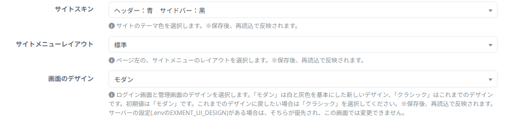
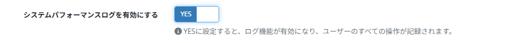

# 시스템 설정
사이트의 이름·로고·디자인, 권한을 쓰는 방법 등 Exment의 시스템 전체에 관계되는 설정을 하는 화면입니다.  
이 페이지에서는 화면의 항목을 위에서부터 차례로 설명합니다. 메일·LINE·IP 필터 등은 각 페이지로 가는 링크가 있습니다.  

## 설정 화면
메뉴의 "시스템 설정"을 누릅니다.  
시스템 설정 화면이 나옵니다.  
시스템 설정은 [기본 설정]과 [상세 설정]으로 나뉘어 있습니다.  
오른쪽 위의 버튼을 누르고, 나온 대화 상자에서 고르면 전환할 수 있습니다.

  
  

## 사이트 기본 정보
사이트의 이름·로고·메뉴의 모양 등 사이트의 기본 정보를 정합니다.

- Exment의 메뉴 레이아웃(메뉴의 모양)에는 "표준"과 "작은 아이콘"의 2종류가 있습니다.  
차이는 아래 이미지를 보십시오.  
- 처음에 나오는 메뉴 레이아웃은 [사이트 메뉴 레이아웃](/ko/system_setting?id=사이트-메뉴-레이아웃)에서 정합니다. 이미지의 빨간 테두리 부분을 누르면 그때그때 전환할 수도 있습니다.

표준
  

작은 아이콘
  

#### 사이트 이름 ※필수
- 메뉴 레이아웃이 "표준"일 때 페이지의 왼쪽 위에 나오는 사이트 이름입니다.  
- 초기값은 "Exment"입니다.  

#### 사이트 이름(약칭) ※필수
- 메뉴 레이아웃이 "작은 아이콘"일 때 왼쪽 위에 나오는 사이트 이름입니다.
- 초기값은 "Exm"입니다.  

#### 사이트 로고
- 메뉴 레이아웃이 "표준"일 때 페이지의 왼쪽 위에 나오는 사이트의 로고입니다.  
- [찾아보기] 버튼을 클릭하여 쓰고 싶은 이미지를 선택하십시오.  
- 권장 크기: 200px * 40px  

※ 사이트 로고를 설정하면 메뉴 레이아웃이 "표준"일 때 왼쪽 위에는 사이트 이름 대신 사이트 로고가 나옵니다.

#### 사이트 로고(작게)
- 메뉴 레이아웃이 "작은 아이콘"일 때 페이지의 왼쪽 위에 나오는 사이트의 로고입니다.  
- [찾아보기] 버튼을 클릭하여 쓰고 싶은 이미지를 선택하십시오.  
- 권장 크기: 40px * 40px  

※ 사이트 로고(작게)를 설정하면 메뉴 레이아웃이 "작은 아이콘"일 때 왼쪽 위에는 사이트 이름 대신 사이트 로고(작게)가 나옵니다.

#### 사이트 파비콘(ico)  
- 아래 이미지처럼 사이트를 보고 있을 때나 북마크할 때 쓰이는 아이콘 이미지입니다.  
- [찾아보기] 버튼을 클릭하여 쓰고 싶은 이미지를 선택하십시오.  
- 권장 크기: 16px * 16px  

  

#### 사이트 스킨
- 사이트의 테마 색입니다. 헤더와 사이드바의 색을 다음 조합에서 고릅니다.  
- 헤더(초기 설정은 파랑): 파랑·노랑·초록·보라·빨강·흰색
- 사이드바(초기 설정은 흰색): 검정·흰색

※ [화면 디자인](/ko/system_setting?id=화면-디자인)이 "모던"일 때는 헤더와 사이드바는 흰색과 회색 그대로이고, 고른 색이 "강조색"이 됩니다(중요한 버튼·링크·선택 중인 메뉴·입력 중인 칸의 테두리 등). 파랑 이외의 색에서는 헤더의 위쪽 가장자리에 그 색의 가는 선이 들어갑니다. "-light"가 붙는 색은 붙지 않는 색과 같은 강조색입니다.  
※ v7.1.0 이후는 저장하면 바로 반영됩니다. v7.0 이전은 저장한 뒤 웹 페이지를 다시 읽어 들이면 반영됩니다.

#### 사이트 메뉴 레이아웃
- 사이트 메뉴의 레이아웃을 "표준"이나 "작은 아이콘"에서 고릅니다.  
각각의 예는 위의 이미지를 보십시오.
- 초기값은 "표준"입니다.  

※ 저장한 뒤 웹 페이지를 다시 읽어 들이면 반영됩니다.

#### 화면 디자인
- 로그인 화면과 관리 화면의 디자인을 "모던"과 "클래식" 중 하나에서 선택합니다.
    - 모던: 흰색과 회색을 기본으로 한 새 디자인입니다.
    - 클래식: v7.0 이전과 같은 디자인입니다.
- 초기값은 "모던"입니다.

※ v7.1.0부터 쓸 수 있습니다.  
※ v7.1.0으로 업데이트하면 화면 디자인은 "모던"으로 바뀝니다. 지금까지의 디자인으로 되돌리고 싶을 때는 이 항목에서 "클래식"을 선택하고 저장하십시오.  
※ "모던"에서는 헤더와 사이드바가 흰색과 회색을 기본으로 한 표시가 되고, [사이트 스킨](/ko/system_setting?id=사이트-스킨)에서 고른 색이 강조색이 됩니다. 사이트 로고에 이미지를 설정한 경우는 로고 뒤에 강조색의 배경이 붙습니다.  
※ "모던"의 데이터 목록에서는 조작 열(표시·편집·삭제)이 체크박스의 바로 오른쪽(왼쪽 편)에 표시됩니다.  
※ 서버의 설정(.env 파일의 "EXMENT_UI_DESIGN")으로 디자인을 고정한 경우는 그쪽이 우선합니다. 이때 이 항목은 바꿀 수 없고 "(서버 설정으로 고정됨)"이라고 표시됩니다. 자세한 내용은 [설정값 목록](/ko/config)을 참조하십시오.  
※ 저장하면 바로 반영됩니다. 표시가 깨질 때는 브라우저에서 Ctrl+F5(강력 새로 고침)를 누르십시오.

#### API 사용
- "YES"로 하면 API를 쓸 수 있습니다.
- 초기값은 "NO"입니다.

#### 서버 외부 통신 수행
- YES로 하면 Exment의 최신 버전 알림 등 외부 서버와 통신하는 처리(데이터를 받기만 합니다)를 할 수 있습니다.
- 초기값은 "YES"입니다.  

#### 권한 관리 사용
- 설정이 YES인 경우, [시스템 전체에 대한 권한이나 사용자 정의 테이블별 권한](/ko/role_group)을 설정할 수 있습니다.  
- YES일 때는 사용자를 지정하여 권한을 줄 수 있습니다.
- 초기값은 "YES"입니다.  

#### 조직 관리 사용
- 설정이 YES인 경우, [권한 관리 사용](/ko/system_setting?id=권한-관리-사용)에서 조직을 지정하여 권한을 줄 수 있습니다.  
- 초기값은 "YES"입니다.  

#### 시스템 성능 로그 사용
- YES로 하면 느린 화면의 조작을 "시스템 성능 로그"에 기록합니다.
- 기록하는 것은 화면의 URL(검색 등의 값은 "***"로 가립니다)·사용자·처리 시간·SQL입니다. SQL은 값을 넣지 않고 "?" 그대로 기록합니다.
- 초기값은 "NO"입니다.

YES로 하면 다음 3가지 항목이 표시됩니다(v7.1.0 이후).

| 항목 | 내용 | 초기값 |
| --- | --- | --- |
| 성능 로그: 느린 화면 기준(초) | 화면의 처리에 이 초 수 이상 걸렸을 때 기록합니다. 0으로 하면 이 조건으로는 기록하지 않습니다. | 3 |
| 성능 로그: 느린 SQL 기준(초) | SQL 하나에 이 초 수 이상 걸렸을 때 기록합니다. 0으로 하면 이 조건으로는 기록하지 않습니다. | 1 |
| 성능 로그: 1시간당 최대 기록 수 | 1시간에 기록하는 건수의 상한입니다. 상한을 넘은 만큼은 기록하지 않습니다. 0으로 하면 상한이 없습니다. | 100 |

※ "느린 화면 기준(초)"과 "느린 SQL 기준(초)"을 둘 다 0으로 하면 모든 조작을 기록합니다(v7.0 이전과 같은 동작입니다). 조사할 때만 그렇게 하십시오. v7.0 이전부터 로그를 ON으로 했던 환경은 업데이트한 뒤에도 이 "모두 기록" 그대로입니다.  
※ 로그를 보려면 왼쪽 메뉴의 "관리자 설정" → "시스템 성능 로그"를 엽니다.  
※ v7.0.3 이후는 YES로 하고 저장하면 로그의 테이블과 메뉴("관리자 설정" 안)가 자동으로 만들어집니다. 템플릿을 설치할 필요는 없습니다.  
※ v7.0.2 이전은 템플릿([Template zip file](https://exment.net/template/system_logs.zip))을 설치하고 `php artisan exment:update`를 실행하십시오.

#### 시스템 관리자
- 시스템 관리자가 되는 사용자를 설정할 수 있습니다.
- 초기값은 Exment를 설치했을 때 초기 설정을 한 사용자입니다.

#### 데이터 목록 표시 건수
- 데이터 목록 페이지에서 처음에 내보내는 데이터의 건수입니다.  
  "10건", "20건", "30건", "50건", "100건" 중 하나를 선택합니다.
- 초기값은 "20건"입니다.  

#### 검색 및 대시보드 표시 건수
- [키워드 검색](/ko/search)을 했을 때나 [대시보드의 데이터 목록](/ko/dashboard)에서 처음에 내보내는 데이터의 건수입니다.  
"5건", "10건", "20건" 중 하나를 선택합니다.  
- 초기값은 "5건"입니다.  

#### 날짜 및 시간 표시 형식
- 날짜의 표시 형식을 3종류("표준(Y-m-d H:i:s)", "사용자 정의(Y/m/d H:i:s)", "로컬(Y년 m월 d일 H시 i분 s초)") 중에서 고를 수 있습니다. 초기값은 "표준(Y-m-d H:i:s)"입니다.

#### 데이터 검색 방법
- 등록한 데이터의 검색 방법을 "앞부분 일치"(앞이 같은 것)나 "부분 일치"(중간에 포함하는 것)에서 고릅니다.
- 초기값은 "앞부분 일치"입니다.

#### 데이터 목록 필터 숨기기
- 체크한 항목은 데이터 목록 화면의 필터에 나오지 않게 됩니다.

#### 데이터 화면의 시스템 항목 표시 위치
- 데이터 편집 화면과 데이터 상세 화면에서 시스템 항목을 내보내는 위치를 정합니다.  
- "상단에 표시", "하단에 표시", "숨기기"에서 선택할 수 있습니다. 초기값은 "상단에 표시"입니다.  

#### 데이터 저장 후 기본 이동 위치
- [데이터 등록](/ko/data_form) 화면에는 데이터를 저장한 뒤에 어느 화면으로 옮길지를 고르는 체크박스가 있습니다. 그 체크박스에 처음부터 체크를 넣어 둘 수 있습니다.

#### 헤더의 사용자 정보 표시 내용
- 헤더의 사용자 정보에 내보내는 내용을 정할 수 있습니다. 비워 두면 내보내지 않습니다.
- 사용자 테이블의 사용자 정의 열과 생성 일시에서 고를 수 있습니다.

#### 사용자가 선택할 수 있는 언어
- 사용자가 오른쪽 위의 메뉴·로그인 화면·로그인 사용자 설정에서 고를 수 있는 언어입니다(v7.2.4 이후). 비워 두면 들어 있는 모든 언어를 고를 수 있습니다. 사이트의 언어는 언제나 고를 수 있습니다.
- 자세한 내용은 [사용자별 언어와 시간대](/ko/user_locale)를 보십시오.

#### 사용자가 언어를 선택하지 않았을 때 브라우저의 언어 사용
- YES로 하면 언어를 고르지 않은 사용자에게는 브라우저의 언어(사용자가 선택할 수 있는 언어 중에서)로 화면을 내보냅니다. NO로 하면 사이트의 언어로 내보냅니다(v7.2.4 이후).
- 초기값은 "YES"입니다. 모두를 사이트의 언어 그대로 둘 때는 NO로 하십시오.

## 조직 설정
권한이나 공유의 설정에서 조직을 어디까지 포함할지를 정합니다.

#### 조직 계층 설정(역할 그룹)
-  역할 그룹의 "사용자/조직 설정"에 조직을 설정했을 때, 그 조직의 상위나 하위 조직을 어디까지 포함할지를 정합니다.
- 초기값은 "역할 그룹이 설정된 조직의 상위 및 하위 계층 사용자도 역할 범위에 포함"으로 설정되어 있습니다.

#### 조직 계층 설정(데이터)
- 각 사용자 정의 데이터의 공유 설정에 조직을 설정했을 때, 그 조직의 상위나 하위 조직을 어디까지 포함할지를 정합니다.
- 초기값은 "데이터가 공유된 조직의 사용자만"으로 설정되어 있습니다.

#### 데이터 공유 설정
-  사용자가 데이터를 새로 만들었을 때 자동으로 공유하는 상대를 그 사용자만으로 할지, 소속 조직도 포함할지를 정합니다.
- 초기값은 "로그인 사용자만"입니다.

## 시스템 메일 설정
시스템에서 메일을 보내기 위한 설정입니다.  
화면에서 설정할 때는 SMTP의 설정값을 입력합니다.  
자세한 내용은 [메일 전송 설정](/ko/mailsend_setting)을 보십시오.

## LINE 설정
[상세 설정]의 "LINE 설정"에서 [LINE 연동](/ko/line)에 쓰는 LINE 공식 계정의 정보(채널 액세스 토큰, 채널 시크릿, 베이직 ID)를 설정합니다.  
자세한 내용은 [LINE 연동](/ko/line)의 시스템 설정을 보십시오.

## 안부 확인 설정
[상세 설정]의 "안부 확인 설정"에서 [안부 확인](/ko/safety_check)의 지진 발생 시 자동 전송 등을 설정합니다.  
자세한 내용은 [안부 확인](/ko/safety_check)의 안부 확인 설정을 보십시오.

## IP 필터 설정
통신을 허용하는 IP 주소를 고정 IP(예: 12.3.5.6)나 범위 지정 형식(예: 123.4.5.0/24)으로 설정합니다.  
설정하지 않은 경우는 모든 IP 주소를 허용합니다.
자세한 내용은 [IP 필터](/ko/additional_ip_filter)를 보십시오.

## 비밀번호 정책

> [로그인 설정](/ko/login_setting)으로 옮겼습니다.

## SSO 설정

> [로그인 설정(SSO)](/ko/login_sso)으로 옮겼습니다.
