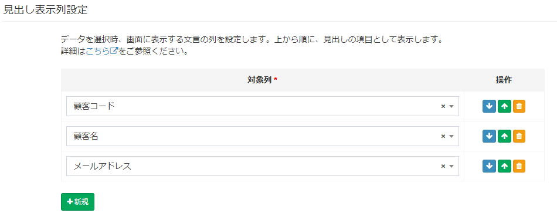
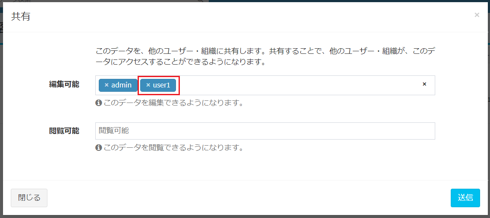

# 사용자 정의 테이블 설정
Exment에서는 데이터를 "사용자 정의 테이블"(표)에 넣어 관리합니다. 고객·견적·작업 등 관리하고 싶은 것마다 테이블을 만듭니다.  
이 페이지에서는 테이블을 만들고·고치고·지우는 방법과 테이블별 설정(데이터에서 쓸 수 있는 기능·권한 등)을 설명합니다.

- 처음 테이블을 만들 때: 아래의 "새로 만들기" → "설정 항목의 상세" → "저장"의 순서로 보십시오.
- 중복 검사나 검색 후보에 내보내는 문구 등 여러 열을 쓰는 설정: 아래의 "확장 설정"을 보십시오.

## 목록
메뉴의 "사용자 정의 테이블"을 누릅니다.  
지금 있는 사용자 정의 테이블의 목록이 나옵니다.  

※ "기본 정보", "사용자", "조직", "알림 템플릿", "메일 발송 이력", "공지사항"  
이 테이블들은 Exment를 설치했을 때부터 들어 있습니다.  
템플릿으로 가져온 테이블도 이 목록에 나옵니다.  

## 새로 만들기

- 목록 화면 오른쪽 위의 [새로 만들기] 버튼을 누릅니다.
  
  
- 테이블 작성 화면이 나오니 필요한 항목을 입력합니다. 항목의 설명은 아래의 "설정 항목의 상세"에 있습니다.

## 설정 항목의 상세

#### 테이블 이름(영숫자) ※필수
- 테이블의 이름을 나타냅니다. (예: user , information , estimate )  
- 여기에서 정한 영숫자는 테이블을 열었을 때의 URL 등에 쓰입니다. (예: http(s)://(Exment의 URL)/data/user)  
- 쓸 수 있는 것은 반각 영숫자와 기호 "-", "_"입니다.
- 다른 테이블에서 쓰고 있는 테이블 이름은 쓸 수 없습니다.  
- 테이블 이름의 글자 수는 30자 이내, 테이블 이름의 첫 글자는 영문자로 지정하십시오.  
- 테이블을 새로 만들 때만 정할 수 있습니다. 저장한 뒤에는 바꿀 수 없습니다.  

> ※ URL은 "/admin"이 붙지 않는 표준 설정(v7.2.1 이후에 새로 설치한 사이트)의 경우입니다. `.env`의 `ADMIN_ROUTE_PREFIX`에 값이 있는 경우(이전 버전에서 설치한 사이트는 "admin")는 사이트의 URL 뒤에 그 값을 더하십시오(예: `http(s)://(Exment의 URL)/admin/oauth/token`). 자세한 내용은 [URL에 포함되는 "admin"의 변경·삭제](/ko/additional_prefix)를 보십시오.

#### 테이블 표시 이름 ※필수
- 화면에 표시하는 이름입니다. 한국어도 쓸 수 있습니다. (예: 사용자, 공지사항, 견적 )  

  

#### 설명
- 테이블에 관한 설명입니다.

- 입력한 설명은 아래 이미지처럼 데이터 화면에서 테이블 표시 이름의 오른쪽에 나옵니다.  

#### 표시 순서
- 사용자 정의 테이블 설정의 목록 화면에서의 표시 순서입니다.  
- 반각으로 입력하거나 좌우의 [-] [+] 버튼으로 숫자를 지정하십시오.

#### 색상
- 테이블의 색을 정합니다. 이 색은 검색할 때의 후보(서제스트) 등에 쓰입니다.

- 지금의 색을 누르면 색을 고르는 화면이 나옵니다.

#### 아이콘
- 테이블의 아이콘을 정합니다. 이 아이콘은 메뉴와 검색 결과에 나옵니다.  

- 지금의 아이콘을 누르면 아이콘을 고르는 화면이 나옵니다.

#### 검색 가능
- 검색 바에서 [검색](/ko/search)을 할 때 이 테이블을 검색의 대상으로 할지 말지를 정합니다. 기본값은 YES입니다.  
숨겨 두고 싶은 테이블 등 검색 결과에 내보내고 싶지 않을 때는 NO로 하십시오.

#### ID를 라벨로 사용
- 검색 바에 나오는 검색 후보에서 라벨의 앞에 데이터의 ID를 붙일 수 있습니다. 자세한 내용은 [제목 표시 열 설정](/ko/table?id=제목-표시-열-설정)을 보십시오. 기본값은 NO입니다.  

#### 1건만 등록 가능
- 데이터를 여러 건 등록하지 않고 1건만 등록할 수 있는 테이블로 할 때는 YES로 하십시오. 기본값은 NO입니다.  

#### 첨부 파일 사용
- 테이블의 데이터에 [첨부 파일](/ko/data_details)을 업로드할 수 있게 할 때는 YES로 하십시오. 기본값은 YES입니다.  

#### 코멘트 사용
- 테이블의 데이터에 [코멘트](/ko/data_details)를 쓸 수 있게 할 때는 YES로 하십시오. 기본값은 YES입니다.  

#### 데이터 변경 이력 사용
- 누가 어떤 내용으로 데이터를 업데이트했는지를 리비전(이력)으로 남기고 싶을 때는 YES로 하십시오. 기본값은 YES입니다.  

#### 변경 이력 버전 수
- "데이터 변경 이력 사용"이 YES일 때 변경 이력을 몇 개까지 남길지(버전 수)를 정수로 입력합니다.  
"200"이라고 입력하면 201번째 업데이트에서 1번째 변경 이력이 사라집니다. 기본값은 100입니다.  

#### 목록 표시 최적화
- YES로 하면 데이터 목록 화면을 먼저 표시하고, 그 뒤에 행을 자동으로 읽어 들입니다. 건수나 열이 많은 테이블에서 목록 화면이 나올 때까지의 시간을 줄입니다. 기본값은 NO입니다.
- 행의 그리기를 나중에 하는 설정입니다. 데이터베이스에 대한 조회를 줄이는 것은 아닙니다.
- 설정은 데이터 목록을 다시 열면 적용됩니다.

※ v7.1.0부터 쓸 수 있습니다.

#### 모든 사용자가 편집 가능

> 테이블 권한의 개요는 [Exment의 역할·권한의 개요](/ko/permission) 페이지를 먼저 확인하십시오.

- YES로 하면 모든 사용자가 이 테이블의 모든 데이터를 편집할 수 있습니다. 사용자별로 권한을 줄 필요가 없어집니다. 기본값은 NO입니다.  

#### 모든 사용자가 열람 가능

> 테이블 권한의 개요는 [Exment의 역할·권한의 개요](/ko/permission) 페이지를 먼저 확인하십시오.

- YES로 하면 모든 사용자가 이 테이블의 모든 데이터를 열람할 수 있습니다. 사용자별로 권한을 줄 필요가 없어집니다. 기본값은 NO입니다.  

※ Exment를 설치할 때 "공지사항" 테이블만 "모든 사용자가 열람 가능"이 YES로 초기 설정되어 있습니다. 이것은 모든 사용자가 공지사항 정보를 열람할 수 있게 하기 위해서입니다.  
한편 공지사항 정보를 편집할 수 있는 것은 관리자뿐입니다.

#### 모든 사용자가 참조 가능

> 테이블 권한의 개요는 [Exment의 역할·권한의 개요](/ko/permission) 페이지를 먼저 확인하십시오.

- YES로 하면 모든 사용자가 이 테이블의 모든 데이터를 참조할 수 있습니다. 사용자별로 권한을 줄 필요가 없어집니다. 기본값은 NO입니다.  

※ "모든 사용자가 참조 가능"만 YES로 하면 그 테이블을 메뉴나 목록 화면에 내보낼 수는 없지만, 다른 테이블에서 참조할 수는 있습니다.  

예: "소비세" 테이블은 일반 사용자에게 목록 화면을 보여 줄 필요는 없지만, 선택지로 "소비세"를 고르게 할 필요가 있습니다. 이런 테이블에서는 "모든 사용자가 참조 가능"을 YES로 하십시오.  

#### 상위 데이터의 권한으로 열람 가능

> 테이블 권한의 개요는 [Exment의 역할·권한의 개요](/ko/permission) 페이지를 먼저 확인하십시오.

- YES로 하면 상위 데이터(1대다)의 권한으로 데이터를 열람할 수 있습니다. 다만 이 테이블 자체에 담당자의 열람 등의 권한을 가지고 있어야 합니다. 기본값은 NO입니다.  

※ 1대다 관계의 자식 테이블에만 표시되는 옵션입니다.  

※ 상위 데이터의 편집 권한을 가지고 있어도 자식 데이터를 편집할 수는 없습니다. 열람만 할 수 있습니다.  

#### 상위 데이터의 편집 권한 필요

> 테이블 권한의 개요는 [Exment의 역할·권한의 개요](/ko/permission) 페이지를 먼저 확인하십시오.

- YES로 하면 이 테이블의 데이터를 편집하려면 상위 데이터(1대다)의 편집 권한이 필요하게 됩니다. 기본값은 YES입니다.  

※ 1대다 관계의 자식 테이블에만 표시되는 옵션입니다.  

#### 메뉴에 추가
- YES로 하면 테이블의 저장과 함께 그 테이블을 메뉴에 추가합니다. 기본값은 NO입니다.  

※ 테이블을 새로 만들 때만 나오는 항목입니다. 메뉴에 추가한 뒤에 메뉴의 설정을 바꿀 때는 [메뉴](/ko/menu) 화면에서 하십시오.  

#### 추가할 상위 메뉴
- "메뉴에 추가"를 YES로 하면 나오는 항목입니다. 추가하는 메뉴의 상위가 되는 메뉴 이름을 고르십시오.  

예: "매뉴얼" 테이블을 새로 만들 때 상위 메뉴로 "관리자 설정"을 고르면, 이미지처럼 "매뉴얼" 테이블의 메뉴가 "관리자 설정" 안의 맨 아래에 만들어집니다.

#### 알림에 추가
- YES로 하면 테이블의 저장과 함께 알림의 설정을 추가합니다. 데이터를 새로 만들거나 업데이트·공유할 때, 코멘트가 있을 때에 권한이 있는 사용자에게 시스템 내 알림을 하는 설정입니다.  

※ 테이블을 새로 만들 때만 나오는 항목입니다. 알림에 추가한 뒤에 알림의 설정을 바꿀 때는 [알림](/ko/notify) 화면에서 하십시오.  

## 저장
- [제출] 버튼을 누르면 설정이 저장되고, 그 내용으로 테이블이 만들어집니다.

- 테이블을 새로 만들었을 때는 저장한 뒤 [사용자 정의 열 목록 화면](/ko/column)으로 바뀝니다.  
이어서 사용자 정의 열을 등록하십시오.

## 편집
- 사용자 정의 테이블 목록에서 고치고 싶은 테이블의 [편집] 버튼을 누르십시오.  
편집 화면으로 바뀌어 설정을 바꿀 수 있습니다.  

## 삭제
- 테이블을 지우고 싶을 때는 먼저 위의 "편집"과 같은 절차로 편집 화면을 여십시오.

- 다음으로 편집 화면 오른쪽 위에 있는 [삭제] 버튼을 누르십시오.  

  

- 아래 이미지와 같은 확인 화면이 나옵니다. 텍스트 영역에 delete me라고 입력하고 [확인] 버튼을 누르면 테이블이 삭제됩니다.  
**※ 다만 다음 종류의 테이블은 삭제할 수 없습니다. ·시스템에서 설치한 테이블 ·관계가 자식으로 설정되어 있는 테이블**

## 확장 설정
테이블 안의 여러 열을 쓰는 설정(중복 검사·열끼리의 비교·제목·데이터의 자동 공유 등)을 할 수 있습니다.

- 사용자 정의 테이블 목록에서 설정하고 싶은 테이블의 [확장 설정] 버튼을 누르십시오.  

- 설정 화면으로 바뀝니다.

  

### 복합 고유 키 설정
여러 열을 묶어 고유 키(중복을 허용하지 않는 조합)로 하면, 데이터를 새로 등록할 때 같은 조합의 값이 이중으로 등록되는 것을 막을 수 있습니다.  

- 조합으로 중복을 막고 싶은 열을 2~3종류 고르십시오.
- 데이터를 새로 등록할 때 고른 열 모두에서, 등록하려는 값이 이미 등록된 값과 같은 경우에 오류가 됩니다.  

예: 아래 이미지처럼 "다음 예정일", "이름"을 고유 키로 하면 같은 다음 예정일에 같은 이름이 여러 건 등록되는 것을 막을 수 있습니다.  

※ 1종류의 열만으로 중복을 막고 싶을 때는 [사용자 정의 열 설정](/ko/column)에서 그 열의 고유를 YES로 하십시오.

※ 1:N의 관계([Exment의 관계 설정 참조](/ko/relation))의 경우, 자식 테이블에 복합 고유 키를 설정할 때 부모 테이블도 고유 키의 하나로 고를 수 있습니다.  
이렇게 하면 같은 상위 데이터 안에서만 중복을 검사할 수 있습니다.

### 두 열 비교
데이터를 새로 만들 때와 업데이트할 때 두 열을 비교합니다. 열의 값이 설정한 조건에 맞을 때만 저장할 수 있습니다. 맞지 않을 때는 오류 메시지를 내보냅니다.  
다음과 같을 때 쓸 수 있습니다.  

- "시작일"이 "종료일" 이전인 경우에만 저장할 수 있다.
-  "X"의 값이 "Y"의 값 이상인 경우에만 저장할 수 있다.
- "담당자"와 "확인자"가 다른 경우에만 저장할 수 있다.

    

#### 입력하지 않은 경우의 처리
한쪽 또는 양쪽 항목이 입력되지 않았을 때는 고른 조건에 따라 결과가 달라집니다.  
여기에서는 저장할 수 있는 경우를 "true", 오류가 되는 경우를 "false"라고 씁니다.

- **A와 B가 일치함** : 값이 둘 다 입력되지 않은 경우 true. 어느 한쪽만 입력되지 않은 경우 false.
- **A와 B가 일치하지 않음** : 값이 어느 한쪽만 입력되지 않은 경우 true. 둘 다 입력되지 않은 경우 false.
- **그 밖** : 항상 true. 날짜나 수치는 값이 비어 있을 때는 보통 비교를 할 수 없기 때문입니다.  
입력하지 않는 일이 없게 하고 싶을 때는 사용자 정의 열 설정이나 사용자 정의 폼 설정에서 필수로 하십시오.

#### 열 종류별 처리
- 대소(A가 B보다 큼, A가 B보다 작음, A가 B 이상임, A가 B 이하임)의 비교는 다음 열 종류에서만 할 수 있습니다.
    - 정수
    - 소수
    - 통화
    - 날짜
    - 시각
    - 날짜 및 시각

- 그 밖의 열 종류에서 대소를 비교하려고 하면 항상 true가 됩니다.

- 열의 종류가 맞지 않으면 대소는 비교할 수 없습니다(예를 들면 "정수"와 "날짜 및 시각"). 본래는 이 설정을 저장할 때 오류로 해야 하는 것입니다.  
다만 지금은 저장할 때 이 검사를 하지 않습니다. 종류가 맞는 두 열을 고르십시오.

#### 기타
- 3열 이상의 값으로 하는 비교, 특별한 조건을 쓴 비교, 다른 테이블의 값을 쓴 비교 등을 하고 싶을 때는 [플러그인의 유효성 검사](/ko/plugin_quickstart_validate)를 만드십시오.

### 제목 표시 열 설정
검색 바의 후보나 선택지 목록에 내보내는 문구(제목)를 어느 열의 값으로 만들지를 정하는 설정입니다.  
  
예를 들어 아래와 같은 "고객 정보"라는 테이블이 있다고 합시다.  
고객 정보 테이블에는 "고객 코드", "고객 이름", "전화번호", "메일 주소"와 같은 열이 있습니다.  
    

검색 바에 검색어를 입력하면 검색 후보가 나옵니다.  
이 후보를 다음과 같이 내보내고 싶다고 합시다.  
"(고객 코드) (고객 이름)"  
    
  
그때는 사용자 정의 테이블의 확장 설정 화면에서 제목에 내보내고 싶은 열을 다음과 같이 등록합니다.  
  
  
이렇게 등록하면 페이지 위쪽의 검색 바에 문자를 입력했을 때 후보가 다음과 같이 나옵니다.  
후보의 문자열은 확장 설정 화면에서 위에서부터 등록한 열의 순서로 늘어섭니다.  
  
  
"메일 주소"도 내보내고 싶을 때는 "메일 주소" 열을 추가하십시오.  
  
  
  
또 사용자 정의 테이블 설정에 "ID를 라벨로 사용" 항목이 있습니다.
  
이 설정을 YES로 하면 라벨의 앞에 "#(id)"라는 문구가 추가됩니다.  
  

#### 기타
- 이 제목 표시 열 설정을 등록하지 않았을 때는 사용자 정의 열 설정에서 1번째 열의 값을 표시합니다.
- 사용자 정의 열 설정에서 1번째 열의 값이 비어 있을 때는 ID를 표시합니다.
- ID를 추가할 수 있는 것은 라벨의 맨 앞뿐입니다. 다른 곳에는 추가할 수 없습니다.  

### 데이터 자동 공유 설정

> 데이터 공유 설정은 [Exment의 역할·권한의 개요](/ko/permission) 페이지를 먼저 확인하십시오.

데이터를 저장할 때 열의 값에 들어 있는 조직이나 사용자에게 자동으로 데이터를 공유할 수 있습니다.  
다음과 같을 때 쓸 수 있습니다.  

- 데이터 "계약 정보"를 새로 만들 때, 열 "주담당자"에 배정된 사용자에게 자동으로 편집 권한을 추가한다.  
- 데이터 "계약 정보"를 업데이트할 때, 열 "관계 조직"에 배정된 조직에 자동으로 열람 권한을 추가한다.  
- 데이터 "작업 관리"를 새로 만들 때, 열 "담당자"에 배정된 사용자에게 자동으로 편집 권한을 추가한다.  

※ 먼저 사용자 정의 테이블에 열 종류가 "사용자"나 "조직"인 열이 필요합니다.

#### 예  
"고객 관리" 테이블에서 이와 같은 열 설정이 정의되어 있는 경우에,

'"새로 만들 때"에, 열 "담당자"에 배정된 사용자에게 "편집" 권한을 추가한다'는 설정을 합니다.

그 뒤에 담당자를 사용자 "user1"로 하는 데이터를 새로 만들 때,

사용자 "user1"에게 이 데이터가 편집 권한으로 공유됩니다.

#### 설정 방법

- ##### 트리거
데이터를 공유하는 시점입니다.  
"새로 만들 때" 또는 "업데이트 시"를 선택할 수 있습니다.  

- ##### 대상 열
데이터 공유의 대상이 되는 사용자 또는 조직입니다.

- ##### 대상 권한
편집 권한과 열람 권한 중 어느 것으로 공유할지를 고릅니다.

#### 공유의 동기화 설정
처음의 설정에서는 트리거가 "업데이트 시"일 때 대상 열의 사용자·조직을 바꾸어도, 전에 들어 있던 사용자·조직에 대한 공유는 사라지지 않고 공유된 채로 남습니다.  

설정을 바꾸면 데이터를 업데이트할 때 "열에 들어 있는 사용자·조직"과 "업데이트한 사용자" 이외의 사용자·조직을 공유에서 뺄 수 있게 됩니다.

그렇게 하려면 옵션 설정의 "업데이트 시 데이터 자동 공유 설정 동기화"를 YES로 하십시오.

### 화면에서의 실행 불가 설정

데이터를 새로 만들기·편집·삭제하는 일이나 가져오기·내보내기를 화면에서 하게 하고 싶지 않을 때 설정합니다.  
설정하면 그 버튼이 화면에 나오지 않게 됩니다.  

- "화면에서 변경 불가" 항목이 표시됩니다.

  

- 설정 예: "내보내기"를 숨긴 경우

  

  

### 데이터 화면의 시스템 항목 표시 위치

데이터 편집 화면과 데이터 상세 화면에서 시스템 항목을 내보내는 위치를 정합니다.  
"시스템 설정에 맞춤", "상단에 표시", "하단에 표시", "숨기기"에서 선택할 수 있습니다.(초기값은 "시스템 설정에 맞춤")  
※ 시스템 전체의 표시 위치는 시스템 설정에서 바꿀 수 있습니다.  

  

### 행 클릭 시 화면 전환

데이터 목록 화면에서 행을 눌렀을 때 어느 화면을 열지를 정합니다.  
"기본값에 맞춤", "데이터 편집 화면", "데이터 상세 화면", "전환하지 않음"에서 선택할 수 있습니다.(초기값은 "기본값에 맞춤")  
※ 시스템 전체의 기본값은 "데이터 상세 화면"이지만, .env의 설정값(`EXMENT_GRIDROW_SELECT_EDIT`·`EXMENT_GRIDROW_SELECT_DISABLED`. [설정값](/ko/config))으로 바꿀 수 있습니다.  

  

### 제목 형식 설정
> 이 설정은 [전문가 모드](/ko/additional_expert)를 활성으로 한 경우에만 표시됩니다.

매개변수 변수를 써서 제목에 내보내는 값을 자유로운 형태로 정할 수 있습니다.  

- 전문가 모드를 활성으로 하고 확장 설정 화면을 엽니다.

- "형식 문자열 입력" 항목이 표시됩니다.  

  

- 데이터에 저장한 값을 제목에 내보낼 때는 [매개변수 변수](/ko/params)를 씁니다.  
예: 사용자 정보에서 "사용자 이름&lt;admin@admin.admin&gt;"이라고 표시하는 경우  
${value:user_name}&lt;${value:email}&gt;  
  

- 이와 같이 입력하면 제목에 내보내는 항목을 정할 수 있습니다.  
  

#### 기타
- 이 제목 표시 형식 설정을 설정해 두면 "제목 표시 열 설정"은 무효가 됩니다.
