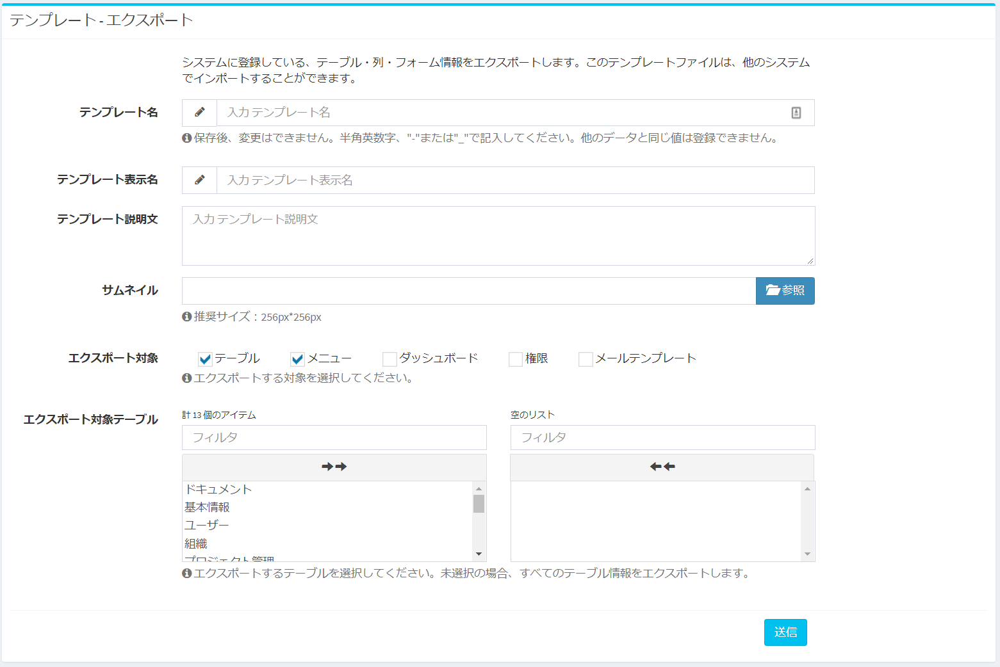
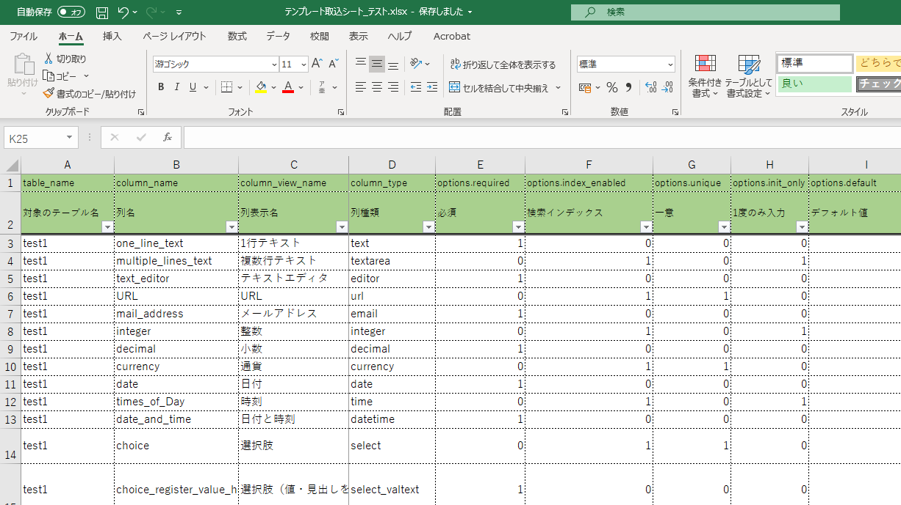

# 템플릿
"템플릿"은 테이블·열·폼·메뉴·대시보드 등의 설정을 하나의 파일로 모은 것입니다. 이 페이지에서는 템플릿을 가져오는 방법(가져오기)과 내보내는 방법(내보내기)을 설명합니다.

| 하고 싶은 일 | 볼 곳 |
|---|---|
| 이 시스템에서 만든 테이블 등을 다른 사용자가 쓸 수 있게 한다 | 내보내기 |
| 다른 사람이 만든 템플릿이나 Exment에서 준비한 템플릿을 가져온다 | 가져오기 |
| 신청·승인의 구조를 한꺼번에 넣는다 | 동봉 템플릿 "신청 팩" |
| Excel에 적어서 여러 테이블을 한꺼번에 만든다 | 가져오기 - Excel 템플릿 |

템플릿을 가져오면, 사용자 정의 테이블 등을 처음부터 만드는 수고를 덜 수 있습니다.

## 페이지 표시
- 왼쪽 메뉴에서 "템플릿"을 선택합니다.  
또는 아래의 URL에 접속하십시오.  
http(s)://(Exment의 URL)/template  
그러면 템플릿 화면이 표시됩니다.  
  

> ※URL은 "/admin"이 붙지 않는 표준 설정(v7.2.1 이후에 새로 설치한 사이트)의 경우입니다. `.env`의 `ADMIN_ROUTE_PREFIX`에 값이 있는 경우(이전 버전에서 설치한 사이트는 "admin")에는 사이트의 URL 뒤에 그 값을 붙이십시오(예: `http(s)://(Exment의 URL)/admin/template`). 자세한 내용은 [URL에 포함된 "admin"의 변경·삭제](/ko/additional_prefix)를 보십시오.

## 내보내기
페이지 위쪽에 있는 "내보내기"에 필요한 사항을 적고, "전송"을 클릭합니다. 설정이 들어 있는 zip 파일이 출력됩니다.  
  

##### 템플릿 이름  
시스템 안에서 쓰는 이름입니다. 반각 영숫자, "-" 또는 "_"로 적습니다.  
다른 템플릿 파일과 겹치지 않는 이름으로 하십시오.  

##### 템플릿 표시 이름  
템플릿 화면에서 표시할 템플릿 이름을 적습니다.

##### 템플릿 설명  
템플릿 화면에서 표시할 설명을 적습니다.

##### 썸네일  
템플릿 화면에서 표시할 썸네일을 업로드합니다. 권장 크기는 256px*256px입니다.  
업로드하지 않는 경우, 템플릿 화면에서는 "No Image" 이미지가 표시됩니다.

##### 내보내기 대상  
이 템플릿에 넣을 것을 선택합니다. 템플릿을 가져오면, 여기에서 선택한 항목이 시스템에 들어갑니다.  
선택할 수 있는 대상은 "테이블" "메뉴" "대시보드" "역할 그룹" "워크플로"입니다.  
※"워크플로"는 v7.0.0 이후에서 선택할 수 있습니다.  
  

##### 내보내기 대상 테이블
"내보내기 대상"에서 "테이블" "메뉴" "역할 그룹" "워크플로"를 선택했을 때, 여기에서 선택한 테이블에 관련된 내용만 내보냅니다.  
자신이 만든 테이블에 관련된 내용만으로 템플릿을 만들고 싶을 때 선택하십시오.  
※선택하지 않은 경우, 모든 항목을 내보냅니다.
  

##### 저장
입력이 끝나면 [전송]을 클릭합니다. 입력한 내용으로 템플릿 파일을 내보냅니다. 데이터 형식은 zip 파일입니다.

## 가져오기
가져올 수 있는 템플릿은 현재 아래의 3가지가 있습니다.  
- Exment에서 준비한 템플릿
- 화면에서 업로드한 템플릿
- 과거에 그 시스템에서 업로드한 템플릿(다시 가져올 수 있습니다)
  

아래의 어느 한 방법으로 가져오기를 실행하십시오.

- ##### 설치 템플릿:
Exment에서 준비한 템플릿과, 과거에 업로드한 템플릿의 목록이 표시되어 있습니다.  
그 가운데에서 가져오고 싶은 템플릿을 선택하십시오.

- ##### 템플릿 업로드(zip):
가지고 있는 Exment 템플릿 파일을 화면에서 업로드하십시오.  
파일 형식은 zip입니다.

- ##### 템플릿 업로드(Excel):
만든 Excel 템플릿 파일을 화면에서 업로드하십시오.   
파일 형식은 xlsx입니다.  
※자세한 내용은 ["Excel 템플릿"](/ko/template?id=import-excel)을 참조하십시오.

##### 저장  
위의 어느 하나를 했으면 "전송"을 클릭합니다. 선택한 템플릿 또는 업로드한 템플릿을 시스템으로 가져옵니다.  
템플릿에서 정의한 테이블·폼·뷰·대시보드 등의 정보가 시스템에 설치됩니다.

### 동봉 템플릿 "신청 팩"
(v7.2.1 이후) 품의·경비 정산·출장 신청·지급 신청·휴가 신청을 승인 워크플로와 세트로 넣는 템플릿입니다. "설치 템플릿"에서 "신청 팩"을 골라 가져옵니다.

| 들어가는 것 | 내용 |
|---|---|
| 테이블 | 품의서·경비 정산(명세: 날짜·계정 과목·지급처·금액·영수증)·출장 신청·지급 신청·휴가 신청 |
| 워크플로 "신청·승인(표준)" | 5가지 신청에서 공통. "下書き"(초안) → [申請] (신청) → "申請中"(신청 중) → [承認] (승인) → "承認済み"(승인 완료. 편집할 수 없게 됩니다)／[差し戻し] (반려. 코멘트 필수) → "差し戻し"(반려) → [再申請] (재신청) → "申請中"(신청 중) |
| 역할 그룹 | 신청자(자신의 신청을 만들기·고치기)·승인자(모든 신청을 보기) |
| 메뉴 | 신청·승인 ▸ 미처리 작업·품의서·경비 정산·출장 신청·지급 신청·휴가 신청 |

#### 넣은 뒤에 할 일
1. "역할 그룹"에서, 신청하는 사원을 **신청자**에, 승인하는 사람을 **승인자**에 넣습니다.
2. "신청·승인" 메뉴는 신청자와 승인자(와 시스템 관리자)에게만 표시됩니다([표시할 역할 그룹](/ko/menu)). 넣은 직후에는 신청자가 없으므로, 시스템 관리자에게만 표시됩니다.

#### 신청에서 승인까지
1. 신청자가 "품의서" 등을 만들어 저장하고, [申請] (신청)을 누릅니다. 이때 **승인할 사람을 고릅니다**.
2. 고른 사람의 "미처리 작업"에 들어갑니다. 내용을 보고 [承認] (승인) 또는 [差し戻し] (반려)를 누릅니다.
3. 반려되면, 신청자가 고쳐서 [再申請] (재신청)을 누릅니다.

※승인할 사람은 신청할 때 고릅니다. 역할 그룹으로 정하는 방식이 아닙니다(워크플로의 권한은 사용자·조직·작성 사용자·열로 정하기 때문). 정해진 사람이 승인하는 방식으로 하고 싶을 때는 "[워크플로](/ko/workflow_setting)"에서 "承認"(승인) "差し戻し"(반려) 액션의 실행자를 바꾸십시오.
※테이블·폼·워크플로는 보통의 사용자 정의 테이블·워크플로와 똑같이 고칠 수 있습니다.

<h3 id="import-excel"><a href="#/ko/template?id=import-excel" data-id="import-excel" class="anchor">가져오기 - Excel 템플릿</a></h3>

Excel 템플릿 파일에 필요한 사항을 적어, 테이블 설정 등을 가져올 수 있습니다.  
화면에서 하나씩 만드는 것과 달리, 여러 테이블 등을 한꺼번에 만들 수 있습니다.

  

#### 실행 방법
- [Excel 템플릿 파일](https://exment.net/downloads/template/exment_template.xlsx)을 다운로드하여 파일을 엽니다.  

- 템플릿 파일에 설정값을 입력합니다. 설정과 대응하는 시트 이름은 다음과 같습니다.
    - 사용자 정의 테이블 : custom_tables
    - 사용자 정의 열 : custom_columns
    - 사용자 정의 테이블(확장 설정) : custom_column_multisettings
    - 릴레이션 설정 : custom_relations
    - 메뉴 : admin_menu

- 적었으면, 템플릿 화면의 "업로드(Excel)" 항목에서 만든 Excel 파일을 선택하여 업로드하십시오.

  

#### 주의 사항
- Excel 템플릿 파일로 가져올 수 있는 것은 현재 아래의 설정입니다. 그 밖의 설정(폼이나 뷰 등)은 화면에서 설정하십시오.
    - 사용자 정의 테이블
    - 사용자 정의 열
    - 사용자 정의 테이블(확장 설정)
    - 릴레이션 설정
    - 메뉴

- 사용자 정의 열 중 "계산식" 설정에는 대응하지 않습니다.  
이 설정은 화면에서 하십시오.

- 사용자 정의 열에서 "사용자" "조직" 열을 추가하는 경우에는 시트 "custom_columns"의 D열 "column_type：列種類"(열 종류)에 "user" "organization"이라고 적으십시오.  
D열 "column_type：列種類"(열 종류)를 "select_table"로, AD열 "options.select_target_table_name：選択肢(対象テーブル名を入力)"(선택지(대상 테이블 이름을 입력))를 "user" "organization"으로 하면 정상적으로 동작하지 않습니다.  
이미 가져와 버린 경우에는 [대응 순서의 페이지](/ja/patch/select_table_user_org)(일본어)에서 업데이트하십시오.

- Excel 파일의 각 시트 이름은 변경하지 마십시오. 또한 Excel 열도 추가하지 마십시오.  
(시트를 추가하는 것은 문제없습니다.)

- 현재 가져오기 처리에서는 유효성 검사(입력 내용의 검사)를 하지 않습니다.  
먼저 테스트 환경 등에서 시험한 뒤, 운영 환경으로 가져오기를 권장합니다.  

#### 템플릿, 샘플
- [Excel 템플릿 파일](https://exment.net/downloads/template/exment_template.xlsx)

- [Excel 템플릿 파일 - 샘플](https://exment.net/downloads/sample/template/exment_template_sample.xlsx)
