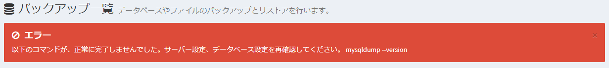
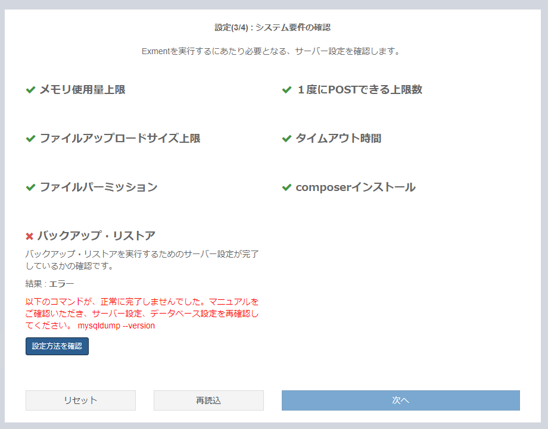

# 자주 묻는 질문, 문제 해결
Exment의 설치나 업데이트, 조작에서 자주 묻는 질문과, 곤란할 때의 조치 방법을 정리했습니다.
오류가 나면 먼저 아래의 "로그 파일"에서 오류 내용을 확인한 다음, 해당하는 항목을 보십시오.
내용은 수시로 업데이트합니다.

## 로그 파일
오류 등이 발생하면 그 내용이 로그 파일에 기록됩니다.
로그 파일은 Exment의 루트 프로젝트 폴더를 기준으로 다음 위치에 있습니다.
/storage/logs/laravel.log


## 설치·업데이트

### 파일·폴더의 Permission Denied가 발생한다
간편 설치를 할 때나 로그 파일에 기록할 때 권한 오류가 날 수 있습니다.
또, 시스템 요구 사항 확인에서 다음 오류가 표시될 수 있습니다.


웹 서버를 실행하는 사용자(apache, www-data 등)의 권한이 부족할 수 있습니다.
Exment의 프로젝트 폴더 가운데 다음 폴더에 이 사용자의 쓰기 권한을 추가하십시오.

- storage
- bootstrap/cache

웹 화면에서 설치하는 "[간편 설치](/ko/quickstart)"의 경우에는, 여기에 더해 다음 폴더에도 같은 사용자의 쓰기 권한이 필요합니다.
※ 설치할 때만 필요합니다. 권한을 더 엄격하게 설정하려면 간편 설치를 마친 뒤에 폴더의 쓰기 권한을 삭제하십시오.

- .env
- app
- config
- public

### composer require나 업데이트 배치가 도중에 끝난다
Linux에 설치할 때 composer require 명령이나 업데이트 배치를 실행하면, 다음과 같이 표시될 수 있습니다.

```
# 패턴 1
Killed

# 패턴 2
mmap() failed: [12] Cannot allocate memory
PHP Fatal error:  Out of memory (allocated XXXXX) (tried to allocate XXXXX bytes) in phar:///usr/local/bin/composer/src/Composer/Console/Application.php on line 82

# 패턴 3
Fatal error: Allowed memory size of XXXXXXXX bytes exhausted
```

이것은 메모리 부족으로 인한 오류입니다.
다음 둘 중 하나를 하면 해결될 수 있습니다.

#### swap 만들기
다음 명령으로 swap(메모리가 부족할 때 디스크를 메모리 대신 쓰는 영역)을 만든 다음, 다시 설치나 업데이트를 하십시오.
※ 환경에 따라 명령 앞에 "sudo"를 추가하십시오.

~~~
dd if=/dev/zero of=/swapfile bs=2M count=2048
chmod 600 /swapfile
mkswap /swapfile
swapon /swapfile
~~~

#### 메모리 상한 변경
다음 내용을 실행하십시오.

- php.ini 파일의 memory_limit를 수정합니다.

```
memory_limit=000M #적절히, 지금보다 크기를 크게 한다
memory_limit=-1 #또는 이렇게 지정. 메모리를 무제한으로 사용할 수 있으므로, 본인 책임으로 설정하십시오
```

- composer의 환경 변수를 설정(업데이트 시의 문제인 경우에는 배치에 추가하십시오)

```
COMPOSER_MEMORY_LIMIT=-1 composer update
```


### 수동 설치나 업데이트 시 composer 오류가 발생한다

수동 설치나 업데이트를 할 때 다음과 같은 오류가 날 수 있습니다.

```
Installation failed, reverting ./composer.json to its original content.

  [RuntimeException]
  Could not load package XXX/XXX in http://repo.packagist.org: [UnexpectedValueException] Could not parse version constraint ~4.*: Invalid version string "~4.*"
```

이 경우 composer의 버전을 올리면 해결될 수 있습니다. composer를 최신 버전으로 업데이트하십시오.
**※ 환경에 따라 업데이트 방법이 다른 것 같습니다. 아래의 (1)부터 (3) 가운데 하나로 composer 업데이트를 시도해 보십시오.**


#### (1) 다음 명령을 실행

```
composer selfupdate
```

#### (2) 다음 명령을 실행

```
composer self-update
```

#### (3) 위의 어느 쪽으로도 업데이트할 수 없으면 다음 절차를 실행

- ##### composer 삭제
이미 설치되어 있는 composer를 일단 삭제합니다.

```
# Linux·Mac의 경우
which composer
# Windows의 경우
where composer
#결과 예 : /usr/bin/composer
###다음 명령을 실행
rm /usr/bin/composer
```

- ##### composer 다시 설치
다음 절차로 composer를 다시 설치하십시오.
    - [공식 사이트](https://getcomposer.org/download/)
    - [Windows판 해설 사이트](https://weblabo.oscasierra.net/php-composer-windows-install/)
    - [Linux판 해설 사이트](https://weblabo.oscasierra.net/php-composer-centos-install/)
    - [Mac판 해설 사이트](https://weblabo.oscasierra.net/php-composer-macos-homebrew-install/)

### composer update 명령을 실행할 때 "LogicException Invalid key supplied " 오류가 발생한다
composer update 명령을 실행했을 때 다음과 같은 오류가 날 수 있습니다.

```
   LogicException	
	
  Invalid key supplied	
	
  at vendor/league/oauth2-server/src/CryptKey.php:67	
     63▕             if (!$this->isValidKey($this->keyContents, $this->passPhrase ?? '')) {	
     64▕                 throw new LogicException('Unable to read key from file ' . $keyPath);	
     65▕             }	
     66▕         } else {	
  ➜  67▕             throw new LogicException('Invalid key supplied');	
     68▕         }	
     69▕	
     70▕         if ($keyPermissionsCheck === true) {	
     71▕             // Verify the permissions of the key	
	
      +17 vendor frames	
	
  18  [internal]:0	
      Illuminate\Foundation\Application::Illuminate\Foundation\{closure}()	
      +5 vendor frames	
	
  24  artisan:35	
      Illuminate\Foundation\Console\Kernel::handle()	
```

#### 이 경우, 다음 명령으로 API 사용을 비활성화한 다음 Laravel의 키를 만드십시오.

```
# API 사용을 비활성화한다.
UPDATE `systems` SET `system_value` = '0' WHERE `systems`.`system_name` = 'api_available';

# Laravel의 키를 만든다
php artisan passport:keys	

# API 사용을 활성화한다.
UPDATE `systems` SET `system_value` = '1' WHERE `systems`.`system_name` = 'api_available';
```

### 업데이트 배치나 composer require 명령을 실행할 때 "require ext-gd ", "require ext-sodium ", "require ext-zip " 오류가 발생한다
업데이트 배치나 composer require 명령을 실행했을 때 다음과 같이 표시될 수 있습니다.
```
  Problem 1
    - phpoffice/phpspreadsheet[1.23.0, ..., 1.29.0] require ext-gd * -> it is missing from your system. Install or enable PHP's gd extension.
```
```
  Problem 1
    - lcobucci/jwt[5.0.0, ..., 5.3.0] require ext-sodium * -> it is missing from your system. Install or enable PHP's sodium extension.
```
```
  Problem 1
    - exceedone/exment[v5.0.0, ..., v5.0.11] require phpoffice/phpspreadsheet ^1.23.0 -> satisfiable by phpoffice/phpspreadsheet[1.23.0, ..., 1.29.0].
    - phpoffice/phpspreadsheet[1.23.0, ..., 1.29.0] require ext-zip * -> it is missing from your system. Install or enable PHP's zip extension.
    - Root composer.json requires exceedone/exment ^5.0 -> satisfiable by exceedone/exment[v5.0.0, ..., v5.0.11].
```
이 경우, 표시된 PHP의 확장 기능(php extension)을 활성화하십시오.
#### Linux의 경우
~~~
# Ubuntu server
sudo apt-get install php8.2-gd php8.2-zip

# Centos server
sudo yum install gd gd-devel php-gd php-pecl-zip.x86_64
~~~

#### Mac/Windows의 경우

##### (1) php.ini 파일의 경로 가져오기

~~~
# 다음 명령을 실행합니다. php.ini 파일의 경로는 "Loaded Configuration File" 줄에 표시됩니다.

php --ini
~~~

##### (2) php.ini 파일 수정

~~~
# 아래의 주석 처리를 해제한다
extension=gd

# 아래의 주석 처리를 해제한다
extension=sodium

# 아래의 주석 처리를 해제한다
extension=zip
~~~


### 처음 설치한 후 관리 화면에 접속할 때 "SQLSTATE[HY000][202] Permission denied" 오류가 발생한다
Apache에서 MySQL에 접속할 때, SELinux(Linux의 보안 기능)의 설정이 필요할 수 있습니다.
이 오류가 나면 다음 명령을 실행하십시오.

~~~
sudo setsebool -P httpd_can_network_connect_db=1
~~~


### 업데이트 시 "Migrating: 2019_08_19_000000_create_failed_jobs_table"에서 오류가 발생한다
업데이트에서 데이터베이스를 변경하는 처리 도중에 다음과 같은 메시지가 나올 수 있습니다.
~~~
Migrating: 2019_08_19_000000_create_failed_jobs_table  
SQLSTATE[42S01]: Base table or view already exists: 1050 Table 'failed_jobs' already exists.
~~~

이 경우에는 다음 순서로 조치하십시오.

1. "설치한 폴더\database\migrations"에 있는 "2019_08_19_000000_create_failed_jobs_table" 파일을 삭제합니다.
2. 다시 업데이트를 실행합니다.


### 임대 서버에서 "composer require" 등의 명령을 실행할 때 "Killed"라고 표시된다
메모리에 부하가 걸렸을 때 가끔 일어납니다(항상 일어나는 것은 아닙니다).
이 표시가 나오면, 명령 앞에 "nice -n 20"을 붙여서 composer를 실행하십시오. 우선순위를 낮추어 명령을 실행합니다.

~~~
nice -n 20 composer .....
~~~

※ 이 방법으로 실행해도 다시 "Killed"라고 표시될 수 있습니다. 양해해 주십시오.


### composer의 경로를 설정하려면
composer의 경로를 잡는(composer의 위치를 설정하는) 절차입니다.

#### 설정값을 추가한다
- [이 절차](/ko/config)의 "Composer 경로"에서 composer까지의 경로를 설정합니다.

```
# 예: 다음 명령을 실행
which composer
#출력 예: /usr/local/bin/composer

# 다음 값을 .env에 기입
EXMENT_COMPOSER_PATH=/usr/local/bin/composer
```

- 이렇게 하면 composer까지의 경로가 잡힙니다.


### 유지 보수 모드 해제
데이터베이스 복원에서는 복원하는 동안 유지 보수 모드가 됩니다.
복원이 끝나면 유지 보수 모드는 자동으로 해제됩니다. 어떤 이유로 해제되지 않았으면 다음 절차로 직접 해제하십시오.

- 프로젝트의 루트 폴더에서 다음 명령을 실행하십시오.

```
php artisan up
```


## 백업·복원

### 백업·복원에 실패한다
백업 화면이나 명령에서 다음과 같은 메시지가 표시될 수 있습니다.



또는 설치 화면에서 다음과 같이 표시될 수 있습니다.


이 오류가 표시되면 백업·복원에 필요한 설정이 되어 있지 않을 수 있습니다.
아래의 2가지를 확인하십시오.

#### mysql-client가 웹 서버에 설치되어 있지 않다, 경로가 잡혀 있지 않다
Exment의 백업·복원에서는 다음 명령을 웹 서버에서 실행합니다.

- mysql 명령
- mysqldump 명령

**명령이 설치되어 있지 않은 경우**에는 mysql 명령·mysqldump 명령을 설치하십시오.
설치 방법은 환경에 따라 다릅니다.
예: [Amazon Linux 2](http://tech-wiki.pomme-verte.net/?p=793)

**경로가 잡혀 있지 않은 경우**(웹 서버를 동작시키는 사용자가 mysql 명령·mysqldump 명령의 위치를 찾지 못하는 경우)에는 다음 방법으로 전체 경로로 명령을 실행할 수 있게 하십시오.
※ 설정 변경의 자세한 내용은 [여기](/ko/config)에서 확인하십시오.

- env 파일을 연다.
- 다음 내용을 추가한다.

```
EXMENT_MYSQL_BIN_DIR=("mysql" 실행 파일이 있는 폴더까지의 경로)
#예
EXMENT_MYSQL_BIN_DIR=/usr/bin
```
※ "EXMENT_MYSQL_BIN_DIR="C:\MySQL\bin""처럼 경로를 큰따옴표로 감싸면 일부 환경에서 올바르게 인식되지 않을 수 있습니다. "EXMENT_MYSQL_BIN_DIR=C:\MySQL\bin"처럼 그대로 적는 것을 권장합니다.

#### php.ini에 "safe_mode=Off"를 추가한다
※ safe_mode는 PHP 5.4에서 없어진 설정입니다. 현재의 Exment(PHP 8.2 이상)에서는 이 절차가 필요 없습니다. 오래된 환경을 사용하는 경우에만 확인하십시오.

mysql 명령·mysqldump 명령을 서버에서 실행하기 위해 safe_mode를 Off로 해야 합니다.
다음 내용을 실행하십시오.

- php.ini 파일을 연다.
- 다음 내용을 추가한다.

```
safe_mode=Off
```

## 기타
### 대량의 입력 항목 전송에 실패한다
현재 일부 설정 화면에서, 한 화면에 입력 항목이 매우 많으면 정상적으로 동작하지 않을 수 있습니다.

- 원인: 실제 POST 값이 PHP의 설정값 "max_input_vars(한 번에 POST할 수 있는 상한 수)"를 넘었을 때 발생합니다.
- 조치: [PHP 설정값 변경](/ko/additional_php_ini)을 하여 매개변수 값을 바꾸십시오.
  
현재 다음 기능에서 발생하기 쉬운 것을 확인했습니다.

- 워크플로 이용 설정에서 테이블 수·워크플로 수가 많을 때
- 사용자 정의 폼 설정 화면에서 등록하는 열 항목의 건수가 매우 많은 경우
- 사용자 정의 데이터 입력 화면에서 항목의 건수가 매우 많은 경우

### Excel을 템플릿으로 한 문서 출력에서 이미지 출력에 실패한다
Exment의 플러그인(문서 출력 또는 내보내기) 기능에서 이미지가 들어 있는 Excel 템플릿을 사용하여 문서를 출력하면, 만들어진 파일에 이미지가 들어가지 않을 수 있습니다.
이것은 사용하는 라이브러리 "PhpSpreadSheet"의 버전에 따라 발생할 수 있습니다. 다음 절차를 실행하십시오.

※ 다음은 Exment v4.x 이전(PHP7.X)을 사용하는 경우의 절차입니다. Exment v7.0.0에서는 PhpSpreadSheet 1.29 이상이 자동으로 설치되므로 다음 절차는 필요 없습니다.

#### PHP 버전이 7.3, 7.4인 경우
현재(2022/02/25) PhpSpreadSheet의 최신 버전인 1.22.0에서는 이 현상이 발생하지 않습니다.
PhpSpreadSheet를 다음 절차로 1.22.0으로 바꾸십시오.

```
composer require phpoffice/phpspreadsheet=~1.22.0
```

#### PHP 버전이 7.2인 경우
PhpSpreadSheet1.22.0은 PHP7.2를 지원하지 않습니다.
그래서 번거로우시겠지만 PHP 버전을 7.3 이상으로 업데이트하십시오.

