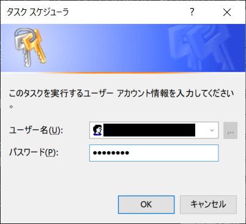

# (고급 사용자용) 자동 업데이트
Exment의 새 버전이 나왔을 때 자동으로 업데이트하기 위한 설정입니다.  
서버에 매일 정해진 시간에 동작하는 처리(정기 업데이트 처리)를 등록해 둡니다.

- 보통의 업데이트 방법과 어느 범위의 버전까지 올라가는지는 [업데이트](/ko/update)를 보십시오.

## 자동 업데이트 사양
등록한 처리는 매번 다음 일을 합니다.

- Web API를 실행하여 Exment의 최신 버전 정보(1)를 가져온다
- 설치되어 있는 Exment의 버전(2)을 가져온다
- (2)보다 (1)이 새로우면 업데이트 배치를 실행한다
- 단, (2)가 "dev"로 시작하는 버전이면 업데이트하지 않는다

## 설정 방법
Linux와 Windows에서 절차가 다릅니다.

| 서버 | 볼 곳 | 사용하는 것 |
|---|---|---|
| Linux(사쿠라 인터넷, XServer 포함) | 설정 절차(Linux) | 업데이트 배치, ExmentAutoUpdate.bash, jq, cron |
| Windows | 설정 절차(Windows) | 업데이트 배치, ExmentAutoUpdate.exe, 작업 스케줄러 |

### 설정 절차(Linux)
**(1) 업데이트 배치를 둔다**

[업데이트 배치](/ko/update)를 내려받아 Exment의 프로젝트 폴더에 둡니다.  
환경에 맞게 다음 파일을 내려받으십시오.

- 사쿠라 인터넷의 경우 : ExmentUpdateLinuxSakura.sh
- XServer의 경우 : ExmentUpdateLinuxXserver.sh
- 그 밖의 경우 : ExmentUpdateLinux.sh

> 업데이트를 수행하는 셸이 갱신되었으므로 [업데이트](/ko/update)를 확인하고 교체해 주십시오.  
셸 파일의 2번째 줄에 "v1.1.0" 이상의 버전이 적혀 있는지 확인하십시오.

**(2) 업데이트 확인용 배치를 내려받는다**

다음 명령을 Exment 프로젝트의 루트 디렉터리에서 실행합니다.

~~~
wget https://exment.net/downloads/cmd/ExmentAutoUpdate.bash
chmod 775 ExmentAutoUpdate.bash
~~~

**(3) "jq"를 설치한다**

"jq"라는 라이브러리를 사용합니다. 다음 명령으로 "jq" 명령이 설치되어 있는지 확인합니다.

```
jq --help
```

- "명령이 없습니다"와 같은 표시가 나온 경우에는 jq 명령이 설치되어 있지 않습니다.  
[공식 문서의 방법](https://stedolan.github.io/jq/download/)으로 jq 명령을 설치하십시오.

**(4) 업데이트 배치에 composer의 위치를 적는다**

composer의 경로를 조사합니다. 다음 명령을 임의의 경로에서 실행하고 결과를 복사합니다.

```
which composer
# 결과 예
# /home/xxx/usr/local/bin/composer
```

내려받은 ExmentUpdateLinux.sh(또는 ExmentUpdateLinuxSakura.sh, ExmentUpdateLinuxXserver.sh)를 편집합니다.  
파일 안의 composer_path 값을 "which composer"의 결과로 바꿉니다.

```
# composer_path=''
# 아래와 같이 수정
composer_path='/home/xxx/usr/local/bin/composer'
```

**(5) cron에 등록한다**

다음 명령을 실행합니다.

~~~
crontab -e
~~~

Cron 설정 화면이 나오므로 다음 내용을 적습니다.

~~~

###아래 내용을 추가
(실행할 분) (실행할 시) * * * cd /(Exment의 루트 디렉터리); bash ExmentAutoUpdate.bash
# 예: 경로 /var/www/exment 아래의 Exment를 매일 3:00에 실행하는 경우
0 3 * * * cd /var/www/exment; bash ExmentAutoUpdate.bash >> storage/logs/ExmentAutoUpdate.log  2>&1
~~~


#### 아래는 XServer의 경우에 추가로 실시

- 다음 명령을 실행하여 HOME 경로를 조사합니다.

```
echo $HOME
# 결과 예
# /home/xxx
```

- 그런 다음 내려받은 ExmentUpdateLinuxXserver.sh를 편집합니다.  
home_path 값을 "echo $HOME"의 결과로 바꿉니다.

```
# home_path=''
# 아래와 같이 수정. 끝에 "/"는 붙이지 않는다
home_path='/home/xxx'
```


#### 설정 완료
- 이제 매일 정해진 시간에 ExmentAutoUpdate.bash가 동작합니다. 최신 버전이 있으면 자동으로 버전을 올립니다.
- 자동 업데이트의 실행 로그는 storage/logs/ExmentAutoUpdate.log에 남습니다.


### 설정 절차(Windows)
**(1) 업데이트 배치와 자동 업데이트 프로그램을 둔다**

1. [업데이트 배치 ExmentUpdateWindows.bat](https://exment.net/downloads/cmd/ExmentUpdateWindows.bat)를 내려받아 Exment의 프로젝트 폴더에 둡니다.

2. [여기](https://exment.net/downloads/cmd/ExmentAutoUpdateWindows.zip)에서 자동 업데이트 프로그램의 zip을 내려받습니다.

3. 내려받은 zip 파일의 압축을 풀고, Exment의 프로젝트 폴더에 "ExmentAutoUpdateWindows" 폴더째로 둡니다.

```
# 폴더 계층(일부)
- app
- bootstrap
- config
- ExmentUpdateWindows.bat
- ExmentAutoUpdateWindows
    - ExmentAutoUpdate.exe
    - ExmentAutoUpdate.exe.config
    - Newtonsoft.Json.dll
```

**(2) 작업 스케줄러에 등록한다**

1. Windows 메뉴에서 "task"라고 입력하여 작업 스케줄러를 실행합니다.  


2. 작업 스케줄러에서 "작업 만들기"를 클릭합니다.  


3. "일반" 탭에서 다음과 같이 설정합니다. ("이름"은 원하는 이름입니다)  


4. "트리거" 탭을 클릭합니다. 트리거를 만듭니다.  
    (1) "새로 만들기" 버튼을 클릭합니다.  
    그런 다음 아래와 같이 입력합니다.  
    - 작업 시작: 예약 상태
    - 시작: 시작할 날짜의 실행 시간
    - 간격: 1일
    - "사용"에 체크  
    끝나면 "확인"을 클릭합니다.  


5. "동작" 탭에서 "새로 만들기" 버튼을 클릭합니다.  
그런 다음 아래와 같이 입력합니다.
    - 동작: 프로그램 시작
    - 프로그램/스크립트: 배치한 "ExmentAutoUpdate.exe"까지의 경로

    

6. 노트북 PC의 경우에는 "조건" 탭에서 "컴퓨터의 AC 전원이 켜져 있는 경우에만 작업 시작"의 체크를 해제합니다.  


7. 여기까지 설정했으면 확인을 클릭합니다.  
그런 다음 사용자의 자격 증명을 입력하는 화면이 나오므로 암호를 입력하십시오.  


8. 설정이 끝나면 "작업 스케줄러 라이브러리"에서 만든 작업을 선택하고 "실행"을 클릭하십시오.  


이것으로 설정 완료입니다.


#### 설정 완료
- 이제 매일 정해진 시간에 ExmentAutoUpdate.exe가 동작합니다. 최신 버전이 있으면 자동으로 버전을 올립니다.

