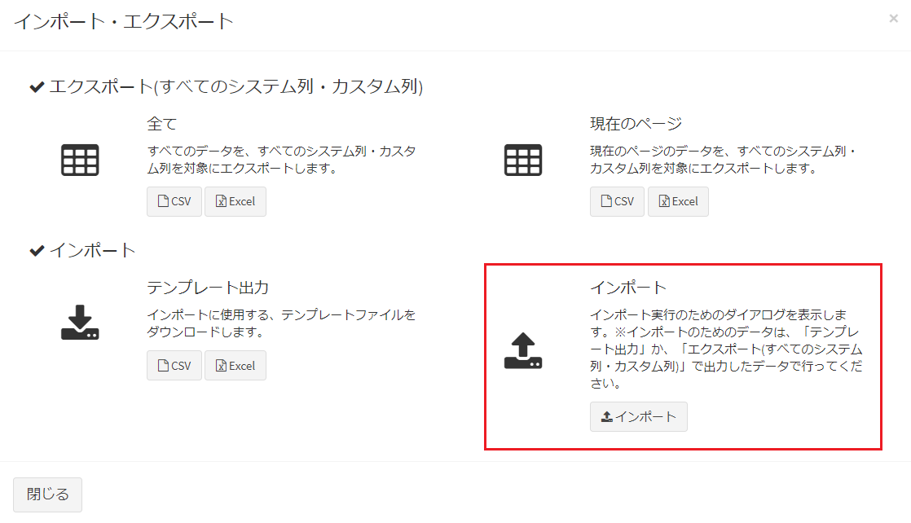
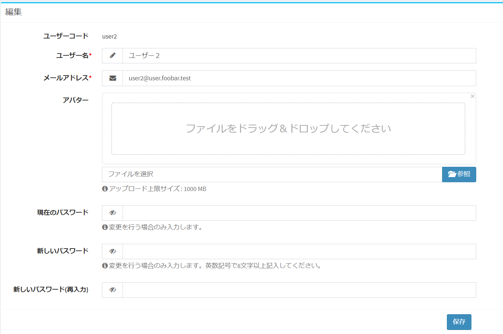

# 사용자·로그인 사용자
사용자와 로그인 사용자를 관리하는 화면의 설명입니다.

| 하고 싶은 일 | 볼 곳 |
|---|---|
| 사용자를 추가·편집·삭제한다 | "사용자 관리" |
| 사용자가 로그인할 수 있게 한다·비밀번호를 정한다 | "로그인 사용자 관리" |
| 많은 사용자에게 한꺼번에 로그인 설정을 한다 | "로그인 사용자 정보의 일괄 가져오기" |
| 사용자가 자신의 정보를 보고 바꿀 수 있게 한다 | "로그인 사용자의 본인 정보 열람·편집" |

## 명칭 정의
### 사용자
자기 회사나 조직에 소속된 사원 등의 사람입니다.  
이 시스템을 쓰지 않는 사람도 사용자로 추가할 수 있습니다.  
사용자 코드, 이메일 주소가 필수입니다.  
사용자는 다른 테이블의 데이터에 연결하여 등록할 수 있습니다. 다만 사용자인 것만으로는 시스템에 로그인할 수 없습니다.

### 로그인 사용자
사용자 중 Exment에 로그인할 수 있는 사람입니다.  
사용자 정보에 비밀번호가 붙으므로, Exment의 로그인 화면에서 로그인하여 데이터를 등록하거나 참조하는 등의 일을 할 수 있습니다.  

#### 사용자, 로그인 사용자의 설정 절차

Exment에 로그인할 수 있게 되기까지의 순서는 위 그림과 같습니다.  
① 사용자 관리 화면에서 사용자의 사용자 코드, 사용자 이름, 이메일 주소를 등록합니다.  
② 로그인 사용자 관리 화면에서 ①에서 등록한 사용자의 비밀번호를 설정합니다.  
이것으로 등록한 사용자가 Exment에 로그인할 수 있게 됩니다.  

> 로그인할 때 비밀번호를 정해진 횟수만큼 틀리면, 그 사용자는 한동안 로그인할 수 없게 됩니다.  

## 사용자 관리
모든 사용자의 정보를 관리하는 방법을 적습니다.  

### 목록 화면 표시
왼쪽 메뉴의 "사용자"를 클릭합니다.  
또는 다음 URL을 여십시오.  
이렇게 하면 사용자의 목록 화면이 표시됩니다.
http(s)://(Exment의 URL)/data/user  
지금 시스템에 등록된 사용자의 목록이 나옵니다.

> ※ URL은 "/admin"이 붙지 않는 표준 설정(v7.2.1 이후에 새로 설치한 사이트)인 경우입니다. `.env`의 `ADMIN_ROUTE_PREFIX`에 값이 있는 경우(이전 버전에서 설치한 사이트는 "admin")에는 사이트 URL 뒤에 그 값을 붙이십시오(예: `http(s)://(Exment의 URL)/admin/data/user`). 자세한 내용은 [URL에 포함된 "admin"의 변경·삭제](/ko/additional_prefix)를 참고하십시오.

### 사용자 새로 추가
- "사용자"의 목록 화면에서 페이지 오른쪽 위의 ［새로 만들기］ 버튼을 클릭합니다.

- 새로 추가 화면이 표시됩니다. 필요한 내용을 입력합니다.

#### 소속 조직 설정
사용자를 소속시킬 조직이 있을 때는 후보 데이터 목록에서 골라 선택된 데이터로 옮기십시오.  
※ 조직이 만들어져 있지 않을 때는 이 항목이 나오지 않습니다.

#### 역할 그룹 설정
사용자에게 부여할 역할 그룹이 있을 때는 후보 데이터 목록에서 골라 선택된 데이터로 옮기십시오.

#### 로그인 설정
로그인 권한 부여를 YES로 하면 사용자를 로그인 사용자로 만들 수 있습니다.  
설정하는 방법은 아래의 [로그인 사용자 관리](/ko/user?id=로그인-사용자-관리)를 참고하십시오.

### 저장
설정을 입력했으면 ［전송］을 클릭하십시오.

### 편집
사용자를 편집하려면 그 행의 ［편집］ 링크를 클릭하십시오.  

### 삭제
사용자를 삭제하려면 그 행의 ［삭제］ 링크를 클릭하십시오.  

## 로그인 사용자 관리
위의 화면에서 만든 사용자에 대해 로그인 사용자의 관리를 합니다.  
비밀번호 추가, 비밀번호 재발급, 로그인 권한 삭제 등을 할 수 있습니다.  

### 화면 표시
왼쪽 메뉴의 "로그인 사용자"를 클릭합니다.  
또는 다음 URL을 여십시오.  
이렇게 하면 로그인 사용자 설정 화면이 표시됩니다.
http(s)://(Exment의 URL)/loginuser  
지금 시스템에 등록된 사용자와 그 로그인 정보가 나옵니다.  

### 로그인 정보 추가
로그인 정보를 추가할 사용자의 행에서 ［편집］ 링크를 클릭하십시오.  

- 로그인 정보 편집 화면이 나옵니다.  
  
로그인 권한을 추가할 때는 "로그인 권한 부여"를 YES로 합니다.  
YES로 하면 "비밀번호 자동 생성" 항목이 나옵니다.

#### 비밀번호 자동 생성
YES일 때는 로그인 권한을 추가할 때 비밀번호를 자동으로 만듭니다.  
만든 다음 그 사용자의 이메일 주소로 비밀번호 메일이 자동으로 전송됩니다.  
**※ 이 기능을 쓰려면 [메일 설정](/ko/system_setting)이 필요합니다.**  
  
NO일 때는 비밀번호를 입력하는 텍스트 상자와 "사용자 정보 메일 보내기" 항목이 나옵니다.

#### 비밀번호 입력
"비밀번호 자동 생성"이 NO일 때 나옵니다.  
로그인 사용자의 비밀번호를 입력하십시오.  

#### 사용자 정보 메일 보내기
"비밀번호 자동 생성"이 NO일 때 나옵니다.  
이 항목이 YES일 때는 그 사용자의 이메일 주소로 비밀번호 메일이 전송됩니다.  
**※ 이 기능을 쓰려면 [메일 설정](/ko/system_setting)이 필요합니다.**

#### 첫 로그인 시 비밀번호 변경
YES로 하면 사용자가 처음 로그인했을 때 비밀번호를 바꾸는 화면을 표시합니다.  
새로 등록한 사용자와 비밀번호를 재설정한 사용자에게 적용됩니다.

### 로그인 권한 삭제
로그인 권한을 삭제합니다.  
목록 화면에서 열 "로그인 사용자 설정"이 "YES"인 사용자의 ［편집］ 링크를 클릭하십시오.  
  

"로그인 권한 부여"를 NO로 바꿉니다.  
  
그다음 ［전송］을 클릭하십시오.  

### 로그인 사용자 정보의 일괄 가져오기
로그인 사용자 정보를 한꺼번에 가져올 수 있습니다.  
사용자 화면에서 1건씩 로그인 설정을 하지 않아도 한꺼번에 로그인 설정을 할 수 있습니다.

순서는 다음과 같습니다.

1. 사용자를 등록합니다("사용자 정보 등록").  
2. 로그인 사용자 정보를 내보냅니다("로그인 사용자 정보 출력").  
3. 내보낸 파일을 편집합니다("가져올 파일 만들기").  
4. 가져옵니다("가져오기").

#### 사용자 정보 등록
먼저 로그인 정보를 부여하고 싶은 사용자를 [사용자 관리](/ko/user?id=사용자-관리) 화면에서 추가하십시오.

#### 로그인 사용자 정보 출력
- 왼쪽 메뉴의 "로그인 사용자"를 클릭합니다.  
또는 다음 URL을 여십시오.  
이렇게 하면 로그인 사용자 설정 화면이 표시됩니다.
http(s)://(Exment의 URL)/loginuser  
지금 시스템에 등록된 사용자와 그 로그인 정보가 나옵니다.  

- 화면 오른쪽 위의 "가져오기/내보내기" 버튼을 클릭합니다.  
그다음 "내보내기"를 클릭합니다.

  

- 등록된 사용자 정보와 그 사용자의 로그인 사용자 정보가 출력됩니다.

  

#### 각 열의 내용
- id  
사용자의 id입니다. 나중에 가져올 때 이 값은 바꾸지 마십시오.  

- 사용자 이름, 사용자 코드, 이메일 주소  
사용자 정보입니다.  
※ 나중에 가져올 때 이 값을 바꾸어도 사용자 정보에는 반영되지 않습니다. 사용자 정보는 "사용자" 화면에서 바꾸십시오.

- 로그인 권한 부여  
그 사용자에게 Exment 표준의 로그인 정보가 붙어 있는지 여부입니다. 1일 때는 로그인 정보가 붙어 있습니다.

- 비밀번호 자동 생성, 비밀번호, 사용자 정보 메일 보내기  
내보냈을 때는 값이 비어 있습니다. 가져올 때 씁니다.

#### 가져올 파일 만들기
위에서 내보낸 파일을 편집하여 가져올 파일을 만듭니다.  
각 열에는 다음과 같이 입력하십시오.

- 로그인 권한 부여  
    - 그 사용자에게 Exment 표준의 로그인 권한을 부여하고 싶을 때는 1로 하십시오.  
    - 이미 로그인 권한이 붙어 있고 그대로 둘 때는 1인 채로 두십시오.  
    - 이미 로그인 권한이 붙어 있는 사용자에게서 로그인 권한을 삭제하고 싶을 때는 0으로 하십시오.

- 비밀번호 자동 생성  
그 사용자의 비밀번호를 자동으로 만들고 싶을 때는 1을 입력하십시오.  
이미 로그인 권한이 붙어 있는 사용자에게 설정하면 비밀번호 재설정이 됩니다.

- 비밀번호  
사용자의 비밀번호를 직접 정하고 싶을 때는 비밀번호 문자열을 입력하십시오.  
이미 로그인 권한이 붙어 있는 사용자에게 설정하면 비밀번호 재설정이 됩니다.

- 사용자 정보 메일 보내기  
로그인 정보를 새로 부여했을 때, 또는 비밀번호를 바꾸었을 때 비밀번호를 메일로 보내고 싶으면 1을 입력하십시오.

#### 가져오기
- 로그인 사용자 설정 화면에서 화면 오른쪽 위의 "가져오기/내보내기" 버튼을 클릭합니다.  
그다음 "가져오기"를 클릭합니다.

  

- 만든 가져올 파일을 업로드합니다.

- 로그인 정보가 부여됩니다.

## 로그인 사용자의 본인 정보 열람·편집
사용자에게는 "사용자 코드", "사용자 이름", "이메일 주소", "아바타", "비밀번호" 등의 정보가 등록되어 있습니다.

- "아바타", "비밀번호"는 처음부터 로그인 사용자 자신이 표시·변경할 수 있습니다.  
- "사용자 코드", "사용자 이름", "이메일 주소", "그 밖에 새로 만든 열"은 다음 설정을 하면 로그인 사용자 자신이 열람·편집할 수 있게 됩니다.  

#### 사용자 정의 열 설정: 본인 정보 열람·편집

사용자 테이블의 사용자 정의 열 설정에서는 "본인 정보 열람·편집"을 설정할 수 있습니다.  
고를 수 있는 것은 "표시 안 함", "참조만", "편집 가능"의 3가지입니다.  
각각 로그인 사용자가 할 수 있는 일은 다음과 같습니다.

##### 표시 안 함
로그인 사용자는 등록 정보를 표시할 수 없습니다.  

##### 참조만
로그인 사용자는 등록 정보를 표시할 수 있지만 편집은 할 수 없습니다.  

##### 편집 가능
로그인 사용자는 등록 정보를 표시할 수도 편집할 수도 있습니다.
> "한 번만 입력 가능" 등의 옵션이 설정되어 있을 때는 그쪽이 우선합니다.

#### 로그인 사용자 화면에서의 열람·편집

Exment 화면의 오른쪽 위에 있는 로그인 사용자 이름을 클릭하고 ［설정］을 클릭합니다.  

로그인 사용자가 표시할 수 있는 정보가 나옵니다.  
입력할 수 있는 열은 본인이 편집하여 저장할 수 있습니다.    

※ 그림의 예에서는 "사용자 코드"를 참조만, "사용자 이름", "이메일 주소"를 편집 가능으로 했습니다.
