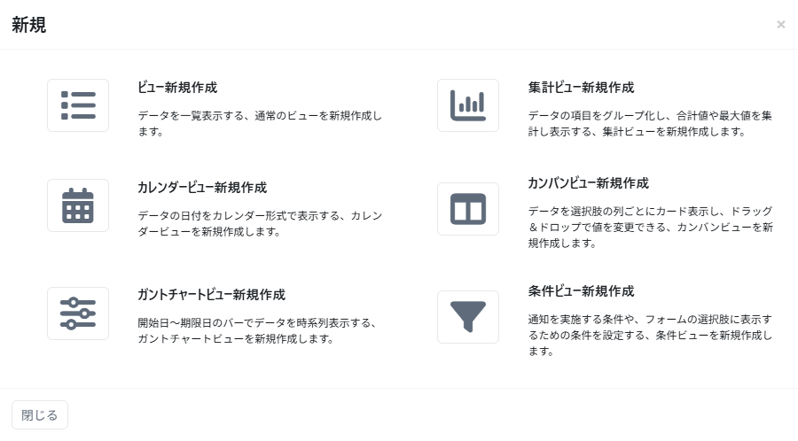
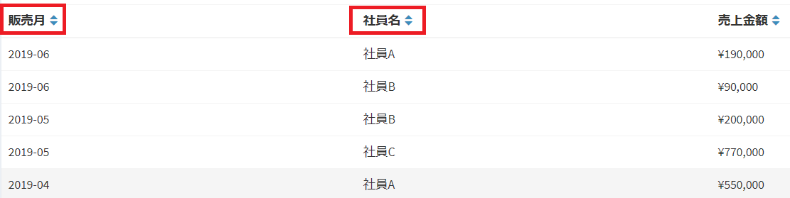
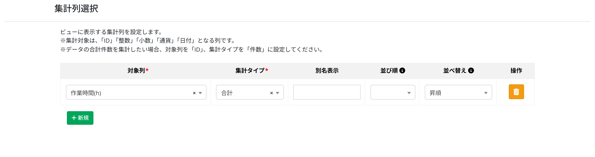
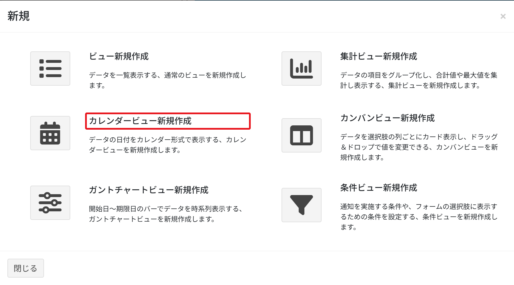
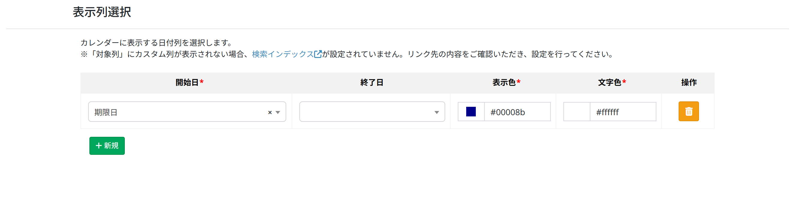
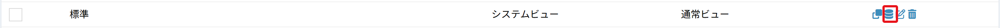

# 사용자 정의 뷰
뷰는 [데이터 목록 화면](/ko/data_grid)을 "어떻게 보여 줄지" 정한 것입니다. 어느 열을 표시할지, 어떤 데이터로 좁힐지, 어떤 순서로 정렬할지를 뷰마다 정합니다.  
이 페이지에서는 뷰의 종류와, 뷰를 만드는 방법·설정 항목을 설명합니다.

설정 순서는 다음과 같습니다.

1. 뷰 목록을 엽니다("페이지 표시").  
2. ［새로 만들기］에서 만들고 싶은 종류의 뷰를 고릅니다("뷰 새로 추가").  
3. 설정 항목을 입력하고 ［전송］으로 저장합니다.

## 뷰의 종류
지금은 다음 종류가 있습니다.

| 종류 | 쓰임새 |
|---|---|
| 뷰(목록 뷰) | 데이터를 목록으로 봅니다 |
| 집계 뷰 | 그룹별로 합계·건수 등을 봅니다 |
| 캘린더 뷰 | 캘린더 모양으로 봅니다 |
| 칸반 뷰 | 상태별 열에 카드 모양으로 봅니다 |
| 간트 차트 뷰 | 시작일부터 기한일까지를 가로 막대로 봅니다 |
| 전체 데이터 뷰 | 시스템이 자동으로 만드는, 목록 뷰와 같은 모양의 뷰 |
| 조건 뷰 | 알림 조건 등에서 좁히기에만 씁니다 |

### 뷰(목록 뷰)

보통의 뷰이며, 데이터 목록입니다.  
등록한 데이터를 목록으로 표시합니다.

### 집계 뷰

등록한 데이터를 그룹으로 묶어 합계, 건수, 최댓값 등의 집계 값을 표시합니다.  
대시보드에서는 그래프로 만들 수 있습니다.

### 캘린더 뷰

등록한 데이터를 캘린더 모양으로 표시합니다.

### 칸반 뷰

등록한 데이터를 상태별 열에 카드 모양으로 표시합니다.  
카드를 다른 열로 끌어다 놓으면 그 항목의 값을 바꿀 수 있습니다.  
자세한 내용은 [칸반 뷰](/ko/view_kanban)를 참고하십시오.

### 간트 차트 뷰
등록한 데이터를 시작일부터 기한일(종료일)까지의 가로 막대(바)로, 시간 순서대로 표시합니다.  
자세한 내용은 [간트 차트 뷰](/ko/view_gantt)를 참고하십시오.

### 전체 데이터 뷰
기본은 목록 뷰와 같지만 다음 점이 다릅니다.  
- 시스템이 자동으로 만듭니다.  
- 1건만 만들어집니다. 사용자가 새로 만들거나 삭제할 수 없습니다.  
- [검색](/ko/search) 화면에서 목록을 표시할 때 쓰입니다.  
- 집계 뷰에서 그 명세 데이터를 표시할 때 쓰입니다.

### 조건 뷰
좁히기에만 쓰는 뷰입니다. [알림](/ko/notify)의 알림 조건이나, 사용자 정의 열의 열 설정이 "선택 (테이블에서)"일 때의 좁히기에 쓰입니다.  
- 표시 열 설정은 없습니다.  
- 데이터 목록 화면에는 나오지 않습니다.  
- 관리자만 설정할 수 있습니다. 일반 사용자는 설정할 수 없습니다.

## 페이지 표시
- 사용자 정의 테이블 목록에서 설정하고 싶은 테이블 하나에 체크하고, 오른쪽 위의 "테이블 상세 설정"을 클릭합니다.  
  
- 또는 메뉴에서 설정하고 싶은 테이블을 고른 다음, 같은 방법으로 오른쪽 위의 "테이블 상세 설정"을 클릭합니다.  
※ 그 테이블을 미리 메뉴에 표시해 두어야 합니다.  
  
- 테이블 상세 설정 화면에서 뷰 설정 아이콘을 클릭합니다.  

- 이제 그 사용자 정의 테이블의 뷰 목록이 표시됩니다.  

## 뷰 새로 추가
- "사용자 정의 뷰 설정" 화면에서 페이지 오른쪽 위에 있는 ［새로 만들기］ 버튼을 클릭합니다.

대화 상자에 나온 것 중에서 만들고 싶은 종류의 버튼을 클릭합니다.  
  
- 뷰 새로 추가 화면이 표시됩니다. 필요한 내용을 입력합니다.

## 뷰의 설정 항목
#### 뷰 표시 이름
뷰의 이름을 입력합니다.  

#### 뷰 권한
누가 이 뷰를 쓸 수 있는지를 시스템 뷰 · 사용자 뷰 중 하나로 정합니다.

- 시스템 뷰  
시스템 관리자만 설정할 수 있습니다.  
테이블에 접근 권한이 있는 모든 사용자가 쓸 수 있는 뷰입니다.

- 사용자 뷰  
시스템 관리자가 아니어도 설정할 수 있는 뷰입니다.  
만든 사용자만 쓸 수 있는 뷰입니다.

※ 시스템 뷰를 나중에 사용자 뷰로 바꿀 수는 없습니다.  
**시스템 관리자가 만든 사용자 뷰**는 나중에 시스템 뷰로 바꿀 수 있습니다.  
※ [사용자 뷰 비활성화](/ko/config) 설정을 하면 일반 사용자는 뷰를 만들 수 없게 됩니다.

#### 표시 건수
데이터 목록에서 한 페이지에 데이터를 몇 건 표시할지 고릅니다.

#### 기본값
뷰를 여러 개 만들었을 때, 사용자가 데이터 목록을 열면 처음에 나오는 것은 "YES"로 해 둔 뷰입니다.  
※ "NO"로 해 둔 뷰도 뷰 목록에서 고르면 표시할 수 있습니다.  
※ "기본값"을 "YES"로 할 수 있는 것은 사용자 정의 테이블 하나에 뷰 하나뿐입니다.  
둘 이상의 뷰에서 "YES"로 하면, 마지막에 "YES"로 한 뷰 말고는 "NO"로 바뀝니다.

#### 뷰 정보 상자 사용
［YES］로 하면 뷰 위에 정보 상자를 표시할 수 있습니다.  
제목과 본문을 입력하여 업무 내용이나 사용자에게 보내는 메시지를 표시할 수 있습니다.

#### 표시 열 선택
뷰에 표시할 열의 설정입니다.  
여기에서 설정한 열이 데이터 목록 화면 등에 나옵니다.

##### 대상 열
뷰에 표시할 열입니다.  
  
##### 별칭 표시 이름  
여기에 넣은 이름으로 뷰에 나옵니다.  

##### 셀 표시 프리셋  
이 뷰에서 그 열을 어떤 모양으로 표시할지 고릅니다.  
※ 사용자 정의 열 설정의 내용보다 우선합니다. 자세한 내용은 [표시 프리셋](/ko/cell_style_preset)을 참고하십시오.  

##### ［↓］ 버튼  
뷰에 표시할 항목을 오른쪽으로 옮깁니다.  

##### ［↑］ 버튼  
뷰에 표시할 항목을 왼쪽으로 옮깁니다.  

##### ［삭제］ 버튼  
뷰의 표시를 삭제합니다.

##### ［새로 만들기］ 버튼  
뷰의 표시 열을 새로 추가합니다.

#### 데이터 표시 조건
뷰에 표시할 데이터를 좁히는 조건입니다.  
"기간 안의 것만 표시", "특정 상태의 것만 표시"처럼 좁히고 싶을 때 조건을 추가합니다.  
※ 이 설정과는 별도로, 로그인 사용자가 권한을 가진 데이터만 나오도록 좁히기가 걸립니다. 권한이 없는 데이터는 이 설정과 관계없이 나오지 않습니다.

>조건 항목의 열 유형이 선택 (테이블에서)인 경우, 조건 값에 나오는 문구는 [제목 표시 열 설정](/ko/table)에서 바꿀 수 있습니다.

##### 대상 열　　
좁히기 조건에 쓸 열입니다.  
  
##### 검색 조건
조건의 내용을 고릅니다.  
자세한 내용은 [검색 조건에 대하여](/ko/view?id=검색-조건에-대하여)를 확인하십시오.  

##### 검색 값　　
조건과 비교할 값을 입력합니다.  
  
##### ［삭제］ 버튼　　
뷰의 표시 조건을 삭제합니다.
  
##### ［새로 만들기］ 버튼　　
뷰의 표시 조건을 새로 추가합니다.

#####   조건 결합
"모든 조건에 일치"를 고르면 모든 조건에 맞는 데이터를 표시합니다.  
"하나 이상의 조건에 일치"를 고르면 조건 중 하나라도 맞는 데이터를 표시합니다.

#####   조건 반전
"조건 반전"에 체크하면 조건에 맞지 않는 데이터를 표시합니다.  
※ 집계 뷰에서는 조건 반전을 쓸 수 없습니다.

#### 검색 조건에 대하여
"대상 열"에서 고른 열의 종류("날짜", "사용자" 등)에 따라 조건의 선택지가 달라집니다.  
여기에서는 설명이 필요한 검색 조건만 적습니다.

##### 대상 열의 종류가 "날짜"인 경우
- X일 전 날짜 이후  
- X일 후 날짜 이후  
- X일 전 날짜 이전  
- X일 후 날짜 이전  
데이터의 날짜가 그 범위에 들어 있을 때 뷰에 나옵니다.  

예: 현재 날짜가 1/15이고 검색 값을 "8"로 등록한 경우  

##### 대상 열의 종류가 "사용자"인 경우
- 로그인 사용자와 일치  
데이터의 값이 로그인한 사용자와 같을 때 뷰에 나옵니다.  

- 로그인 사용자와 불일치    
데이터의 값이 로그인한 사용자와 다를 때 뷰에 나옵니다.  

#### 데이터 정렬
뷰에 표시할 데이터의 정렬(표시 순서)을 설정합니다.

 
##### 대상 열  
정렬에 쓸 열입니다.  

##### 정렬  
정렬을 "오름차순(작은 순)", "내림차순(큰 순)" 중 어느 쪽으로 실행할지 지정합니다.  

##### ［↓］ 버튼  
우선도를 낮추어 정렬 순서로 표시합니다.  

##### ［↑］ 버튼  
우선도를 높여 정렬 순서로 표시합니다.  

##### ［삭제］ 버튼  
뷰의 데이터 정렬을 삭제합니다.  

##### ［새로 만들기］ 버튼　　
데이터 정렬을 새로 추가합니다.

#### 뷰의 "필터" 항목 지정

뷰 위에 나오는 "필터"에서 선택지로 표시할 열을 지정합니다.
  

##### 대상 열  
"필터"에 표시할 열입니다.  

##### ［↓］ 버튼  
"필터"의 항목 표시를 아래로 옮깁니다.  

##### ［↑］ 버튼  
"필터"의 항목 표시를 위로 옮깁니다.  

##### ［삭제］ 버튼  
뷰의 "필터" 항목 표시를 삭제합니다.  

##### ［새로 만들기］ 버튼　　
뷰의 "필터" 표시 열을 새로 추가합니다.  

## 집계 뷰 새로 추가
- "사용자 정의 뷰 설정" 화면에서 페이지 오른쪽 위에 있는 ［새로 만들기］의 "집계 뷰 새로 만들기"를 클릭합니다.

- 집계 뷰 새로 추가 화면이 표시됩니다. 필요한 내용을 입력합니다.

## 집계 뷰의 설정 항목

#### 뷰 표시 이름·뷰 권한·기본값
위의 [뷰의 설정 항목](/ko/view?id=뷰의-설정-항목)과 같은 설정 항목입니다.

#### 그룹 열 선택
여기에서 고른 열의 값별로 데이터를 그룹으로 묶어 집계합니다.  
열을 여러 개 설정하면 여러 항목의 조합별로 나누어 집계합니다.

##### 대상 열  
그룹으로 묶을 때 기준이 되는 열입니다.  

- 예 1: 대상 열을 2개 설정하면, 그림처럼 2개 열의 조합으로 그룹을 묶어 집계합니다.  
※ "매출 금액"은 그룹 열이 아니라 집계 열로 설정한 열입니다.

  

- 예 2: "판매월" 열만 그룹 열로 하면, 예 1에서 "사원 이름" 열까지 포함하여 나뉘어 있던 데이터가 한 열의 그룹으로 묶여 집계됩니다.  

  

##### 별칭 표시 이름　　
여기에 넣은 이름으로 뷰에 나옵니다.  

##### 열 유형　　
대상 열의 사용자 정의 열 유형이 "날짜" 또는 "날짜 및 시각"일 때만 다음 중에서 고를 수 있습니다.  
"연도별", "연월별", "연월일별", "월별", "일별", "요일별"  
대상 열을 여기에서 고른 날짜 단위로 그룹으로 묶습니다.  
※ 예 1~3의 그림은 판매월의 열 유형을 "연월별"로 했을 때의 표시입니다.

##### 정렬 순서　　
집계 뷰에서 데이터를 표시하는 순서의 설정입니다.  
어느 열의 값의 크고 작음을 먼저 보고 데이터를 정렬할지, 열의 우선순위를 정합니다.  
순서는 그룹 열 선택과 집계 열 선택을 모두 합쳐서 매깁니다.  

- 예 3: 위의 예 2는 정렬 순서에서 "판매월" 열을 1, "매출 금액"을 2로 했을 때의 표시입니다. 정렬 순서에서 "판매월"을 2, "매출 금액"을 1로 하면, 아래 그림처럼 "매출 금액" 열의 값을 우선한 정렬 순서가 됩니다.  

  

##### 정렬  
대상 열을 값이 작은 순·큰 순 중 어느 쪽으로 정렬할지 설정합니다.  
"오름차순(작은 순)", "내림차순(큰 순)" 중 하나를 고릅니다.  

- 예 4: 위의 예 3은 정렬에서 "매출 금액"을 내림차순으로 했을 때의 표시입니다. 오름차순으로 하면 아래 그림처럼 됩니다.  

  

##### ［화살표］ 버튼
집계 뷰에서의 열의 순서를 설정합니다.  
그룹 열 선택에서 위에 있는 항목일수록 집계 뷰에서는 왼쪽에 나옵니다.  

##### ［삭제］ 버튼  
뷰의 그룹 열을 삭제합니다.

##### ［새로 만들기］ 버튼  
뷰의 그룹 열을 새로 추가합니다.

#### 집계 열 선택
여기에서 고른 열의 값을 집계합니다.  

##### 대상 열  
값을 집계할 열입니다.  

##### 집계 유형  
"합계", "건수", "최솟값", "최댓값"  
이 4가지 집계 유형 중에서 고릅니다. 고른 집계의 결과가 뷰의 대상 열에 나옵니다.

##### 별칭 표시 이름  
여기에 넣은 이름으로 뷰에 나옵니다.  

##### ［삭제］ 버튼  
뷰의 집계 열을 삭제합니다.
  
##### ［새로 만들기］ 버튼  
뷰의 집계 열을 새로 추가합니다.

#### 표시 조건
뷰에 표시할 데이터를 좁히는 조건입니다.  
"기간 안의 것만 표시", "특정 상태의 것만 표시"처럼 좁히고 싶을 때 조건을 추가합니다.  
※ 이 설정과는 별도로, 로그인 사용자가 권한을 가진 데이터만 나오도록 좁히기가 걸립니다. 권한이 없는 데이터는 이 설정과 관계없이 나오지 않습니다.

>조건 항목의 열 유형이 선택 (테이블에서)인 경우, 조건 값에 나오는 문구는 [제목 표시 열 설정](/ko/table)에서 바꿀 수 있습니다.

##### 대상 열  
좁히기 조건에 쓸 열입니다.  
  
##### 검색 조건  
조건의 내용을 고릅니다.  
자세한 내용은 [검색 조건에 대하여](/ko/view?id=검색-조건에-대하여)를 확인하십시오.  
  
##### 검색 값  
조건과 비교할 값을 입력합니다.  
  
##### ［삭제］ 버튼  
뷰의 표시 조건을 삭제합니다.
  
##### ［새로 만들기］ 버튼  
뷰의 표시 조건을 새로 추가합니다.

## 캘린더 뷰 새로 추가

- "사용자 정의 뷰 설정" 화면에서 페이지 오른쪽 위에 있는 ［새로 만들기］의 "캘린더 뷰 새로 만들기"를 클릭합니다.

- 캘린더 뷰 새로 추가 화면이 표시됩니다. 필요한 내용을 입력합니다.

## 캘린더 뷰의 설정 항목

#### 뷰 표시 이름·뷰 권한·기본값
위의 [뷰의 설정 항목](/ko/view?id=뷰의-설정-항목)과 같은 설정 항목입니다.

#### 표시 열 선택
뷰에 표시할 열의 설정입니다.  
캘린더 뷰에서는 시작일과 종료일을 설정하면 날짜 열의 데이터를 기간으로 표시할 수 있습니다.  
※ 하루로만 표시하고 싶을 때는 시작일만 지정하십시오.

##### 시작일  
기간의 시작일로 할 열을 설정하십시오.  
※ 종료일을 설정하지 않으면, 시작일로 설정한 열의 날짜에 하루로만 나옵니다.

##### 종료일  
기간의 종료일로 할 열을 설정하십시오.

##### 표시 색  
뷰에 표시할 데이터의 배경색을 설정합니다.

##### 글자 색  
뷰에 표시할 데이터의 글자 색을 설정합니다.

##### ［삭제］ 버튼  
뷰의 표시를 삭제합니다.

##### ［새로 만들기］ 버튼  
뷰의 표시 열을 새로 추가합니다.

#### 표시 조건
뷰에 표시할 데이터를 좁히는 조건입니다.  
"기간 안의 것만 표시", "특정 상태의 것만 표시"처럼 좁히고 싶을 때 조건을 추가합니다.  
※ 이 설정과는 별도로, 로그인 사용자가 권한을 가진 데이터만 나오도록 좁히기가 걸립니다. 권한이 없는 데이터는 이 설정과 관계없이 나오지 않습니다.

>조건 항목의 열 유형이 선택 (테이블에서)인 경우, 조건 값에 나오는 문구는 [제목 표시 열 설정](/ko/table)에서 바꿀 수 있습니다.

##### 대상 열  
좁히기 조건에 쓸 열입니다.  
  
##### 검색 조건  
조건의 내용을 고릅니다.  
자세한 내용은 [검색 조건에 대하여](/ko/view?id=검색-조건에-대하여)를 확인하십시오.  
  
##### 검색 값  
조건과 비교할 값을 입력합니다.  
  
##### ［삭제］ 버튼  
뷰의 표시 조건을 삭제합니다.
  
##### ［새로 만들기］ 버튼  
뷰의 표시 조건을 새로 추가합니다.

#### 캘린더 뷰에서의 제목
그림의 예처럼, 캘린더 뷰에서는 데이터의 날짜 자리에 제목이 나옵니다.  

- 나오는 제목은 [제목 표시 열 설정](/ko/table)에서 설정한 것입니다.

- 또한 표시 열 선택의 시작일에 사용자 정의 열의 유형이 "날짜 및 시각"인 열을 설정했을 때는, 데이터의 시각이 제목의 맨 앞에 나옵니다.  

## 저장
설정을 입력했으면 ［전송］을 클릭하십시오.

## 미리 보기
뷰의 새로 만들기·편집 화면에서 페이지 오른쪽 위의 ［미리 보기］ 버튼을 클릭하면, 입력 중인 설정으로 데이터가 어떻게 보이는지(데이터 목록·칸반·간트 차트)를 다른 창에서 확인할 수 있습니다.  
설정을 저장하기 전에 보이는 모습을 확인할 수 있습니다.

- ［미리 보기］ 버튼이 나오는 것은 목록 뷰·전체 데이터 뷰·칸반 뷰·간트 차트 뷰입니다. 집계 뷰·캘린더 뷰·조건 뷰 등에서는 나오지 않습니다.  
- 미리 보기에서는 설정이 저장되지 않습니다. 설정을 바꾼 다음 표시를 새로 하려면, 원래 화면에서 ［미리 보기］ 버튼을 다시 클릭하십시오.  
- "표시 열 선택", "데이터 표시 조건", "데이터 정렬"에서 대상 열이나 조건을 고르지 않은 행은 미리 보기에 반영되지 않습니다. 그 경우 미리 보기 화면에 "뷰 설정 중 ○개 행(표시 열, 표시 조건, 정렬)은 대상 열 또는 검색 조건이 아직 선택되지 않아 이 미리 보기에 반영되지 않았습니다."라고 나옵니다.

## 편집
뷰를 편집하려면 그 행의 ［편집］ 링크를 클릭하십시오.  

## 삭제
뷰를 삭제하려면 그 행의 ［삭제］ 링크를 클릭하십시오.  

## 사용자 정의 뷰의 복제
［이 뷰의 복제］ 링크를 클릭하면, 같은 설정이고 뷰 표시 이름만 빈칸인 뷰가 만들어집니다.

## 데이터 목록 표시
［이 뷰로 데이터 목록 표시］ 버튼을 클릭하면 그 뷰의 설정으로 데이터 목록이 나옵니다.

## 사용자 정의 뷰의 공유
만든 사용자 정의 뷰를 다른 사용자·조직과 공유합니다.  
※ 공유할 수 있는 것은 "사용자 뷰"뿐입니다. ("시스템 뷰"는 처음부터 권한이 있는 모든 사용자에게 공개되어 있습니다.)  
※ 공유 대상으로 고를 수 있는 것은 테이블에 접근 권한이 있는 사용자 또는 조직입니다.  

#### 공유 방법
1. 사용자 정의 뷰의 편집 화면에 있는 "공유" 버튼을 클릭합니다.  
※ 새로 만들 때는 이 버튼이 나오지 않습니다.  

2. 사용자 정의 뷰의 공유 대화 상자가 표시됩니다.  

3. 공유하고 싶은 사용자 또는 조직을 추가하고 "전송"을 클릭합니다. 이것으로 공유됩니다.  

