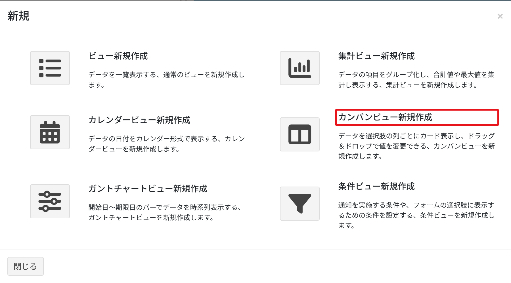
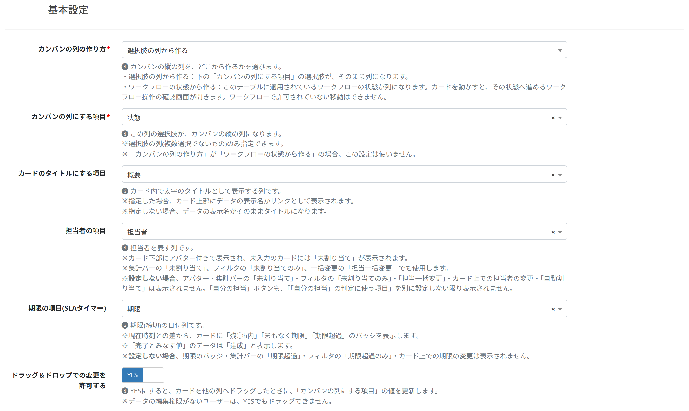
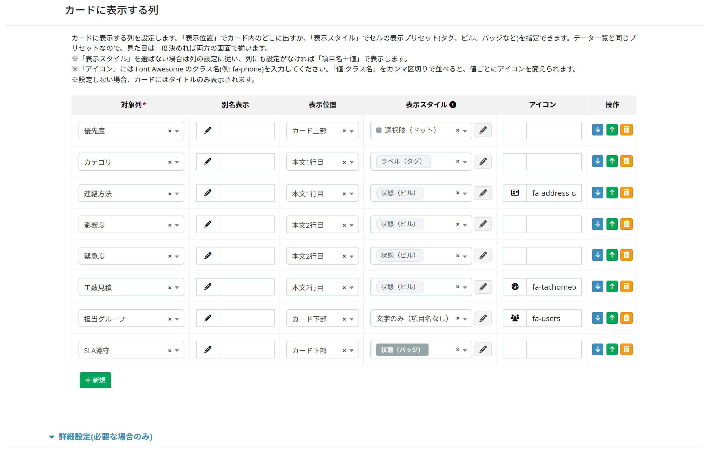
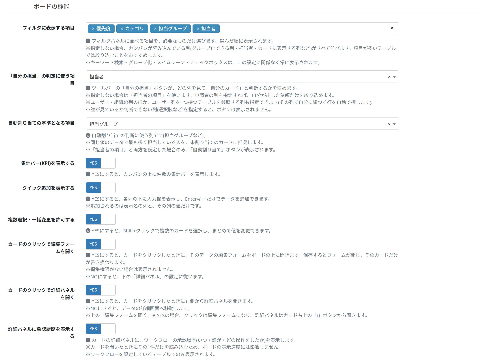
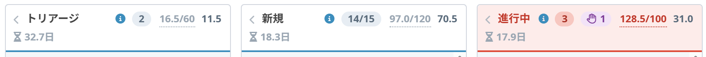
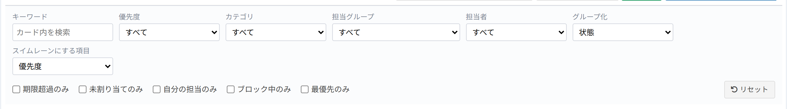
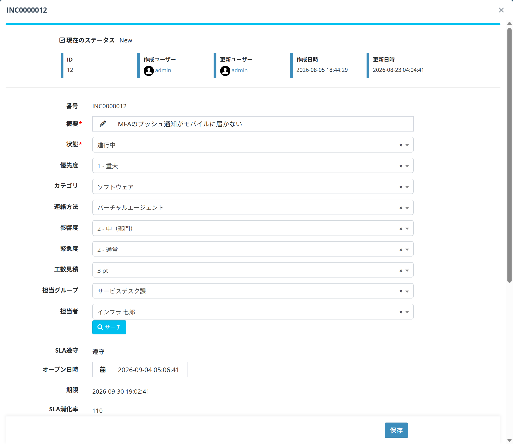
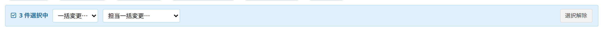
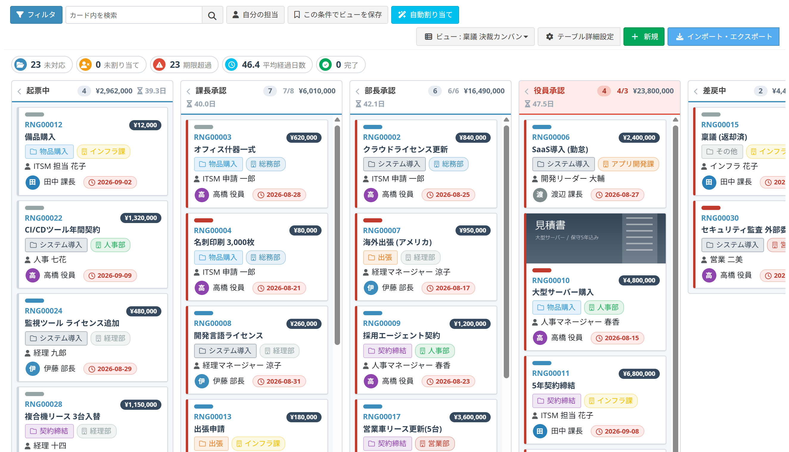

# 칸반 뷰

데이터를 "상태별 레인(세로 열)"에 늘어놓은 카드 모양으로 표시하고, 끌어다 놓기로 상태를 바꿀 수 있는 뷰입니다.

## 칸반 뷰란

칸반이란 일을 카드 한 장으로 나타내고, "미처리", "처리 중", "완료" 같은 공정의 레인에 늘어놓아 관리하는 방법입니다.  
어느 일이 어느 공정에서 멈춰 있는지 한눈에 알 수 있고, 카드를 다음 레인으로 옮기기만 하면 상태를 진행시킬 수 있습니다.

Exment의 칸반 뷰에서는 다음을 할 수 있습니다.

- 선택지 열(상태·우선순위 등) 또는 워크플로의 상태를 그대로 세로 레인으로 만들기
- 카드를 끌어서 그 항목의 값을 업데이트하기
- 카드에 담당자·기한·라벨·진행률 막대 등을 표시하기
- 레인별 건수·합계 금액·평균 체류 일수를 헤더에 표시하기
- 카드를 클릭하여 보드 위에서 편집 폼 열기

## 뷰 새로 추가

1. 사용자 정의 뷰 설정 화면을 엽니다([사용자 정의 뷰](/ko/view) 참고).
2. 오른쪽 위의 ［새로 만들기］ 버튼을 클릭합니다.
3. 표시된 대화 상자에서 "칸반 뷰 새로 만들기"를 선택합니다.

## 기본 설정

#### 칸반 레인 생성 방법
칸반의 세로 레인을 어디에서 만들지 고릅니다.

| 선택지 | 내용 |
| --- | --- |
| 선택지 열의 값으로 만들기 | 아래 "칸반 레인으로 사용할 열"의 선택지가 그대로 레인이 됩니다. |
| 워크플로 상태로 만들기 | 이 테이블에 적용된 워크플로의 상태가 레인이 됩니다. 카드를 옮기면 그 상태로 진행하는 워크플로 작업의 확인 화면이 열립니다. 워크플로에서 허용하지 않는 이동은 할 수 없습니다. |

※ 워크플로를 설정하지 않은 테이블에서는 이 항목이 표시되지 않습니다.

#### 칸반 레인으로 사용할 열
이 열의 선택지가 칸반의 세로 레인이 됩니다.  
※ 선택지 열(다중 선택이 아닌 것)만 지정할 수 있습니다.  
※ "칸반 레인 생성 방법"이 "워크플로 상태로 만들기"인 경우 이 설정은 쓰지 않습니다.

#### 카드 제목으로 사용할 열
카드 안에서 굵은 글씨의 제목으로 표시할 열입니다.  
※ 지정하면 카드 위쪽에 데이터의 표시 이름이 링크로 표시됩니다.  
※ 지정하지 않으면 데이터의 표시 이름이 그대로 제목이 됩니다.

#### 담당자 열
담당자를 나타내는 열입니다. 카드 아래쪽에 아바타와 함께 표시되며, 입력하지 않은 카드에는 "미할당"이 표시됩니다.  
집계 막대의 "미할당", 필터의 "미할당만", 일괄 변경의 "담당자 일괄 변경"에서도 사용합니다.

※ 설정하지 않으면 아바타·집계 막대의 "미할당"·필터의 "미할당만"·"담당자 일괄 변경"·카드 위에서의 담당자 변경·"자동 할당"은 표시되지 않습니다.

#### 기한 열(SLA 타이머)
기한(마감)의 날짜 열입니다. 현재 시각과의 차이로 카드에 "남은 시간 ○h", "기한 임박", "기한 초과" 배지를 표시합니다.  
※ "완료로 간주할 값"의 데이터는 "달성"으로 표시합니다.  
※ 설정하지 않으면 기한 배지·집계 막대의 "기한 초과"·필터의 "기한 초과만"·카드 위에서의 기한 변경은 표시되지 않습니다.

#### 끌어다 놓기로 값 변경 허용
YES로 하면 카드를 다른 레인으로 끌었을 때 "칸반 레인으로 사용할 열"의 값을 업데이트합니다.  
※ 데이터 편집 권한이 없는 사용자는 YES여도 끌 수 없습니다.

## 카드에 표시할 열

카드 안에 늘어놓을 항목을 설정합니다. 설정하지 않으면 카드에는 제목만 표시됩니다.

| 항목 | 내용 |
| --- | --- |
| 대상 열 | 카드에 표시할 열 |
| 별칭 표시 이름 | 카드에 표시할 이름을 바꿀 때 입력 |
| 표시 위치 | 카드 안의 어디에 표시할지 |
| 표시 스타일 | 어떤 모양으로 표시할지 |
| 아이콘 | Font Awesome의 클래스 이름(예: fa-phone) |

### 표시 위치

| 선택지 | 표시 장소 |
| --- | --- |
| 카드 상단 | 제목 위 |
| 본문 1행 | 제목 아래, 첫째 줄 |
| 본문 2행 | 제목 아래, 둘째 줄 |
| 카드 하단 | 카드의 맨 아래 |

### 표시 스타일

데이터 목록과 같은 "셀 표시 프리셋"에서 고릅니다. 모양을 한 번 정하면 목록에서도 칸반에서도 같은 표시가 됩니다.

| 설정 | 카드의 표시 |
| --- | --- |
| 프리셋을 고름 | 그 프리셋의 모양(태그, 필, 배지, 점, 아바타 등)으로 표시합니다. **열의 설정보다 우선합니다** |
| 선택 안 함 | 열 쪽의 "표시 프리셋" 또는 열의 표시 설정에 따릅니다 |
| 둘 다 미설정 | "항목 이름: 값" 형태로 표시합니다 |

값별 색상은 열 쪽의 설정이 그대로 쓰입니다. 프리셋은 모양만 정하므로, 같은 프리셋을 어느 열에나 쓸 수 있습니다.

연필 버튼으로 프리셋을 새로 만들거나 편집할 수 있습니다. 자세한 내용은 [셀 표시 프리셋](/ko/cell_style_preset)을 참고하십시오.

> 워크플로 상태나 작성 일시 같은 "열이 아닌 항목"도 프리셋을 고르면 같은 모양으로 표시할 수 있습니다. 다만 값별 색상은 열의 설정이므로 이런 항목에는 적용되지 않습니다.

### 아이콘
Font Awesome의 클래스 이름(예: fa-phone)을 입력합니다. 프리셋에 아이콘이 들어 있어도 여기의 지정이 우선합니다.  
선택지마다 아이콘을 바꾸고 싶으면 "값:클래스 이름"을 쉼표로 구분하여 입력합니다.  
예: `phone:fa-phone,mail:fa-envelope,chat:fa-comments`

## 고급 설정(필요한 경우에만)

초기값 그대로도 칸반은 동작합니다. 필요해졌을 때만 설정하십시오.

### 카드 표시 설정

#### 커버 이미지 열
카드 위쪽에 커버로 표시할 이미지 열입니다.  
※ 이미지가 등록되지 않은 데이터는 커버 없이 표시됩니다. 여러 장이 등록되어 있으면 첫 번째 장을 사용합니다.

#### 커버 이미지 표시 방법
"채우기(넘치는 부분 잘림)"는 틀에 가득 차게 표시하고, 넘치는 부분을 잘라 냅니다.  
"전체 표시(여백 있음)"는 이미지 전체를 넣고, 여백이 생깁니다.

#### 색상 라벨 열
카드 위쪽에 색상 라벨로 표시할 선택지 열입니다. 다중 선택 열도 지정할 수 있습니다.  
※ "필터 패널에 표시할 열"을 지정하지 않은 동안은, 지정한 열이 필터에도 추가됩니다.

#### 라벨 표시 방법
"칩(텍스트 포함)"은 글자가 들어간 작은 라벨이고, "색상 막대만"은 색만 있는 가는 막대입니다.

#### 배지 열
카드 오른쪽 위에 작은 배지로 표시할 열입니다(건수·포인트·번호 등). 값이 비어 있는 데이터에는 표시되지 않습니다.

#### 진행률 막대로 표시할 숫자 열 / 진행률 막대의 최댓값
카드의 제목 아래에 진행률 막대를 표시합니다.  
0%~49%는 파랑, 50%~99%는 주황, 100%는 초록이 됩니다.  
"진행률 막대의 최댓값"은 막대가 100%가 되는 값입니다(입력하지 않으면 100).

#### 경과 일수 기준 열 / 경과 일수 색 구분
경과 일수를 계산하는 기준이 되는 날짜 열입니다(접수일 등). 경과 일수에 따라 카드 왼쪽 끝의 색이 바뀝니다.  
"경과 일수 색 구분"에는 색이 바뀌는 일수를 작은 순으로, 쉼표로 구분하여 3개 입력합니다.  
예: `1,2,3` → 1일에 노랑, 2일에 주황, 3일 이상에 빨강.  
예: `3,7,14` → 긴 공정용.  
바꾸지 않으면 `1,2,3`입니다.

#### 기한 임박으로 판단할 시간(시간)
기한까지 이 시간이 남지 않은 카드를 "기한 임박"(노란색)으로 합니다.  
예: 문의라면 2(시간), 납기가 일 단위라면 48(=2일). 입력하지 않으면 2시간입니다.

### 레인 관리

#### 스윔레인으로 사용할 열
이 열의 값별로 칸반을 가로 방향으로 나누어 표시합니다. 지정하지 않으면 나누지 않고 표시합니다.

#### 레인 헤더에 합계를 표시할 열
레인의 헤더 아래에 이 숫자 항목의 합계를 표시합니다.  
예: 금액을 고르면 "임원 승인 ¥34,700,000"처럼, 그 레인에 멈춰 있는 금액을 한눈에 알 수 있습니다.  
※ 표시 전용입니다. WIP 상한에는 영향을 주지 않습니다.

#### 레인별 평균 체류 일수 표시
레인의 헤더 아래에 그 레인의 카드가 평균 며칠 동안 거기에 머물러 있는지 표시합니다. 어느 공정에서 정체되고 있는지(병목)를 알 수 있습니다.  
※ 워크플로인 경우는 "그 상태가 된 일시", 그 밖에는 "최종 업데이트 일시"부터 셉니다.

#### 레인별 WIP 상한
레인별로 "동시에 가질 수 있는 건수의 상한"을 설정합니다. 상한을 넘은 레인은 헤더가 빨갛게 됩니다.

| 항목 | 내용 |
| --- | --- |
| 대상 레인 | 상한을 설정할 레인(테이블의 선택지에서 고릅니다) |
| 상한 건수 | 그 레인에 동시에 둘 수 있는 건수(1~999. 행을 추가했을 때는 5) |

#### WIP 상한 계산 기준(숫자 열)
WIP 상한을 "건수"가 아니라 이 숫자 항목의 합계로 셉니다.  
예: 수량을 고르면 레인의 헤더에 "1550/1200"처럼 합계 값과 상한이 표시됩니다.  
※ 정수·소수·통화 항목만 지정할 수 있습니다.

#### WIP 상한을 초과하는 이동

| 선택지 | 동작 |
| --- | --- |
| 허용(헤더만 빨갛게 표시) | 지금까지와 같습니다. 헤더가 빨갛게 될 뿐, 이동은 할 수 있습니다. |
| 확인 후 허용 | 확인 메시지를 표시하고, OK이면 이동합니다. |
| 허용 안 함 | 상한에 도달한 레인은 끄는 동안 회색이 되며, 이동할 수 없습니다. |

※ "최우선(긴급)으로 간주할 값"의 카드는 이 제한을 받지 않습니다. 다만 건수에는 셉니다.

#### 레인별 규칙(정책)
레인의 헤더에 그 레인의 규칙을 표시합니다. 표시에 마우스를 올리면 내용이 나옵니다.  
예: "테스트 중" 레인에 "테스트 사양서의 모든 항목에 OK가 붙으면 다음으로"라고 적어 두면, 다음으로 진행할 조건이 모두에게 보입니다.

#### 완료로 간주할 값
"완료"로 다룰 칸반 레인을 테이블의 선택지에서 고릅니다.  
고른 레인의 데이터는 기한 계산을 멈추고, 집계 막대의 "완료"에 셉니다.  
※ 워크플로로 만드는 경우 "완료"로 설정된 상태는 자동으로 완료로 다루므로, 여기에서 지정할 필요가 없습니다.

#### 차단됨으로 간주할 값
"멈춰 있는 일"을 나타내는 값을 고릅니다. 고른 값을 가진 카드에는 빨간 테두리와 깃발 표시가 붙고, 집계 막대와 필터에 "차단됨"이 추가됩니다.

#### 최우선(긴급)으로 간주할 값
"끼어드는 최우선 안건"을 나타내는 값을 고릅니다. 고른 값을 가진 카드에는 눈에 띄는 테두리가 붙고, 그 값으로 스윔레인을 나누고 있으면 그 스윔레인이 맨 위에 고정됩니다.  
※ 많은 값을 최우선으로 하면 의미가 없어집니다. 1개나 2개로 줄이십시오.

#### 보드에 표시하지 않을 레인
고른 값의 레인을 보드에 표시하지 않습니다.  
예: "완료", "취소"를 고르면, 끝난 일이 사라지고 진행 중인 일만 있는 보드가 됩니다.  
※ 숨긴 레인의 데이터는 읽어 들이지 않습니다. 건수가 많은 테이블에서는 이것만으로 표시가 크게 빨라집니다.

### 보드 기능

| 항목 | 내용 |
| --- | --- |
| "내 담당" 판정에 사용할 열 | 도구 모음의 "내 담당" 버튼이 어느 열을 보고 "내 카드"라고 판단할지 정합니다. 지정하지 않으면 "담당자 열"을 씁니다. |
| 자동 할당 기준 열 | 자동 할당의 판단에 쓰는 열입니다(담당 그룹 등). 같은 값의 데이터를 가장 많이 담당하고 있는 사람을 미할당 카드에 추천합니다(아래 "자동 할당" 참고). |
| 필터 패널에 표시할 열 | 필터 패널에 늘어놓을 항목입니다. 고른 순서대로 표시됩니다. 지정하지 않으면 보드가 읽어 들이는 모든 열이 표시됩니다. |
| 집계 막대(KPI) 표시 | 칸반 위에 건수의 집계 막대를 표시합니다. |
| 빠른 추가 표시 | 각 레인의 아래에 입력란을 표시하여, Enter 키만으로 데이터를 추가할 수 있습니다. |
| 다중 선택 및 일괄 변경 허용 | Shift+클릭으로 여러 카드를 선택하여 한꺼번에 값을 바꿀 수 있습니다. |
| 카드를 클릭하면 편집 폼 열기 | 카드를 클릭했을 때 그 데이터의 편집 폼을 보드 위에 엽니다. |
| 카드를 클릭하면 상세 패널 열기 | 카드를 클릭했을 때 오른쪽에서 상세 패널을 엽니다. |
| 상세 패널에 승인 이력 표시 | 카드의 상세 패널에 워크플로의 승인 이력을 표시합니다. 워크플로를 설정한 테이블에서만 고를 수 있습니다. |

※ 새로 만든 뷰에서는 집계 막대·빠른 추가·다중 선택·편집 폼·상세 패널·승인 이력이 모두 YES입니다.

※ "편집 폼 열기"와 "상세 패널 열기"를 둘 다 YES로 하면, 클릭은 편집 폼이 되고 상세 패널은 카드 오른쪽 위의 "i" 버튼으로 엽니다.  
※ 둘 다 NO인 경우, 클릭하면 데이터의 상세 화면으로 이동합니다.

### 읽어 들일 건수

#### 레인별 읽어 들일 카드 수
레인 하나당 처음에 읽어 들이는 카드의 건수입니다(0~500. 새 뷰에서는 0).  
0(미입력)으로 하면 보드 전체에서 "최대 표시 건수"까지 읽어 들입니다.  
50 등을 넣으면 레인마다 50건씩 읽어 들이고, 레인 아래에 ［더 보기］ 버튼이 나옵니다.

※ 건수·합계·평균 체류 일수·집계 막대는 읽어 들인 카드가 아니라 데이터베이스 전체를 집계한 올바른 값이 됩니다.  
※ 좁히기나 키워드 등으로 이미 읽어 들인 카드만 집계하는 경우에는 "이미 읽어온 카드 ○건만 표시하고 있습니다(전체 ○건). …"이라고 표시됩니다.  
※ **데이터가 수천 건 있는 경우에는 이 방식을 권장합니다.** "최대 표시 건수"의 상한에 얽매이지 않습니다.

#### 최대 표시 건수
칸반에 표시할 데이터의 최대 건수입니다(1~2000). 건수가 많으면 표시가 느려집니다.  
새 뷰에서는 300, 또는 환경 키 `EXMENT_KANBAN_MAX_SIZE_COUNT`를 설정한 경우에는 그 값이 됩니다.

## 보드 사용법

### 화면 보는 법

#### 도구 모음

| 버튼 | 내용 |
| --- | --- |
| 필터 | 좁히기 패널을 엽니다 |
| 카드 내 검색 | 키워드로 카드를 좁힙니다 |
| 내 담당 | 내가 담당인 카드만 표시합니다 |
| 이 조건으로 뷰 저장 | 지금의 좁히기 조건으로 새 뷰를 만듭니다 |
| 자동 할당 | 화면에 있는 미할당 카드 중 신뢰도가 높은 것에 담당자를 할당합니다(아래) |

#### 자동 할당

［자동 할당］은 추천만 하는 것이 아니라 담당자를 **써넣습니다**.

- 화면에 있는 미할당 카드 중 신뢰도가 85% 이상인 것은 그 자리에서 담당자가 할당됩니다.
- 그 밖의 카드는 미할당인 채로 남습니다. 카드 위에는 추천 담당자가 비율과 함께 표시되고, 상세 패널에는 "제안만(직접 확인 권장)"과 ［이 담당자 적용］ 버튼이 표시됩니다.
- 좁히기나 "카드 내 검색"으로 숨겨진 카드, 그리고 완료로 다루는 레인에 있는 카드는 대상이 아닙니다.
- 결과는 "N건 자동 할당(신뢰도 85퍼센트 이상) / M건은 제안만"으로 표시됩니다.

#### 집계 막대(KPI)

최대 6개의 수치를 표시합니다. 각각 대응하는 설정을 했을 때만 표시됩니다.

| 수치 | 표시되는 조건 |
| --- | --- |
| 미처리 | 항상 표시 |
| 미할당 | "담당자 열"을 설정함 |
| 기한 초과 | "기한 열(SLA 타이머)"을 설정함 |
| 평균 경과 일수 | "경과 일수 기준 열"을 설정함 |
| 차단됨 | "차단됨으로 간주할 값"을 설정함 |
| 완료 | "완료로 간주할 값"을 설정함(워크플로 보드에서는 완료로 한 상태) |

※ 레인별로 읽어 들이는 경우, "차단됨"은 "≥8"처럼 "그 건수 이상"으로 표시될 수 있습니다.  
※ 좁히고 싶은 경우에는 ［필터］의 "기한 초과만", "미할당만" 등의 체크를 사용하십시오.

#### 레인의 헤더

왼쪽부터 레인을 접는 "‹"·레인 이름·규칙 표시·건수·차단됨 건수·WIP·합계·평균 체류 일수가 늘어섭니다.

- 건수는 표시하고 있는 카드의 수입니다. 레인별로 읽어 들이고 아직 남은 것이 있으면 "표시 중/전체"(예: 14/15)가 됩니다.
- WIP("읽어 들인 수/상한")는 건수와는 별도의 표시이며, WIP 상한을 설정한 레인에만 표시됩니다.
- 차단됨 건수는 차단됨 카드가 있는 레인에만 표시됩니다.
- 합계와 평균 체류 일수는 뷰 설정에서 ON으로 한 경우에, 카드가 있는 레인에만 표시됩니다.

#### 카드

설정에 따라 라벨·번호·우선순위·경과 일수·제목·진행률 막대·각 항목·담당자·기한이 표시됩니다.

### 카드 옮기기

카드를 다른 레인으로 끌면 "칸반 레인으로 사용할 열"의 값이 업데이트됩니다.  
업데이트 후에는 화면 아래쪽에 ［실행 취소］가 표시되어, 바로 앞의 이동을 취소할 수 있습니다.

※ 편집 권한이 없으면 끌 수 없습니다.  
※ 워크플로로 만든 레인인 경우에는 워크플로 작업의 확인 화면이 열립니다.

### 필터

［필터］를 클릭하면 좁히기 패널이 열립니다.

- 각 항목의 값으로 좁힐 수 있습니다
- "그룹화", "스윔레인으로 사용할 열"은 이 화면에서 일시적으로 바꿀 수 있습니다
- 좁히기 체크를 쓸 수 있습니다. 각각 쓸 수 있는 경우에만 표시됩니다
  - "기한 초과만"…"기한 열(SLA 타이머)"을 설정함
  - "미할당만"…"담당자 열"을 설정함
  - "내 담당만"…"내 담당" 판정에 사용할 열이 사용자 열이고, 보드가 "나"를 판별할 수 있음
  - "차단됨만"…"차단됨으로 간주할 값"을 설정함
  - "최우선만"…"최우선(긴급)으로 간주할 값"을 설정함
- ［초기화］로 패널의 내용을 지웁니다

좁힌 상태에서 ［이 조건으로 뷰 저장］을 클릭하면 그 조건의 뷰를 새로 만들 수 있습니다.

### 편집 폼

"카드를 클릭하면 편집 폼 열기"를 YES로 한 경우, 카드를 클릭하면 보드 위에 편집 폼이 열립니다.

- 저장하면 폼이 닫히고 **그 카드만** 바뀝니다. 보드 전체를 다시 읽어 들이지 않습니다.
- 입력 오류가 있으면 폼을 연 채로 항목 옆에 메시지가 표시됩니다.
- Esc 키로 닫을 수 있습니다.

### 상세 패널

카드 오른쪽 위의 "i" 버튼(상세 패널만 유효한 경우에는 카드 클릭)으로 오른쪽에서 상세 패널이 열립니다.

- "카드에 표시할 열"에서 설정한 항목에 더하여, 칸반 레인으로 사용할 열·커버 이미지·제목·진행률 막대·라벨·모서리 배지를 확인할 수 있습니다
- ［이동할 위치］를 선택하여, 끌지 않고도 레인을 바꿀 수 있습니다
- ［데이터 열기］로 보통의 상세 화면으로 이동합니다

"워크플로 상태로 만들기" 보드에서는 실행할 수 있는 워크플로 작업의 버튼과, ("상세 패널에 승인 이력 표시"가 YES인 경우에는) 승인 이력이 표시됩니다. 이 보드에는 ［이동할 위치］가 표시되지 않습니다.  
선택지 열로 만든 보드에서는 워크플로를 설정한 테이블이라도 워크플로 작업과 승인 이력이 표시되지 않습니다.

### 다중 선택 및 일괄 변경

"다중 선택 및 일괄 변경 허용"을 YES로 한 경우, **Shift+클릭**(또는 Ctrl+클릭)으로 여러 카드를 선택할 수 있습니다.

- ［일괄 변경...］으로 선택한 카드의 레인(상태 등)을 한꺼번에 바꿉니다
- ［담당자 일괄 변경...］으로 담당자를 한꺼번에 바꿉니다
- ［선택 해제］로 선택을 해제합니다

### 빠른 추가

"빠른 추가 표시"를 YES로 한 경우, 각 레인의 맨 아래에 입력란이 표시됩니다.  
제목을 입력하고 Enter 키를 누르기만 하면, 그 레인의 값이 들어간 데이터를 새로 등록할 수 있습니다.

※ 등록되는 것은 표시 이름 열과 그 레인(상태 등)의 값뿐입니다. 다른 항목은 나중에 편집하십시오.

## 워크플로로 레인 만들기

"칸반 레인 생성 방법"에서 "워크플로 상태로 만들기"를 고르면, 테이블에 적용된 워크플로의 상태가 그대로 레인이 됩니다.

- 카드를 옮기면 그 상태로 진행하는 워크플로 작업의 확인 화면이 열립니다
- 워크플로에서 허용하지 않는 이동은 할 수 없습니다
- "완료"로 설정된 상태는 자동으로 완료로 다룹니다

신청·승인 업무에서는 승인 대기 건수와 금액을 레인별로 표시할 수 있으므로, 어디에서 승인이 멈춰 있는지 바로 알 수 있습니다.

## 대량 데이터를 다룰 때는

데이터가 수천 건을 넘는 테이블에서는 다음 설정을 권장합니다.

1. **"레인별 읽어 들일 카드 수"에 50 정도를 설정합니다**  
   레인마다 조금씩 읽어 들이고, 필요한 만큼만 ［더 보기］로 추가합니다. 건수와 합계는 읽어 들인 카드가 아니라 데이터베이스 전체의 올바른 값이 표시됩니다.
2. **"보드에 표시하지 않을 레인"에서 완료 계열의 레인을 뺍니다**  
   끝난 일을 읽어 들이지 않는 것만으로 표시 속도가 크게 좋아집니다.
3. **뷰의 "데이터 표시 조건"으로 대상을 좁힙니다**  
   기간이나 담당 부서 등으로, 처음부터 읽어 들일 범위를 좁힙니다.

## 관련 항목

- [사용자 정의 뷰](/ko/view)
- [데이터 목록의 조작 도구](/ko/data_grid_tools)
- [워크플로 설정](/ko/workflow_setting)
- [플로 디자이너](/ko/workflow_design)
