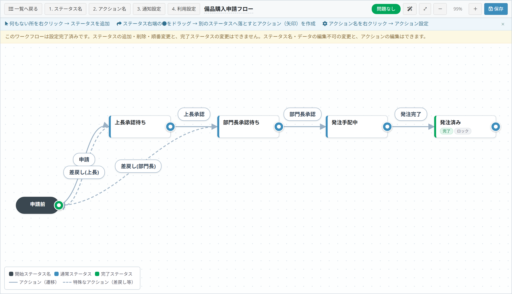
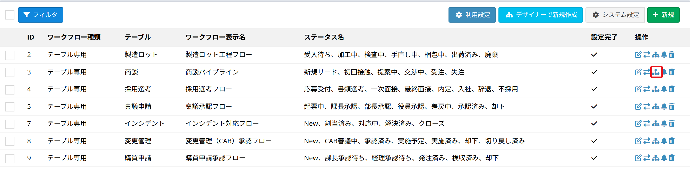
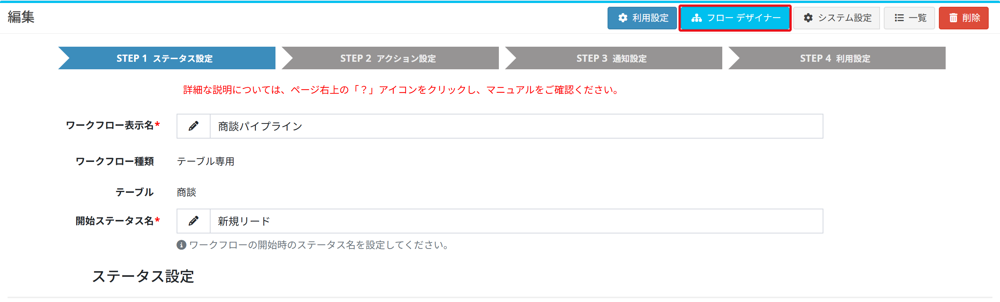
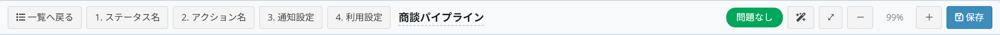
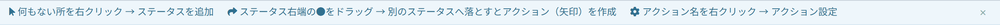
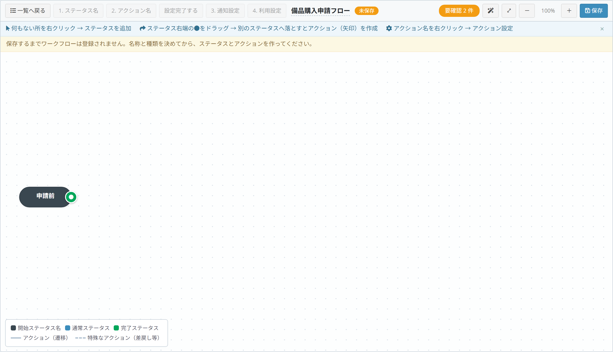
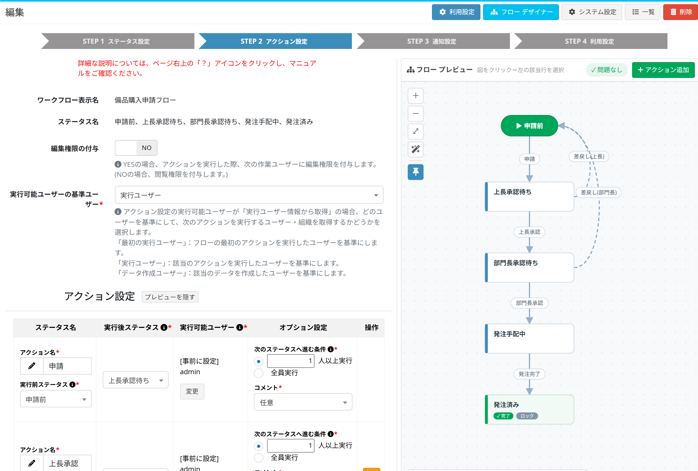

# 플로 디자이너

워크플로의 상태와 액션(조작)을 플로 그림 위에서 직접 만들고 편집할 수 있는 화면입니다.

## 플로 디자이너란

[워크플로 설정](/ko/workflow_setting)에서는 상태를 "1단계"의 표에서, 액션을 "2단계"의 표에서 설정합니다.  
표만으로 설정하면 다음과 같은 점을 알기 어려워집니다.

- 어느 상태에서 어느 상태로 진행할 수 있는가
- 막다른 곳이 된 상태가 없는가
- 반송의 경로가 바르게 이어져 있는가

플로 디자이너는 그 내용을 **그림으로 보면서** 만들고 편집하기 위한 화면입니다.

- 저장 위치는 1단계·2단계와 같습니다. 디자이너에서 만든 것은 그대로 1단계·2단계의 표에 반영됩니다
- 어느 화면에서 설정해도 괜찮습니다. 그림으로 만들고, 자세한 조건은 표에서 조정하는 방법도 쓸 수 있습니다

## 화면 열기

### 1. 이미 있는 워크플로를 그림으로 편집하기

워크플로 설정의 목록에서 대상 행의 [플로 디자이너] 아이콘을 클릭합니다.

1단계·2단계의 화면에서도 오른쪽 위의 [플로 디자이너] 버튼으로 열 수 있습니다.

### 2. 새 워크플로를 그림에서 만들기

워크플로 설정의 목록에서 오른쪽 위의 [디자이너로 새로 만들기] 버튼을 클릭합니다.

## 화면 보는 법

### 도구 모음

| 항목 | 내용 |
| --- | --- |
| 목록으로 돌아가기 | 워크플로 설정의 목록으로 돌아갑니다 |
| 1. 상태 이름 / 2. 액션 이름 | 표 형식의 설정 화면(1단계·2단계)으로 이동합니다 |
| 설정 완료하기 | 워크플로의 설정을 완료합니다. "2. 액션 이름"의 오른쪽에 있으며, 설정을 완료한 뒤에는 표시되지 않습니다. 자세한 내용은 [워크플로 설정](/ko/workflow_setting)을 참조하십시오 |
| 3. 알림 설정 / 4. 이용 설정 | 설정을 완료한 뒤에 쓸 수 있습니다 |
| (워크플로 이름) | 편집 중인 워크플로의 이름입니다 |
| 문제 없음 / 확인 필요 ○건 | 입력 검사의 결과입니다. 클릭하면 내용이 표시됩니다 |
| 자동 정렬 | 노드의 위치를 자동으로 다시 늘어놓습니다 |
| ⤢(전체 보기) | 그림 전체가 들어가도록 표시합니다 |
| －／＋ | 표시 배율을 바꿉니다 |
| 저장 | 편집한 내용을 저장합니다 |

### 조작 힌트

화면 위쪽에는 기본적인 조작이 항상 표시되어 있습니다.

### 범례

| 표시 | 의미 |
| --- | --- |
| 검은 노드 | 시작 상태 |
| 파란 노드 | 일반 상태 |
| 초록 노드 | 완료 상태 |
| 실선 화살표 | 액션(다음 상태로 진행하는 조작) |
| 점선 화살표 | 특수 액션(반송 등, 작업 사용자에 포함하지 않는 조작) |

노드에 붙는 "완료" "잠금" 표시는 각각 완료 상태·데이터 편집 불가를 나타냅니다.

## 기본 조작

### 상태 추가하기

그림의 **아무것도 없는 곳을 마우스 오른쪽 버튼으로 클릭**하고, [상태 추가]를 선택합니다.

| 항목 | 내용 |
| --- | --- |
| 상태 추가 | 오른쪽 클릭한 위치에 새 상태를 만듭니다 |
| 자동 정렬 | 노드의 위치를 자동으로 다시 늘어놓습니다 |
| 전체 보기 | 그림 전체가 들어가도록 표시합니다 |

### 액션(화살표) 만들기

상태의 **오른쪽 끝에 있는 ●를 드래그**하여 다른 상태 위에서 놓습니다.  
두 상태를 잇는 액션(화살표)이 만들어집니다.

아무것도 없는 곳에서 놓은 경우에는 "새 상태를 만들어 연결"을 고를 수 있습니다. 상태 만들기와 액션 만들기를 이어서 할 수 있습니다.

### 액션의 설정 바꾸기

**액션 이름을 마우스 오른쪽 버튼으로 클릭**하고, [액션 설정]을 선택합니다.

| 항목 | 내용 |
| --- | --- |
| 액션 설정 | 액션 이름·실행 가능 사용자·옵션을 설정합니다 |
| 액션 삭제 | 이 화살표(액션)를 삭제합니다 |

### 상태의 설정 바꾸기

**상태를 마우스 오른쪽 버튼으로 클릭**하면, 상태 이름의 변경, 완료 상태의 지정, 삭제를 할 수 있습니다.

※데이터가 들어 있는 상태는 삭제할 수 없습니다. 삭제하려고 하면 "사용 중이므로 삭제할 수 없습니다"라고 표시됩니다.  
※시작 상태는 삭제할 수 없습니다. 이름만 변경할 수 있습니다.

### 그림의 배치 정리하기

- 노드는 드래그로 자유롭게 움직일 수 있습니다
- [자동 정렬]로, 왼쪽에서 오른쪽으로 흐르는 모양으로 자동으로 다시 늘어놓습니다
- [⤢(전체 보기)]로, 그림 전체가 화면에 들어가는 배율로 합니다

### 저장하기

오른쪽 위의 [저장] 버튼을 클릭합니다.  
저장할 때까지 변경한 내용은 데이터베이스에 반영되지 않습니다. 저장하지 않은 변경이 있을 때는 도구 모음에 "저장 안 됨"이라고 표시됩니다.

※저장하지 않고 페이지를 떠나려고 하면 확인 메시지가 표시됩니다.  
※다른 사람이 같은 워크플로를 먼저 업데이트한 경우에는 "다른 화면에서 이 워크플로가 업데이트되었습니다"라고 표시됩니다. 페이지를 새로 고친 뒤 다시 저장하십시오.

## 확인 필요(입력 검사)

도구 모음의 오른쪽에는 입력 내용의 검사 결과가 항상 표시됩니다.

- 문제가 없는 경우는 초록색 "문제 없음"
- 문제가 있는 경우는 주황색 "확인 필요 ○건"

클릭하면 내용이 목록으로 표시되고, 다시 클릭하면 해당하는 곳으로 이동합니다.

주된 검사 내용은 다음과 같습니다.

| 메시지 | 의미 |
| --- | --- |
| 워크플로 이름이 입력되지 않았습니다. 이대로는 저장할 수 없습니다. | 이름을 입력하지 않으면 저장할 수 없습니다 |
| 워크플로 이름이 30자를 초과합니다. 이대로는 저장할 수 없습니다. | 이름은 30자까지입니다 |
| 워크플로 종류를 선택하십시오.／대상 테이블을 선택하십시오. | 워크플로 종류와, "테이블 전용"인 경우에는 대상 테이블을 고릅니다 |
| 시작 상태 이름이 입력되지 않았습니다. 이대로는 저장할 수 없습니다. | 시작 상태의 이름을 입력하십시오 |
| "○○"에서 시작하는 액션이 없습니다. | 시작 상태에서 다음으로 진행하는 화살표가 없습니다 |
| 상태가 없습니다.／액션이 없습니다. | 상태와 액션을 1건 이상 추가하십시오 |
| 완료 상태를 하나 이상 설정하십시오. | 완료 상태는 정확히 1건으로 합니다 |
| "○○"에 도달하는 액션이 없습니다. | 어디에서도 도달할 수 없는 상태가 있습니다 |
| "○○"에서 나가는 액션이 없으며 완료 상태도 아닙니다. | 막다른 상태가 있습니다 |
| 액션 "○○"의 실행 전 상태／실행 후 상태가 설정되지 않았습니다. | 액션의 앞뒤 상태를 둘 다 고릅니다 |
| 액션 "○○"이(가) 삭제된 상태를 참조하고 있습니다. | 존재하지 않는 상태로 화살표가 향해 있습니다 |
| 액션 이름이 입력되지 않은 행이 있습니다. 이대로는 저장할 수 없습니다. | 모든 액션에 이름이 필요합니다 |
| 액션 "○○"의 액션 이름이 30자를 초과합니다. | 액션 이름은 30자까지입니다 |
| 액션 "○○"의 실행 전과 실행 후 상태가 같습니다. 이대로는 저장할 수 없습니다. | 같은 상태로 돌아가는 화살표는 설정할 수 없습니다 |
| 액션 "○○"의 실행 가능 사용자가 설정되지 않았습니다. 이대로는 저장할 수 없습니다. | 누가 실행할 수 있는지를 설정하십시오 |
| 액션 "○○"의 "다음 상태로 진행하는 조건"의 인원수는 0~10의 숫자로 입력하십시오. | 인원수를 고치십시오 |

액션의 실행 가능 사용자에 대해서는, "특수 액션"과 "이전 액션의 실행 사용자가 선택"을 조합한 경우, 첫 번째 액션에서 "이전 액션의 실행 사용자가 선택"이나 "사전에 설정"이 아닌 것을 지정한 경우, 같은 실행 전 상태에서 "이전 액션의 실행 사용자가 선택"과 다른 설정을 함께 쓴 경우에도 메시지가 표시됩니다.

"에 도달하는 액션이 없습니다" "에서 나가는 액션이 없으며…"는 경고이며, 저장은 멈추지 않습니다. 그 밖의 메시지는 저장을 멈춥니다.

## 디자이너로 새로 만들기

[디자이너로 새로 만들기]에서 연 경우, 처음에 "기본 정보" 대화 상자가 표시됩니다.

| 항목 | 내용 |
| --- | --- |
| 워크플로 표시 이름 | 워크플로의 이름(30자까지) |
| 워크플로 종류 | "범용" 또는 "테이블 전용" |
| 테이블 | 워크플로의 대상 테이블. 종류가 "테이블 전용"일 때만 입력합니다 |
| 시작 상태 이름 | 첫 상태의 이름("기표 중" "신청 전" 등) |

입력하고 [저장]하면, 그림의 왼쪽에 시작 상태가 표시됩니다.

그 뒤, 오른쪽 클릭으로 상태를 추가하고, ●를 드래그하여 액션을 이어 갑니다.

> **저장할 때까지 워크플로는 등록되지 않습니다.**  
> 상태와 액션을 만들고 저장하면, 도구 모음의 [설정 완료하기]를 누를 수 있게 되어 3단계(알림 설정)·4단계(이용 설정)로 진행할 수 있습니다.

## 2단계의 "플로 미리보기"

2단계(액션 설정)의 화면에도 오른쪽에 플로 그림이 표시됩니다.

- 표를 편집하면 그림이 바로 업데이트됩니다
- 그림 안의 액션을 클릭하면 왼쪽 표의 해당 행이 선택됩니다
- [＋액션 추가]로 표에 행을 추가합니다
- [확인 필요 ○건]은 디자이너와 같은 입력 검사입니다

### 배치 저장(핀 버튼)

노드를 움직인 배치를 기록할지 여부를 전환합니다.

- 핀이 눌린 상태에서 화면을 저장하면, 지금의 배치가 기록되어 다음에 열었을 때도 같은 배열이 됩니다
- 눌려 있지 않은 경우, 배치는 저장되지 않고 매번 자동 정렬로 표시됩니다

### 미리보기 숨기기

그림이 필요 없는 경우에는 [미리보기 숨기기]로 숨길 수 있습니다. 표의 입력란을 넓게 쓸 수 있습니다.

## 주의점

#### 설정이 완료된 워크플로를 편집하는 경우
[설정 완료하기]를 실행한 워크플로에서는 1단계와 마찬가지로 상태가 고정됩니다.

- 상태의 추가·삭제·순서 변경과 완료 상태의 변경은 할 수 없습니다. 오른쪽 클릭 메뉴의 [상태 추가] [상태 삭제]는 "설정이 완료되어 변경할 수 없습니다"라고 표시되어 고를 수 없습니다.
- 상태 이름, "데이터 편집 불가", 그리고 모든 액션은 계속 편집할 수 있습니다.

이것과는 별도로, **신청 중인 데이터나 이력에서 쓰이고 있는 상태는 설정 완료 전이라도 삭제할 수 없습니다.**

#### 완료 상태
설정 완료 전의 워크플로에서는 완료 상태는 **정확히 1건**입니다.

- 완료 상태는 1건만 설정할 수 있습니다. 여러 개 있는 경우에는 1건을 남기고 해제한 뒤 저장하십시오.
- 완료 상태가 1건도 없는 경우에도 저장할 수 없습니다.
- 1단계의 화면에서 저장한 경우에도 표의 마지막 행의 1건만 완료 상태가 됩니다.

설정이 완료된 워크플로에는 템플릿에서 온 것 등으로 완료 상태가 여러 개 있는 경우가 있습니다. 그 경우에는 그대로 유지되며, 플로 디자이너에서는 변경할 수 없습니다.

#### 필터 조건(분기)에 대하여
액션의 필터 조건은 2단계의 화면에서 설정합니다.  
플로 디자이너에서 저장해도 설정해 둔 조건은 사라지지 않습니다. 그림 안에서는 "조건 1" "조건 2"로 분기가 표시됩니다.

## 관련 항목

- [워크플로 설정](/ko/workflow_setting)
- [워크플로 설정 예](/ko/workflow_example)
- [워크플로 실시](/ko/workflow_execution)
- [칸반 뷰](/ko/view_kanban)
