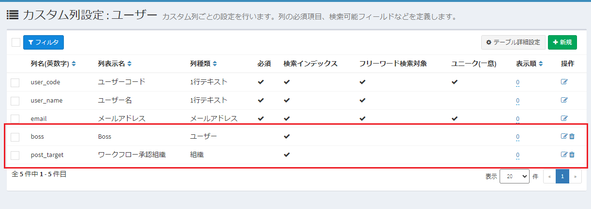

# 워크플로 설정
신청·승인 등의 "워크플로"를 만들어 테이블에서 쓸 수 있게 하는 페이지입니다. 시스템 관리자가 설정합니다.

설정의 흐름은 다음과 같습니다.

1. **Step1.상태 설정**: "미신청" "승인 대기" "완료" 등의 상태를 정합니다.
2. **Step2.액션 설정**: "신청" "승인" 등의 조작과, 누가 실행할 수 있는지를 정합니다.
3. **설정 완료하기**: 워크플로의 설정을 완료합니다. 이 다음에는 상태의 추가·삭제·순서 변경을 할 수 없습니다.
4. **Step3.알림 설정**: 워크플로를 실행했을 때 보낼 알림을 정합니다.
5. **Step4.이용 설정**: 어느 테이블에서 쓸지를 정합니다.

※상태와 액션은 플로 그림 위에서 직접 만들고 편집할 수도 있습니다. 자세한 내용은 [플로 디자이너](/ko/workflow_design)를 참조하십시오.

## 워크플로란
워크플로란 "업무에서 주고받는 일련의 흐름"을 말합니다.  
많은 업무에는 "누가 시작하고, 누가 판단이나 처리를 하고, 어떻게 완료하는가"라는 흐름이 있습니다.  
Exment에서 워크플로를 설정하면, 예를 들어 다음과 같은 흐름을 실행할 수 있습니다.

  
- 사용자는 관리부에 경비를 신청한다
- 관리부는 경비 신청을 승인한다. 또는 반려한다
- 승인된 경비는 그 뒤로 데이터를 수정할 수 없다

## 용어집
Exment의 워크플로에서 쓰는 용어입니다.

  

##### 워크플로  
신청이나 승인 등, 업무의 흐름 전체를 나타냅니다.  

##### 상태  
워크플로의 현재 상태를 나타냅니다.  
예: 미신청, 승인 대기, 완료  

##### 액션  
사용자가 실행하는 조작입니다. 실행하면 어떤 상태에서 다른 상태로 옮겨 갑니다.  
예: 신청, 승인, 반려, 반송

##### 작업 사용자  
다음 액션을 실행할 차례인 사용자입니다.

## 목록 화면 표시
시스템 관리자가 메뉴의 "관리자 설정 > 워크플로"를 클릭합니다.  
저장되어 있는 워크플로의 목록이 표시됩니다.

## 새로 만들기

1. 목록 화면 오른쪽 위의 [만들기] 버튼을 클릭합니다.
2. 워크플로 작성 화면의 "Step1.상태 설정"이 표시되므로, 필요한 사항을 입력합니다.

### Step1.상태 설정
워크플로의 상태를 설정합니다.

  

#### 워크플로 표시 이름 ※필수
- 화면에 표시하는 워크플로의 이름입니다. 한글 등도 쓸 수 있습니다. (예: 승인 플로)  

#### 워크플로 종류 ※필수
- 만드는 워크플로의 종류입니다. "범용" 또는 "테이블 전용" 중 하나를 선택하십시오.  
※만든 뒤에는 변경할 수 없습니다.  
##### 범용  
여러 테이블에서 워크플로를 쓸 수 있습니다.  
"신청" "승인" "반려" 등 표준적인 상태·액션만 쓰고 싶은 경우에 이것을 선택하십시오.  
##### 테이블 전용  
새로 만들 때 선택한 테이블에서만 쓸 수 있습니다. 그 대신 그 테이블의 사용자 정의 열을 써서 액션의 실행 대상을 바꿀 수 있습니다.  
예: "경비 정산" 테이블에서, 사용자 정의 열 "금액"이 100,000엔 이상이면 "부장 승인" 액션, 100,000엔 미만이면 "과장 승인" 액션을 실행하도록 나눌 수 있습니다.

#### 시작 상태 이름 ※필수
- 아직 워크플로를 실행하지 않은 상태의 상태 이름을 설정합니다.

#### 상태 설정
- 워크플로의 설정이나 사용할 상태를 정의합니다.  
※표의 마지막 행의 상태는 플로 완료를 나타내는 것으로 하십시오.
##### 상태 이름  
그 상태의 이름입니다.
##### 데이터 편집 불가  
이 상태인 동안 대상 데이터를 편집할 수 없게 할지 여부입니다. 편집하게 하고 싶지 않을 때는 YES로 하십시오.  
예: "미신청"일 때는 데이터를 편집·삭제할 수 있지만, "신청 중" "완료"일 때는 편집·삭제하게 하고 싶지 않다. 이 경우 "신청 중" "완료"를 YES로 합니다.

### Step2.액션 설정

  
#### 워크플로 표시 이름  
상태 설정에서 설정한 표시 이름이 표시됩니다.
#### 상태 이름  
상태 설정에서 설정한 상태 이름이 표시됩니다.
#### 편집 권한 부여  
워크플로를 실행할 때 "다음 작업 사용자"에게 편집 권한을 줄 수 있습니다.
#### 실행 가능 사용자의 기준 사용자 ※필수  
액션의 실행 가능 사용자가 "실행 사용자 정보에서 가져오기"인 경우에 기준이 되는 사용자를 설정합니다. "최초 실행 사용자" "실행 사용자" "데이터 작성 사용자" 중에서 선택할 수 있습니다.

#### 액션 설정
- 워크플로에서 실시할 액션을 설정합니다.  
##### 액션 이름  
그 액션의 이름입니다.
##### 실행 전 상태  
그 액션을 실행하기 위한 상태를 설정합니다.  
예: 실행 전 상태를 "미실시"로 한 경우, 각 데이터의 상태가 "미실시"이면 그 액션을 실행할 수 있다.  
##### 액션 설정  
어떤 액션을 실행할 수 있는지를 설정합니다. [변경] 버튼을 클릭하여 설정을 변경합니다.  
워크플로 종류에 따라 설정 내용이 다릅니다.  

  ※워크플로 종류가 "범용"인 경우:  
    이 액션을 실행한 뒤의 상태를 설정합니다. "실행 전 상태"와는 다른 상태를 선택하십시오.

  ※워크플로 종류가 "테이블 전용"인 경우:  
액션을 실행하는 조건과 실행 후의 상태를 설정합니다. 조건과 상태의 조합은 최대 3개까지 설정할 수 있습니다.

> 조건 항목의 열 종류가 선택지(다른 테이블의 값 목록에서 선택)인 경우, 조건 값에 표시되는 문구는 [제목 표시 열 설정](/ko/table)에서 변경할 수 있습니다.

#### 실행 가능 사용자  

이 액션을 실행할 수 있는 사용자·조직 등을 선택합니다. [변경] 버튼을 클릭하여 설정을 변경합니다.
  

##### 실행 가능 사용자: 이전 액션의 실행 사용자가 선택
액션을 실행하는 사용자가 그때마다 어느 사용자·조직 앞으로 할지를 고릅니다.  
  

##### 실행 가능 사용자: 사전에 설정
어느 사용자·조직 앞으로 할지를 관리자가 미리 정해 둡니다. 플로는 그 설정대로 진행됩니다.  
  

**■설정 항목**

- 사용자  
지정한 사용자가 액션을 실행할 수 있습니다.  

- 조직  
지정한 조직에 소속된 사용자가 액션을 실행할 수 있습니다.  

- 사용자 정의 열  
대상 데이터의 사용자 정의 열에 설정된 사용자 또는 조직이 액션을 실행할 수 있습니다. "테이블 전용"만의 기능입니다.  

- 시스템 > 작성 사용자  
사용자 정의 데이터를 만든 사용자가 액션을 실행할 수 있습니다.

##### 실행 가능 사용자: 실행 사용자 정보에서 가져오기
워크플로를 실행하는 사용자의 정보에서 받는 사람을 정합니다. 그 사용자에게 설정되어 있는 사용자·조직 항목(상사 등)의 값을 가져와, 그 사용자·조직 앞으로 액션을 실행합니다.

- 예1: 사용자A의 상사가 "부장X"인 경우, 부장X에게 액션을 실행
- 예2: 사용자B의 상사가 "부장Y" "부장Z"인 경우, 부장Y·부장Z에게 액션을 실행
  

※이 기능을 쓰려면 시스템 관리자가 미리 "사용자" 테이블에 사용자 정의 열 종류 "사용자" "조직"의 열을 추가해야 합니다. 또한 이 열들은 "검색 인덱스"를 YES로 해야 합니다.

**■기준 사용자**

실행 가능 사용자를 가져올 때 기준이 되는 사용자입니다. [워크플로 단위로 설정](/ko/workflow_setting?id=실행-가능-사용자의-기준-사용자-필수)합니다.  

- "최초 실행 사용자": 플로의 첫 액션을 실행한 사용자를 기준으로 합니다.  
- "실행 사용자": 해당 액션을 실행한 사용자를 기준으로 합니다.  
- "데이터 작성 사용자": 데이터를 만든 사용자를 기준으로 합니다.  

> 기준 사용자의 차이에 따른 동작의 차이는 [워크플로 예](/ko/workflow_example)를 확인하십시오.

**■사용자 정의 열**

사용자 테이블의 "사용자" 열이나 "조직" 열이 후보로 표시됩니다. 액션을 실행할 때, 기준 사용자의 해당 열에 설정된 사용자 또는 조직이 다음 액션을 실행할 수 있습니다.  

#### 옵션 설정 > 다음 상태로 진행하는 조건  
이 액션을 몇 명이 실행하면 다음 상태로 진행할지를 설정합니다.  
※보통은 1명이 실행하면 플로가 진행됩니다. "3명 이상 승인한 경우에만 다음 상태로 진행" "관리 조직의 모든 사용자가 승인한 경우에만 다음 상태로 진행"처럼 하고 싶을 때 이 설정값을 바꾸십시오.  

#### 옵션 설정 > 코멘트  
액션을 실행할 때 코멘트를 입력할 수 있는지 여부입니다.  
"필수" "선택" "사용 안 함" 중에서 선택할 수 있습니다.  
※"필수"로 설정한 액션은 [LINE](/ko/line)의 알림 카드에 버튼이 표시되지 않아, LINE에서 실행할 수 없습니다.

#### 옵션 설정 > 특수 액션  
체크하면 이 액션의 "실행 가능 사용자"를 현재 작업 사용자에 포함하지 않습니다.  
(현재 작업 사용자란, 지금의 상태에서 어떤 워크플로 액션을 실행할 수 있는 사용자를 말합니다)  
관리자가 특례로 승인하는 액션 등에 체크하십시오.  
※작업 사용자가 "특수 액션"에만 할당되어 있는 경우, 대상 사용자에게는 알림이 가지 않습니다. 또한 "현재 작업 사용자"에도 표시되지 않습니다.

※주된 용도는, 진행 중인 워크플로를 관리자 권한으로 처음으로 되돌리거나, 특례로 플로를 완료까지 가져가기 위한 액션입니다.

#### 보통의 액션과의 차이
| 개요 | 보통 | 특수 액션 |
| ---- | ---- | ---- |
| 실행 가능 사용자 설정 | 제한 없음 | "사전에 설정"만 |
| 대상 사용자에게 알림 | 실시된다 | 실시되지 않는다 |
| "현재 작업 사용자"에 표시 | 표시된다 | 표시되지 않는다 |
| [미처리 작업](/ko/workflow_task)에 표시 | 표시된다 | 표시되지 않는다 |

### 설정 완료하기
상태 설정과 액션 설정을 모두 하면, 페이지 오른쪽 위에 "설정 완료하기" 버튼이 표시됩니다.  

  

클릭하면 워크플로의 설정을 완료합니다.  
※설정을 완료하면 다음 일을 할 수 없게 됩니다. 
- 상태의 추가, 삭제, 순서 변경

### Step3.알림 설정
스텝 3·스텝 4는 [설정 완료하기]를 실행한 뒤에 표시됩니다.  
워크플로를 실행했을 때 보낼 알림을 설정합니다. 설정 항목은 [알림·메일 전송 설정](/ko/notify)을 참조하십시오.

### Step4.이용 설정
어느 테이블에서 어느 워크플로를 실행할지를 설정합니다.  
  

- 테이블마다 표시되는 것은 "범용"이거나 그 테이블 전용으로 만든 워크플로 중 "설정 완료"인 것입니다.

- 워크플로를 쓸 때는 "사용" 체크박스에 체크하십시오.  

- 날짜로 워크플로를 전환할 때는 "사용 시작일" "사용 종료일"에 날짜를 넣습니다. 기간이 겹치지 않게 하여 저장하십시오.

이것으로 워크플로 설정이 완료됩니다.  
실제로 워크플로를 실행하는 경우에는 [워크플로 실시](/ko/workflow_execution)를 확인하십시오.

### 워크플로의 삭제
등록한 워크플로 설정은 삭제할 수 있습니다.  
이미 이용 설정을 한 워크플로 설정을 삭제할 때는 다음 점에 주의하십시오.

- 워크플로 설정을 복원할 수 없게 됩니다.
- 진행 중인 워크플로가 무효가 됩니다.
- **상태 설정에서 "데이터 편집 불가" 설정이 YES로 되어 있어도, 편집 불가로 되어 있던 데이터를 다시 편집할 수 있게 됩니다.**

  

### 그 밖의 세부 사양

- "실행 가능 사용자: 실행 사용자 정보에서 가져오기" "실행 가능 사용자의 기준 사용자: 실행 사용자"에서 "옵션 설정 > 다음 상태로 진행하는 조건"을 2명 이상으로 한 경우, 다음 작업 사용자는 마지막으로 실행한 사용자를 기준으로 가져옵니다.  
예: "다음 상태로 진행하는 조건"을 3명으로 한 경우, "다음 액션을 실행하는 사용자"를 가져오는 기준 사용자는 3번째로 액션을 실시한 사용자뿐입니다. 1~2번째 사용자의 정보는 가져오지 않습니다.

- "실행 전 상태"가 같은 액션에서, "실행 가능 사용자: 사전에 설정"과 "실행 가능 사용자: 이전 액션의 실행 사용자가 선택"을 동시에 설정할 수 없습니다. ("실행 가능 사용자: 사전에 설정"을 "특수 액션"으로 한 경우는 제외.)

- "실행 전 상태"가 같은 액션에서, "실행 가능 사용자: 실행 사용자 정보에서 가져오기"와 "실행 가능 사용자: 이전 액션의 실행 사용자가 선택"을 동시에 설정할 수 없습니다. ("실행 가능 사용자: 실행 사용자 정보에서 가져오기"를 "특수 액션"으로 한 경우는 제외.)

