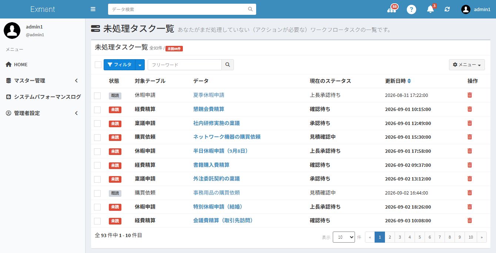
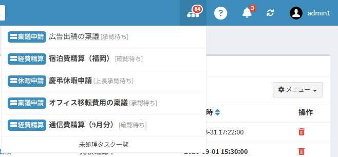
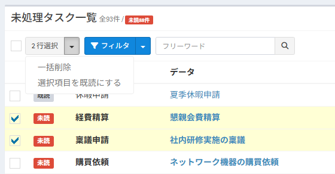
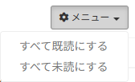
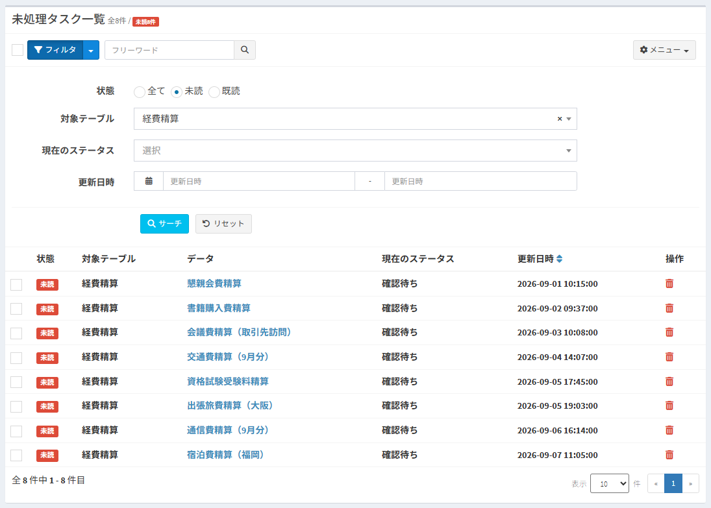
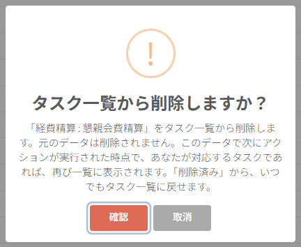
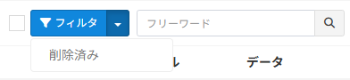
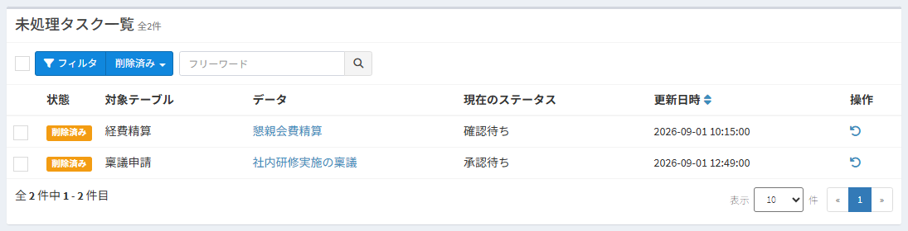

# 미처리 작업

로그인 사용자가 액션을 실행해야 하는 워크플로의 데이터(작업)를, 모든 테이블에서 모아 한꺼번에 표시하는 화면입니다.  
페이지 오른쪽 위의 아이콘에서도 미처리 작업을 언제든지 확인할 수 있습니다.

## 미처리 작업이란

워크플로를 쓰다 보면 다음과 같은 일이 일어나기 쉽습니다.

- 승인을 기다리는 데이터가 어느 테이블에 있는지, 테이블을 하나씩 열지 않으면 알 수 없다
- 신청이 도착한 것을 알아차리지 못해 처리가 멈춘다

미처리 작업 목록은 로그인 사용자가 **지금 액션을 실행할 수 있는 데이터**를, 테이블에 걸쳐 하나의 목록으로 표시합니다.  
목록에서 열면 그 데이터의 상세 화면으로 이동하여, 그대로 액션을 실행할 수 있습니다.

### 목록에 표시되는 데이터

다음 조건을 모두 만족하는 데이터가 작업으로 표시됩니다.

- "사용"으로 설정된, 설정이 완료된 워크플로의 데이터일 것
- 로그인 사용자 또는 로그인 사용자가 소속된 조직이 현재 상태의 작업 사용자일 것
- 데이터의 상세 화면에, 로그인 사용자가 실행할 수 있는 액션의 버튼이 표시될 것
  - 액션 설정의 조건을 만족하지 않는 데이터는 표시되지 않습니다
  - "다음 상태로 진행하는 조건"이 2명 이상인 액션에서, 로그인 사용자가 이미 액션을 실행한 경우에는 표시되지 않습니다
  - "특수 액션"은 작업의 대상이 되지 않습니다
- 로그인 사용자가 그 데이터를 참조할 권한을 가지고 있을 것

※목록에 표시되는 것은 로그인 사용자 자신의 작업뿐입니다. 시스템 관리자라도 다른 사용자의 작업은 표시되지 않습니다.  
※시작 상태의 데이터(아직 신청하지 않은 데이터 등)는 첫 액션(신청 등)을 실행할 수 있는 사용자에게 작업으로 표시됩니다.  
※워크플로의 "사용 종료일"이 지난 경우에도, 이미 진행 중인 데이터는 완료할 때까지 작업으로 표시됩니다.

## 화면 열기

### 페이지 오른쪽 위의 아이콘에서 열기

로그인하면 페이지 오른쪽 위에 미처리 작업 아이콘이 표시됩니다.  
빨간 숫자는 아직 열지 않은(읽지 않은) 작업의 건수입니다.

아이콘을 클릭하면, 업데이트 일시가 새로운 작업부터 최대 5건이 표시됩니다.

- 읽지 않은 작업은 굵은 글씨로 표시됩니다
- 작업을 클릭하면 그 데이터의 상세 화면이 열립니다. 작업은 읽음이 됩니다
- 맨 아래의 "미처리 작업"을 클릭하면 목록 화면이 열립니다
- 작업이 없는 경우에는 "미처리 작업이 없습니다."라고 표시됩니다

※아이콘의 건수는 5분마다 자동으로 업데이트됩니다. 미처리 작업 목록이나 아이콘에서 조작한 경우(작업을 열기, 읽음으로 하기, 목록에서 삭제하기 등)에는 바로 업데이트됩니다. 그 밖의 변경(다른 사용자가 액션을 실행한 경우 등)은 다음번 이후의 자동 업데이트에서 반영됩니다. 업데이트 간격은 [설정값](/ko/config)에서 변경할 수 있습니다.  
※읽지 않은 건수가 늘어나면, 아이콘이 흔들려 알려 줍니다.

### URL에서 열기

아래의 URL에 접속해도 표시할 수 있습니다.

~~~
http(s)://(Exment의 URL)/workflow_task
~~~

> ※URL은 "/admin"이 붙지 않는 표준 설정(v7.2.1 이후에 새로 설치한 사이트)의 경우입니다. `.env`의 `ADMIN_ROUTE_PREFIX`에 값이 있는 경우(이전 버전에서 설치한 사이트는 "admin")에는 사이트의 URL 뒤에 그 값을 붙이십시오(예: `http(s)://(Exment의 URL)/admin/workflow_task`). 자세한 내용은 [URL에 포함된 "admin"의 변경·삭제](/ko/additional_prefix)를 보십시오.

왼쪽 메뉴에 추가하는 경우에는 [메뉴](/ko/menu)에서 메뉴 종류 "사용자 정의 URL", URI에 "workflow_task"를 설정하십시오.

## 화면 보는 법

### 건수

목록의 제목 오른쪽에 건수가 표시됩니다.

| 표시 | 내용 |
| --- | --- |
| 총 ○건 | 목록에 표시되는 작업의 건수입니다. 필터링 중에는 조건에 일치하는 건수입니다 |
| 읽지 않음 ○건 | 아직 열지 않은 작업의 건수입니다 |
| 삭제됨 ○건 | 목록에서 삭제한 작업의 건수입니다. 1건 이상 있는 경우에 표시됩니다. 클릭하면 [삭제한 작업의 목록](/ko/workflow_task?id=삭제한-작업을-목록으로-되돌리기)을 표시합니다 |

### 목록의 열

| 열 | 내용 |
| --- | --- |
| (체크박스) | 한꺼번에 조작할 작업을 선택합니다 |
| 상태 | "읽지 않음" 또는 "읽음"입니다. 읽지 않은 작업은 행 전체가 굵은 글씨로 표시됩니다 |
| 대상 테이블 | 데이터가 등록되어 있는 테이블입니다 |
| 데이터 | 데이터의 제목입니다. 클릭하면 데이터의 상세 화면이 열립니다 |
| 현재 상태 | 워크플로의 현재 상태입니다. 데이터가 편집 불가인 경우에는 자물쇠 표시가 나옵니다 |
| 업데이트 일시 | 데이터의 업데이트 일시입니다 |
| 조작 | 휴지통 아이콘으로 작업을 목록에서 삭제합니다. 자세한 내용은 [작업을 목록에서 삭제하기](/ko/workflow_task?id=작업을-목록에서-삭제하기)를 확인하십시오 |

- 처음에는 업데이트 일시가 오래된 순서로 늘어섭니다. 오래 기다리게 한 작업일수록 위에 표시됩니다.
- "업데이트 일시" 오른쪽의 아이콘을 클릭하면, 새로운 순서·오래된 순서를 전환할 수 있습니다.
- 화면 아래쪽에서, 한 페이지에 표시할 건수(10·20·30·50·100건)를 변경할 수 있습니다. 처음에는 20건입니다.

## 작업 처리하기

1. 목록의 행을 클릭합니다.
2. 데이터의 상세 화면이 열리고, 작업은 읽음이 됩니다.
3. 페이지 오른쪽 위의 액션 버튼에서 액션을 실행합니다. 순서는 [워크플로 실시](/ko/workflow_execution)를 확인하십시오.
4. 액션을 실행한 데이터는 다음 작업 사용자의 작업이 됩니다. 로그인 사용자가 다음 상태의 작업 사용자가 아니면, 목록에는 표시되지 않게 됩니다.

## 읽지 않음·읽음

- 목록이나 아이콘에서 열지 않은 작업은 "읽지 않음"입니다.
- 작업을 열면 "읽음"이 됩니다.
- 읽은 작업이라도, 그 데이터에서 다음 액션이 실행되면 다시 "읽지 않음"이 됩니다. 상태가 바뀐 경우뿐 아니라, 여러 사람의 승인이 필요한 스텝에서 누군가가 승인한 경우에도 같습니다.
- 읽지 않음·읽음은 사용자마다 기록됩니다. 다른 사용자의 표시나 데이터 자체에는 영향을 주지 않습니다.

### 한꺼번에 읽음·읽지 않음으로 하기

- **선택한 작업을 읽음으로 하기**: 체크박스로 선택하고, 표시된 [○ 선택한 항목] 버튼 오른쪽의 ▼에서 "선택 항목을 읽음으로 표시"를 클릭합니다.

- **모두 읽음으로 표시／모두 읽지 않음으로 표시**: 오른쪽 위의 [메뉴]에서 선택합니다. 확인 대화 상자에서 [확인]을 클릭하면 실행됩니다.

※필터링 중인 경우, 조건에 일치하는 작업만 대상이 됩니다.

## 작업 필터링하기

### 자유 검색어

[필터] 버튼 오른쪽의 입력란에 글자를 입력하고, 검색 아이콘을 클릭합니다.  
데이터의 제목([제목 표시 열 설정](/ko/table)에서 설정한 열)에, 입력한 글자를 포함하는 작업을 표시합니다.  
데이터의 ID로도 검색할 수 있습니다(예: "#15" 또는 "15").

### 필터

[필터] 버튼을 클릭하면 조건의 입력란이 열립니다. 조건을 입력하고 [검색]을 클릭합니다.

| 항목 | 내용 |
| --- | --- |
| 상태 | "전체" "읽지 않음" "읽음" 중에서 선택합니다 |
| 대상 테이블 | 지정한 테이블의 작업만 표시합니다 |
| 현재 상태 | 지정한 상태의 작업만 표시합니다. 여러 워크플로에 같은 이름의 상태가 있는 경우에는 하나의 선택지로 모아서 표시됩니다 |
| 업데이트 일시 | 지정한 기간에 업데이트된 작업만 표시합니다 |

- [초기화]를 클릭하면 필터의 조건을 지웁니다. 자유 검색어·정렬 순서·표시 건수는 그대로 남습니다.
- 조건을 지정하고 있는 동안은 필터의 입력란이 열린 상태로 표시됩니다.
- 조건은 URL에 포함됩니다. 필터링한 화면을 북마크해 두면, 다음에도 같은 조건으로 표시할 수 있습니다.

## 작업을 목록에서 삭제하기

담당을 바꾸어 받았다, 다른 방법으로 이미 대응했다 등, 목록에 표시해 둘 필요가 없는 작업은 자신의 목록에서 삭제할 수 있습니다.

- **1건씩 삭제하기**: 행 오른쪽 끝의 휴지통 아이콘을 클릭하고, 확인 대화 상자에서 [확인]을 클릭합니다.
- **한꺼번에 삭제하기**: 체크박스로 선택하고, [○ 선택한 항목] 버튼 오른쪽의 ▼에서 "일괄 삭제"를 클릭합니다.

- **데이터 자체는 삭제되지 않습니다.** 자신의 미처리 작업 목록에 표시되지 않게 될 뿐입니다. 다른 사용자의 목록에도 영향을 주지 않습니다.
- 그 데이터에서 다음에 액션이 실행되고, 그때 로그인 사용자가 작업 사용자이면 다시 "읽지 않음"으로 목록에 표시됩니다.
- 목록을 표시한 뒤에 액션이 실행된 데이터는 삭제되지 않습니다. 목록을 다시 표시하여 최신 상태를 확인하십시오. 삭제되지 않은 건수는 메시지로 표시됩니다.
- 실수로 모든 작업을 놓치지 않도록, "모두 삭제" 기능은 없습니다.

## 삭제한 작업을 목록으로 되돌리기

[필터] 버튼 오른쪽의 ▼에서 "삭제됨"을 선택하면, 목록에서 삭제한 작업이 표시됩니다.  
건수의 "삭제됨 ○건" 링크에서도 표시할 수 있습니다.

- 행 오른쪽 끝의 되돌리기 아이콘을 클릭하면, 그 작업을 목록으로 되돌립니다.
- 한꺼번에 되돌리는 경우에는 체크박스로 선택하고, [○ 선택한 항목] 버튼 오른쪽의 ▼에서 "선택 항목을 작업 목록으로 되돌리기"를 클릭합니다.
- 목록으로 되돌린 작업은 "읽지 않음"이 됩니다.
- 보통의 목록으로 돌아가려면 ▼에서 "취소"를 선택합니다.

※이미 처리되어 로그인 사용자의 작업이 아니게 된 데이터는 "삭제됨"에도 표시되지 않습니다.

## 같은 조직의 구성원에게 알림

실행 가능 사용자에 "조직"이 설정된 액션을 조직의 구성원 중 1명이 실행하여 상태가 바뀌면, 같은 조직의 다른 구성원에게 [시스템 내 알림](/ko/notify)으로 알립니다.  
조직 앞으로 온 작업을 누군가가 처리했다는 것을 알 수 있으므로, 같은 작업을 이중으로 확인하는 수고를 막을 수 있습니다.

- 제목: 소속 조직이 담당하는 워크플로가 처리되었습니다
- 본문: (실행한 사용자) 님이 "(테이블 이름): (데이터의 제목)"의 상태를 "(변경 후의 상태)"(으)로 변경했습니다.

알림의 조건은 다음과 같습니다.

- 알림을 받는 것은 액션의 작업 사용자로 되어 있는 조직에 소속된 구성원 중, 그 테이블의 데이터를 참조할 수 있는 사용자입니다. 액션을 실행한 사용자 본인에게는 알리지 않습니다.
- 작업 사용자가 "사용자"뿐인 경우에는 알리지 않습니다.
- "다음 상태로 진행하는 조건"이 2명 이상인 액션에서는 상태가 바뀌었을 때(마지막 1명이 실행했을 때)만 알립니다.
- 조직 기능을 쓰지 않는 경우에는 알리지 않습니다.
- 이 알림은 워크플로의 알림 설정과는 별도로 전송됩니다. 보내지 않으려면 [설정값](/ko/config)의 "EXMENT_SAME_ORG_WORKFLOW_NOTIFY"를 false로 하십시오.

## 설정값

".env" 파일에서 다음 설정을 변경할 수 있습니다. 자세한 내용은 [설정값 목록](/ko/config)을 확인하십시오.

| 설정 키 | 기본값 | 내용 |
| --- | --- | --- |
| EXMENT_WORKFLOW_TASK_NAVBAR | true | false인 경우, 페이지 오른쪽 위의 미처리 작업 아이콘을 표시하지 않습니다 |
| EXMENT_WORKFLOW_TASK_NAVBAR_INTERVAL | 300 | 아이콘의 건수를 자동으로 업데이트하는 간격(초)입니다 |
| EXMENT_SAME_ORG_WORKFLOW_NOTIFY | true | false인 경우, 같은 조직의 구성원에게 알림을 전송하지 않습니다 |
