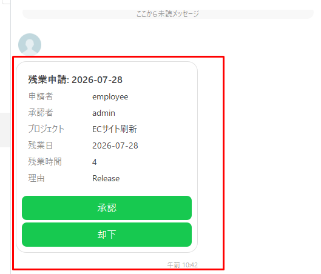
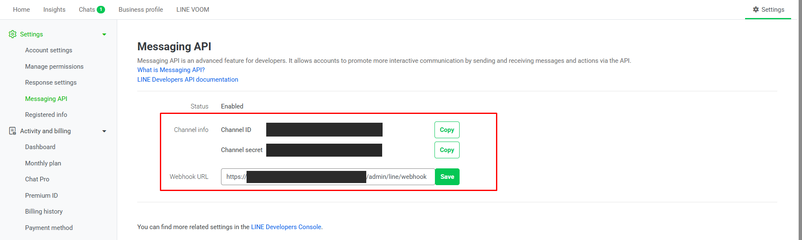
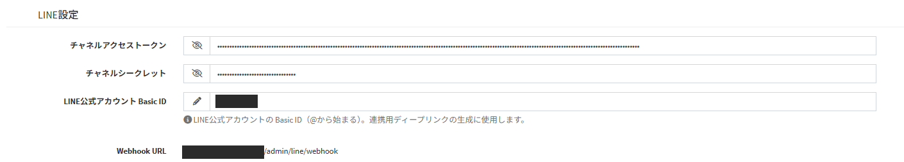
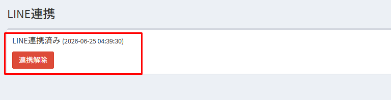
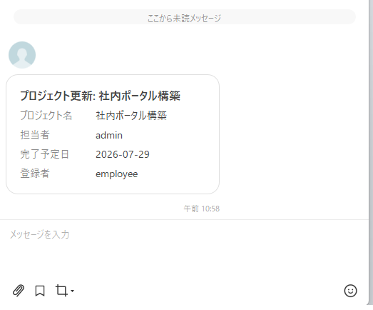
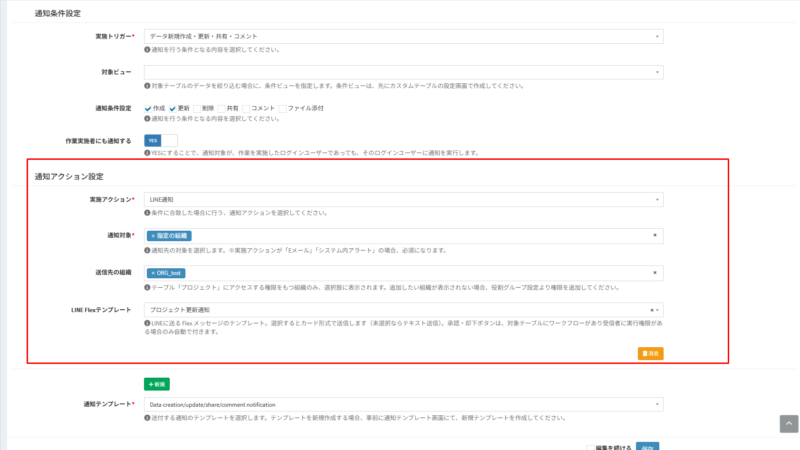
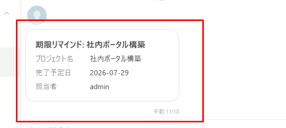
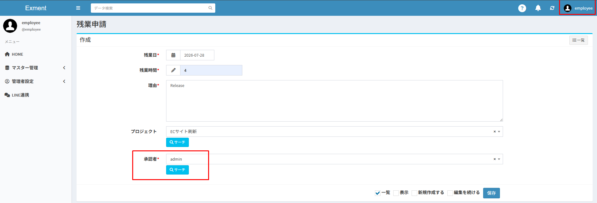
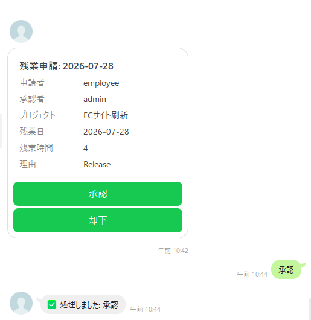

# LINE integration
Connect Exment with your company's LINE Official Account.  
Users can receive Exment notifications on LINE, and execute workflow actions from the buttons of the notification cards they receive on LINE.  
For the function that checks the safety of employees by LINE and email, see [Safety check](/safety_check).  
※ LINE integration is available from v7.0.0.

## What you can do with LINE integration
- **LINE account link** : Each user links their own LINE account to their Exment user. A user must link their account to receive notifications on LINE.
- **LINE notification** : Select "LINE" as the action of a [notification](/notify) to send messages to LINE. Messages can be sent as text or as cards (Flex Message).
- **Workflow actions from LINE** : Buttons of workflow actions such as "Approve" and "Reject" are shown on the notification card. Press a button to execute the action directly from LINE.
- **LINE send log** : Every message sent by a LINE notification or a safety check is recorded, whether it succeeded or failed.

## Setup flow
| Step | What to do | Who |
| --- | --- | --- |
| 1 | [Prepare the LINE Official Account](/line?id=preparing-the-line-official-account) | Administrator |
| 2 | [Enter the channel information in the Exment system settings](/line?id=system-settings) | Administrator |
| 3 | [Register the Webhook URL in LINE](/line?id=webhook-settings) | Administrator |
| 4 | [Set up the task schedule](/additional_task_schedule) (when you use notifications triggered by "The Passage of Time") | Server administrator |
| 5 | [Link LINE accounts](/line?id=linking-a-line-account) | Each user |
| 6 | [Create LINE Flex templates](/line?id=line-flex-templates) (when you send cards) | Administrator |
| 7 | [Set up notifications](/line?id=setting-up-line-notifications) | Administrator |

## Requirements
- A LINE Official Account with the Messaging API enabled is required. Messages from Exment are sent from this account.
- The LINE platform must be able to access the Exment Webhook URL. Publish Exment at an "https://" URL that can be accessed from the internet and has a valid SSL certificate.
- To use notifications triggered by "The Passage of Time", you need to set up the [task schedule](/additional_task_schedule).

> A LINE Official Account has a monthly limit on the number of messages it can send, depending on its pricing plan. Each notification sent from Exment counts as one message per recipient. Replies to user operations (such as "LINE account linked successfully!") are not counted.  
For details, see the pricing plans of LINE Official Account.

## Preparing the LINE Official Account

### Enabling the Messaging API
- Create a LINE Official Account in [LINE Official Account Manager](https://manager.line.biz). You can also use an existing account.
- Enable the Messaging API in "Settings" > "Messaging API". When you select (or create) a provider, a Messaging API channel is created for the LINE Official Account.

### Checking the channel information
Check the following three values, which you will enter in Exment.

| Value | Where to find it | Used for |
| --- | --- | --- |
| Channel secret | "Settings" > "Messaging API" in LINE Official Account Manager, or the "Basic settings" tab of the [LINE Developers Console](https://developers.line.biz/console/) | Verifying the signature of the data (webhooks) sent from LINE |
| Channel access token (long-lived) | Select the channel in the LINE Developers Console, and click [Issue] under "Channel access token" on the "Messaging API" tab | Sending messages |
| Basic ID | Next to the account name in LINE Official Account Manager, or "Bot basic ID" on the "Messaging API" tab of the LINE Developers Console. It starts with "@" | Creating the QR code for linking accounts |

※ Do not disclose the channel secret or the channel access token to third parties.

### Response settings
- In "Settings" > "Response settings" of LINE Official Account Manager, turn on "Webhooks".
- If you use auto-response messages, we recommend turning them off. Exment replies to the text messages users send. While auto-response messages are enabled, they are sent in addition to the replies from Exment.

## System settings
- Click "Admin Setting" > "System Setting" in the left menu, and switch to [Detail Setting] with the button at the top right.  
You can also open it from the following URL.

~~~
http(s)://(Exment URL)/admin/system?advanced=1
~~~

- In "LINE Setting", enter the following items and click [Save].

| Item | Description |
| --- | --- |
| Channel access token | Enter the channel access token (long-lived) issued in the LINE Developers Console. |
| Channel secret | Enter the channel secret. |
| LINE Official Account Basic ID | Enter the basic ID, including the leading "@". |
| Webhook URL | Shows the Webhook URL to register in LINE. It cannot be edited. |

※ After saving, the channel access token and the channel secret are masked.  
※ These values can also be set in the ".env" file. See [Setting values](/line?id=setting-values) for details. The values saved on the system settings screen take priority.

## Webhook settings
The LINE webhook notifies Exment of what users do on LINE, such as sending a link code or pressing a button on a notification card.

- Select the channel in the LINE Developers Console and open the "Messaging API" tab.
- Click [Edit] for "Webhook URL", paste the Webhook URL shown in "LINE Setting" of the system settings, and click [Update].  
The Webhook URL has the following format.

~~~
https://(Exment URL)/admin/line/webhook
~~~

- Turn on "Use webhook".
- Click [Verify] and check that "Success" is shown.

※ The Webhook URL can also be set in "Settings" > "Messaging API" of LINE Official Account Manager.  
※ Only a URL that starts with "https://" and has a valid SSL certificate can be registered as the Webhook URL.  
※ The Exment [IP filter settings](/additional_ip_filter) are not applied to the Webhook URL. If you restrict access with a firewall or the like, allow access from the LINE platform.

## Linking a LINE account
Each user who receives notifications on LINE links their own LINE account.  
**LINE notifications are not sent to users who have not linked their LINE account.** Ask your users to link their accounts before you start using LINE notifications.

### Linking
- Log in to Exment and click "LINE Link" in the left menu.  
You can also open it from the following URL.

~~~
http(s)://(Exment URL)/admin/line/link
~~~

- Click [QRコードを生成] (Generate QR code). The QR code for linking is shown.

- Scan the QR code with the LINE app on your smartphone.  
The chat with the LINE Official Account opens, with "LINK (link code)" already entered.  
※ If you have not added the LINE Official Account as a friend, add it by following the instructions on the screen.

- Send the message as it is. When the reply "LINE account linked successfully!" arrives, the link is complete.

- When you reopen the "LINE Link" screen, "LINE連携済み" (Linked) is shown.

※ By default, a link code is valid for 10 minutes. If it has expired, click [QRコードを生成] again.  
※ A LINE account can be linked to only one user. If a LINE account that is already linked sends a link code, "This LINE account is already linked to an account. To change it, please unlink it on the web first." is replied.  
※ By default, up to 5 wrong link codes can be sent. If 5 wrong codes are sent within 10 minutes (by default) of the first wrong code, linking is blocked until those 10 minutes have passed. While linking is blocked, even a correct link code gets the reply "The link code is invalid or has expired. Please check and try again.".

### Unlinking
On the "LINE Link" screen, click [連携解除] (Unlink).  
If you change your smartphone or LINE account, unlink and then link again.

## LINE Flex templates
A LINE Flex template defines the content of the card (Flex Message) sent by a LINE notification.  
If no template is selected in the notification settings, the message is sent as text.

### Creating a template
- Open the data list of the "LINE Flexテンプレート" (LINE Flex template) table from the following URL.  
To add it to the left menu, add it in [Menu](/menu) with the menu type "Table".

~~~
http(s)://(Exment URL)/admin/data/line_flex_template
~~~

- Click [New], enter the following items, and save.

| Item | Description |
| --- | --- |
| Flexキー (Flex key) | A key that identifies the template (example: ot_request). Do not use "safety_check", which is used by the [safety check](/safety_check). |
| テンプレート名 (Template name) | The name of the template. It is shown in the options of "LINE Flex template" in the notification settings. |
| タイトル (Title) | The heading of the card. Variables can be used. If it is empty, the label of the data is shown. |
| 本文項目 (Body items) | The items shown in the body of the card. Enter one item per line, in the format "Label = value". |
| 説明 (Description) | A description of the template. It is not shown on LINE. |

※ When you create a new template, "タイトル" and "本文項目" are filled with initial values for workflow notifications (status, action name, and so on). Change them when you use the template for other notifications, such as notifications on data creation or update.  
※ The "安否確認" (Safety Check) template (Flex key "safety_check") is created automatically when the [safety check](/safety_check) is installed. Do not select it in "LINE Flex template" of the notification settings, and do not edit or delete it.

### Writing the body items
Enter the label on the left of "=" and the value on the right. Variables can be used in the value.  
The following is an example of a card for an overtime request.

~~~
Applicant = ${created_user}
Approver = ${value:approver}
Project = ${value:project}
Overtime date = ${value:ot_date}
Overtime hours = ${value:ot_hours}
Reason = ${value:reason}
~~~

- Lines whose value is empty are not shown on the card.
- If "本文項目" is empty, a notification triggered by a workflow shows the standard items, such as the status and the action name.

### Variables
[Parameter variables](/params) can be used. The main variables are as follows.

| Variable | Description |
| --- | --- |
| ${value} | The label of the data |
| ${value:(column name)} | The value of a column of the data (example: ${value:approver}) |
| ${created_user} | The name of the user who created the data |
| ${table_view_name} | The display name of the table |
| ${workflow:status_name} | The status name after the action is executed ※1 |
| ${workflow:status_from_name} | The status name before the action is executed ※1 |
| ${workflow:action_name} | The name of the executed action ※1 |
| ${workflow:action_user} | The user who executed the action ※1 |
| ${workflow:comment} | The comment entered when the action was executed ※1 |
| ${notify_target_column_key} | The name of the "Notify Target Date Column" ※2 |
| ${notify_target_column_value} | The value of the "Notify Target Date Column" ※2 |

※1 Available only in notifications triggered by "Workflow".  
※2 Available only in notifications triggered by "The Passage of Time".

### Buttons on the card
Buttons are added to the card automatically. You do not set them in the template.

| Button | When it is shown |
| --- | --- |
| Workflow actions (such as "Approve" and "Reject") | When all of the following conditions are met. - The data has a workflow, and the recipient has an action they can execute - The recipient has not executed the action yet - The "Comment" of the action is not "Required" - No next work user needs to be selected after the action (the next status has no action whose executable user is "Selected by the user who executed the previous action") |
| View details | When the Exment URL starts with "https://". Opens the data details page. |

For details, see [Executing workflow actions from LINE](/line?id=executing-workflow-actions-from-line).

## Setting up LINE notifications
In "Notify Action Setting" of the [notification](/notify) settings screen, set the following items.  
For how to open the notification settings screen, see [Notification](/notify?id=list-screen-display).

| Item | Description |
| --- | --- |
| Notify Action | Select "LINE". |
| Notify Target | Select the users to notify (required). You can select a "User" column of the table (shown with "Custom Column" and the column name), "Specified user", "Specified organization", "Create User", and so on. |
| LINE Flex template | To send a card, select a [LINE Flex template](/line?id=line-flex-templates). If it is empty, the message is sent as text. |

- When a message is sent as text, it is created from the subject and body of the "Notify Mail Template".
- When "Specified organization" is selected, the message is sent to all users who belong to the organization.
- Among the notify targets, users who have not linked their LINE account are skipped. This is not an error, and nothing is recorded in the [LINE send log](/line?id=line-send-log).
- LINE notifications are sent right after the processing that triggers them, such as saving data. They do not use a queue, and messages that failed are not sent again automatically. Check the result in the [LINE send log](/line?id=line-send-log).

### Example 1: Notify when data is created or updated
- Notify Trigger: "Data Create/Update"
- Notify condition: check "Created" and "Updated"
- Notify Action: "LINE"
- Notify Target: the "Person in charge" user column (shown as "Custom Column" with the column name)
- LINE Flex template: the template you created

When the data is saved, a card like the following arrives on LINE.

※ By default, the user who saved the data is not notified. To notify that user as well, set "Notify the worker" to YES.

### Example 2: Notify the members of an organization
Select "Specified organization" in "Notify Target", and select the organization in "E-mail destination organization".  
The message is sent to the users of the organization who have linked their LINE account.

※ Only organizations that have access permission to the table are shown as options.

### Example 3: Remind the day before a deadline
- Notify Trigger: "The Passage of Time"
- Notify Target Date Column: the date column to use as the base (example: planned completion date)
- Notification date: "1"
- Before and After Notification: "Before"
- Notification time: the hour at which the notification is sent (0 to 23)
- Notify Action: "LINE"

At the specified time, a card like the following arrives.

※ To run notifications triggered by "The Passage of Time", you need to set up the [task schedule](/additional_task_schedule). The notification is executed at minute 00 of the specified hour.  
※ To run the notification immediately to check your settings, execute the following command. The notification is executed regardless of the notification time.

~~~
php artisan exment:notify --name=(notify name (alphanumeric))
~~~

※ To prevent the same reminder from being sent twice, for example when the command is executed repeatedly, set "LINE_DEDUPE_MINUTES". See [Setting values](/line?id=setting-values) for details.

## Executing workflow actions from LINE
You can execute a workflow action from the buttons of a notification card received on LINE.  
This section uses the example of an approver approving an overtime request on LINE. For how to set up workflows, see [Workflow settings](/workflow_setting).

### Workflow settings
In "Action settings" of the workflow settings, set the actions executed from LINE as follows.

- Executable user: the users who execute the action (example: the "Approver" column of the table, set with "Set in advance")
- Comment: "Optional" or "Not used"

※ No button is shown on the LINE card for an action whose "Comment" is "Required". A comment must be entered, so execute the action on the Exment screen.  
※ No button is shown either when the next status has an action whose executable user is "Selected by the user who executed the previous action". The next work users must be selected, so execute the action on the Exment screen.

### Notification settings
Set up a notification that sends a LINE notification to the approver. Be sure to select a "LINE Flex template". No button is shown when the message is sent as text.

- **To notify when the data is created** : In the notification settings of the table, set "Data Create/Update" as the trigger, "Created" as the notify condition, the "Approver" column as the notify target, and "LINE" as the notify action.
- **To notify the next work user when an action is executed** : In the notification settings of the workflow, set "LINE" as the notify action and "Next Work User" as the notify target.

### Approving from LINE
- The applicant selects the approver and creates the overtime request data.

- A card with "Approve" and "Reject" buttons arrives on the approver's LINE.  
Press a button to execute the action. A reply such as "Done: 承認" arrives.

- The status of the data is updated in Exment.

※ The action is executed as the user who linked the LINE account. When a button is pressed, Exment checks again whether the user can execute the action.  
※ If the action cannot be executed, for example because another user has already processed the data or the user has already executed the same action, "This action is unavailable or has already been processed." is replied.  
※ If the next work users must be selected, "This action requires selecting the next work users. Please process it on the web." is replied. Execute the action on the Exment screen.  
※ If the "Comment" of the action was changed to "Required" after the card was sent, "This action requires a comment. Please process it on the web." is replied.  
※ Users who are not set up as login users cannot execute actions from LINE. "This account has not activated login." is replied.

## LINE send log
Every message sent by a LINE notification or a [safety check](/safety_check) is recorded in the "LINE送信履歴" (LINE send log) table, whether it succeeded or failed.  
Replies to user operations (such as "LINE account linked successfully!" and "Done: 承認") are not recorded.  
Open the following URL to show the list.

~~~
http(s)://(Exment URL)/admin/data/line_send_log
~~~

| Column | Description |
| --- | --- |
| LINEユーザーID (LINE user ID) | The LINE user ID of the recipient. |
| メッセージ種別 (Message type) | "text" or "flex" (card). |
| 送信Flexテンプレート (Flex template) | The LINE Flex template used to send the card. |
| 件名 (Subject) | The subject of the message. For a card, its title. |
| 本文 (Body) | The data of the message sent to LINE (JSON format). For a card, the whole Flex Message is recorded. |
| 送信対象ユーザー (Recipient user) | The Exment user who received the message. |
| 送信日時 (Sent at) | The date and time the message was sent. |
| 送信結果 (Result) | "success" or "failed". |
| エラー内容 (Error) | The reason when sending failed (example: "HTTP 400 ..."). |

※ Messages are not sent to users who have not linked their LINE account, so nothing is recorded for them. When a notification does not arrive, check the LINE account link first.  
※ The columns shown on the list can be changed with [custom views](/view).

## Setting values
The following settings can be changed in the ".env" file. See the [list of set values](/config?id=line-integration) for details.

| Setting key | Default value | Description |
| --- | --- | --- |
| LINE_CHANNEL_ACCESS_TOKEN | (none) | The channel access token. The value saved on the system settings screen takes priority. |
| LINE_CHANNEL_SECRET | (none) | The channel secret. The value saved on the system settings screen takes priority. |
| LINE_OA_BASIC_ID | (none) | The basic ID. The value saved on the system settings screen takes priority. |
| LINE_DEDUPE_MINUTES | 0 | For LINE notifications triggered by "The Passage of Time", after a LINE message about the same record is sent to a user, no message is sent to the user again for this number of minutes. Messages sent by other notification settings and messages that failed also count. 0 disables this function. |
| LINE_LINK_CODE_TTL_MINUTES | 10 | How long a link code is valid (minutes). |
| LINE_LINK_MAX_ATTEMPTS | 5 | How many wrong link codes can be sent. When this number is exceeded, linking is blocked for a while. |
| LINE_LINK_ATTEMPT_DECAY_MINUTES | 10 | The period (minutes) in which wrong link codes are counted. If "LINE_LINK_MAX_ATTEMPTS" wrong codes are sent within this period after the first wrong code, linking is blocked until the period has passed. |
| LINE_HTTP_TIMEOUT | 10 | The timeout (seconds) when communicating with the LINE platform. |
| LINE_API_BASE | https://api.line.me | The URL of the LINE Messaging API. Normally, do not change it. |

※ Notifications skipped because of "LINE_DEDUPE_MINUTES" are not recorded in the LINE send log. "LINE reminder skipped by dedupe" is written to "storage/logs/laravel.log".

## Troubleshooting
| Symptom | Main causes | What to do |
| --- | --- | --- |
| Webhook [Verify] fails | - The Webhook URL does not start with "https://", or the SSL certificate is invalid - Exment cannot be accessed from the internet - The channel secret is wrong | Check the Webhook URL, how the server is published, and "Channel secret" in the system settings. |
| No reply arrives after sending the link code | - "Use webhook" is off - The Webhook URL is wrong | Check the [webhook settings](/line?id=webhook-settings). |
| Clicking [QRコードを生成] shows "The LINE Official Account basic ID is not configured. Set it under Admin settings > System settings." | The basic ID is not set | Enter "LINE Official Account Basic ID" in the system settings. |
| "The link code is invalid or has expired. Please check and try again." is replied | - The link code has expired or is wrong - Linking is temporarily blocked because wrong link codes were sent repeatedly | Click [QRコードを生成] and scan the new QR code. If linking is blocked, wait a while (10 minutes by default) and send the code again. |
| "This LINE account is already linked to an account. To change it, please unlink it on the web first." is replied | The LINE account is already linked to an Exment user | Log in to Exment as the linked user, click [連携解除] (Unlink) on the "LINE Link" screen, and then link again. |
| "To link your account, send: LINK &lt;code&gt;." is replied | A user who has not linked their LINE account sent a message other than a link code | Scan the QR code and link the account by following [Linking a LINE account](/line?id=linking-a-line-account). |
| "Invalid command." is replied | A user who has linked their LINE account sent a message other than a link code | This is not an error. Exment does not respond to messages other than link codes. For additional responses to a safety check, see [Safety check](/safety_check?id=answering-on-line). |
| A LINE notification does not arrive, and nothing is recorded in the LINE send log | The notified user has not linked their LINE account | Ask the user to [link their LINE account](/line?id=linking-a-line-account). |
| The result in the LINE send log is "failed" | - The channel access token is wrong or no longer valid - The user has blocked the LINE Official Account - The monthly message limit has been reached | Check the "エラー内容" (Error) column. If you reissued the channel access token, enter it again in the system settings. |
| The "Approve" and "Reject" buttons are not shown on the card | - The "Comment" of the action is "Required" - The next work users must be selected after the action (the next status has an action whose executable user is "Selected by the user who executed the previous action") - The recipient cannot execute the action, or has already executed it - The data has already been processed - No LINE Flex template is selected | See [Executing workflow actions from LINE](/line?id=executing-workflow-actions-from-line). |
| A LINE notification triggered by "The Passage of Time" is not sent | - The task schedule is not running - The notification time does not match the server time - It was skipped because of "LINE_DEDUPE_MINUTES" | Check the [task schedule](/additional_task_schedule). You can also run the notification with "php artisan exment:notify" to check. |
| The "View details" button is not shown | The Exment URL does not start with "https://" | Run Exment at an "https://" URL. |
