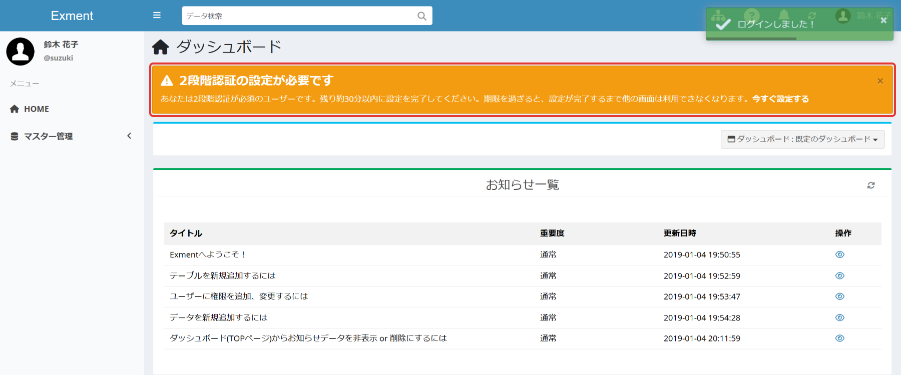
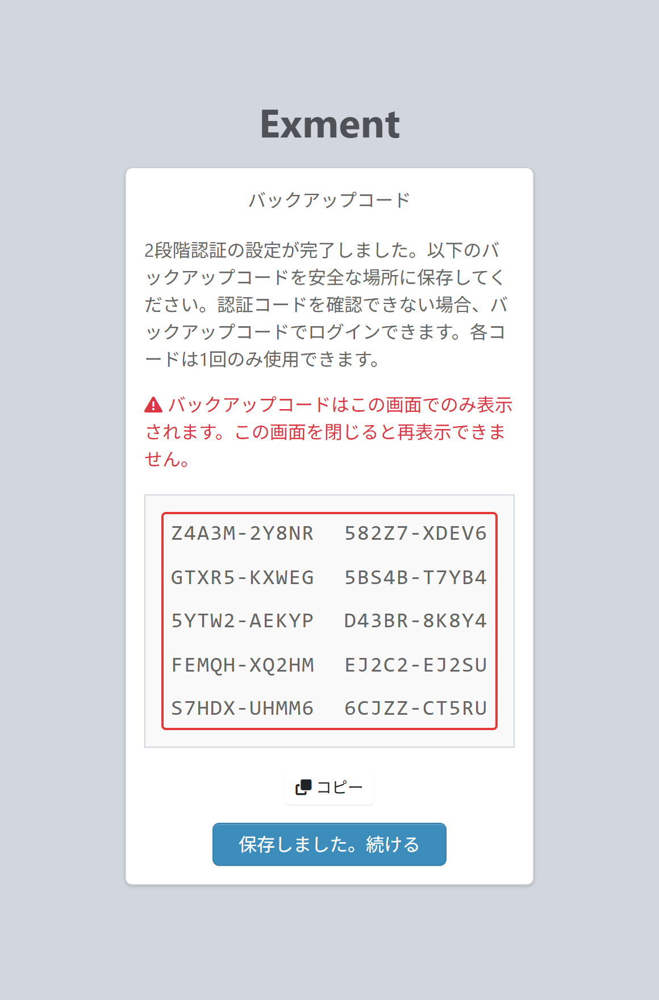
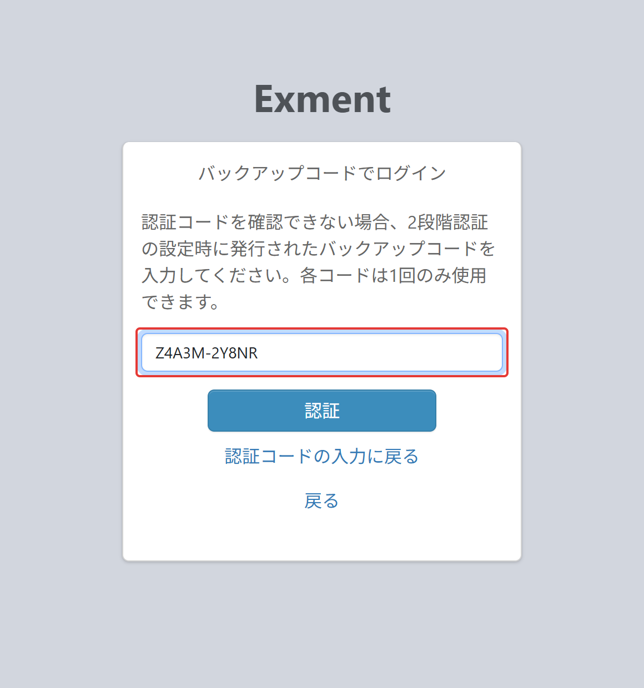
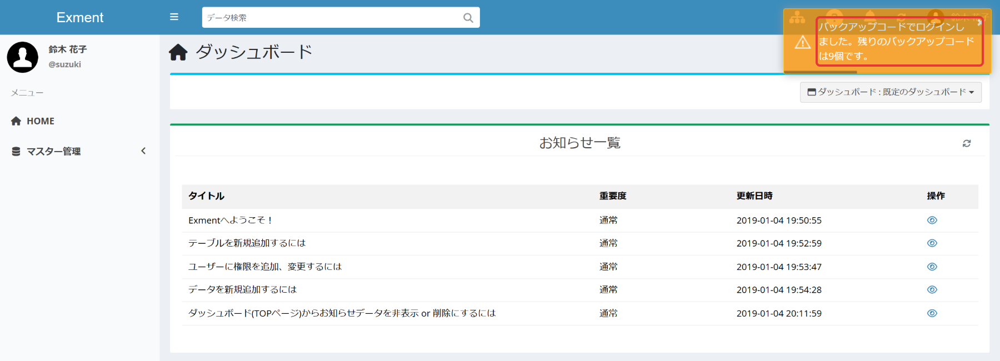

# Login (two-step verification)
Here's how to log in to Exment using two-factor authentication.  
The administrator sets the initial settings for 2-step authentication.  
[Click here](/login_2factor_setting) Please refer to.  

## Two-factor authentication method
Currently, the following two-step authentication methods are supported.  
Ask your administrator which method you are using.  

- E-mail: After logging in with your ID / password, an e-mail with the authentication code will be sent to the registered e-mail address.  
Enter the verification code in the form to complete the login.  

- Google Authenticator: After login with ID / Password, two-factor authentication is performed using Google Authenticator.  

### Two-step verification procedure (email)

- On the login screen, enter your ID / password and click the login button.
  

- The two-step verification screen is displayed, and the verification code input field is displayed.
  

- In addition, the authentication code will be sent to the email address of the user who has logged in. Check it.
  

### Two-step authentication procedure (Google authentication system)

- On the login screen, enter your ID / password and click the login button.
  

- The two-step verification screen is displayed, and the verification code input field is displayed.
  

- When you log in for the first time, you need to set up Google Authenticator first.  
By clicking the "Send" button, an email for registering with Google Authenticator will be sent to the registered email address.  
  

- The URL for Google Authenticator registration will be sent to the email address of the user who has logged in. Click it.
  

- Clicking on the sent URL will take you to the screen to install the two-factor authentication system. Perform steps 1-3.  
If you enter the authentication code correctly and send it, login with 2-step authentication will be completed.

  

> If you enter the authentication code incorrectly more than a certain number of times in 2-step authentication, login from the authenticated communication will be blocked. Please be careful.  
> If you enter a wrong authentication code or recovery code 5 times in a row, you are logged out and cannot pass two-step authentication for 15 minutes (the administrator can change the count and the time).  
> E-mail: only the authentication code sent last is valid. Google authenticator: a code used once cannot be used again.

### Grace period for the setup
When the administrator sets "Specify Required Users by Role Group" of the login setting to "YES", a required user who logs in without registering the Google Authenticator sees a warning with the remaining time at the top of every page, asking for the setup.  
Click "Set up now" in the warning, or open the user name at the top right > "User Setting", and set up two-step authentication.  
After the remaining time (30 minutes by default, the administrator can change it), no page other than the setup can be opened until the setup is completed.  
※ The remaining time is not reset by logging out and logging in again.
  

## Recovery codes
When you complete the login with two-step authentication for the first time (the registration of Google Authenticator, or the first authentication code of e-mail authentication), 10 recovery codes are issued and shown only once.  
When you cannot see the authentication code (the smartphone is lost, the e-mail cannot be received, and so on), you can log in by entering a recovery code instead of the authentication code.

- Save the shown recovery codes in a safe place, for example with the "Copy" button. The same codes cannot be shown again after you leave the page.  
After saving, click "I have saved the codes. Continue".
  

- Each code can be used only once.

### Log in with a recovery code

- On the login screen, enter your ID / password and click the login button.

- On the two-step authentication page, click "Log in with a recovery code".  
※ The link is not shown when no recovery code has been issued, or all the codes have been used.

- Enter a recovery code and click the "Authentication" button. The case and the hyphen do not matter.  
The login is completed, and the number of the remaining recovery codes is shown.
  
  

> If you enter a recovery code incorrectly more than a certain number of times, login from the authenticated communication will be blocked. Please be careful.  
> Wrong authentication codes and recovery codes are counted together. After 5 wrong codes in a row, you are logged out and cannot pass two-step authentication for 15 minutes.

### Generate new recovery codes
Generate new codes when few recovery codes remain, or when you lost the codes.

- Open the user name at the top right > "User Setting".  
The "Recovery Codes" item shows the remaining count.

- Click "Generate new recovery codes", and click "Generate new recovery codes" again on the confirmation page.  
10 new recovery codes are shown. All of the previous codes are invalidated.
