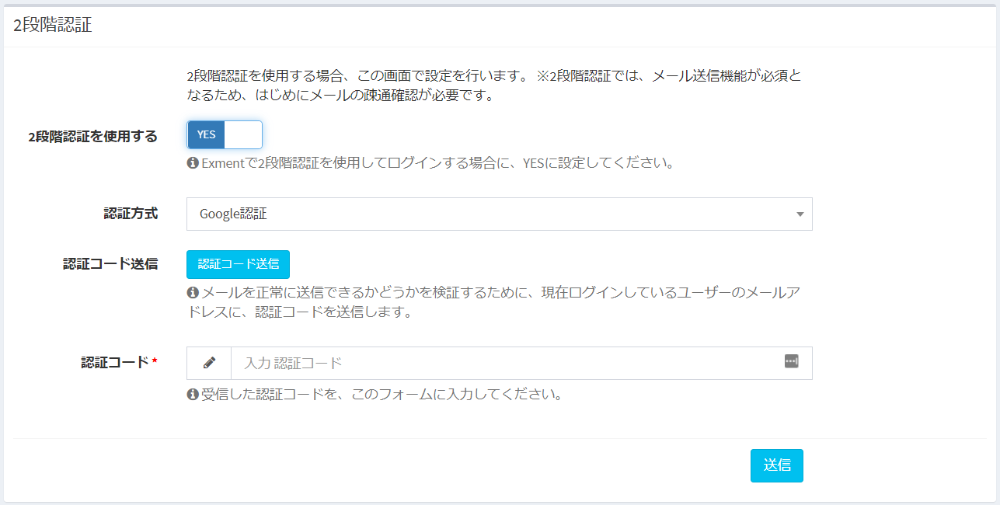
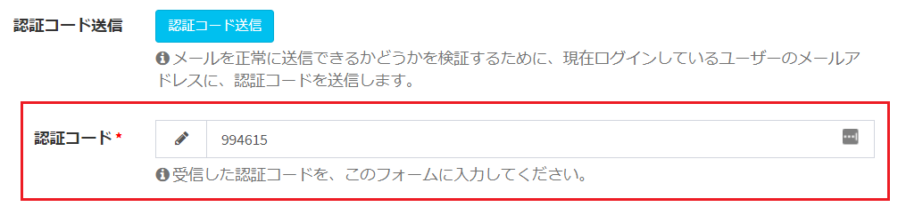
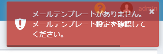

# Two-factor authentication system settings
Exment supports two-factor authentication (logging in by entering one more code after the password).  
This page gives the steps of the settings with which a system administrator makes two-factor authentication usable.

The steps are as follows.

1. (Only when you use Google Authenticator) Install the library
2. Add a setting to the ".env" file
3. On the login setting screen, make the mail settings and save
4. Set "Use Two-Step Authentication" to YES and choose the method
5. Receive the authentication code, enter it and save

## Two-factor authentication method
The two-factor authentication methods that can be used now are the following two.  

##### Email
After you log in with the ID and password, an email with an authentication code arrives at the registered email address.  
Enter that authentication code on the screen, and the login is finished.

##### Google Authenticator
After you log in with the ID and password, two-factor authentication is done with Google Authenticator.

## Assumptions
- Two-factor authentication of Exment is set for the whole system, not for each user.  

- To use two-factor authentication, the system must be able to send emails. This is the same when "Google 2-Step Verification" is chosen as the method.

- When the method is "Google 2-Step Verification", an email for registering Google Authenticator is sent to the registered email address when a user logs in for the first time.  
  
By pressing the link in the email, users can set up two-factor authentication themselves.  
Once it is set up, from the second time on they only enter the authentication code shown in Google Authenticator.  

## Setting method
The steps to set up two-factor authentication.

- When the method you use is "Google 2-Step Verification", run the following command in the root folder of the project.

~~~
composer require pragmarx/google2fa
~~~

> Since v7.0.0, simplesoftwareio/simple-qrcode is installed automatically as a dependency of Exment, so you do not need to add it.

- Open the ".env" file in the root folder of the project and add the following.  
Note: see [Setting value list](/config) for how to edit the setting file.

~~~
EXMENT_LOGIN_USE_2FACTOR=true
~~~

- Open the login setting screen with an administrator account.

- First, make the mail settings. Enter the setting values for sending email. See [System mail settings](/system_setting?id=system-mail-settings) for details.  
After entering them, press [Submit] once to save.  

- After that, show "Two-Step Authentication" in the lower part of the login setting screen.  
  

- Set "Use Two-Step Authentication" to "YES".  
When it is YES, the remaining setting items appear.  
  

- In "Default Authentication", choose the method used for two-factor authentication ("E-Mail Authentication" or "Google 2-Step Verification").  

- Press the [Authentication code transmission] button, and an authentication code is sent to the account you are logged in with now.  
Enter the authentication code written in the email in the "Authentication Code" item.
  
  

Note: when you press the [Authentication code transmission] button, an error like the image below can appear.  
This error appears after an update from a version lower than v1.4.0.  
In that case, import the notification template by following [these steps](/update/v1_4).  
  

Note: an email sending error can also appear.  
It appears when the email sending settings are not correct.
In that case, see [System mail settings](/system_setting?id=system-mail-settings) and correct the settings.
  

- Finally, press [Submit] to save the settings.

## Disable setting
If, for some reason, you want to turn two-factor authentication off by force, make the following setting.

- Open the ".env" file in the folder of the project and add the following.  
Note: see [Setting value list](/config) for how to edit the setting file.

~~~
EXMENT_LOGIN_USE_2FACTOR=false
~~~

With this setting, two-factor authentication is off even when "Use Two-Step Authentication" is set on the screen.
  
  
[←Back to Login settings](/login_setting)
