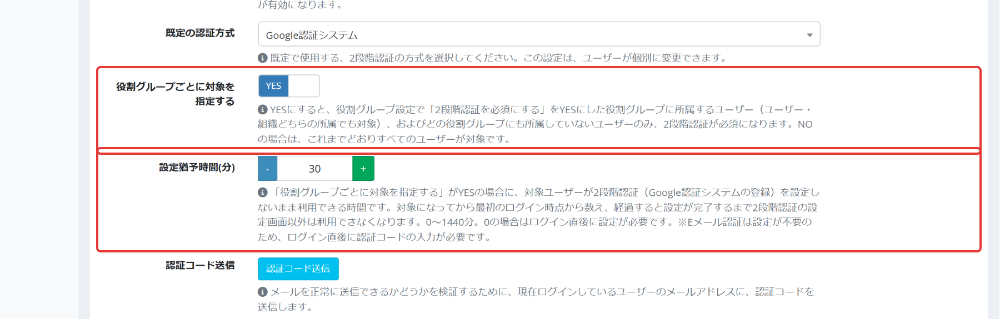
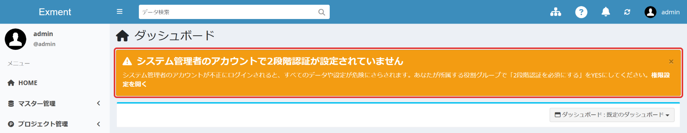
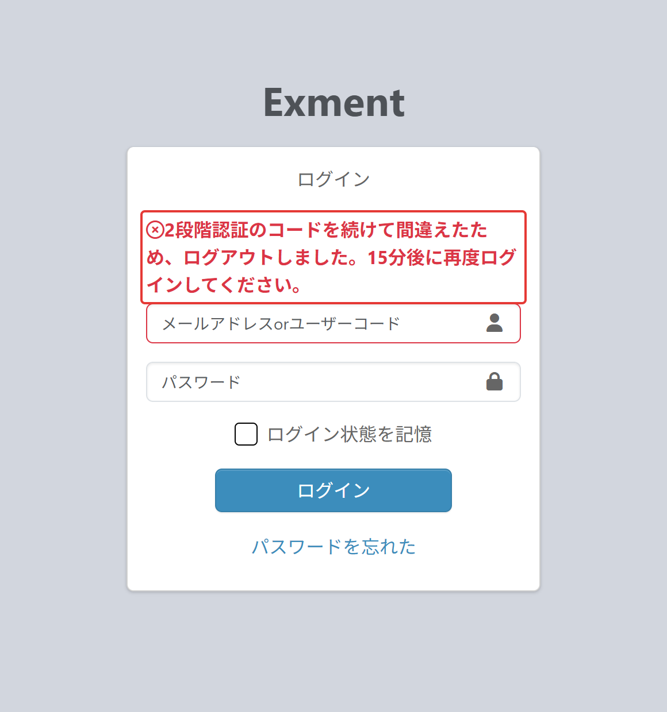

# Two-factor authentication system settings
Exment supports two-step verification.  
This section describes how to configure Exment on the system administration side.  

## Two-factor authentication method
Currently, the following two-step authentication methods are supported.  

- E-mail: After logging in with your ID / password, an e-mail with the authentication code will be sent to the registered e-mail address.  
Enter the verification code in the form to complete the login.  

- Google Authenticator: After login with ID / Password, two-factor authentication is performed using Google Authenticator.  

## Assumptions
- Two-step authentication in Exment is not set by individual login users, but is set by the entire system.  
For example, if the two-step authentication method is selected as "Google authentication system", all users will perform two-step authentication using the Google authentication system.  
By default, every user is required two-step authentication. Set "Specify Required Users by Role Group" to "YES" to require it by role group. See [Users required two-step authentication](#users-required-two-step-authentication) for details.  

- When performing two-factor authentication with Exment, it is essential that the system be able to send e-mail.  
This is the same even when the type of two-step verification is set to "Google Authenticator".  

- If you set two-step authentication and set the authentication method to "Google Authenticator", when the user logs in for the first time, the e-mail for registering Google Authenticator to the registered e-mail address Send.    
  
By clicking the link of the sent e-mail address, each user can set up 2-step verification.  
By performing the setting once, the initial setting will not be performed for the second and subsequent times, and it will be a method that only inputs the authentication code from the Google authentication system.  

- When a user completes the login with two-step authentication for the first time, 10 [recovery codes](#recovery-codes) are issued to the user.

## Setting method
This is how to set up two-factor authentication.

- Execute the following command from the root folder of the project.  

~~~
composer remove pragmarx/google2fa
composer remove  simplesoftwareio/simple-qrcode=^2.0.0
~~~

- Open the ".env" file from the root folder of the project, and add as follows.  
※ how to edit the configuration file, for more information click [here](/config) Please refer to.

~~~
EXMENT_LOGIN_USE_2FACTOR=true
~~~

- It will transition to the system setting screen with the administrator account.  

- First, configure the email settings. Enter the settings for sending email. See [System Mail Settings](/system_setting#System-mail-settings) for details.  
After completing the settings, click “Submit” once to save.  

- After that, "2 step authentication" is displayed at the bottom of the system setting screen.  
  

- Set the "Use two-factor authentication" item to "YES".  
By setting to YES, the remaining setting items will be displayed.  
  

- In the "Default authentication method" item, select "Email" or "Google Authenticator" for the method used for two-step authentication.  

- To require two-step authentication by role group, set the "Specify Required Users by Role Group" item to "YES". See [Users required two-step authentication](#users-required-two-step-authentication) for details.  

- Click the "Send Authentication Code" button to send an authentication code to use the two-step verification to the currently logged in account.  
Enter the authentication code in the sent e-mail in the "Authentication code" field.  
  
  

※When clicking the "Send Authentication Code" button, an error like the image below may occur.  
This error occurs when updating from a version lower than v1.4.0.  
In that case, follow [these steps](/update/v1_4) to import the email template.  
  

※In addition, an error like the image below may occur.  
Occurs when the e-mail transmission settings are not performed properly. In that case, make the correct settings according to the [system mail settings](/system_setting#System-mail-settings).  
  

- Then click "Send" to save the settings.

## Users required two-step authentication
The "Specify Required Users by Role Group" item sets who is required two-step authentication.
  

##### NO (default)
Every login user performs two-step authentication at every login. This is the same behavior as before.  

##### YES
Only the following users perform two-step authentication at every login. The other users log in with the ID / password only.  

- The users of the role groups whose "Require two-step authentication" is set to "YES" in the role group setting. Both the users who belong to the role group as a user and the users who belong to it through their organization are required.
- The users who belong to no role group.

The "Require two-step authentication" item of the role group is shown on the permission setting screen of the role group after "Use two-factor authentication" is saved as "YES". See [Role group / permission setting](/role_group#create-new-role-group) for details.  

##### Grace Period for Setup (minutes)
Shown when "Specify Required Users by Role Group" is "YES".  
The minutes a required user can use Exment without registering the Google Authenticator (default: 30).  
It is counted from the first login after the user is required. During the period, a warning that asks for the setup is shown at the top of every page.  
After the period, no page other than the two-step authentication setup can be opened until the setup is completed (every page is redirected to the setup).  
If 0 is set, the setup is required right after login.  
※ E-mail authentication needs no setup, so the authentication code is asked right after login regardless of the grace period.  
※ The grace period is not reset by logging out and logging in again.

## Warning to system administrators
When a system administrator logs in without two-step authentication, the warning "Two-step authentication is not set up for the system administrator account" is shown at the top of the first page after login.  
If a system administrator account is used by someone else, all the data and settings are at risk, so the warning asks to set up two-step authentication.  
  

- It is shown in the following cases.
    - "Use two-factor authentication" is "NO". The link of the warning opens the [login setting](/login_setting) page.
    - "Specify Required Users by Role Group" is "YES", and "Require two-step authentication" of the role group of the system administrator is "NO". The link of the warning opens the [role groups](/role_group) page.
- The warning is shown once at each login. It disappears when another page is opened.
- It is not shown in the following cases.
    - Logged in with two-step authentication
    - During the grace period for setup (the warning that asks for the setup is shown instead)
    - Logged in by SSO (OAuth / SAML)
    - Two-step authentication is not enabled in the ".env" file (EXMENT_LOGIN_USE_2FACTOR is not set)

## Recovery codes
Recovery codes are entered instead of the authentication code to log in when the user cannot see the authentication code (the smartphone is lost, the e-mail cannot be received, and so on).  

- When the user completes the login with two-step authentication for the first time (the registration of Google Authenticator, or the first authentication code of e-mail authentication), 10 recovery codes are issued and shown only once.  
The user has to save the shown codes in a safe place.

- Each code can be used only once. A used code cannot be used again.

- Clicking "Log in with a recovery code" on the two-step authentication page opens the recovery code input page.

- On the user setting page (the user name at the top right > "User Setting"), the "Recovery Codes" item shows the remaining count, and new codes can be generated.  
Generating new codes invalidates all of the previous codes.

- Only the hashed values of the recovery codes are stored in the database. Nobody, including the administrator, can see the codes after they are issued.  
If a user used up or lost the codes, generate new codes after logging in with the authentication code.

- Only a user who has completed the setup of two-step authentication can get and use recovery codes. A user who has not registered the Google Authenticator (including a user in the grace period) can neither generate recovery codes nor log in with one.

- The hashed values are computed with `APP_KEY` of ".env". Changing `APP_KEY` invalidates all of the issued recovery codes (as it does the registration of the Google Authenticator). In that case, each user generates new codes after logging in with the authentication code.

## Limit of wrong codes
To prevent guessing the code (brute-force attacks), the input of the codes of two-step authentication is limited.

- When a user enters a wrong authentication code (e-mail, Google authenticator) or recovery code 5 times in 15 minutes (default), the user is logged out, and cannot pass two-step authentication for 15 minutes.  
The login page shows "You have been logged out because of repeated wrong codes of two-step authentication. Please log in again in N minutes."
  

- The limit is per user. Other users of the same network are not affected. A successful two-step authentication resets the count.
- Logging in with the password again while limited, the user is logged out when the page of two-step authentication opens.
- E-mail: the authentication code already sent is invalidated when the user is limited.
- E-mail: only the authentication code sent last is valid. When the user logs in again and a new code is sent, the old code cannot be used.
- Google authenticator: the codes of 30 seconds before and after are accepted, for a difference of the clock of the device. A code used once (and older codes) cannot be used again.
- Wrong codes of two-step authentication are not counted for the [IP block](/login_setting#protection-against-brute-force-attacks).

Whether to limit, the count and the time can be changed in "Protection against brute-force attacks" of the [login setting](/login_setting#limit-wrong-two-step-authentication-codes).

The range of the codes accepted for Google authenticator can be changed in the ".env" file. Usually no change is needed.
*For details of editing the setting file, see [here](/config).

~~~
# Codes accepted before and after the current one for Google authenticator (1 = 30 seconds)
EXMENT_LOGIN_2FACTOR_GOOGLE_WINDOW=1
~~~

## Disable setting
If you want to forcibly disable 2-step verification for any reason, please do the following settings.

- Open the ".env" file from the project folder and add as follows.  
※ how to edit the configuration file, for more information [click here](/config) Please refer to.  

~~~
EXMENT_LOGIN_USE_2FACTOR=false
~~~

By performing this setting, even if you set "Use two-factor authentication" on the screen, two-factor authentication will be disabled.
