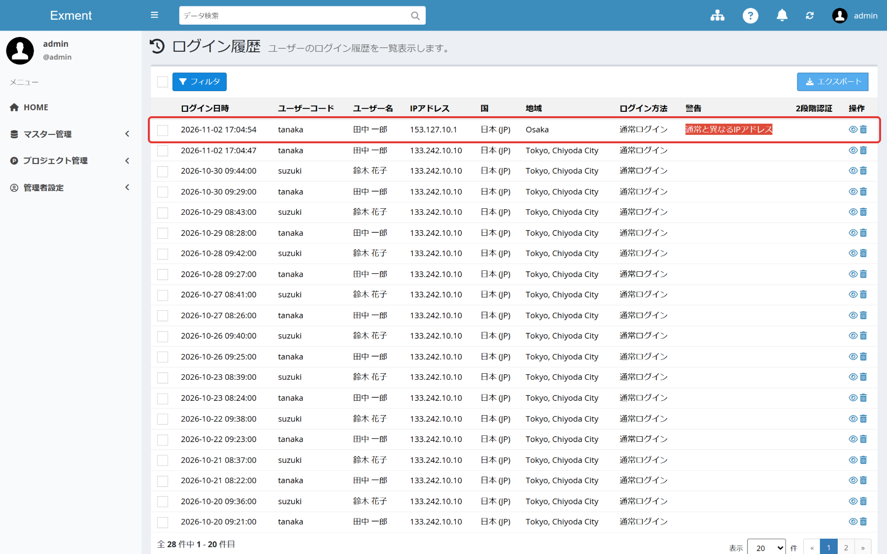
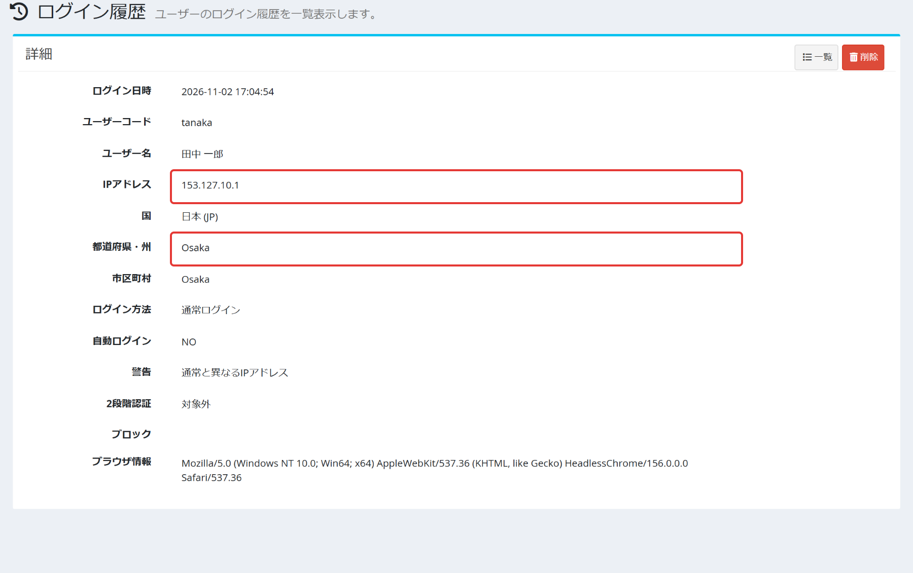
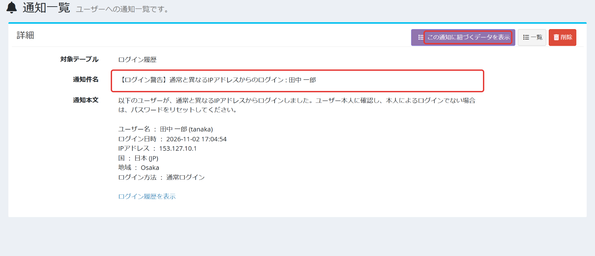
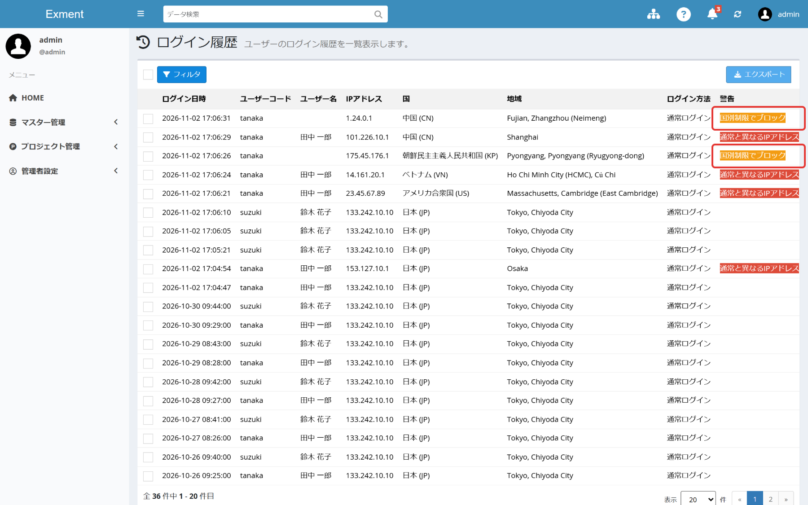
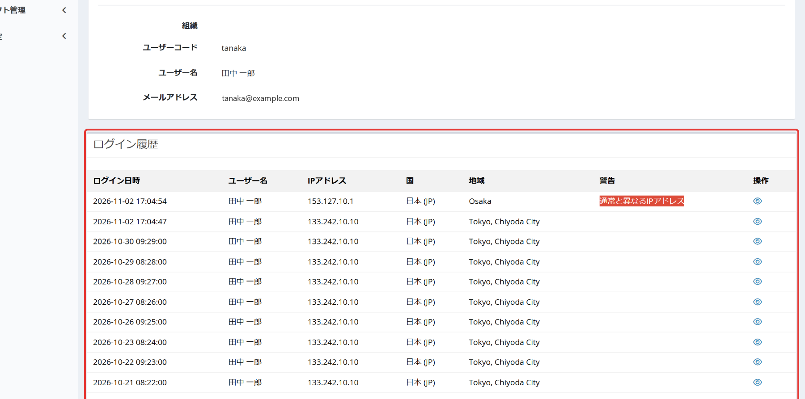
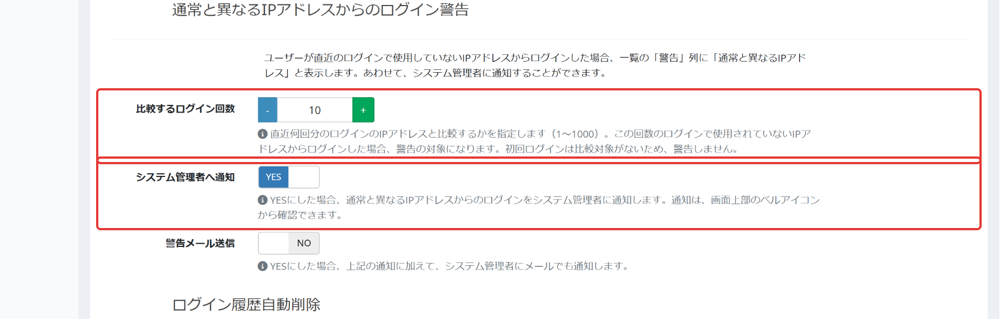

# Login history
The history of users logging in to Exment is listed on the Web page.  
You can check when, who and from where a user logged in. A warning is displayed for a login from an IP address different from usual.

  


## What is recorded
One history is recorded every time a user logs in successfully.  
In addition to the default login, login by LDAP / OAuth / SAML and auto login by "Remember me" are also recorded.  
Logins blocked by the [login restriction by country](/login_setting#login-restriction-by-country) are also recorded. See [Blocked logins](#blocked-logins) for details.  
* API authentication is not recorded. API execution can be checked in the [operation log](/logs).


## Confirmation Method
- Enter the following URL.  
http(s)://(Exment URL)/admin/login_history  

- Alternatively, add "Login history" to the menu.  
Open the "Administrator Settings" > "Menu" page and select the menu type "System Menu" to display the target "Login history". Select it and save it.  
* "Login history" is not displayed in the menu by default.

- The page can be displayed only by users who have the system administrator permission, same as the operation log. The "Manage login user" permission of a role group alone does not open it.

- If you want to display the details of the data, click the row, or the "Show" icon of the row.  

- From "Filter" at the top of the list, you can filter by user code, user name, IP address, country, warning, blocked and login date.

- The login histories of each user can also be checked on the user detail page. See [Check on the user detail page](#check-on-the-user-detail-page) for details.

- You can export in CSV / Excel format from "Export" at the upper right of the list.

- To delete histories, click the "Delete" icon of the row, or select rows with the checkboxes on the left and execute "Delete".  
* Deleted histories cannot be restored. To delete them automatically after a retention period, use [Auto-delete login histories](#auto-delete-login-histories).

- Login histories cannot be edited from the page.


### About each item

- ##### Login date
The date and time of the login.

- ##### User code / User name
The user who logged in. The values at the time of login are saved, so the history keeps showing them even if the user is renamed or deleted afterwards.

- ##### IP Address
The IP address of the device that logged in.  
* If Exment is operated behind a reverse proxy or a load balancer, configure the [reverse proxy setting](/additional_reverse_proxy). Otherwise all histories are recorded with the IP address of the proxy.

- ##### Country / Location
The country and the location (region, city) resolved from the IP address.  
The [GeoIP database](#geoip-database) is required.

- ##### Login method
Default login, LDAP, OAuth or SAML.

- ##### Warning
One of the following is displayed.  
    - Different from usual IP address : The user logged in from an IP address different from usual. See [How "different from usual IP address" is judged](#judging-an-ip-address-different-from-usual) for details.
    - Blocked (country) : The login was blocked by the [login restriction by country](/login_setting#login-restriction-by-country). See [Blocked logins](#blocked-logins) for details.

- ##### Two-factor authentication
The status of [two-factor authentication](/login_2factor_setting).  
    - Completed : After the password was authenticated, two-factor authentication was also completed.
    - Not completed : The password was authenticated, but two-factor authentication has not been completed.
    - Blank ("Not applicable" on the detail page) : The login is not subject to two-factor authentication, so no one-time password is asked. In the following cases:
        - Two-factor authentication is not used
        - Login by OAuth or SAML
        - "Specify Required Users by Role Group" of two-factor authentication is "YES", and the user is not subject to it. See [Users required two-step authentication](/login_2factor_setting#users-required-two-step-authentication) for details.
        - Blocked logins

- ##### Blocked (detail page only)
For a blocked login, the reason ("Blocked (country)") is displayed. Blank for a successful login.

- ##### Auto login (detail page only)
YES when the user was logged in automatically by "Remember me".

- ##### Browser information (detail page only)
The browser information (user agent) of the device that logged in.
  


## Judging an IP address different from usual
The IP address of the login is compared with the IP addresses used in the user's most recent logins (the last 10 logins by default). A warning is displayed when the IP address differs from all of them.

- A user who has no login history (the first login) has nothing to compare with, so no warning is displayed.
- Only the histories of the same user are compared. IP addresses used by other users are not compared.
- A history whose two-factor authentication is "Not completed", and a history of a [blocked login](#blocked-logins), are not treated as "an IP address the user used".
- IPv6 addresses are treated as the same IP address when the first 64 bits (network part) are the same.
- The number of recent logins to compare can be changed in the [warning notification setting](#warning-notification-setting).

* A warning is also displayed when a user logs in from a place different from usual, such as home or outside the office. A warning does not mean the login is unauthorized.  
* An IP address that was warned once is treated as "an IP address the user used" from then on. The second and later logins from the same IP address are not warned.

### Notification to system administrators
When a login is warned, system administrators are notified.

- A notification is displayed on the bell icon at the top of the page. Open it to check the user, login date, IP address, country and location, and display the history from "Show login history".
  

- If you set "Send warning mail" to YES in the [warning notification setting](#warning-notification-setting), system administrators are also notified by mail.
- If you do not need the notification, set "Notify system administrators" to NO. The "Warning" column of the list is displayed regardless of the notification setting.


## Blocked logins
When the [login restriction by country](/login_setting#login-restriction-by-country) is used, logins from countries that are not allowed are blocked and recorded in the login history.  
"Blocked (country)" is displayed in the "Warning" column of the list.
  

- When blocked on the login form (default login / LDAP), the ID entered on the login page is recorded as the user code. The login is blocked before the password is authenticated, so the user name is blank.
- When blocked on OAuth / SAML, the user code and the user name are blank, and only the login provider is recorded.
- When an auto login by "Remember me" is blocked, the user code and the user name are recorded, and "Auto login" is YES.
- Blocked logins are not notified to system administrators ([Notification to system administrators](#notification-to-system-administrators)).
- Select "Blocked logins" in "Blocked" of "Filter" to display only the blocked logins. Select "Successful logins" to display the list without them.
- In the exported file, the last column "Blocked" contains the reason ("country" for the login restriction by country). Blank for a successful login.


## Check on the user detail page
The login histories of the user are displayed at the bottom of the user detail page.  
  

- The items are login date, user name, IP address, country, location and warning.
- Newest first, 10 per page.
- Click the "Show" icon of the row to display the detail page of the login history.
- Displayed only to the users who can display the login history page (system administrators).
- Not displayed for a user who is not a login user (and has no past login history).
- Login histories cannot be edited or deleted from this page.


## Warning notification setting
At the bottom of the login history page, you can configure how the warning is judged and notified.
  

#### Number of recent logins to compare
- Specify how many of the most recent logins are compared. Enter an integer from 1 to 1000.
- The default value is "10".

#### Notify system administrators
- If YES, a login from an IP address different from usual is notified on the bell icon of system administrators.
- The default value is "YES".

#### Send warning mail
- If YES, system administrators are also notified by mail, in addition to the notification on the bell icon.
- Available only when "Notify system administrators" is YES.
- The default value is "NO".


## GeoIP database
The country and the location are resolved using the GeoIP database file placed on the server.  
IP addresses are not sent to any external service for resolving.

- Login histories are recorded even if the GeoIP database is not placed. Only the country and the location are left blank.
- The country and the location of a private IP address, such as an in-house network, cannot be resolved.
- The result is an approximate position. With VPN or mobile networks, it may differ from the actual place.

### How to place
Execute the following command on the server.  
The "IP to City Lite" database (about 130MB) published free of charge by [DB-IP](https://db-ip.com) is downloaded and placed in `storage/app/geoip`.  

```
php artisan exment:geoip-update
```

* If the server cannot connect to the internet, download the file (extension mmdb) on another device and place it in `storage/app/geoip`.

### Auto-update
The GeoIP database is updated every month. If you keep using an old database, the accuracy goes down.  
If you set "Auto-update GeoIP database" to YES at the bottom of the login history page, it is downloaded and updated automatically every month.  
* [Task schedule](/additional_task_schedule) is required for auto-update.


## Auto-delete login histories
At the bottom of the login history page, you can configure settings to automatically delete login histories.

#### Auto-delete login histories
- If YES, login histories older than the retention period are deleted automatically once a day.
- The default value is "NO".

#### History retention period (days)
- Specify the number of days to keep login histories. Enter a value of 1 or more.
- The default value is "365".

* [Task schedule](/additional_task_schedule) is required for auto-delete.


## Config
The following values can be changed in the .env file.

#### GeoIP database path
- Config key : EXMENT_GEOIP_DB_PATH
- Default : None
- Role : Full path of the GeoIP database file (extension mmdb). If not set, the mmdb file in `storage/app/geoip` is used.

#### GeoIP database download URL
- Config key : EXMENT_GEOIP_DOWNLOAD_URL
- Default : `https://download.db-ip.com/free/dbip-city-lite-{year}-{month}.mmdb.gz`
- Role : The URL downloaded by `php artisan exment:geoip-update`. {year} and {month} are replaced with the year (4 digits) and the month (2 digits) at the time of execution.  
For example, when executed in November 2026, the file is downloaded from `https://download.db-ip.com/free/dbip-city-lite-2026-11.mmdb.gz`.  
Usually you do not need to change it. Set it only when the server downloads the file from another place, such as a mirror server in your network.
