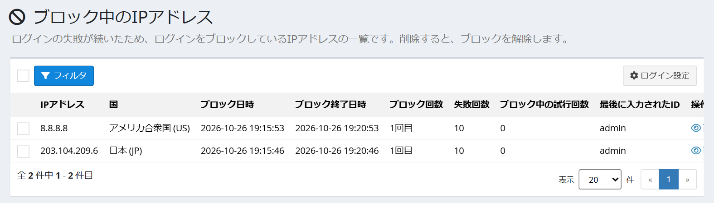
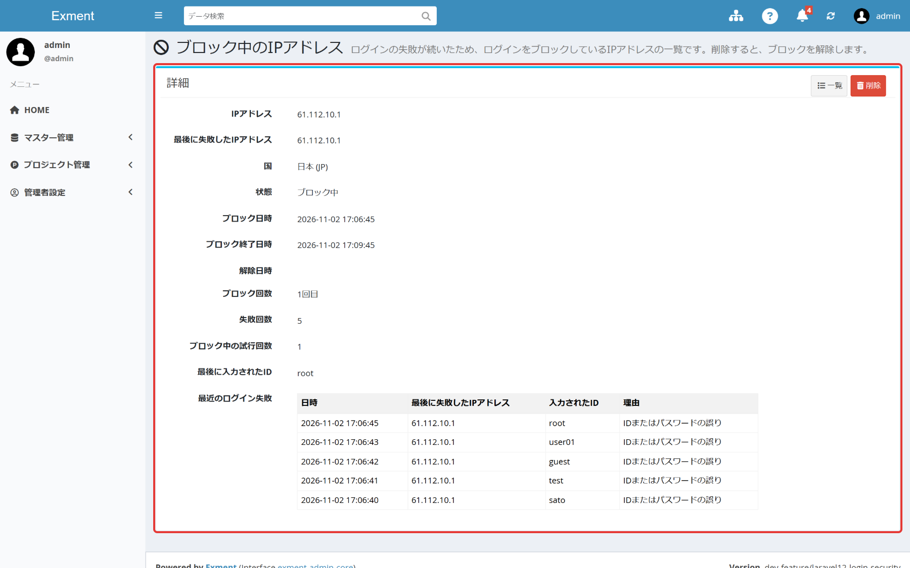

# Blocked IP addresses
Lists the IP addresses whose logins are blocked because of repeated failed logins.  
The blocks are also released on this page.  
See [Login settings - Protection against brute-force attacks](/login_setting#protection-against-brute-force-attacks) for the setting of the IP block.

  

## How to open
- Enter the following URL.  
http(s)://(Exment URL)/admin/login_ip_block  

- The link "Blocked IP Addresses" in "Protection against Brute-force Attacks" of the "Login Setting" page also opens it.

- To add it to the menu, open "Admin settings" > "Menu", select the menu type "System menu", select "Blocked IP Addresses", and save.  
*It is not in the menu by default.

- Only users with the system administrator permission can open it (same as the login history).

- When an IP address is blocked, system administrators are notified (can be turned off in the setting). The notification opens the detail of the blocked IP address.

## Items of the list

| Item | Description |
|---|---|
| IP Address | The blocked IP address. IPv6 is shown by the network of the first 64 bits (Ex. 2001:db8:1:2::/64). |
| Country | The country judged from the IP address. The [GeoIP database](/login_history#geoip-database) is required. |
| Blocked At | When the block started. |
| Blocked Until | The block ends automatically after this time. |
| Blocks | How many times the IP address was blocked repeatedly within 24 hours (1, 2, 3 or more). If "Longer Block When Blocked Again" is YES, the block time gets longer by this count. |
| Failures | Number of the failed logins that made the block. |
| Attempts While Blocked | Number of login attempts from this IP address while blocked. |
| Last Entered ID | The ID entered just before the block. |

- Only the IP addresses blocked now are listed. IP addresses whose block has ended are not listed.
- "Filter" at the top of the list narrows down by the IP address and the last entered ID.

## Detail
Click the row, or the "Show" icon of the row, to show the detail.  
In addition to the items above, it shows:

- Status: Blocked, Ended, Released
- Last Failed IP Address (for IPv6, the actual address in the network)
- Released At
- Recent Failed Logins: the recent failed logins from this IP address (up to 20) with the date, IP address, entered ID and reason (wrong ID or password, wrong CAPTCHA).
  

## Release the block
When valid users are blocked (Ex. the IP address of your office), release the block.

- Click the "Delete" icon of the row, or the "Delete" button of the detail page, to release the block.
- To release many IP addresses, check the rows and delete them from the action at the top of the list.
- A released IP address can log in at once. The failures before the release are not counted again, and its next block starts from the first block time.
- To never block the IP address again, add it to "IP Addresses Never Blocked" of the login setting.

